# MLA-C02 Final Cheatsheet

## Content Domain 1: Data Preparation for ML and AI
<a name="machine-learning-engineer-associate-02-domain1"></a>

**Topics**
+ [Task 1.1: Collect and store data.](#machine-learning-engineer-associate-02-domain1-task1)
+ [Task 1.2: Perform data transformation, feature engineering, and pre-processing.](#machine-learning-engineer-associate-02-domain1-task2)
+ [Task 1.3: Validate data quality and manage bias.](#machine-learning-engineer-associate-02-domain1-task3)

### Task 1.1: Collect and store data.
<a name="machine-learning-engineer-associate-02-domain1-task1"></a>

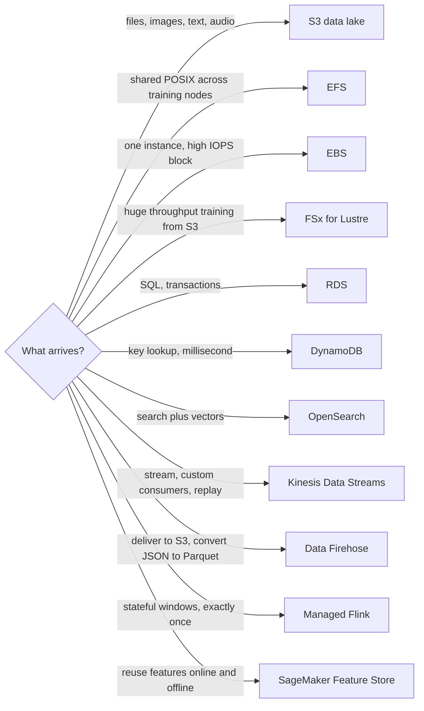

| Business need | Constraint | Implement |
|---|---|---|
| Durable lake, any type, cheap | Analytics later, not POSIX | S3. Standard if hot. Intelligent-Tiering if access unknown. Glacier if archive. Object Lock if WORM compliance |
| Many training instances read the same files | POSIX, shared | EFS |
| One EC2, low-latency disk | Not shared | EBS |
| GPU job starved on S3 reads | Throughput, not durability | FSx for Lustre linked to S3 |
| Relational source, joins, ACID | Structured | RDS. pgvector if vectors must stay in Postgres |
| Online feature or metadata lookup | Single-digit ms, key access | DynamoDB. On-demand if spiky. Fix hot partition key if throttled |
| k-NN, filters, hybrid keyword plus vector | Low-latency RAG | OpenSearch Service |
| Vectors, moderate scale, SQL filters already on Postgres | Do not add a new cluster | RDS with pgvector |
| Store embeddings or docs at lowest cost | Latency not sub-10 ms | S3 |
| Graph of entities | Relationship traversal | Neptune |
| Warehouse SQL, BI | Columnar analytics at rest | Redshift or Athena on Parquet |
| Fine-grained lake permissions, column or row | Compliance, multi-team | Lake Formation |
| On-prem into S3 | Least ops transfer | DataSync or Storage Gateway |
| Several consumers, replay, order per key, sub-second | You process, not just deliver | Kinesis Data Streams |
| Land stream in S3, OpenSearch, or Redshift. Optional JSON to Parquet or ORC | Least ops, buffer OK | Data Firehose. Lambda only for a small transform |
| Windows, joins, exactly-once stream logic | State | Managed Flink |
| Estate already speaks Kafka | Protocol lock-in | Apache Kafka |
| Same feature definition for train and inference | No training-serving skew. Point-in-time correct | Feature Store. Online store for inference. Offline store on S3 for training |
| Video or audio stream | Not a file dump | Kinesis Video Streams, then S3 |
| Text, images, audio files | Multimodal | Raw in S3. Metadata in catalog or DynamoDB. Embeddings in the vector store |

| Access pattern | Format |
|---|---|
| Column scans, Athena, Spark, Glue, predicate pushdown | Parquet or ORC |
| APIs, semi-structured, streams before conversion | JSON |
| Small interchange, humans | CSV only at the edge. Convert before analytics |
| Firehose landing zone | JSON in, Parquet or ORC out |

| Symptom | Cause | Fix |
|---|---|---|
| `WriteProvisionedThroughputExceeded`, hot shard | Bad partition key or too few shards | Higher-cardinality key, more shards, or on-demand |
| `IteratorAge` rising | Consumers behind | Scale consumers or Flink or Lambda. Not more producers |
| S3 503 on one prefix | Hot prefix | Spread keys |
| DynamoDB throttle | Hot key or low provisioned | On-demand or new key design |
| Feature lookup at train uses future values | Leakage | Point-in-time join on event time |
| Training nodes cannot share disk | Wrong store | EFS or FSx, not EBS |

---

### Task 1.2: Perform data transformation, feature engineering, and pre-processing.
<a name="machine-learning-engineer-associate-02-domain1-task2"></a>

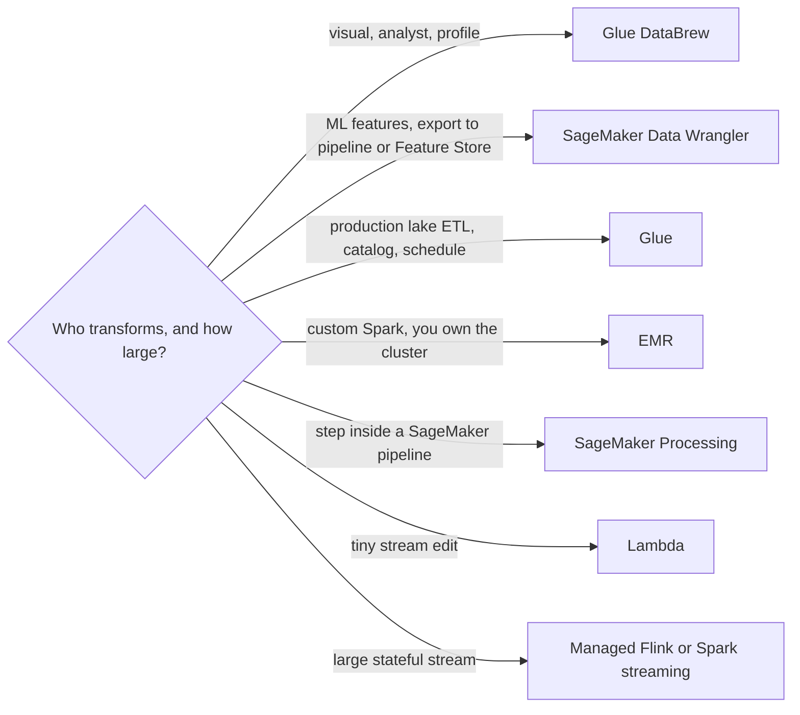

| Business need | Constraint | Implement |
|---|---|---|
| Production raw to curated, crawlers, catalog | Serverless Spark | Glue. CSV or JSON raw zone to Parquet curated zone |
| Quality rules in that same pipeline | Fail the job | Glue Data Quality |
| No-code clean and profile | Analyst, not a pipeline owner | DataBrew |
| Feature recipe for a model, quick bias view | Stay in SageMaker | Data Wrangler, then Feature Store or pipeline |
| Heavy custom Spark, Hadoop, long cluster | Control over Spark | EMR. Not Glue if they insist on cluster control |
| Custom Python or sklearn prep | Part of train pipeline | SageMaker Processing |
| Firehose record tweak | Milliseconds, small | Lambda |
| Reuse features, online plus offline match | Many models | Feature Store feature groups |
| Text or image to numbers for search or models | Same model at index and query | Embedding model on Bedrock or SageMaker. Reindex if you change model |
| Docs for RAG | Retrieval quality | Chunk, overlap, metadata |
| PII cannot enter train or prompts | Discover then destroy | Macie on S3, Comprehend PII, redact in Glue or DataBrew. Runtime mask is Guardrails, not Macie |
| FM learns a task format | Labeled pairs | Fine-tune JSONL, prompt and completion or messages |
| FM learns domain language | Unlabeled corpus | Continued pre-training |
| Smaller cheaper model copies a large one | Teacher outputs exist | Distillation data from teacher traces |
| Streaming features | Low lag | Lambda or Flink into Feature Store online store |

| Feature problem | Transform | Do not |
|---|---|---|
| Different numeric scales, distance or gradient models | Standardize or normalize | Fit on all rows before the split |
| Right skew | Log | Log zeros without an offset |
| Noise in a continuous column | Bin | Bin the target away |
| Datetime | Split hour, day, month | Leave a raw timestamp for a tree-less linear model and hope |
| High-cardinality categories | Embed or hash. Target-encode only inside the fold | Target-encode on the full column |
| Text classification | Tokenize, domain augmentation | Augment the test set |
| Images | Resize, normalize, augment minority class | Augment after the split leak into val |
| RAG docs | Fixed chunk plus overlap by default | One chunk per huge PDF |
| RAG, meaning boundaries matter | Semantic chunking | Semantic if cost of chunking is the complaint |
| RAG, small hit must expand to section | Hierarchical parent-child | Hierarchical if you only need a FAQ of one line |
| Already chunked upstream | No second chunker | Double chunk |
| Filters by tenant, date, ACL | Metadata on each chunk | Metadata only in the prompt |
| Tables and figures dropped | Parser that keeps layout, not plain text dump | Default text extract |

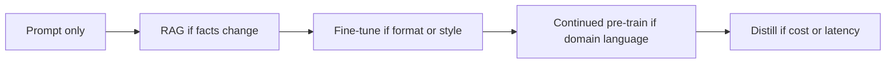

Leakage traps: scaler fit before split. Random split on a time series. Future feature values in a Feature Store join. Duplicates in both train and test. Target encoded with the validation rows.

---

### Task 1.3: Validate data quality and manage bias.
<a name="machine-learning-engineer-associate-02-domain1-task3"></a>

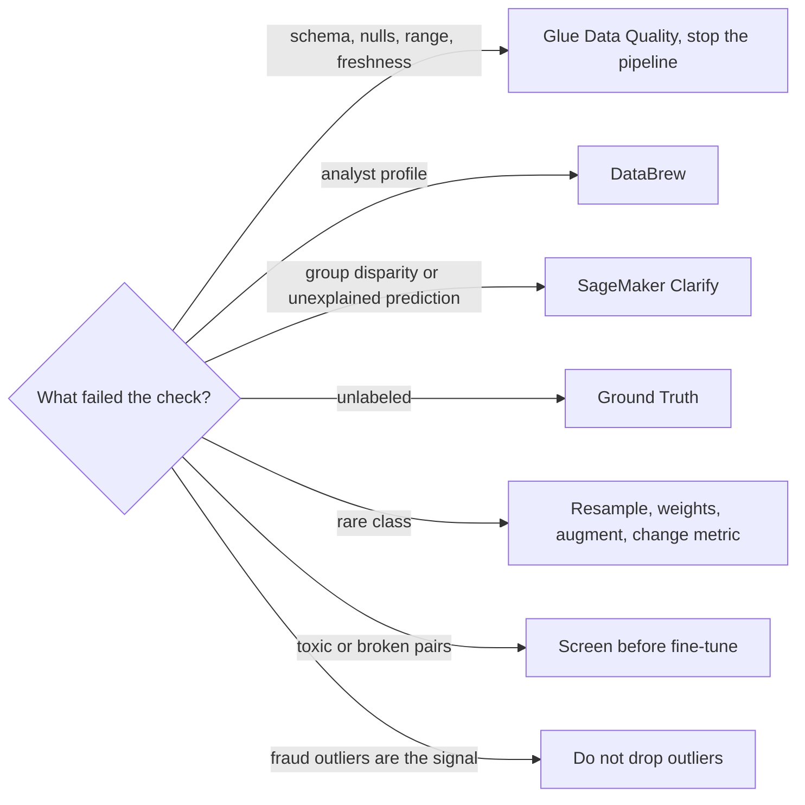

| Business need | Constraint | Implement |
|---|---|---|
| Block bad data before train | Rules, automated | Glue Data Quality. Completeness, uniqueness, range, freshness. Fail the job |
| Visual profile, one-off | No pipeline yet | DataBrew |
| Measure bias before and after train | Protected group named | Clarify. Detection is not the fix |
| Explain a tabular prediction | Auditors | Clarify SHAP. Trees can also use built-in importance |
| Need labels | Sensitive data | Ground Truth, **private** workforce. Not public crowd |
| Cut labeling cost after a seed set | Some labels exist | Ground Truth automated labeling |
| Review low-confidence **inference** | Human on the decision | Augmented AI. Not Ground Truth |
| Class imbalance | Accuracy looks fine | Precision, recall, F1, PR-AUC. Class weights. Stratified split |
| Minority images or text | Cannot collect fast | Augment the minority only, on train only |
| Multimodal skew | One modality under-represents a group | Bias metrics per modality, then rebalance that modality |
| Fine-tune data trustworthy | Poison, empty, toxic, PII pairs | Validate pairs, content-safety screen, dedup, hold out a clean eval set |
| Missing values | Skewed numeric | Median, not mean. Mode for categories. Indicator column if missingness is informative |
| Duplicates | FM memorization | Exact and near-dup removal before fine-tune |
| Compliance archive of who labeled what | Audit | Manifest in S3, private workforce, KMS, CloudTrail |

| Bias or quality signal | Action |
|---|---|
| Pre-train label rates differ by group | Collect, stratify, reweight. Clarify pre-training metrics |
| Pre-train looks fair, post-train does not | Proxy features. Dropping the protected column is not enough |
| Time series | Split by time. Do not shuffle |
| Anomaly use case | Keep outliers. Use Random Cut Forest later, do not “clean” them away |
| Imbalance plus FM fine-tune | Balance pairs or the model collapses to the majority style |
| Protected attribute absent but ZIP or name remains | Proxy bias. Clarify plus feature review |

??? Clarify names worth recognizing

    Pre-training: class imbalance, difference in proportions of labels, KL, JS, total variation, Kolmogorov-Smirnov.

    Post-training: disparate impact, difference in positive proportions in predicted labels, accuracy difference, recall difference, treatment equality.

    If the stem says “which metric detects bias in the training set before fit”, it is a pre-training metric. If it says “predictions favor a group”, it is post-training.


---

## Content Domain 2: ML Model and Foundation Model (FM) Development
<a name="machine-learning-engineer-associate-02-domain2"></a>

**Topics**
+ [Task 2.1: Choose appropriate modeling approaches for ML and AI solutions.](#machine-learning-engineer-associate-02-domain2-task1)
+ [Task 2.2: Train, fine-tune, and customize models for ML and AI solutions.](#machine-learning-engineer-associate-02-domain2-task2)
+ [Task 2.3: Analyze and evaluate the performance of ML and AI systems.](#machine-learning-engineer-associate-02-domain2-task3)

### Task 2.1: Choose appropriate modeling approaches for ML and AI solutions.
<a name="machine-learning-engineer-associate-02-domain2-task1"></a>

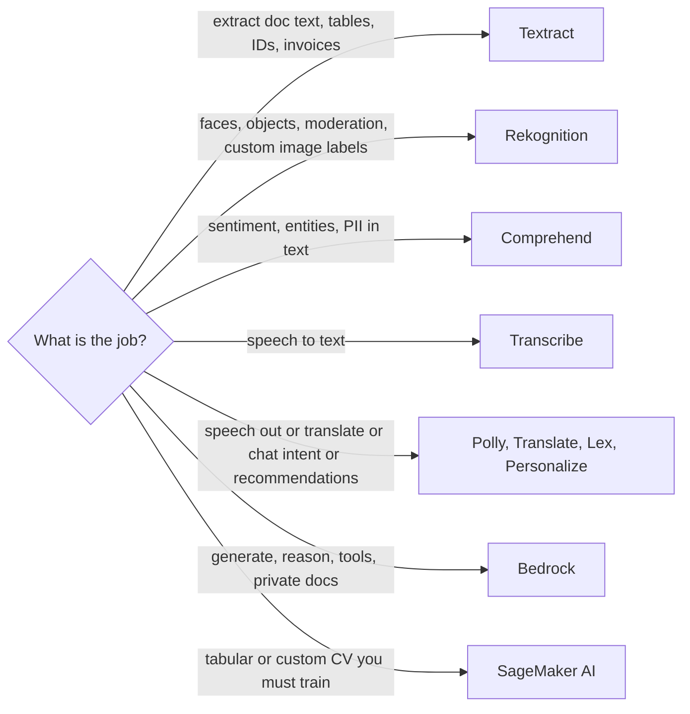

| Business need | Constraint | Implement |
|---|---|---|
| Standard vision, NLP, speech, docs | No ML platform to run | Matching AI service. Least code |
| Custom image classes, little infra | Still images | Rekognition Custom Labels before a full SageMaker train |
| Doc bytes to text, then intent | Two steps | Textract, then Comprehend. Not Comprehend on a PDF |
| Call audio to topics | Audio first | Transcribe, then Comprehend |
| Recommendations from user-item events | Not free text | Personalize |
| Answer from company docs that change | Citations, no retrain cycle | RAG |
| Exact SKU, clause ID, legal term | Vector alone misses keywords | Hybrid search |
| Tenant or ACL on every hit | Isolation | Metadata filters |
| Top-k is noisy | Latency budget remains | Retrieve wide, rerank narrow |
| Question needs several docs | One retrieve is not enough | Query decomposition or agentic RAG |
| Stable brand voice or strict JSON | Facts are not the gap | Prompt, then fine-tune |
| Domain jargon, lots of unlabeled text | Behavior is not the gap | Continued pre-training |
| Bill and latency too high after quality is proven | Quality bar already met | Distillation or a smaller FM |
| Regulator wants a simple reason code | Interpretability | Linear Learner or tree, plus Clarify. Not an opaque net |
| Latency SLO tight | Quality can drop a step | Smaller model, provisioned capacity, Inferentia |
| Cost is the SLO | Latency loose, periodic | Batch, not a live FM |
| No labeled data, task is generative | Cannot train supervised | Bedrock prompt or RAG. Not XGBoost |
| Unique tabular problem, you own labels | AI API does not fit | SageMaker built-in or script mode |

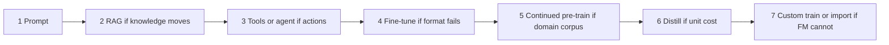

Trade the stem will force you to name:

| Axis | Pick the left when | Pick the right when |
|---|---|---|
| Managed AI API vs SageMaker | Task matches the API | Custom objective, your algorithm, your container |
| Prompt vs fine-tune | Few-shot already hits the format | Format still fails and pairs exist |
| RAG vs fine-tune | Facts change or must be cited | Knowledge is stable and the gap is behavior |
| On-demand FM vs provisioned | Spiky, pay per token, cold start OK | Steady throughput, hard latency, no cold start |
| Big FM vs small or distilled | Quality first, low volume | Production QPS and token bill dominate |

---

### Task 2.2: Train, fine-tune, and customize models for ML and AI solutions.
<a name="machine-learning-engineer-associate-02-domain2-task2"></a>

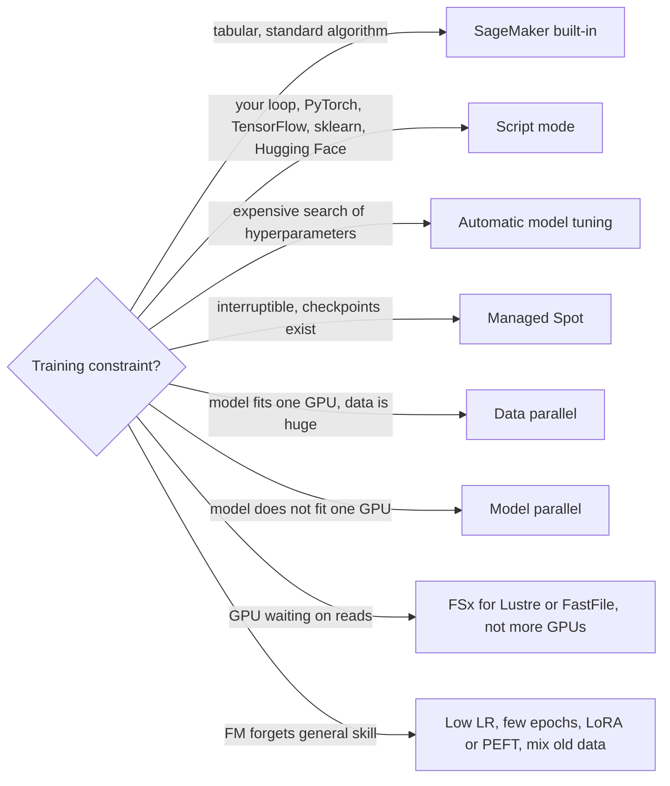

| Business need | Constraint | Implement |
|---|---|---|
| Tabular classify or regress, missing values, importance | Speed to baseline | XGBoost |
| Interpretable linear or logistic, many parallel models | Simple | Linear Learner |
| Cluster | Scale features first | K-Means |
| Shrink width | Scale first | PCA |
| Anomaly, no labels | Outliers are signal | Random Cut Forest |
| Sparse clicks or recommendations | High dimension | Factorization Machines |
| Many related time series | Forecast | DeepAR |
| Word vectors or text class, classic | Not an FM problem | BlazingText |
| Suspicious IP behavior | Security analytics | IP Insights |
| Algorithm not built-in | Supported framework | Script mode. Estimator plus entry point |
| Tune with few full trains | Evaluations costly | AMT Bayesian. Hyperband to stop bad trials early. Grid only if tiny and discrete |
| Cut wall clock | Fault tolerant | Early stopping. Spot plus S3 checkpoints. Distributed training |
| Overfit, train good, val bad | Gap | More data, augment, regularize, dropout, fewer epochs, early stop, simpler model |
| Underfit, both bad | No gap, both high | More capacity, more features, longer train, less regularization |
| Fine-tune wipes general ability | Catastrophic forgetting | Do not full-rank if general skill must remain |
| Accuracy up, cost OK | Latency secondary | Ensemble |
| Cost down, quality OK on easy cases | Hard cases rare | Cascade: cheap model first, FM only if uncertain |
| Retrieval weak | Index exists | Same embedding model, hybrid, metadata, rerank, chunk retune, query rewrite |
| Prompt is the product | Must be versioned | Bedrock Prompt Management. Not a string buried in code |

| Symptom while training | Change |
|---|---|
| Loss NaN or diverges | Learning rate down. Check bad inputs. Clip gradients |
| Loss flat | Learning rate up, or labels or features are broken |
| GPU OOM | Smaller batch, larger GPU, gradient checkpointing, model parallel |
| GPU idle, disk busy | Storage throughput, not another GPU |
| Spot interruption kills the run | Checkpoint interval was missing |
| Val rises while train falls | Early stop. You are past the useful epoch |

??? "Built-in algorithm crib"

    | Algorithm | Use |
    |---|---|
    | XGBoost | Tabular, classification and regression |
    | Linear Learner | Linear or logistic |
    | K-Means | Clustering |
    | PCA | Dimensionality |
    | Factorization Machines | Sparse recommend or click |
    | Random Cut Forest | Anomaly |
    | IP Insights | IP anomaly |
    | DeepAR | Probabilistic forecast |
    | BlazingText | Word2Vec or text class |
    | Image Classification, Object Detection, Semantic Segmentation | Vision with labels |
    | K-NN | Similarity |
    | LDA, Neural Topic Model | Topics, unsupervised text |
    | Object2Vec | Pair embeddings |
    | Seq2Seq | Classic sequence tasks. Prefer Bedrock if the stem is generative and least-ops |


---

### Task 2.3: Analyze and evaluate the performance of ML and AI systems.
<a name="machine-learning-engineer-associate-02-domain2-task3"></a>

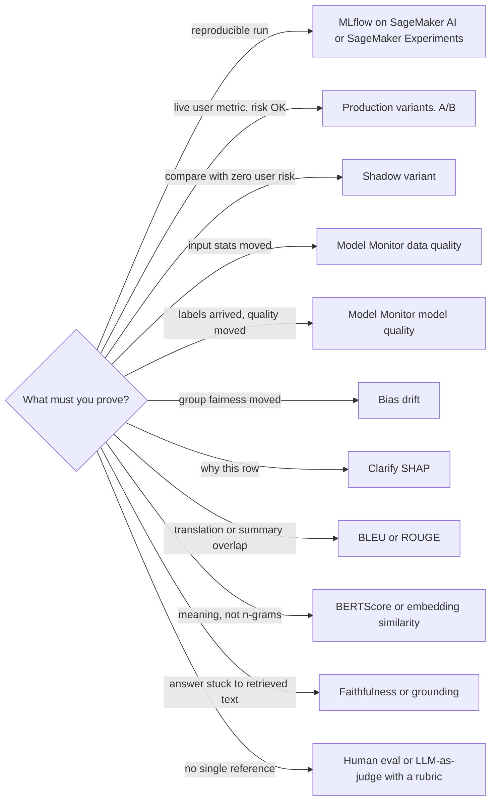

| Business need | Constraint | Implement |
|---|---|---|
| Audit params, code, data, metric | Repeat the run | Experiments or MLflow. Registry for the promoted artifact |
| Version and test prompts | GenAI | Bedrock Prompt Management plus Bedrock evaluations |
| Catch bad deploy before users | No user traffic on the candidate | Shadow variant. Copy of traffic, response discarded |
| Pick the variant users prefer | Real outcomes required | A/B production variants. Then promote the winner |
| Baseline then alert | Production | Model Monitor baseline from approved window |
| Labels are late | Cannot wait for model quality | Data-quality drift is the leading signal. Model quality when ground truth lands |
| Explain to a reviewer | Tabular | SHAP via Clarify |
| False alarm is expensive | Fraud alert pages a human, disease screen is the opposite | Precision if false positives hurt. Recall if false negatives hurt |
| Both errors hurt, classes skewed | Accuracy banned | F1 and PR-AUC. Not accuracy. Not ROC alone |
| Translation | Reference text | BLEU |
| Summary overlap | Reference text | ROUGE |
| Paraphrase still counts | N-gram fails | BERTScore or semantic similarity |
| RAG cites the corpus | Hallucination is the defect | Retrieval recall at k, plus faithfulness. Grounding check |
| Scale human taste | Judge can be biased | LLM-as-judge, fixed rubric, spot-check with humans |
| High-impact decision | Policy requires a person | Human-in-the-loop. A2I on low confidence |
| RAG got worse after a doc update | Retrieval, not the FM | Retrieval accuracy monitor, then chunk, embed, or refresh |

| Train vs val | Meaning |
|---|---|
| Both fall, then val rises | Overfit. Early stop |
| Both stay high | Underfit, or bad labels, or leakage you have not found |
| Train NaN | LR, bad batch, exploding gradients |
| Val perfect, too perfect | Leakage or duplicate rows |

Regression stems: RMSE or MAE. Ranked lists: NDCG. Perplexity measures LM fit, not answer quality. Do not pick perplexity for “is this summary good”.

---

## Content Domain 3: Deployment and Orchestration of ML and AI Workflows
<a name="machine-learning-engineer-associate-02-domain3"></a>

**Topics**
- [Content Domain 4: Operating, Monitoring, and Securing ML and AI Solutions](#content-domain-4-operating-monitoring-and-securing-ml-and-ai-solutions)
    - [Task 4.1: Monitor ML and AI model inference and performance.](#task-41-monitor-ml-and-ai-model-inference-and-performance)
    - [Task 4.2: Optimize and manage ML and AI infrastructure costs and performance.](#task-42-optimize-and-manage-ml-and-ai-infrastructure-costs-and-performance)
    - [Task 4.3: Secure ML and AI workloads and model endpoints.](#task-43-secure-ml-and-ai-workloads-and-model-endpoints)
    - [Last-minute signal index](#last-minute-signal-index)

### Task 3.1: Manage deployment infrastructure for ML and AI model types.
<a name="machine-learning-engineer-associate-02-domain3-task1"></a>

```mermaid
flowchart LR
  I{"Inference shape?"} -->|"ms latency, steady"| RT["SageMaker real-time endpoint"]
  I -->|"spiky, idle most of the day, cold start OK"| SV["Serverless Inference"]
  I -->|"large payload, seconds to minutes, queue OK"| AS["Async Inference"]
  I -->|"nightly file to file, no endpoint"| BT["Batch Transform"]
  I -->|"many models, one container, save cost"| MM["Multi-model endpoint"]
  I -->|"preprocess then model then postprocess"| IP["Inference pipeline, multi-container"]
  I -->|"bring a container or existing orchestrator"| EX["ECS, EKS, or EC2"]
  I -->|"FM, variable tokens"| OD["Bedrock on-demand]
  I -->|"FM, hard latency, committed QPS"| PT["Bedrock Provisioned Throughput"]
  I -->|"weights trained outside"| IMP["Bedrock Custom Model Import or SageMaker"]
```

| Business need | Constraint | Implement |
|---|---|---|
| Live app, stable latency | Always warm | Real-time endpoint. Min instance count at least 1 |
| Bursty, low average | Cold start acceptable | Serverless Inference |
| Payload near 1 GB, long run | Not interactive ms | Async Inference. Scale on backlog, not CPU alone |
| Score a daily dataset | No endpoint bill | Batch Transform |
| Hundreds of models, same framework | Memory, not simultaneous hot models | Multi-model endpoint. Expect load latency on cold model |
| Different containers in one call | Serial steps | Multi-container or inference pipeline |
| Custom server, Triton, your mesh | SageMaker hosting does not fit | ECS or EKS, image in ECR |
| Base FM, pay per use | Traffic uneven | Bedrock on-demand |
| Custom or fine-tuned FM, guaranteed capacity | No cold start, steady | Provisioned Throughput |
| Custom FM, spiky, pay per token | Cold start of seconds OK | On-demand custom model deployment. Not “always buy provisioned” |
| External weights, Bedrock API | Supported architecture | Custom Model Import |
| External weights, custom serving stack | Full control | SageMaker, your container |
| One agent, actions, knowledge base | Managed agent | Bedrock Agents. Action group is Lambda plus API schema |
| Your framework, isolated session, MCP tools | Production agent runtime | AgentCore Runtime |
| Existing APIs become tools | Standard tool protocol | AgentCore Gateway |
| Remember the user next week | Not process RAM | AgentCore Memory. New session is a new microVM |
| Block a tool regardless of the prompt | Deterministic | AgentCore Policy on the gateway |
| RAG in production | Filters and precision | Knowledge Base, hybrid, metadata filter, rerank |
| Safe cutover | Auto rollback | Canary or linear or blue/green plus CloudWatch alarm |
| Compare model, users untouched | Zero blast radius | Shadow, not canary |

Agent communication: tools via MCP or action groups. Multi-agent only if the stem has specialist roles. One agent if one task list is enough.

---

### Task 3.2: Provision and configure resources for ML and AI workloads based on existing architecture and requirements.
<a name="machine-learning-engineer-associate-02-domain3-task2"></a>

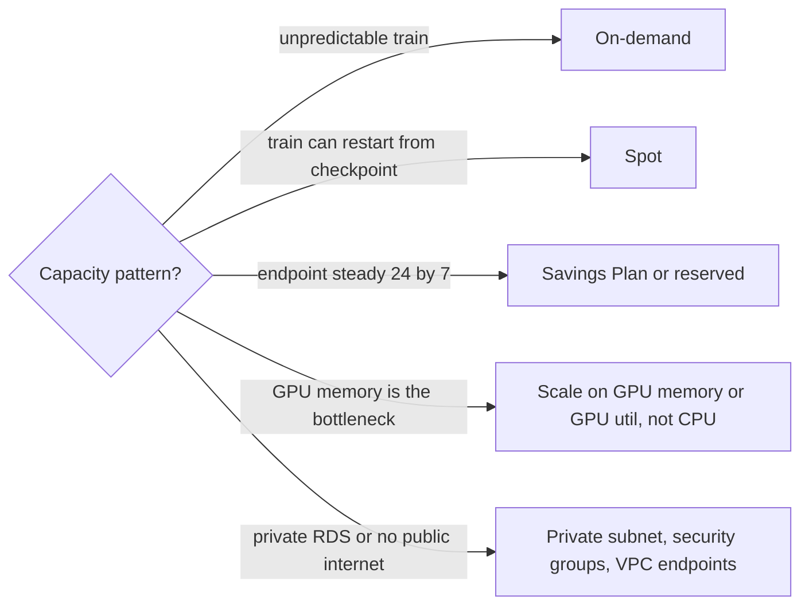

| Business need | Constraint | Implement |
|---|---|---|
| Repeatable infra | Reviewable change | CloudFormation or CDK. Service Catalog if a blessed product |
| Chain train, eval, approve, deploy | ML lineage | SageMaker Pipelines |
| Chain arbitrary AWS steps, human approve | Not only SageMaker | Step Functions |
| Team already lives in Airflow | DAG portability | MWAA |
| React to S3, drift, schedule | Loose coupling | EventBridge |
| Image scan before deploy | Supply chain | ECR plus Inspector |
| Endpoint only inside the VPC | No public invoke | VPC-attached endpoint, security group on the ENI, private app subnet |
| Job must read private RDS or EFS | Inside VPC | VPC config on the job |
| No path to the public internet | Still must read S3 and call AWS APIs | Gateway endpoint for S3. Interface endpoints for SageMaker, Bedrock, ECR, Logs, KMS, STS |
| Container must not open outbound | Isolation | Network isolation. Data via SageMaker channels, not a download in code |
| Real-time scale | Classic target | `SageMakerVariantInvocationsPerInstance` |
| GPU FM endpoint | CPU looks idle | GPU utilization and GPU memory |
| Async queue growing | Workers behind | Backlog size per instance |
| Scale from zero forbidden | Latency SLO | Min capacity greater than 0 |
| Knowledge base | Docs in S3 | Bedrock Knowledge Bases. Pick vector store, embedding model, chunk strategy, sync |
| Retrieval misses IDs | Keyword matters | Hybrid pipeline |
| Retrieval returns almost-right chunks | Precision | Rerank |
| Agent state across turns | Session dies | Memory service keyed by actor and session. Do not store state on the instance |
| GPU scarce | Training wait | Right family, quota, checkpointed spot, or Trainium if cost is the driver |
| Many agents, tools, memory, identity | Platform not a single Lambda | AgentCore runtime, gateway, memory, identity |

| Family | Use when |
|---|---|
| ml.m, ml.c | Classical ML, CPU |
| ml.r | RAM heavy prep |
| ml.g | GPU inference, smaller train |
| ml.p | Large GPU train or large FM |
| ml.inf | Cheap inference if the model can run on Inferentia |
| ml.trn | Cheap train on Trainium |
| Graviton | CPU price-performance |

Inference Recommender when the stem is “which instance meets latency at lowest cost” and you should not guess a size.

VPC trap: timeout or cannot connect is route, security group, NACL, or missing endpoint. AccessDenied is IAM or the KMS key policy. A key policy that omits the role still denies even if IAM allows.

---

### Task 3.3: Implement automated orchestration and continuous integration and continuous delivery (CI/CD) pipelines for MLOps and AI workloads.
<a name="machine-learning-engineer-associate-02-domain3-task3"></a>

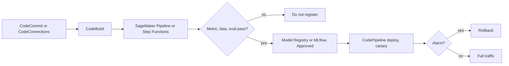

| Business need | Constraint | Implement |
|---|---|---|
| CI stages, source, build, deploy | Standard DevOps | CodePipeline |
| Git on AWS | Repo in account | CodeCommit |
| GitHub, GitLab, Bitbucket | External git | CodeConnections. Pending connection is an auth failure, not a buildspec bug |
| Build, test, package image | Compile step | CodeBuild. Failures: buildspec, role, image, secrets |
| Shift traffic, rollback | Deployment safety | CodeDeploy or SageMaker endpoint update with auto-rollback |
| Train and promote a model | Lineage | SageMaker Pipelines with a condition step |
| Only Approved models in prod | Audit | Model Registry status. EventBridge on Approved to deploy |
| Team standard is MLflow | Same runs and registry | MLflow on SageMaker AI |
| Retrain on drift or calendar | Closed loop | EventBridge to the pipeline. Promote only if it beats the champion |
| Prompt change is a release | No silent edit | Prompt Management versions. Prompt tests in CI |
| Agent release | Repeatable | Agent version pipeline. Stage tools before prod |
| Fine-tuned FM release | Versioned cutover | Eval job, then on-demand deployment or Provisioned Throughput, then shift alias. Keep previous version for rollback |
| Docs changed, answers stale | Fresh index | S3 event to EventBridge to Knowledge Base sync. Full reindex if the embedding model changed |
| Security gate | Image and code | Inspector on the image. CodeGuru on the code |
| Regulated promote | Human | Manual approval in registry or pipeline. Low risk can auto-approve |

| Pipeline symptom | Look at |
|---|---|
| Source never starts | CodeConnections handshake, repo permissions |
| Build fails immediately | buildspec path, CodeBuild role, missing secret |
| Deploy loops | Alarm already red, so rollback keeps firing |
| New model skipped prod | Registry still PendingManualApproval |
| RAG pipeline “succeeded” but answers old | Sync not invoked, or query cache, or wrong index |
| Tests passed, users harmed | Gate checked accuracy on a balanced set, or prompt tests were absent |

Gates worth putting in the pipeline: schema and data-quality, metric vs champion, bias check, prompt or FM eval, image scan. A pipeline that only builds a container is incomplete for this exam.

---

## Content Domain 4: Operating, Monitoring, and Securing ML and AI Solutions
<a name="machine-learning-engineer-associate-02-domain4"></a>

**Topics**
- [Content Domain 4: Operating, Monitoring, and Securing ML and AI Solutions](#content-domain-4-operating-monitoring-and-securing-ml-and-ai-solutions)
    - [Task 4.1: Monitor ML and AI model inference and performance.](#task-41-monitor-ml-and-ai-model-inference-and-performance)
    - [Task 4.2: Optimize and manage ML and AI infrastructure costs and performance.](#task-42-optimize-and-manage-ml-and-ai-infrastructure-costs-and-performance)
    - [Task 4.3: Secure ML and AI workloads and model endpoints.](#task-43-secure-ml-and-ai-workloads-and-model-endpoints)
    - [Last-minute signal index](#last-minute-signal-index)

### Task 4.1: Monitor ML and AI model inference and performance.
<a name="machine-learning-engineer-associate-02-domain4-task1"></a>

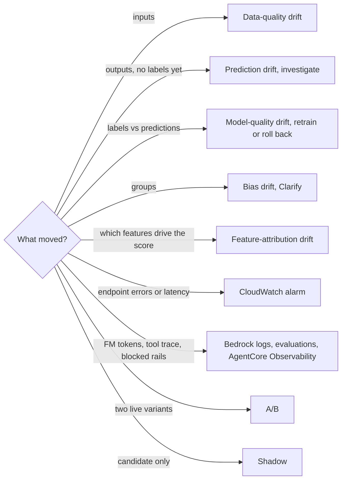

| Business need | Constraint | Implement |
|---|---|---|
| Latency, errors, saturation | Endpoint health | CloudWatch. ModelLatency is the model. OverheadLatency is container and network around it |
| FM quality over time | Not just HTTP 200 | Bedrock model evaluation and invocation logs |
| Alarm a human | Threshold | CloudWatch alarm to SNS |
| Trace one slow request across API, Lambda, endpoint | Distributed latency | X-Ray. Not X-Ray for accuracy |
| Input distribution changed | Labels not back yet | Data-quality monitor. Do not wait for model quality |
| Ground truth landed | Real performance | Model-quality monitor against baseline |
| Users must not see the challenger | Risk | Shadow |
| Business metric needs real users | Risk accepted | A/B, then shift traffic |
| Agent stalls | Tool or coordination | AgentCore Observability. Tool-failure rate, truncated stream, coordination failure, max-iteration hits |
| Workflow step failed | Glue, Flink, pipeline | Step Functions or job metrics, plus CloudWatch. Kinesis IteratorAge for consumer lag |
| GenAI observability dashboard | Tokens and errors | CloudWatch generative AI observability plus Bedrock evaluations |

| Metric pattern | Meaning |
|---|---|
| ModelLatency high, OverheadLatency low | Instance too small, model too heavy, GPU memory pressure |
| OverheadLatency high | Preprocess container, payload, network |
| 4XX | Client, auth, schema |
| 5XX | Crash, OOM, bad container |
| Throttles | Quota or provisioned capacity |
| Data drift only | Leading indicator. Do not retrain blindly. Check upstream |
| Model quality down, data quality stable | Concept drift or label shift. Retrain or roll back |
| GPU memory high, CPU low | Wrong autoscale metric |

---

### Task 4.2: Optimize and manage ML and AI infrastructure costs and performance.
<a name="machine-learning-engineer-associate-02-domain4-task2"></a>

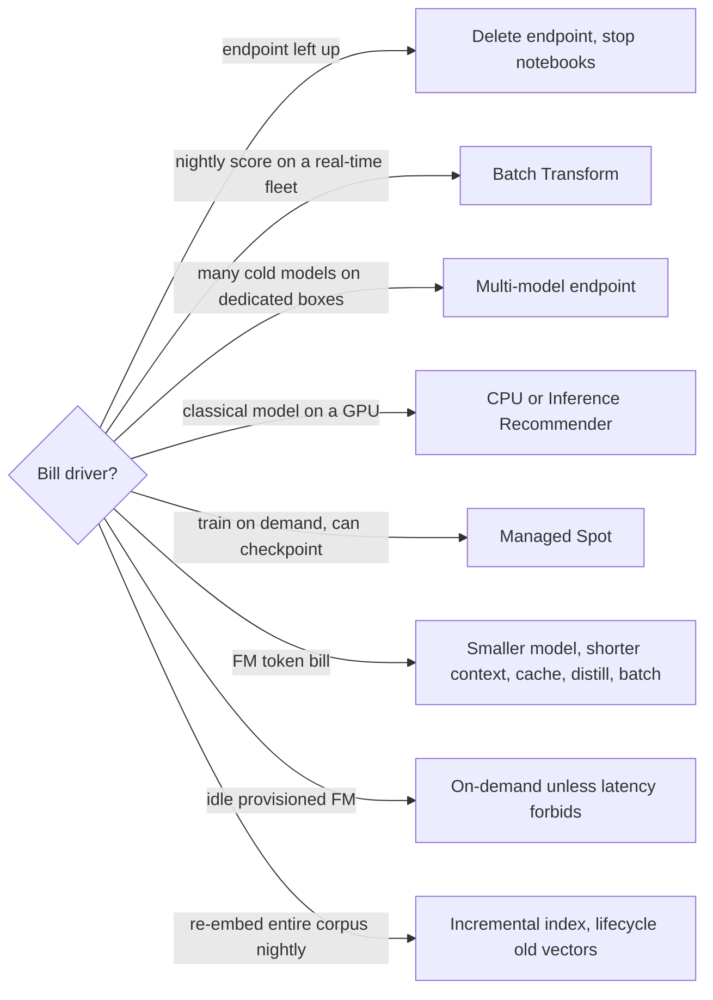

| Business need | Constraint | Implement |
|---|---|---|
| Meet latency at lowest instance cost | Do not guess the size | Inference Recommender, then the smallest passing family |
| Steady endpoint | Commit | Savings Plans |
| Interruptible train | Checkpoints in S3 | Spot |
| Spiky low volume | Cold start OK | Serverless Inference or Bedrock on-demand |
| FM steady and latency-bound | Idle capacity is acceptable | Provisioned Throughput. Compare break-even vs on-demand |
| FM spiky | Cold start OK | On-demand. Custom models can use on-demand deployment |
| See the trend | Showback | Cost Explorer plus tags |
| Hard quota and alert | Budget owner | AWS Budgets |
| Rightsize advice | After a week of metrics | Compute Optimizer |
| Idle waste | Hygiene | Trusted Advisor, and the forgotten endpoint |
| Dashboards | Ops | CloudWatch dashboard. Not QuickSight for p99 latency |
| Deep request path | Cross-service | X-Ray |
| Agent token burn | Loops | Cap iterations. Route easy turns to a small model. Watch tokens per successful task |
| Embedding cost | Unchanged docs | Do not re-embed. Cache. Batch the new chunks |
| Vector store cost | Recall still met | Smaller dimension, delete stale indexes, do not copy every index into every env |
| Log cost and data risk | Full prompts in logs | Log metadata and hashes, not entire contexts |

Production FM cost is input tokens plus output tokens, times retries, times agent turns, plus always-on provisioned capacity. A reranker that cuts chunks often saves more than it costs.

---

### Task 4.3: Secure ML and AI workloads and model endpoints.
<a name="machine-learning-engineer-associate-02-domain4-task3"></a>

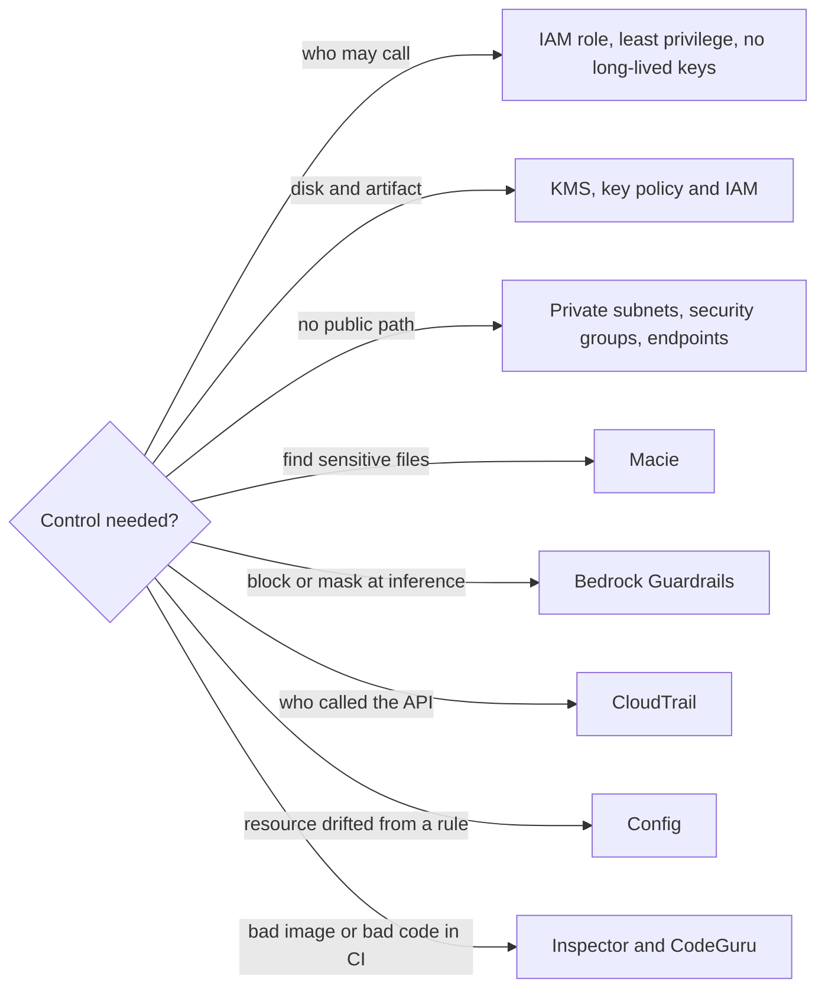

| Business need | Constraint | Implement |
|---|---|---|
| App on Lambda, EC2, ECS, SageMaker calls a model | Credentials | Execution role. Not an IAM user access key |
| App outside AWS calls Bedrock | Key-based access | Bedrock API key, stored in Secrets Manager, scoped and rotated. IAM still preferred if it can assume a role |
| Train job reads one prefix | Least privilege | Role limited to that bucket prefix, ECR repo, log group, and KMS key. Not `*` |
| Invoke one FM | Blast radius | `bedrock:InvokeModel` on that model ARN |
| Separate duties | Dev cannot deploy prod | Distinct roles. Registry approval. Permission boundaries if data scientists share an account |
| Encrypt artifacts | Audit key use | SSE-KMS, encrypted EBS and SageMaker volumes, CloudTrail on KMS |
| Distributed train must not sniff the wire | In transit | Inter-container traffic encryption |
| Private inference | No internet | VPC, private subnets, endpoint security groups, S3 gateway endpoint, interface endpoints |
| Discover S3 PII | At rest, not in the request path | Macie |
| Redact text in a pipeline | Before train | Comprehend PII, Glue or DataBrew |
| Block topics, prompt attack, PII, ungrounded answers | Runtime policy | Bedrock Guardrails on input and output. Attach to model, agent, and knowledge base |
| Ground answers in retrieved chunks | Hallucination control | Contextual grounding check. Not a bigger model by itself |
| Audit API calls | Who started the train or invoke | CloudTrail. Data events if S3 object reads matter |
| Detect public bucket or unencrypted volume | Compliance drift | Config |
| Scan CI | Before deploy | CodeGuru for code. Inspector for images. Fail the pipeline |
| High-risk agent action | Irreversible tool | Policy deny, plus human approval. Least-privilege tool role |
| Debug denied vs unreachable | Symptom split | AccessDenied: IAM or key policy. Timeout: security group, route, missing endpoint |

| Risk | Mitigation |
|---|---|
| Data poisoning | Lock training prefixes, checksums, private workforce, quality gate |
| Model theft | Private endpoint, encrypted artifacts, no public bucket |
| Prompt injection | Guardrails prompt-attack filter, tool policy, do not pass raw user text into admin tools |
| PII in prompts and logs | Redact before log, Guardrails sensitive-information filter, Macie on the lake |
| Excessive agent agency | Allow-list tools, low-privilege credentials, iteration cap, approval on writes |
| Cross-account | Assume role. Do not copy keys |
| KMS still denies | Key policy must name the role. IAM alone is not sufficient |

<details>
<summary>Guardrail and network crib</summary>

Guardrails: content filters, denied topics, word filters, sensitive-information block or mask, prompt-attack filter, contextual grounding.

Interface endpoints typically required in a locked-down VPC: SageMaker API, SageMaker runtime, Bedrock, ECR API, ECR Docker, CloudWatch Logs, KMS, STS, Secrets Manager if used. S3 is a gateway endpoint.

Network isolation on a training job is not the same switch as VPC config. Isolation cuts outbound from the container. VPC config attaches the job to your subnets so it can reach private data stores.

</details>

---

### Last-minute signal index

| Stem | Answer shape |
|---|---|
| JSON stream to Parquet in S3, least ops | Data Firehose |
| Replay and multiple consumers | Kinesis Data Streams |
| Windowed exactly-once | Managed Flink |
| Shared files across trainers | EFS |
| Fastest reads for a heavy train | FSx for Lustre |
| Online and offline features, no skew | Feature Store, point-in-time |
| Visual clean | DataBrew |
| Lake ETL | Glue |
| ML feature UI | Data Wrangler |
| Custom Spark cluster | EMR |
| Bias numbers | Clarify |
| Label sensitive data | Ground Truth private workforce |
| Review a live decision | A2I |
| Forms and tables | Textract |
| Changing private knowledge | RAG |
| Strict JSON still fails after prompts | Fine-tune |
| Domain corpus, unlabeled | Continued pre-training |
| Token bill after quality is fine | Distill or smaller model |
| Loss NaN | Lower learning rate |
| Train good, val bad | Overfit, early stop |
| Zero user risk comparison | Shadow |
| Real user comparison | A/B production variants |
| 1 GB, minutes, queue | Async Inference |
| Nightly S3 to S3 | Batch Transform |
| Idle most of the day, ms not strict | Serverless Inference |
| Many models, one container | Multi-model endpoint |
| Hard FM latency, steady | Provisioned Throughput |
| Spiky FM | On-demand |
| Weights from outside, Bedrock API | Custom Model Import |
| GitHub source | CodeConnections |
| Promote only if better | Registry plus condition step |
| Approved status then deploy | EventBridge on registry |
| Stale RAG | Knowledge Base sync |
| Labels late | Data-quality drift first |
| GPU busy, CPU idle | Autoscale on GPU, not CPU |
| Endpoint still billed | Delete it |
| Timeout in VPC | Endpoint or security group |
| AccessDenied and IAM looks right | KMS key policy |
| Block topics and mask PII at invoke | Guardrails |
| Find PII already in S3 | Macie |
| Bad container in CI | Inspector |
| Bad code in CI | CodeGuru |