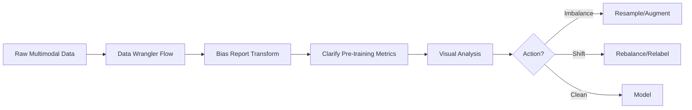

# Skill 1.3.4: Optimize multimodal data distributions by applying bias metrics across numeric, text, and image assets

## Task 1.3: Data Preparation for ML and AI - Validate data quality and manage bias

---

## Core Objective
**Measure and correct distribution distortions across every modality** (numeric, text, image) before training. Bias in one modality poisons the entire model regardless of how clean other modalities are.

---

## Bias Metric Decision Matrix by Modality

| Modality | Primary Bias Metrics | AWS Tooling | When to Apply |
|---|---|---|---|
| **Numeric/Tabular** | Class Distribution Balance (CDB), Demographic Disparity (DD), Difference in Proportions of Labels (DPL) | SageMaker Clarify, Data Wrangler Bias Report | Pre-training on structured features |
| **Text** | Counterfactual log probability, token-level demographic association, toxicity/polarity skew | SageMaker Clarify (NLP), Amazon Comprehend PII/toxicity | After tokenization; before embedding/fine-tuning |
| **Image** | Label distribution per subgroup, pixel-intensity variance across classes, representation parity | SageMaker Data Wrangler (custom visual checks), SageMaker Ground Truth label distributions | After annotation; before augmentation pipeline |

> **Exam Gotcha:** SageMaker Clarify's **pre-training bias metrics** include Class Imbalance (CI), Difference in Proportions of Labels (DPL), Kullback-Leibler (KL) divergence, JS divergence, Lp-norm, and Total Variation Distance (TVD). Post-training metrics (disparate impact, DPPL, DCA, DNC, AD, CDD, TE) are a *different* align — don't confuse pre- vs post- metrics.

---

## Bias Metrics Syntax (SageMaker Clarify)

### Core Parameters (Boto3 `SagemakerClarifyProcessor`)

```python
from sagemaker import clarify

bias_config = clarify.BiasConfig(
    label_values_or_threshold=[1],          # positive label
    facet_name="gender",                     # sensitive attribute
    facet_values_or_threshold=["female"],    # protected group
    group_name="age_group"
)

clarify_processor.run_bias(
    data_config=...,
    bias_config=bias_config,
    model_config=...,
    pre_training_methods=["CI", "DPL", "KL", "TVD", "KS"],  # metric selection
    post_training_methods=["DPPL", "DI", "DCA", "DCR", "AD", "TE"]
)
```

### Key CLI Flag Patterns

```bash
# Data Wrangler bias report
aws sagemaker list-processing-jobs --name-prefix "clarify-bias-"

# Glue Data Quality DQDL rule for distribution checks
Distribution "feature_column" > 0.1
```

> **Exam Gotcha:** `pre_training_methods` parameter accepts `"CI"`, `"DPL"`, `"KL"`, `"JS"`, `"LP"`, `"TVD"`, `"KS"` — **JS and LP require explicit comparison between facet groups.** `post_training_methods` include `"DPPL"` (Difference in Positive Proportions in Labels), `"DI"` (Disparate Impact), `"DCA"` (Difference in Conditional Acceptance), `"DCR"` (Difference in Conditional Rejection), `"AD"` (Accuracy Difference), `"TE"` (Treatment Equality), `"CDDPL"`.

---

## Multimodal Bias Mitigation Techniques

| Defect Type | Numeric Fix | Text Fix | Image Fix |
|---|---|---|---|
| **Class Imbalance** | SMOTE, class weights, undersampling | Back-translation, synonym replacement | Oversampling via GANs, geometric transforms |
| **Underrepresentation** | Stratified sampling | Conditional generation, data collection | Augmentation (rotation, crop, color jitter) |
| **Collection Order Bias** | Shuffle before split | Shuffle examples or batches | Shuffle file paths before dataloader |
| **Label Noise** | Cross-validator agreement | Inter-annotator agreement (Fleiss' kappa) | Ground Truth consensus (AWS): max 10 workers, threshold-based |
| **Distribution Shift** | KS-test vs baseline | Drift detection on embeddings | KL divergence on feature maps |

---

## Mitigation Choice Rules

> **CRITICAL:** Shuffling reorders existing data — it does **not** fix underrepresentation. Augmentation adds variation — it does **not** fix collection-order bias. Duplicating rare-class records can deepen representation bias if duplicates come from a narrow slice.

| Technique | Defect It Fixes | Defect It DOES NOT Fix |
|---|---|---|
| **Shuffle** | Order-induced batch bias | Missing groups, imbalance |
| **Stratified Split** | Subgroup leakage across splits | Imbalance within strata |
| **Augmentation** | Underrepresented variation | Label noise, collection order |
| **SMOTE** | Numeric class imbalance | Representation bias |
| **Class Weights** | Training-time imbalance | Evaluation metric distortion |
| **Deduplication** | Duplicate bias, overfitting | Missing data |

---

## Data Wrangler Bias Report Workflow



**Transform steps:** `Join`, `Concat`, `Shuffle`, `SMOTE`, `Resample`, `Detect duplicate rows`

> **Exam Gotcha:** Data Wrangler's **"Bias Report"** action wraps a Clarify processing job that computes pre-training metrics on the in-memory DataFrame. It requires the dataset to be in a **tabular form** even if the underlying data is text/image — embeddings or extracted features serve as the numeric proxies.

---

## Security & Compliance for Bias Analysis

| Concern | Requirement |
|---|---|
| **PII in bias metrics** | Use Comprehend DetectPII before Clarify; redact with Comprehend or Comprehend Medical |
| **KMS Encryption** | Pass `output_kms_key` to Clarify processor; Data Wrangler supports SSE-KMS |
| **VPC Endpoint** | SageMaker Studio private mode; Comprehend, S3, SageMaker API endpoints (interface VPC endpoints) |
| **Cross-account** | `role_arn` for Clarify job must allow S3 read from source bucket + write to output bucket |

---

## Anti-Patterns & Traps

- **Accuracy on imbalanced multimodal data:** A 99% dominant class yields 99% accuracy without learning anything — use F1, Precision-Recall AUC, or balanced accuracy.
- **Local normalization per batch:** Applying per-batch normalization on unbalanced batches shifts distributions differently — use global statistics or population-level normalization.
- **Token-level bias without context:** Measuring word co-occurrence alone ignores polysemy (e.g., "stroke" in medical vs. art context) — use contextual embeddings.
- **Image augmentation without label-aware transforms:** Applying rotations to OCR digits (6 vs 9) corrupts labels — augment only where semantics are invariant.
- **Ignoring intersectional bias:** Gender bias may only manifest for specific age groups — evaluate facet combinations (e.g., `gender × race`).

---

## Validation Checklist Before Training

| Check | Numeric | Text | Image |
|---|---|---|---|
| Completeness | Glue Data Quality `Completeness` | Prompt-response pair field presence | EXIF/corrupt file scan |
| Distribution drift | KS statistic vs baseline | Embedding cosine distance | FID/feature drift |
| Label agreement | — | Fleiss' kappa ≥ 0.6 | Ground Truth worker consensus |
| Content safety | — | Bedrock Guardrails / Comprehend toxicity | — |
| Deduplication | Exact + fuzzy match | SimHash/neardup | Perceptual hash |

> **Hard Rule:** **Ground Truth** underlying worker requirements: `NumberOfHumanWorkersPerDataObject` default `3`; `AnnotationConsolidationConfig` for bounding box requires `Threshold` for worker consensus; maximum `10` workers per object.