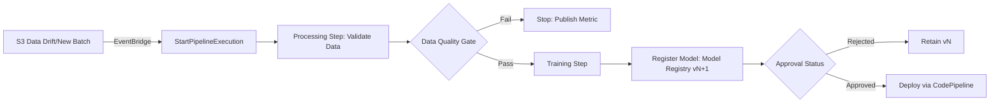

# Skill 3.3.5: Build and integrate mechanisms to re-train models.

## Task 3.3: Deployment and Orchestration of ML and AI Workflows - Implement automated orchestration and CI/CD pipelines for MLOps and AI workloads.

---

## Retraining Trigger Selection Matrix

| Trigger Type | Mechanism | Best For | Anti-Pattern |
|---|---|---|---|
| **Schedule-based** | EventBridge Rule (`cron`/`rate`) → `StartPipelineExecution` | Stable data drift, compliance-mandated periodic retraining, batch cadence | Irregular data arrival (wastes compute) |
| **Event-driven** | S3 `ObjectCreated` → EventBridge → Lambda/SQS → `StartPipelineExecution` | Irregular data batches, streaming ingestion, new labeled datasets | No event source exists or events unreliable |
| **Manual** | Console/CLI `start-pipeline-execution` or SageMaker Pipeline Studio | Pipeline under initial validation, one-off Data Scientist experiments | Production MLOps requiring unattended operation |

> **Exam Gotcha:** A pipeline that ends at **registration** (Model Registry) rather than **deployment** is the correct design. Approval gates live between registration and deployment stages.

---

## Retraining Pipeline Architecture (SageMaker Pipelines)



### Key Boto3/CLI Parameters

| Component | Parameter | Notes |
|---|---|---|
| `start_pipeline_execution` | `PipelineExecutionDescription` | Optional description for audit trail |
| `ProcessingStep` | `cache_config` | Enable `EnableInterContainerCommunication` for distributed processing |
| `TrainingStep` | `RetryPolicy.MaxAttemptRetry` | Must set >1 for transient EC2/Training failures |
| `CreateModelPackage` | `ModelApprovalStatus=PendingManualApproval` | Blocks auto-deploy; requires human/tests to promote |
| `RegisterModel` | `InferenceSpecification` | Encapsulates container, instance, and data capture config |

> **Hard Rule:** Retraining pipeline **must terminate at registry, not at endpoint**. Auto-deploying fresh models contradicts CI/CD approval gates and audit requirements.

---

## Integration with CI/CD (CodePipeline ↔ SageMaker)

| Stage | AWS Service | SageMaker Integration |
|---|---|---|
| **Source** | CodeCommit / S3 / CodeConnections | Model artifact, training script, prompt files |
| **Build/Test** | CodeBuild | Unit tests on pre-processing code; `sagemaker.image_uris` validation |
| **Evaluation Gate** | CodeBuild + Step Functions | Invoke SageMaker Processing for metric evaluation; Block on threshold breach |
| **Deploy** | CodeDeploy / SageMaker Deploy API | Target: `UpdateEndpoint`, `CreateEndpointConfig`, `RegisterModel` |
| **Approve** | Manual Approval Action (CodePipeline) | Post-registry; before deployment stage |

### IAM Role Boundaries

| Pipeline Component | Minimum IAM Permissions |
|---|---|
| **CodePipeline role** | `sagemaker:StartPipelineExecution`, `sagemaker:DescribePipelineExecution`, `s3:GetObject` |
| **SageMaker Pipeline role** | `s3:GetObject`/`PutObject` (training data/output), `kms:Decrypt` (if KMS-SSE), `logs:CreateLogGroup/Stream` |
| **EventBridge rule role** | `sagemaker:StartPipelineExecution` on target pipeline ARN |
| **CodeBuild role** | `s3:GetObject` (test data), `cloudwatch:PutMetricData` (emit eval metrics), `sagemaker:InvokeEndpoint` (smoke test) |

> **Security Note:** Retraining pipelines reading KMS-encrypted S3 require the SageMaker execution role to have `kms:Decrypt` on the specific CMK — not the default service role.

---

## Data Drift Detection & Retraining Thresholds

| Metric | Service | Retraining Trigger |
|---|---|---|
| **Feature drift** | SageMaker Model Monitor (`DataQualityJobDefinition`) | Schedule or EventBridge on violation |
| **Prediction degradation** | CloudWatch Alarm on `Invocation5XXErrors` / custom model quality metric | Alarm threshold breach → EventBridge → retrain |
| **Baseline deviation** | SageMaker Model Monitor `ModelQualityJobDefinition` (baseline + ground truth merge) | Scheduled metrics evaluation |

### Model Monitor Retraining Loop

1. **Schedule Monitoring Job** with `baseline_constraints` and `baseline_statistics` from S3
2. **Enable CaptureConfig** (`DataCaptureConfig`) with `EnableCapture=True`, `SamplingPercentage=100`
3. **Compare** captured predictions to constraints via `ModelQualityMonitor`
4. **Emit** violation metrics to CloudWatch
5. **Trigger** EventBridge rule on metric → `StartPipelineExecution`

> **Gotcha:** DataCaptureConfig only applied at **endpoint creation**; cannot modify existing endpoint in-place.

---

## Model Versioning & Lineage Tracking

| Tool | Purpose | Key Feature |
|---|---|---|
| **SageMaker Model Registry** | Version truth and audit | Immutable `ModelPackage` ARNs with `ModelGroupName`, `ModelPackageVersion`, `ApprovalStatus` |
| **MLflow on SageMaker AI** | Experiment tracking → Registry | `mlflow.sagemaker.register_model()` auto-registers winning run |
| **AWS Artifact** | Pipeline artifact lineage | `Artifact` lineage from `CreateArtifact` (source/input/output) |
| **SageMaker Lineage** | End-to-end data-model-endpoint graph | `AddAssociation` between Dataset, TrainingJob, ModelPackage |

### Registration Flow (Boto3)

```python
sagemaker_client.register_model(
    ModelPackageGroupName="churn-model-group",
    ModelPackageDescription="v2.3 CLI pipeline retrain",
    ModelApprovalStatus="PendingManualApproval",
    InferenceSpecification={
        "Containers": [{
            "Image": "763104351884.dkr.ecr.us-east-1.amazonaws.com/pytorch-inference:2.1.0",
            "ModelDataUrl": "s3://bucket/model-v2.3.tar.gz"
        }],
        "SupportedContentTypes": ["text/csv"],
        "SupportedResponseMIMETypes": ["application/json"]
    }
)
```

---

## Prompt & Agent Versioning (GenAI)

| Artifact | AWS Service | Versioning Pattern |
|---|---|---|
| **Prompt** | Amazon Bedrock Prompt Management | `CreatePromptVersion`, variants compared in parallel |
| **Agent** | Amazon Bedrock Agents | Agent ARN + alias; `UpdateAgentAlias` for blue/green |
| **Knowledge Base** | Bedrock Knowledge Bases | `StartIngestionJob` with incremental resync (delta only) |

> **Anti-Pattern:** Treating a **copy of a vector index** as a refresh. Copying does not regenerate embeddings. Any change to embedding model, chunking strategy, or index dimensions requires **full re-indexing** — not incremental resync.

---

## Common Distractor Traps

**Wrong Answer Pattern 1:** Auto-deploy from training pipeline directly to production endpoint.
**Why Wrong:** Bypasses Model Registry approval, deployment guardrails, and CI/CD audit.

**Wrong Answer Pattern 2:** Schedule-based retrain for irregular data arrival.
**Why Wrong:** Wastes compute, delays recency.

**Wrong Answer Pattern 3:** Unit tests pass → deploy model.
**Why Wrong:** Unit tests verify code, not model quality. Must include model evaluation gate (metric threshold on held-out data).

**Wrong Answer Pattern 4:** Configure Model Monitor on existing endpoint without DataCaptureConfig.
**Why Wrong:** Capture must be enabled at endpoint creation; not retrofittable.