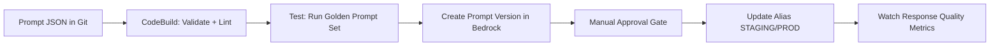

# Skill 3.3.7: Manage Prompts (Amazon Bedrock Prompt Management)

## Task 3.3: Deployment and Orchestration of ML and AI Workflows

### Core Concept & Business Objective

**Primary objective:** Treat prompts as versioned, auditable, deployable artifacts—not embedded application strings. Prompt Management moves prompt changes from ad-hoc console edits into a governed release lifecycle integrated with CI/CD.

| Capability | Purpose |
|---|---|
| **Prompt versioning** | Immutable snapshots; each change creates a new version for rollback/audit |
| **Prompt variables** | Parameterized placeholders (`{{variable}}`) filled at inference time |
| **Prompt variants** | A/B test multiple prompt versions simultaneously against live traffic |
| **Bedrock Prompt Flows** | Chain prompt templates, knowledge bases, agents, and Lambda into an orchestrated graph |
| **Deployable alias** | Stable named reference (e.g., `PROD`, `STAGING`) pointing to a specific version |

> **EXAM GOTCHA:** Prompts are behavior-changing artifacts exactly like model weights. A pipeline that versions models but not prompts cannot attribute a generative output regression to its root cause. Both must be under version control.

---

### Key APIs, SDK Methods & Boto3 Parameters

| Operation | Boto3/CLI | Notes |
|---|---|---|
| **Create prompt** | `bedrock.create_prompt()` | Defines `name`, `description`, `variantName`, `templateType=TEXT`, `templateConfiguration` with `text` + `inputVariables` |
| **Create prompt version** | `bedrock.create_prompt_version(promptIdentifier=arn, description=...)` | Snapshot of a variant; returns `version` (e.g., `1`, `2`) |
| **Update variant** | `bedrock.update_prompt_variant()` | Edits template or inference config; does NOT change existing versions |
| **Create alias** | `bedrock.create_prompt_alias(promptIdentifier, aliasName, promptVersion=...)` | Alias targets a specific version; clients call alias ARN |
| **Invoke via alias** | `bedrock_runtime.invoke_model(promptIdentifier=aliasArn, modelId=..., variables={...})` | Runtime fills variables; alias resolves to version |
| **List versions** | `bedrock.list_prompt_versions(promptIdentifier, maxResults=...)` | Audit lineage and diff history |
| **Delete prompt version** | `bedrock.delete_prompt_version()` | Cannot delete a version referenced by an alias |

> **CRITICAL RULE:** An alias can point to exactly **one version** at a time. Traffic splitting between prompt versions is done via **Bedrock Prompt Flows** routing or application-level distribution—not by the alias itself.

---

### Security, Compliance & IAM

| Layer | Config |
|---|---|
| **IAM for prompt access** | `bedrock:GetPrompt`, `bedrock:GetPromptVersion`, `bedrock:CreatePromptVersion`, `bedrock:GetPromptAlias`, `bedrock:ListPromptVersions` |
| **Runtime invocation** | `bedrock:InvokeModel` on the **prompt alias ARN** (not the model ARN alone) |
| **KMS at rest** | Prompt templates and versions encrypted with AWS-managed key by default; custom KMS key via `kmsKeyArn` at prompt creation |
| **In transit** | TLS 1.2+ enforced; **VPC Interface Endpoint** for Bedrock (`com.amazonaws.region.bedrock`, `bedrock-runtime`, `bedrock-agent-runtime`) to avoid internet egress |
| **Resource policies** | Prompt resources support Bedrock resource-based policies for cross-account sharing |

> **ANTI-PATTERN:** Storing prompt text in application code or SSM Parameter Store without versioning. This bypasses auditability, makes rollback manual, and breaks the "every behavior-changing artifact has a version" rule.

---

### Prompt Management vs. Alternatives — Decision Matrix

| Requirement | Service/Approach | Why |
|---|---|---|
| Versioned prompts with variables, variants, aliases | **Amazon Bedrock Prompt Management** | Purpose-built; native integration with Bedrock runtime; alias-based deployment |
| Full prompt + model + RAG + agent orchestration | **Bedrock Prompt Flows** | Graph-based multi-step orchestration; node-level versioning |
| Experiment tracking for prompt/model combos | **MLflow on SageMaker AI** + prompt as parameter | Track prompt text as a logged parameter alongside model metrics |
| Code-only prompts in Git, deployed via CI/CD | **CodePipeline + CodeBuild + app config** | Viable but lacks native Bedrock versioning/alias semantics |
| Sharing prompts across accounts without copying | Bedrock **Resource Policies** | Cross-account access via prompt ARN |

> **DISTRACTOR TRAP:** Don't confuse **Prompt Management** (store/version prompts) with **Bedrock Agents** (multi-step orchestration with tool use) or **Bedrock Knowledge Bases** (RAG ingestion/retrieval). Prompt Flows = orchestration; Prompt Management = artifact governance.

---

### CI/CD Pipeline Integration for Prompts



| Pipeline Stage | Action |
|---|---|
| **Source** | Prompt templates as JSON/YAML in CodeCommit/CodeConnections repo |
| **Build** | Validate variables (`{{...}}`), schema check, linter (e.g., `promptfoo`) |
| **Test** | Run **golden prompt dataset**; compare candidate vs. baseline version using LLM-as-judge (faithfulness, relevance, toxicity) |
| **Register** | `bedrock.create_prompt_version()` — immutable snapshot |
| **Approve** | Manual gate in CodePipeline; separation of "tested" from "deployed" |
| **Deploy** | Update alias: `bedrock.update_prompt_alias(aliasName='PROD', promptVersion=newVersion)` |
| **Rollback** | Point alias back to `previousVersion` — one API call, no redeploy |

> **EXAM GOTCHA:** Generative AI tests **cannot assert exact string matches** — responses vary between runs. Use aggregate quality scoring against a baseline, not deterministic assertions.

---

### Automated Deployment for Fine-Tuned Foundation Models + Prompts

| Artifact | Versioning Mechanism | Deployment Action |
|---|---|---|
| **Fine-tuned model** | SageMaker Model Registry version (from training job) | Update endpoint deployment via CodeDeploy blue/green or canary |
| **Prompt** | Bedrock Prompt Management version + alias | Update alias target inside CodePipeline deploy stage |
| **Agent** | Bedrock Agent version (`agentVersion`) + alias | Update agent alias via DeploymentStage |
| **RAG knowledge base** | Ingest job triggering incremental resync | S3 event → EventBridge → `StartIngestionJob` |

**Combined release pattern:**
- Both model version and prompt version are passed as pipeline parameters.
- Deploy stage updates both aliases atomically (or in a coordinated order: model first, then prompt).
- Rollback reverts both aliases to previous versions.

---

### Anti-Patterns & Common Distractor Traps

| Anti-Pattern | Why It Fails |
|---|---|
| **Editing prompt in-place in Bedrock console** | No version, no rollback, no audit trail; breaks reproducibility |
| **Embedding prompt text in Lambda/app code** | Requires app redeploy for prompt change; untracked behavior change |
| **Testing prompts with exact string assertions** | Non-deterministic outputs cause flaky builds and false negatives |
| **Versioning prompts but not models (or vice versa)** | Cannot attribute regression root cause; incomplete audit lineage |
| **Using alias as traffic-splitting mechanism** | Aliases are single-version pointers; use Prompt Flows or app-level A/B |
| **Deleting a version referenced by an alias** | Bedrock rejects this API call; must reassign alias first |

> **HARD RULE:** `create_prompt_version` produces an **immutable** snapshot. You cannot edit a version after creation. Any change requires a new version — this is what makes audits and rollbacks trustworthy.

---

### Quick Reference — Key Exam Commands

```bash
# Create a prompt with variables
aws bedrock create-prompt \
  --name "customer-support-summarizer" \
  --description "Summarizes support tickets" \
  --variant-name "v1" \
  --template-configuration '{
    "text": {
      "text": "Summarize the following support ticket in {{length}} words: {{ticket_text}}",
      "inputVariables": [{"name": "length"}, {"name": "ticket_text"}]
    }
  }'

# Create a snapshot version
aws bedrock create-prompt-version \
  --prompt-identifier "arn:aws:bedrock:us-east-1:123456789012:prompt/PROMPT123" \
  --description "Approved for production"

# Point PROD alias to version 3
aws bedrock create-prompt-alias \
  --prompt-identifier "arn:aws:bedrock:us-east-1:123456789012:prompt/PROMPT123" \
  --alias-name "PROD" \
  --prompt-version "3"

# Invoke using alias (runtime)
aws bedrock-runtime invoke-model \
  --model-id "anthropic.claude-3-sonnet-20240229-v1:0" \
  --body '{"promptIdentifier": "arn:...:prompt-alias/PROMPT123/PROD", "variables": {"length": "50", "ticket_text": "..."}}' \
  output.json
```