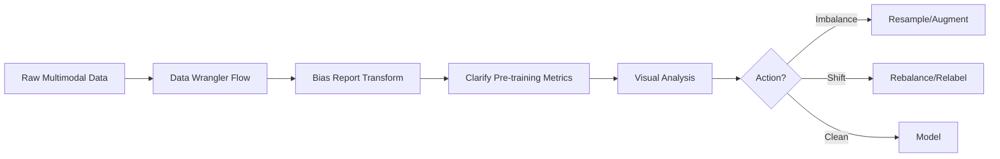

# Skill 1.1.1: Extract data from data sources (for example, Amazon S3, Amazon EBS, Amazon EFS, Amazon RDS, Amazon DynamoDB, Amazon OpenSearch Service)

## Task 1.1: Data Preparation for ML and AI - Collect and store data

---

## Source-to-Storage Decision Matrix

| **Data Source** | **Storage Type** | **Access Pattern** | **ML Use Case** | **Primary Extraction Method** |
|---|---|---|---|---|
| **Amazon S3** | Object storage | REST API (GET/PUT); S3 Select | Landing zone for training data | AWS SDK (`boto3`), S3 Select, Athena, Glue |
| **Amazon EBS** | Block storage (single instance) | POSIX block device | Local scratch, high IOPS training | Direct disk read on attached instance |
| **Amazon EFS** | Shared POSIX file system | NFSv4 mount, multi-instance | Distributed training w/ shared namespace | NFS mount on all training nodes |
| **Amazon RDS** | Relational (row store) | SQL queries, JDBC/ODBC | Structured, queryable records | Glue JDBC connection, DMS, `pandas.read_sql` |
| **Amazon DynamoDB** | NoSQL key-value/document | GetItem/BatchGetItem by key | Fast feature lookup by entity ID | DynamoDB Streams, Glue ETL, `boto3` scan/batch |
| **Amazon OpenSearch Service** | Search/analytics index | REST API (`_search`, `_msearch`) | Full-text search, vector similarity (k-NN) | OpenSearch Query DSL, `Scroll` API, `_search_after` |

---

## Key Boto3 / SDK Parameters & Patterns

### S3 Extraction (`boto3.client('s3')`)
- **`get_object()`** — key params: `Bucket`, `Key`, `Range` (byte-range for partial reads)
- **`select_object_content()`** — SQL over CSV/JSON/Parquet; use `ExpressionType='SQL'`, `InputSerialization`, `OutputSerialization`
- **`list_objects_v2()`** — pagination via `ContinuationToken`; handles >1000 keys automatically
- **Anti-pattern:** Iterating `list_objects_v2()` in a loop without pagination → silently truncates results

### DynamoDB Extraction (`boto3.client('dynamodb')`)
- **`scan()`** — full table read; inefficient for large tables; **`ParallelScan`** with `TotalSegments`/`Segment` for parallelism
- **`query()`** — keyed lookup; required params: `KeyConditionExpression`, `ExpressionAttributeValues`
- **Export to S3:** Use native **Export to S3** feature (point-in-time, no table throughput impact) vs. **DynamoDB Streams** (continuous, ordered)
- **Anti-pattern:** Using `scan()` for production extraction when a key-based `query()` or S3 export exists

### RDS Extraction
- **`boto3.client('rds').describe_db_instances()`** — retrieve endpoint, port, credentials via Secrets Manager
- **Prohibited:** Direct internet access to RDS without VPC placement; use **VPC endpoints** or NAT gateway
- **Bulk export:** `SELECT INTO OUTFILE S3` (Aurora MySQL) or `aws_s3.query_export_to_s3()` (Aurora PostgreSQL) — no intermediate EC2 required

### EFS / EBS
- **EFS:** Mount target in each AZ; use `nfsvers=4.1` for multi-AZ failover; `GeneralPurpose` vs `Max I/O` performance modes
- **EBS:** `Multi-Attach` only on **io1/io2** volumes within same AZ; never across AZs or for multi-instance training data

---

## Format Selection Matrix

| **Format** | **Orientation** | **Best For** | **Exam Distractor Trap** |
|---|---|---|---|
| **CSV** | Row | Simple interchange, human-readable | Uncompressed CSV forces full scans of all columns |
| **JSON** | Row/document | Nested schemas, event data | Schema inference over JSONL may fail on sparse fields |
| **Parquet** | Columnar | Analytics, column pruning, predicate pushdown | Using JSON for "small columns, many rows" workloads |
| **ORC** | Columnar | Hive/Spark ecosystems, compression | Confusing ORC with a streaming wire format |
| **Avro** | Row | Schema evolution, Kafka serialization | Avro is not columnar; full-row reads required |

> **Exam Gotcha:** Columnar formats (Parquet/ORC) reduce I/O for column-projected queries, but **increase write latency**. Row formats (CSV/JSON/Avro) are write-friendly but scan-heavy. The curated layer in a data lake should be columnar; the raw layer often stays row-oriented.

---

## Distributed File Storage Trade-offs

| **Requirement** | **Service** | **Why** | **Anti-Pattern** |
|---|---|---|---|
| Multi-instance shared namespace | **EFS** | NFSv4, multi-AZ, 1000s of concurrent mounts | Attaching EBS volumes to each instance and syncing manually |
| Single-instance, high IOPS | **EBS (io2/gp3)** | Block device, sub-ms latency | Using EFS for latency-bound single-instance workloads |
| High-throughput parallel training | **FSx for Lustre** | 100s GB/s throughput, S3-backed | EFS for large-scale distributed training requiring sub-ms parallel I/O |
| Object storage for datasets | **S3** | Infinite scale, cheap, durable | Storing training data exclusively on instance-local volumes |

---

## Security, Compliance & Connectivity

- **IAM PassRole required:** For AWS Glue ETL jobs, SageMaker training jobs, and EMR clusters — the role must be passed to the service at launch
- **Encryption defaults:**
  - **S3:** SSE-S3 by default (AES-256); upgrade to **SSE-KMS** for access-controlled key rotation
  - **DynamoDB:** Encryption at rest always on (default); no option to disable
  - **RDS:** Encryption at rest only selectable at instance creation; cannot enable post-provisioning
  - **EFS:** Encryption at rest via KMS at file system creation; encryption in transit via mount option `-o tls`
  - **EBS:** Encrypted volumes only if launched from encrypted snapshot or with encryption enabled at launch
- **VPC endpoints recommended for:** S3 (Gateway endpoint), DynamoDB (Gateway endpoint), RDS (interface), OpenSearch (interface), EFS (interface)
- **OpenSearch access control:** Fine-grained access control (FGAC) with IAM or Cognito; domain-level policy controls who can call `_search`

> **Exam Gotcha:** Cross-account S3 access for ML training requires **both** the bucket policy in the source account and an IAM role in the training account with `s3:ListBucket` and `s3:GetObject`.

---

## Streaming Extraction vs. Batch Extraction

| **Scenario** | **Service/Access Pattern** | **Key Parameter** |
|---|---|---|
| Near-real-time ingestion | **Kinesis Data Streams** → consumers | `ShardCount`, `RetentionPeriodHours` (24–8760) |
| Kafka-native ingestion | **Amazon MSK** + Kafka Consumers | Consumer group offsets, partitions |
| Continuous SQL processing | **Managed Service for Apache Flink** | Kinesis/Kafka connectors, checkpointing |
| Historical bulk load | **AWS Glue ETL** or **DynamoDB Export to S3** | Parallelism, worker type (`G.1X`/`G.2X`) |
| Change data capture from RDS | **AWS DMS** to S3/OpenSearch/Kinesis | `ReplicationTask`, `TaskSettings` |

> **Exam Gotcha:** A consumer falling behind in a stream is not always under-provisioned. If the downstream sink is at its limit (e.g., OpenSearch write throughput), adding more consumer workers moves the bottleneck, not the data.

---

## Merge & Deduplication Patterns

- **Key reconciliation:** Timestamp + entity ID composite keys prevent collisions across sources
- **Conflict resolution:** Define an authoritative source (e.g., production database over CRM export) before merging
- **Scheduling:** Use `EventBridge` to trigger Glue jobs when source data lands; avoid time-based polling
- **Catalog-first approach:** Run a Glue Crawler → populate Data Catalog → query via Athena/Redshift Spectrum

---

## Anti-Patterns Quick Reference

- **Storing high-frequency training checkpoints on EBS** with a single instance → data loss risk on instance termination; use S3 or FSx
- **Reading large RDS tables via single-threaded JDBC** → use DMS or Glue with parallel partition reads
- **Writing event data as uncompressed JSON to S3** → expensive downstream scans; convert to gzip/Parquet
- **Using EFS for high-frequency random small-file access** → use EBS io2 or FSx for Lustre
- **Configuring OpenSearch without domain tags** → compliance and cost attribution failure
- **Ignoring Kinesis shard limits** — 1 MB/sec ingest, 2 MB/sec egress per shard; under-sharding causes throttling

---

## Scalability & Troubleshooting Spot Checks

| **Symptom** | **Likely Cause** | **Fix** |
|---|---|---|
| `ProvisionedThroughputExceededException` on DynamoDB | Table capacity exhausted | Enable on-demand mode or scale WCU/RCU; use parallel scan segments |
| S3 `SlowDown` (503) on writes | Hot partition key prefix | Add random prefix, use S3 multipart upload |
| Kinesis `ProvisionedThroughputExceeded` | Shard ingress limit hit | Increase `ShardCount`; verify per-record size ≤1 MB |
| Glue job slow on S3 reads | Reading all columns from JSON | Re-write raw layer to Parquet/ORC |
| OpenSearch cluster yellow/red | Disk pressure or replica issues | Scale up instance type or add data nodes |

---

## Vector Store vs. Feature Store — Placement Logic

- **Vector Store** → answers *"what is similar to this embedding?"*
  - **OpenSearch Service** (k-NN plugin, `cosinesimil` / `l2` / `innerproduct`)
  - **RDS PostgreSQL with `pgvector`** — keeps vectors next to relational data
  - **S3 vector indexes** — batch/offline approximate nearest neighbor search
- **Feature Store** (SageMaker) → answers *"what are the current/historical feature values for this entity?"*
  - **Online store:** millisecond `get_record()`
  - **Offline store:** historical time-travel queries for training

> **Exam Gotcha:** Feature Store and Vector Store are not interchangeable. Feature Store keys on entity ID; Vector Store keys on embedding similarity. A question asking "which service stores model input features for consistent training/inference" points to SageMaker Feature Store.

---

# Skill 1.1.2: Make Storage Decisions and Configure Storage Services
## Task 1.1: Data Preparation for ML and AI - Collect and store data

---

## Storage Decision Matrix (Cost vs. Performance vs. Structure)

| Service | Data Structure | Access Pattern | Latency | Cost Signal | ML Use Case |
|---------|---------------|----------------|---------|-------------|-------------|
| **Amazon S3** | Object (any format) | Read-heavy, batch, parallel | ~100-200ms first byte | Low per GB; tiered | Data lake landing zone, training datasets, model artifacts |
| **Amazon EBS** | Block (raw disk) | Single-instance random I/O | Sub-ms (SSD) | Medium per GB provisioned | Local scratch space, high-IOPS preprocessing |
| **Amazon EFS** | Shared POSIX filesystem | Concurrent multi-instance reads | Low ms | Medium-high per GB | Distributed training needing shared namespace |
| **Amazon FSx for Lustre** | Shared POSIX filesystem | Ultra-low latency, massive throughput | Sub-ms | High per GB | HPC/GPU training on large datasets; S3-backed lazy loading |
| **Amazon RDS** | Relational (tables, SQL) | Transactional, point lookups, joins | Low ms | Medium per instance-hour | Feature metadata, experiment tracking, labels with joins |
| **Amazon DynamoDB** | Key-value/document | Single-digit ms by key | <10ms | Pay per request/capacity | Online feature serving, model registry, inference metadata |

> **Hard rule:** EBS Multi-Attach supports only io1/io2 volumes on Nitro instances and **provides shared block access, not a shared filesystem**. Multiple training instances need EFS/FSx, not EBS.

---

## File Format Selection by Access Pattern

| Format | Orientation | Best When | Anti-Pattern |
|--------|------------|-----------|--------------|
| **Parquet** | Columnar | Analytic queries over few columns, many rows; Athena/Spark; compression efficiency | Streaming single-record writes |
| **ORC** | Columnar | Hadoop/EMR ecosystems; heavy predicate pushdown | Small file counts, rapid ingestion |
| **JSON** | Row (document) | Nested data, API responses, schema evolution | Full-table analytic scans; large file size overhead |
| **CSV** | Row (text) | Simple interchange, human readability | Nested data; large datasets; no schema enforcement |
| **Avro** | Row (binary) | Streaming ingestion (Kafka/Kinesis); compact schema evolution | Ad-hoc analytical queries |

> **Cost rule:** Columnar formats reduce scan size via **column pruning (projection pushdown)** and **predicate pushdown**, directly lowering Athena/Glue query cost and S3 GET requests. Curated data lake layers should always use Parquet/ORC.

---

## Compliance-Driven Storage Configuration

**Key constraints to configure at the storage layer:**

- **Encryption at rest:** S3 default encryption (SSE-S3), KMS customer-managed keys (SSE-KMS) for key rotation and access control; RDS/DynamoDB/OpenSearch all support KMS CMKs.
- **VPC endpoints for private access:** Interface endpoints (RDS, DynamoDB, OpenSearch) or Gateway endpoints (S3) to keep traffic off public internet. **S3 Gateway endpoint is free; interface endpoints incur per-hour fees.**
- **S3 Bucket policies + Object Ownership:** Enforce ACL disabled, block public access, require `x-amz-server-side-encryption: aws:kms` on PUT.
- **Lifecycle policies:** Transition raw data to S3-IA/Glacier to cut cost while retaining compliance retention (e.g., 7-year rule).
- **Data residency:** S3 bucket regions are fixed at creation; cross-region replication for DR/serving-locality needs.

> **Non-negotiable:** RDS encrypts from day one only if configured at creation. **You cannot retroactively enable storage encryption on an unencrypted RDS instance without creating an encrypted snapshot and restoring.**

---

## Streaming Storage: Queue vs. Semantics vs. Reprocessing

| Service | Retention | Replay | Throughput Model | Choose When |
|---------|-----------|--------|------------------|-------------|
| **Kinesis Data Streams** | 1h–365d | Per-shard iterator + timestamp | Shards × 1MB/s ingest, 2MB/s egress each | AWS-native, Lambda/Flask consumers, no Kafka expertise |
| **Amazon MSK** | Configurable (unlimited beyond disk) | Consumer group offsets | Provisioned brokers, add partitions | Existing Kafka tooling/teams, enterprise event backbone |
| **Managed Flink** | N/A (consumer) | Checkpointed state | Parallelism × task slots | Stateful stream processing, windowed aggregations |

**Capacity diagnosis:**

- **Kinesis `WriteProvisionedThroughputExceeded`** → increase shards or batch with `PutRecords` (up to 500 records/5MB per call).
- **Kinesis `ReadProvisionedThroughputExceeded`** → use Enhanced Fan-Out (EFO), register consumers, or increase consumers.
- **Consumer lag growing while write target stays at max throughput** → the bottleneck is downstream, **not** the consumer count. Fix the sink first.
- **MSK `NotEnoughReplicasException`** → insufficient broker capacity for partition replication factor.

> **Exam gotcha:** Adding more Lambda consumers to a Kinesis stream where the downstream database is throttled will not clear the backlog. The Lambda invocations will queue/error locally or at the sink.

---

## Vector Store Selection: Where Embeddings Live

| Option | Query Type | Scale Sweet Spot | Cost Model | Use When |
|--------|-----------|------------------|------------|----------|
| **OpenSearch Service** | k-NN (HNSW/IVF), filter + vector hybrid | Billions of vectors | Instance-hours + storage | Production RAG, conversational search, faceted filtering |
| **RDS PostgreSQL + pgvector** | Exact (IVFFlat) or HNSW | Millions of vectors | RDS instance cost | Embeddings co-located with relational records; no data migration |
| **DynamoDB** | Not native vector; use external KNN redis/layer | N/A | Pay per request | Low-latency metadata store for vector IDs, not similarity search itself |
| **S3 + Athena/Glue** | Batch similarity (manual or Spark) | Trillions of objects | Object storage cost | Offline vector analysis, infrequent querying, archival of embeddings |

> **Scalability rule:** `pgvector` with IVFFlat requires explicit index build (`CREATE INDEX ... USING ivfflat`) and is approximate; HNSW gives better recall but consumes more memory. For RAG at production scale, OpenSearch with KNN plugin or Amazon Bedrock Knowledge Bases are preferred.

---

## SageMaker Feature Store: Online vs. Offline

| Dimension | Online Store | Offline Store |
|-----------|--------------|---------------|
| **Backing** | DynamoDB (managed, low-latency) | S3 + Glue Data Catalog (Parquet) |
| **Latency** | <10ms single-record lookup | Batch, distributed reads |
| **Use case** | Serving inference with `GetRecord` | Training with `GetFeatureGroup`, historical backfill, point-in-time joins |
| **Retention/Deduplication** | Latest value only | Full history, time-travel via `record_identifier` + `event_time` |
| **Consistency** | Strong per record | Eventually consistent |

**Configuration nuances:**
- `EnableOnlineStore=True` required for low-latency serving; `DisableOnlineStore=True` for training-only features (lower cost).
- TTL for online store only (not offline) if use case is time-bounded (e.g., 30-day features).
- **`Deferred` vs. `Standard` write mode**: Use `Deferred` to batch-ingest bulk historical features; `Standard` for real-time single `PutRecord`.
- Feature definition: `FeatureGroup` with `RecordIdentifierFeatureName` (primary key) + `EventTimeFeatureName` (for time-series integrity).

> **Training-serving skew killer:** Use the same `FeatureGroup` for training (offline `GetFeatureGroup`) and serving (online `GetRecord`). This guarantees identical feature transformation code paths. Do not re-derive features in a SageMaker endpoint that were not stored in the feature store.

---

## Cost Optimization Decision Tree

```
How often is the data read?
├── Frequently (multiple times/day) → S3 Standard, EFS Standard, RDS Single-AZ/Multi-AZ
├── Occasionally (monthly) → S3-IA, EFS Infrequent Access (disable lifecycle causing transition)
└── Rarely (compliance, annual) → S3 Glacier Flexible/Deep Archive

Is data structured for SQL or Key-value?
├── SQL + joins → RDS (Aurora for scale) or Redshift for analytics
├── Key-value + single-digit-ms → DynamoDB
└── No fixed schema → S3 with Glue Data Catalog (schema-on-read)

Is access latency <10ms required?
├── Yes → DynamoDB, OpenSearch, EBS (single instance), or Feature Store online
└── No → S3 (100-200ms first byte), Parquet/ORC with Athena/Glue

Is data shared across multiple training instances concurrently?
├── Yes → EFS (moderate perf) or FSx for Lustre (high perf, S3-backed)
└── No → S3 (pull once per instance) or EBS (single instance scratch)
```

---

## Anti-Pattern Quick Reference

| Anti-Pattern | Consequence | Correct Approach |
|--------------|-------------|------------------|
| CSV for curated analytics layer | Full-table scans, high Athena/Glue cost | Convert to Parquet/ORC |
| EBS Multi-Attach for shared training namespace | No shared filesystem, each instance sees raw block | Use EFS or FSx |
| `pgvector` for billions of vectors with high QPS | Memory exhaustion, slow exact search | Use OpenSearch or a dedicated vector database |
| Feature Store without `event_time` | Cannot reconstruct point-in-time training data; leakage | Always include `EventTimeFeatureName` |
| Kinesis Data Streams without EFO for multiple consumers | Consumers compete for `GetRecords` throughput | Register EFO consumers for fan-out |
| Storing raw ML datasets in RDS | Glue crawler can't index; expensive block storage | Use S3 as data lake, RDS for metadata |
| Enabling online store for training-only features | Unnecessary DynamoDB cost | `DisableOnlineStore=True` |

> **Final exam tip:** When a question asks for "low-latency, scalable, serverless" with unstructured or multi-format ML data, **S3 is the default** unless explicit keywords like "shared filestystem across instances" (→ EFS/FSx), "transactional SQL joins" (→ RDS), "single-digit-ms key lookup" (→ DynamoDB), or "embedding similarity" (→ OpenSearch/pgvector) are present.

---

# Skill 1.1.3: Troubleshoot and Debug Data Ingestion and Storage Issues Involving Capacity and Scalability

## Task 1.1: Data Preparation for ML and AI — Collect and Store Data

---

## Core Objective

Diagnose and resolve ingestion/storage bottlenecks by identifying the **binding constraint** in the data pipeline — throughput limit, consumer capacity, storage layout, or API throttling — rather than treating symptoms with blanket scaling.

---

## Bottleneck Identification Matrix

| Symptom | Likely Constraint | Correct Fix | Anti-Pattern (Distractor) |
|---|---|---|---|
| Consumer lag grows linearly over time | Downstream write target at throughput ceiling | Scale write target (DynamoDB WCUs, Kinesis shard count, OpenSearch nodes) | Adding consumer instances (merely queues the backlog) |
| Consumer lag is stable but high | Consumer under-provisioned | Increase Kinesis EFO fan-out consumers / Flink parallelism / Kafka consumer groups | Adding write target capacity |
| Batch job slows as dataset grows | Reading more columns/rows than needed | Convert to columnar format (Parquet/ORC); enable partition pruning | Increasing cluster instance size |
| Ingestion API returns `ProvisionedThroughputExceededException` | DynamoDB WCU/RCU limit hit | Enable auto-scaling or on-demand mode | Retry with unbounded exponential backoff (exacerbates throttling) |
| Kinesis `ProvisionedThroughputExceeded` on read | Consumer reading too fast per shard | Use Enhanced Fan-Out (EFO); start with `LATEST` for high-volume | Increasing shard count (write-side fix for read-side problem) |
| S3 PUTs throttled (`503 SlowDown`) | Prefix hotspot or request rate limit | Add random/date prefix partitioning; use multipart upload | Consolidating to a single prefix for faster naming |
| Kafka `OffsetOutOfRangeException` | Retention period too short vs. consumer speed | Increase `log.retention.hours`; reduce consumer lag | Restarting consumer from latest offset (data loss) |

---

## Kinesis Data Streams — Capacity Model

> **Hard Rules:**
- **1 shard = 1 MB/s write** AND **2 MB/s read (shared)** OR **2 MB/s read (EFO per consumer)**
- **Max 5 reads/sec per shard** with shared throughput
- Records limit: **1 MB max record size**; **1000 records/sec per shard** write
- **Resharding is asymmetric**: splitting/merging does not preserve order across the affected shards

**Scaling Decisions:**

- **Scale writes:** Add shards (`increase-shard-count`) → linear write capacity increase
- **Scale reads with multiple consumers:** Enable **Enhanced Fan-Out (EFO)** via `SubscribeToShard` — each consumer gets dedicated 2 MB/s per shard
- **CloudWatch metrics to watch:** `IncomingRecords`, `ReadProvisionedThroughputExceeded`, `WriteProvisionedThroughputExceeded`, `IteratorAgeMilliseconds` (lag indicator)

**Anti-Pattern:**
> Scaling Kinesis Stream shards to fix consumer lag when the real issue is a slow write target (S3, OpenSearch) — the stream is not the bottleneck.

---

## Apache Kafka (MSK) vs. Kinesis Decision Matrix

| Criterion | Amazon MSK | Kinesis Data Streams |
|---|---|---|
| Retention | Configurable (7 days default, up to years) | **3 days default, 365 days max** |
| Consumer replay | Native offset-based | Requires iterator (`TRIM_HORIZON`, `LATEST`, `AT_TIMESTAMP`) |
| Multi-consumer architecture | Kafka consumer groups | EFO required for dedicated per-consumer throughput |
| Operational burden | Higher (cluster config, partitioning, broker management) | Lower (serverless, fully managed) |
| Best for | Teams already standardized on Kafka, need schema registry, Kafka Connect | AWS-native pipelines, strict ordering within shards, minimal ops |

---

## Storage Capacity & Scalability Troubleshooting

### S3 Scaling Limits & Fixes

| Issue | Root Cause | Resolution |
|---|---|---|
| Slow query performance over growing table | Row-oriented format (CSV/JSON) forces full scans | Convert to **Parquet/ORC** → column pruning + predicate pushdown |
| S3 access throttling | Hot prefix (>3,500 PUT/COPY/POST/DELETE requests/sec per prefix) | Partition prefix with **random/high-cardinality keys** (e.g., `s3://bucket/partitioned-date-UUID`) |
| Storage cost escalation | Keeping all objects in Standard class indefinitely | Implement **S3 Lifecycle rules** → transition to Intelligent-Tiering, Standard-IA, Glacier |
| Data processed by query (Athena/Glue) too large | Unpartitioned table design | Partition by query pattern (e.g., `dt`, `region`) |

### EBS vs. EFS for Training Jobs

| Requirement | EBS | EFS |
|---|---|---|
| **Multi-instance simultaneous read (distributed training)** | ❌ single-instance block device | ✅ shared POSIX mount across many instances |
| **Throughput scaling** | Manual (`gp3` up to 1000 MB/s; `io2` up to 4000 MB/s) | Provisioned throughput (up to 10 GB/s) |
| **Latency (single-instance)** | Lower | Higher |
| **Cost model** | Fixed volume cost regardless of usage | Pay per GB stored + provisioned throughput |

> **Exam Gotcha:** EBS Multi-Attach is limited to `io1`/`io2` volumes and **max 16 instances** — not a substitute for EFS in large distributed training.

---

## Streaming Ingestion — Architecture Patterns & Anti-Patterns

### Correct Patterns

- **Fan-in from multiple shards to a single Flink application**: Use `keyed streams` for ordered, stateful processing; scale with `setParallelism(mapParallelism)` matching shard count
- **Write-heavy ingestion to DynamoDB**: Enable **on-demand capacity** or set auto-scaling with target utilization ≤ 70%; pre-warm after idle periods
- **Event burst handling**: Decouple with **Dead Letter Queue (SQS) or Kinesis buffer** — never backpressure the source producer

### Anti-Patterns (Common Distractor Answers)

1. **Increasing Kinesis shard count to fix consumer lag caused by slow DynamoDB writes** — moves backlog upstream, doesn't clear it
2. **Using Lambda as a persistent stream consumer without batching** — Lambda's `BatchSize` (max 10,000 records) and frequent polling fail at high throughput; prefer **Kinesis Data Analytics (Flink)** for stateful processing
3. **Storing raw event JSON for analytic queries** — raw layer is fine, but curated layer must be columnar (Parquet/ORC) to avoid full scans
4. **Using a single S3 partition prefix for all ingestion keys** — creates hotspot; add granular prefixes or random suffixes
5. **Treating EFS as the sole datastore for ML training features** — high latency for random lookups; use Feature Store online store for inference-time features

---

## Key Boto3 / CLI Commands for Diagnosis

| Action | Command / Method |
|---|---|
| Get Kinesis stream shard count | `aws kinesis describe-stream-summary --stream-name <name>` |
| Update shard count | `aws kinesis update-shard-count --stream-name <name> --target-shard-count <n> --scaling-type UNIFORM_SCALING` |
| Check DynamoDB throttling | `aws cloudwatch get-metric-statistics --namespace AWS/DynamoDB --metric-name ProvisionedWriteCapacityUnits --dimensions Name=TableName,Value=<table>` |
| S3 prefix-level metrics | Enable **CloudWatch Request Metrics** from bucket → view `5xxErrors` by prefix |
| Kafka consumer lag | `kafka-consumer-groups.sh --bootstrap-server <broker> --group <group> --describe` |
| EFS throughput mode check | `aws efs describe-file-systems --file-system-id <fs-id> --query 'FileSystems[].ThroughputMode'` |

---

## Security & Compliance During Scaling

| Requirement | Configuration |
|---|---|
| **Encryption at rest for streaming** | Kinesis: Enable **server-side encryption (KMS)** at stream creation<br>MSK: Enable broker encryption (`aws kms key`) |
| **Encryption in transit** | Kinesis: TLS by default (`HTTPS` endpoint)<br>MSK: Use `TLS` or `TLS_PLAINTEXT` protocol |
| **VPC isolation for private streams** | Kinesis: **VPC Endpoint (Interface/PrivateLink)**<br>MSK: Deploy cluster within VPC; disable public access |
| **Cross-account access** | Use **IAM roles** in consumer account; enable `TrustPolicy` allowing producer role to assume |
| **Compliance of data residency** | S3: Enforce `x-amz-bucket-region` via bucket policy; Kinesis: stream created in specific AWS region |

> **Exam Gotcha:** Kinesis Data Streams **does not automatically encrypt at rest** — SSE must be explicitly enabled with a KMS key. DynamoDB and S3 encrypt at rest by default.

---

## Quick Diagnostic Cheatsheet

| Question to Ask | Diagnostic Command / Check | Likely Fix |
|---|---|---|
| Is the consumer lag growing? | `IteratorAgeMilliseconds` trending up | Look downstream, not consumer |
| Are writes throttled? | CloudWatch → `WriteProvisionedThroughputExceeded` | Scale write capacity / shards |
| Is query slow on large table? | Athena/Glue: check bytes scanned per query | Convert to Parquet/ORC + partition |
| Are S3 POSTs failing with 503? | Enable S3 Request Metrics; look for hot prefix | Randomize/partition keys |
| Is Kafka consumer losing messages? | `OffsetOutOfRangeException` in logs | Increase retention or speed up consumer |
| Does training job need shared data? | EBS can't multi-attach (>1 instance) | Use EFS or FSx for Lustre |

---

**Final Rule:** In ML data pipelines, **capacity problems are always a chain** — find the narrowest link (write target, consumer, storage format, API quota), scale that link specifically, and never hide the symptom with more consumers or bigger instances on the wrong side of the bottleneck.

---

# Skill 1.1.4: Use AWS Streaming Data Sources to Ingest Data

## Task 1.1: Data Preparation for ML and AI - Collect and store data

---

## Core Streaming Service Decision Matrix

| **Requirement** | **Kinesis Data Streams** | **Amazon MSK (Kafka)** | **Managed Apache Flink** |
|---|---|---|---|
| **Primary Use** | AWS-native streaming ingest, replay, fan-out | Kafka workload migration, open-source ecosystem | Stateful stream processing, aggregations, windowing |
| **Ordering Guarantee** | Per-shard ordering | Per-partition ordering | Inherits source semantics |
| **Replay Window** | 24h default, up to 365d | Configurable retention up to unlimited | N/A (processing layer) |
| **Infrastructure** | Serverless capacity modes (on-demand/provisioned) | Self-managed brokers, managed by AWS | Managed compute for Flink apps |
| **Kafka Compatibility** | Via Kinesis Client Library only | Native Kafka protocol | Consumes from both |
| **Best For** | SageMaker integration, Data Analytics pipelines | Existing Kafka skill sets, complex consumer groups | Exactly-once semantics, complex event processing |

---

## Kinesis Data Streams — Exam-Critical Configuration

**Capacity Modes:**
- **On-demand:** No capacity planning, auto-scales up to 2x peak, pay per GB written/read.
- **Provisioned:** Explicit shard count, pay per shard-hour, predictable costs.

> **Exam Gotcha:** On-demand mode has a soft write limit of 200 MiB/s and 200,000 records/s per stream. If the requirement exceeds this, use **provisioned mode with multiple shards** or **multiple streams**.

**Key Scaling Formulas:**
- Each shard ingests up to **1 MB/s or 1,000 records/s** (whichever comes first).
- Each shard supports up to **2 MB/s aggregate read throughput** (5 consumers × 2 MB/s with enhanced fan-out).
- `Shards = max(WriteThroughput/1MB/s, ReadThroughput/2MB/s)`

**Enhanced Fan-Out:**
- Standard consumers share 2 MB/s per shard.
- Enhanced fan-out (EFO) gives each consumer dedicated 2 MB/s, lower latency (~70ms vs ~200ms).

**SDK/Boto3 Essentials:**
```python
# Provisioned mode configuration
response = kinesis.create_stream(
    StreamName='ml-ingest-stream',
    ShardCount=4,
    StreamModeDetails={'StreamMode': 'PROVISIONED'}
)

# Key partitioning for ordering
response = kinesis.put_record(
    StreamName='ml-ingest-stream',
    Data=json.dumps(payload).encode('utf-8'),
    PartitionKey=str(customer_id)  # Same key = same shard = ordered
)
```

---

## Amazon MSK (Managed Kafka) — High-Yield Takeaways

**Tier Options:**

| **Attribute** | **MSK Provisioned** | **MSK Serverless** |
|---|---|---|
| **Scaling** | Manual broker/cluster management | Auto-scales partitions |
| **Cost Model** | Per broker-hour, storage | Per partition-hour, per GB |
| **Best Suited** | Predictable workloads, full control | Variable traffic, hands-off |

**Key Configuration Points:**
- **Partition count drives parallelism.** More partitions = more consumer parallelism, but higher overhead.
- **Replication factor (RF)** defaults to 3 for multi-AZ, 2 for single-AZ.
- **Consumer groups** enable parallel processing. Each partition consumed by exactly one consumer in a group.
- **Retention** can be set to indefinite; different from Kinesis default 24h limit.

**Security & Compliance:**
- **IAM-based auth:** Use IAM roles for MSK authentication via SASL/SCRAM.
- **Mutual TLS (mTLS):** Client certificates for Kafka-native auth.
- **Encryption at rest:** KMS encryption mandatory; encryption in transit via TLS 1.2+.
- **VPC-only:** MSK clusters deploy inside private VPC subnets; access via VPC endpoints or Direct Connect.

> **Exam Gotcha:** MSK requires explicit configuration for cross-VPC access. If the exam scenario involves data sharing across accounts/VPCs, use **MSK Connectors with AWS PrivateLink** or export to **S3 via Firehose**, not direct cross-VPC endpoints.

---

## Managed Apache Flink — Streaming Analytics Layer

**Primary Use Cases:**
- **Exactly-once processing** (transactional guarantees for ML features).
- **Windowing** (tumbling, sliding, session windows for feature aggregation).
- **Stateful enrichment** (joining streaming data with reference data).

**Key Integration Patterns:**

| **Source** | **Flink Connector Type** | **Use Case** |
|---|---|---|
| Kinesis Data Streams | Kinesis Connector (Flink built-in) | AWS-native streaming ETL |
| Amazon MSK | Kafka Connector (Flink built-in) | Kafka ecosystem ingestion |
| S3 (batch replay) | FileSystem Source | Historical backfill into streaming pipeline |

**Operational Notes:**
- **Checkpointing** must be enabled for exactly-once semantics. Configure `CHECKPOINT_INTERVAL` and `MIN_PAUSE_BETWEEN_CHECKPOINTS`.
- **Application scaling:** Flink apps scale via task slots and parallelism. Over-provisioning with `Parallelism = Shards × 2` is a common pattern.
- **State backend:** Use **RocksDB state backend** for large stateful operations; default in-memory has limits.

> **Exam Gotcha:** Managed Flink (formerly KDA for Flink) is the only AWS service that provides **native Flink runtime**. If the scenario mentions "Apache Flink" explicitly, it maps to this service, not to Kinesis Data Analytics (SQL) or EMR.

---

## Streaming Ingestion into SageMaker Feature Store

**Two-Tier Storage Model:**

| **Tier** | **Purpose** | **Latency** | **Access Pattern** |
|---|---|---|---|
| **Online Store** | Low-latency inference feature lookup | Milliseconds | `GetRecord` API |
| **Offline Store** | Historical training data, point-in-time queries | Batch-oriented | S3-backed, queryable via Athena/Spark |

**Streaming Ingestion Pattern:**
1. **Kinesis Data Streams** → capture raw event stream.
2. **Managed Flink** → stateful aggregation, feature transformation, entity resolution.
3. **Feature Store `PutRecord` API** → write to online store; automatic offline store sync via S3.

```python
# Write features to SageMaker Feature Store from Flink
featurestore_runtime.put_record(
    FeatureGroupName='customer-features',
    Record=[
        {'FeatureName': 'customer_id', 'ValueAsString': 'CUST-12345'},
        {'FeatureName': 'avg_transaction_30d', 'ValueAsString': '142.87'}
    ]
)
```

---

## Scaling & Troubleshooting — Anti-Patterns to Avoid

**Common Failure Signatures:**

| **Symptom** | **Root Cause** | **Correct Fix** |
|---|---|---|
| Kinesis IteratorAge increases | Consumer slower than ingress | Add consumer capacity OR reduce work per record |
| MSK consumer lag grows | Downstream write target throttled | Scale downstream target first, then consumers |
| Record disordering | Partition key changed mid-stream | Ensure stable deterministic partition keys |
| Duplicate records after restart | At-least-once delivery | Use idempotent consumers or exactly-once (Flink) |

> **Exam Gotcha:** Adding consumer capacity to a pipeline bottlenecked by a downstream write target does **not** clear the backlog. It moves the queue from the stream to the join buffer. Always identify the actual constraint first.

**Boto3 Monitoring Commands:**
```python
# Check consumer lag
response = kinesis.describe_stream_summary(StreamName='ml-ingest-stream')
# Returns: OpenShardCount, ConsumerCount, StreamStatus

# CloudWatch metrics for stream health
# IteratorAgeMilliseconds  → consumer lag indicator
# ReadProvisionedThroughputExceeded → read throttle events
# WriteProvisionedThroughputExceeded → write throttle events
```

---

## Security & Compliance Checklist for Streaming

| **Requirement** | **Kinesis** | **MSK** | **Managed Flink** |
|---|---|---|---|
| **IAM Auth** | Yes (SigV4) | Yes (SASL/IAM) | Yes (execution role) |
| **Encryption at Rest** | KMS (SSE-KMS) | KMS (mandatory) | Checkpoint state in KMS-encrypted S3 |
| **Encryption in Transit** | TLS (default) | TLS (configurable) | TLS (default) |
| **VPC Endpoint Support** | Yes (Interface + Gateway) | Yes (PrivateLink) | Yes (PrivateLink) |
| **Cross-Account Access** | Resource policies + KMS grants | MSK Connectors or Firehose | IAM cross-account roles |

> **Critical Rule:** Kinesis Data Streams **supports resource policies** for cross-account access. MSK **does not** natively support cross-account VPC connectivity; use **MSK Connect with PrivateLink** or **Firehose to S3** as an intermediary.

---

# Skill 1.1.5: Ingest from and write by using appropriate data formats (for example, Apache Parquet, JSON, CSV, ORC) based on data access patterns.

## Task 1.1: Data Preparation for ML and AI - Collect and store data.

### Core Concept

Select the file format that **matches how the data will be read, not how it was written**. The format decision directly impacts query performance, scan volume, compression efficiency, and overall training/inference cost.

---

### Format Decision Matrix

| Characteristic | CSV | JSON | Apache Parquet | ORC |
|---|---|---|---|---|
| **Orientation** | Row | Row/Document | Column | Column |
| **Human-Readability** | High | High | Low (binary) | Low (binary) |
| **Compression Size** | Largest | Large | Smallest | Small |
| **Schema** | Not enforced | Semi-structured / Evolved | Strictly enforced + Embedded | Strictly enforced + Hive metastore |
| **Predicate Pushdown** | No | Limited | **Yes** (min/max stats) | **Yes** (zone maps, bloom filters) |
| **Column Pruning** | No (reads ALL columns) | No (reads + parses whole document) | **Yes** (reads ONLY requested columns) | **Yes** (reads ONLY requested columns) |
| **Write Speed** | Fast (append) | Fast (append) | Slower (needs column compression/encoding) | Slower (needs column compression) |
| **Best Use Case** | Simple interchange, raw ingestion | APIs, streaming events, nested structures, rapid schema iteration | Analytical queries over large tables, data lake curated layers | Hive-heavy / Hadoop ecosystems, transactional analytics |
| **Worst Anti-Pattern** | Analytical queries on large data | Queries scanning a few fields across millions of records | Row-by-row streaming writes with low-latency demands | Onboarding teams unfamiliar with Hadoop ecosystem |

> **Exam Gotcha:** **CSV/JSON are always parsed row-by-row.** If a query selects just 3 of 200 columns, it still reads and parses the *entire* row. **Parquet/ORC skip 197 columns** at the storage layer via column pruning. This is the single most common format-related exam question.

---

### Access Pattern to Format Mapping

| Access Pattern | Characteristics | Recommended Format | Reasoning |
|---|---|---|---|
| **Analytical queries** (small # of columns, huge # of rows scanned/aggregated) | Aggregations, filters on specific columns, massive table scans | **Parquet** or **ORC** | Column pruning + predicate pushdown minimizes I/O and bytes scanned |
| **Streaming ingestion / event capture** | Record-at-a-time writes, JSON payloads | **JSON** | Append-friendly, preserves nested structures and source schema |
| **Simple batch interchange** | Flat tables, small datasets, external tools | **CSV** | Universal readability, lowest friction overhead |
| **Hive data warehouse integration** | Tables registered in AWS Glue Data Catalog / Hive metastore | **ORC** (or Parquet) | Deep compatibility with Hadoop serialization, ACID support |
| **Model training (random-access batch reads)** | SageMaker training jobs, Spark ML, PyTorch DataLoader | **Parquet** | Columnar + splittable + parallelizable, avoiding full-file decode |

> **Exam Gotcha:** A raw data lake landing zone may keep data in **CSV/JSON** for line-of-business simulation, but a **curated data lake layer should be converted to Parquet/ORC** before feeding analytical scans or continuous model re-training. Converting raw to curated is a `AWS Glue` ETL job trigger, not a `boto3` configuration flag.

---

### Storage Layer + Format Pairing

| Format | Ideal Storage Backend | Migration Note |
|---|---|---|
| **CSV / JSON** | Amazon S3 (raw/landing zone) | Store uncompressed or gzip-compressed; avoid huge file sizes (shift to Parquet > 512 MB) |
| **Parquet** | Amazon S3 (curated / feature layer) | Use `GZIP`, `SNAPPY`, or `ZSTD` compression; keep individual files 128 MB–1 GB for splittability |
| **ORC** | Amazon S3 or HDFS (via EMR) | Prefer ORC when queries originate from Hive, Spark on EMR, or Presto clusters |

> **Exam Gotcha:** **File size is not just about volume.** A 50 MB CSV with a million rows is *worse* for analytical scans than a 512 KB Parquet file containing the same data. Parquet's superiority is not compression alone—it is **column skip + predicate skip**.

---

### Boto3 / AWS Glue Parameter Nuances

| API / Service | Key Parameter | Exam Takeaway |
|---|---|---|
| `boto3.client('glue')` `create_table` | `StorageDescriptor.format` | Must explicitly set `parquet`, `orc`, `json`, or `csv` in the Glue Data Catalog when using Athena or crawler-created tables |
| `boto3.client('glue')` `start_job_run` | `--arguments '{"--data_format": "parquet"}'` | Glue ETL jobs infer format from job script, not from file extension |
| Athena `CREATE TABLE` | `ROW FORMAT SERDE` `STORED AS parquet` | For CSV: `ROW FORMAT DELIMITED FIELDS TERMINATED BY ','`; for Parquet: `STORED AS parquet LOCATION 's3://...'` |
| SageMaker TrainingInput (Boto3) | `ContentType='application/x-parquet'` | SageMaker requires explicit ContentType for data channels when format is not CSV |
| `boto3.client('s3')` `put_object` | `Key` + `Metadata` | Object metadata does **not** dictate format; the file's binary content does. Use correct `.parquet` or `.orc` suffix. |

---

### Architectural Trade-offs (Format Selection)

| Choice | Wins | Losses |
|---|---|---|
| **JSON over Parquet for raw ingestion** | Simple, no ETL before landing, keeps nested schema | Analytical scans on raw JSON are slow and costly |
| **Parquet over CSV for curated data** | Predicate pushdown, column skip, smaller on S3, faster queries | Write time increases (compression + column encoding); harder to manually inspect |
| **ORC over Parquet** | Tighter integration with Hadoop/Hive, ACID/transactional features | Less ubiquitous outside Hadoop ecosystem; slightly worse Python ecosystem support |
| **CSV over JSON** | Human-readable, all tools ingest CSV | No nested data support; slow column scans |

> **Exam Gotcha:** **Predicate pushdown is not automatic.** It only works when the format stores per-column (or per-row-group) statistics. Parquet stores min/max per row group; JSON/CSV do not. Query engines like Athena/Spark can skip entire row groups only for Parquet/ORC.

---

### Security & Compliance

| Requirement | Implementation | Format Relevance |
|---|---|---|
| **Encryption at rest** | S3 SSE-S3, SSE-KMS, or DSSE-KMS | Format-independent: applies to the underlying S3 objects; Parquet's embedded metadata is encrypted too |
| **Encryption in transit** | VPC endpoints (S3 / Glue), TLS between SageMaker Training and S3 | Applies regardless of file format |
| **Access control** | IAM roles, S3 bucket policies, AWS Lake Formation | File format carries no ACLs; fine-grained row/column filtering requires Lake Formation + Parquet/ORC for **row filter / column mask pushdown** |
| **Compliance / data retention** | S3 lifecycle rules to Glacier / Intelligent-Tiering | Parquet compresses well; retain raw JSON if audit requires original source format |

---

### Format Anti-Patterns (Fast Scans)

- **Parquet for row-by-row streaming writes:** You cannot append a single record to Parquet as an independent sync operation; it requires block flush / file compaction. Use JSON or Kafka for event capture.
- **CSV for Spark ML pipelines:** Spark will read every row and every column; also CSV lacks embedded schema → causes type inference failures (e.g., `int` column suddenly scanned as `string`).
- **JSON for Glue crawler with inconsistent schema:** A crawler might misclassify a field; but more critically, queries against JSON need to parse whole documents even for single-column filters.
- **ORC for non-Hadoop teams:** Python/Pandas support for ORC is weaker than Parquet. Prefer Parquet unless the workflow is explicitly Hive/Spark on EMR.
- **Single giant JSON file (e.g., 10 GB) for parallel training:** JSON is **not splittable** by row. SageMaker / Spark cannot parallelize reads across instances. ALWAYS use Parquet for multi-partition parallel training on large data.

---

### Quick Boto3 Example: Reading Parquet via AWS Glue Data Catalog

```python
import boto3
glue = boto3.client('glue')
# Schema must explicitly say parquet
create_table_response = glue.create_table(
    DatabaseName='ml_data_lake',
    TableInput={
        'Name': 'curated_features',
        'StorageDescriptor': {
            'Columns': [{'Name': 'customer_id', 'Type': 'string'}],
            'Location': 's3://my-bucket/curated/features',
            'InputFormat': 'org.apache.hadoop.hive.ql.io.parquet.MapredParquetInputFormat',
            'OutputFormat': 'org.apache.hadoop.hive.ql.io.parquet.MapredParquetOutputFormat',
            'SerdeInfo': {
                'SerializationLibrary': 'org.apache.hadoop.hive.ql.io.parquet.serde.ParquetHiveSerDe'
            }
        }
    }
)
```

---

### When to Convert Formats

| Trigger | Action |
|---|---|
| Raw JSON/CSV lands in S3 | Use **AWS Glue ETL** or **Spark** to convert to Parquet (curated layer) |
| Repeated analytical queries on huge tables | **Convert CSV/JSON → Parquet/ORC** to unlock column pruning |
| Data needs to be joined across multiple tables frequently | **Parquet + S3 bucket partitioning** (e.g., `year=2024/region=eu/`) for Athena/Spark pruning |
| Data evolves rapidly / schema-less | Keep as **JSON**; enforce Parquet schema only after stabilization |

> **Hard Rule:** **Do not use Parquet if the query pattern reads all columns or the dataset is small (< 100 MB).** The overhead of columnar encoding and file-writing cost exceeds the scan benefit. Textbook examples: querying 5 columns out of 500 on 1 TB → **Parquet wins**; querying all columns on 50 MB → **CSV/JSON is acceptable**.

---

# Skill 1.1.6: Merge data from multiple sources

## Task 1.1: Data Preparation for ML and AI - Collect and store data

---

## Primary Business Objective

**Consolidate disparate datasets** from heterogeneous sources into a single, coherent training dataset while resolving schema conflicts, key mismatches, and entity resolution challenges. The merged output must be **queryable, deduplicated, and traceable** to authoritative sources.

---

## Merge Approaches: Decision Matrix

| Approach | Best Use Case | Scale | Trade-offs |
|---|---|---|---|
| **Programming (Python/pandas/Boto3)** | Small-to-medium data, custom merge logic, one-time jobs | MB–low GB | Full control; no cluster overhead. Manual scaling; memory-bound |
| **AWS Glue (Serverless Spark ETL)** | Serverless transformations, scheduled jobs, Data Catalog integration | GB–TB | Auto-scaling; catalog-first. Cold-start latency; Spark tuning needed |
| **Amazon EMR (Managed Spark/Hadoop)** | Heavy transformations, custom cluster configs, existing Hadoop expertise | TB–PB | Full cluster control; cost at scale. Requires cluster lifecycle management |

> **Exam Gotcha:** AWS Glue is the **serverless** choice for merges that need a managed Spark runtime and Data Catalog integration. EMR is chosen when you need **custom cluster configuration** (instance types, Hadoop distros, bootstrap actions).

---

## AWS Glue Merge Essentials

### Key APIs & Boto3 Parameters

```python
# Boto3 Glue job trigger
glue.start_job_run(
    JobName='merge-orders-customers',
    Arguments={
        '--source1': 's3://raw/orders/',
        '--source2': 's3://raw/customers/',
        '--output_path': 's3://curated/merged/',
        '--conflict_resolution': 'source1_wins'
    },
    ExecutionClass='STANDARD'  # vs FLEX for non-urgent jobs
)
```

| Parameter | Notes |
|---|---|
| `ExecutionClass` | `STANDARD` (priority) vs `FLEX` (lower cost, preemptible) |
| `--enable-auto-scaling` | Auto-scales Glue workers during merge |
| `AllocatedCapacity` | Legacy; prefer `NumberOfWorkers` (or `MaxCapacity` for G.1X/G.2X) |
| `WorkerType` | `G.1X` (standard), `G.2X` (memory-heavy), `G.025X` (cost-optimized) |

### Glue DynamicFrame Merge Pattern

```python
# Glue ETL pattern for merging
from awsglue.dynamicframe import DynamicFrame

orders = glueContext.create_dynamic_frame.from_catalog(
    database="raw_db", table_name="orders"
)
customers = glueContext.create_dynamic_frame.from_catalog(
    database="raw_db", table_name="customers"
)

merged = Join.apply(
    customers, orders,
    keys1=["customer_id"], keys2=["cust_key"],
    transformation_ctx="merged"
)

glueContext.write_dynamic_frame.from_options(
    frame=merged,
    connection_type="s3",
    connection_options={"path": "s3://curated/merged/"},
    format="parquet"
)
```

> **Exam Gotcha:** Glue DynamicFrames tolerate schema drift better than Spark DataFrames. Use DynamicFrames when merging semi-structured sources with inconsistent schemas.

---

## Apache Spark Merge Essentials

### Spark Join Types & Use Cases

| Join Type | When Used | Key Consideration |
|---|---|---|
| **Inner** | Only matching records | Drops non-matching entities |
| **Left Outer** | Keep all left records | May introduce nulls; fill with defaults |
| **Full Outer** | Union of all entities | Requires null-handling afterward |
| **Anti** | Find records in left absent in right | Good for data quality gaps |

### Spark Configuration for Merge Performance

```python
spark = SparkSession.builder \
    .appName("merge_data") \
    .config("spark.sql.adaptive.enabled", "true") \
    .config("spark.sql.adaptive.coalescePartitions.enabled", "true") \
    .config("spark.sql.shuffle.partitions", "200") \
    .getOrCreate()

merged = orders_df.join(
    customers_df,
    orders_df["cust_key"] == customers_df["customer_id"],
    how="left_outer"
)
```

| Setting | Purpose |
|---|---|
| `spark.sql.adaptive.enabled` | Optimizes join strategy at runtime based on shuffle statistics |
| `spark.sql.adaptive.skewedJoin.enabled` | Handles skewed keys that cause data imbalance |
| `spark.sql.shuffle.partitions` | Match to data volume to prevent spill to disk |
| `broadcast()` | Broadcast smaller table (< 10 MB or with hint) to avoid shuffling |

> **Exam Gotcha:** For merging a large table with a small lookup table (e.g., dimension data), use **`broadcast()` join**. For two large tables, use **sort-merge join** (default with `.join()`).

---

## Conflict Resolution & Entity Reconciliation

### Critical Merge Decisions

| Decision | Must Be Defined Before Merge |
|---|---|
| **Authoritative source** | Which source wins when fields conflict (e.g., CRM wins over billing) |
| **Key mapping** | Cross-source entity keys (customer_id vs cust_key vs account_id) |
| **Timestamp reconciliation** | Timezone normalization, daylight saving handling |
| **Null semantics** | Empty string vs NULL vs missing field — do they mean the same? |
| **Deduplication** | Natural keys vs surrogate keys; preserve latest vs earliest record |

### Common Merge Anti-Patterns

- **Silent field overwrites**: Merging without explicit conflict resolution rules
- **Key collisions**: Different entities sharing the same key (e.g., customer_id reused across regions)
- **Chained merges**: Merging A+B, then C into A+B, then D into A+B+C — creates inconsistent lineage
- **Crawler-dependent schema discovery**: Relying on crawler-sampled schemas instead of catalog-defined schemas for production merges

> **Exam Gotcha:** AWS Glue Crawlers can **miss columns or misclassify types** when data is highly skewed or sparsely populated. For production merges, define the table schema explicitly in the Data Catalog rather than relying on crawler inference.

---

## Output Format Selection for Merged Data

| Output Use Case | Format | Compression |
|---|---|---|
| **Downstream analytics (Athena/EMR reads)** | **Parquet** or **ORC** (columnar) | Snappy or Zstandard |
| **Interchange/human readability** | JSON or CSV (row-based) | gzip if archival |
| **Fast lookup by key** | Write to DynamoDB or RDS | N/A |
| **Feature store ingestion** | Parquet to offline store | Snappy |

> **Exam Gotcha:** Merged curated datasets queried by Athena, Glue, or Spark should use **columnar formats (Parquet/ORC)** for predicate pushdown and column pruning. Row-based formats force full-entity reads.

---

## Security & Compliance for Merge Pipelines

| Control | Implementation |
|---|---|
| **IAM Role for Glue/EMR** | `AWSGlueServiceRole` or EMR service role with specific S3/bucket access |
| **KMS Encryption (at rest)** | Enable on source and destination S3 buckets; Glue ETL jobs can write encrypted |
| **Encryption in transit** | VLAN for inter-node Spark communication; HTTPS for S3 |
| **VPC Endpoints** | `com.amazonaws.region.s3`, `com.amazonaws.region.glue`, `com.amazonaws.region.dynamodb` |
| **Lake Formation** | Column-level access control on merged datasets via Glue Data Catalog |

> **Exam Gotcha:** AWS Glue ETL jobs run within an AWS-managed VPC by default. To merge data without traversing the public internet, enable **VPC endpoints** for S3, Glue, and DynamoDB, or configure **Glue connections** to route through private subnets.

---

## API, CLI, and Boto3 Quick Reference

### AWS Glue CLI

```bash
# Start a merge job
aws glue start-job-run \
    --job-name merge-entity-data \
    --arguments '{"--source1": "s3://raw/system-a/", "--source2": "s3://raw/system-b/"}'

# Create a crawler to catalog merged output
aws glue create-crawler \
    --name merged-data-crawler \
    --role AWSGlueServiceRole \
    --database-name curated_db \
    --targets '{"S3Targets": [{"Path": "s3://curated/merged/"}]}'
```

### Boto3 Merging with pandas (Serverless Lambda)

```python
import boto3
import pandas as pd

s3 = boto3.client('s3')
# In-memory merge for small datasets
orders = pd.read_csv('s3://raw/orders.csv')
customers = pd.read_csv('s3://raw/customers.csv')
merged = orders.merge(customers, left_on='cust_key', right_on='customer_id', how='left')
merged.to_parquet('s3://curated/merged.parquet')
```

---

## When to Use What

| Scenario | Recommended Approach |
|---|---|
| **Ad hoc one-time merge of <5GB data** | Python (pandas/Boto3) in script or Lambda |
| **Recurring merge of semi-structured data** | AWS Glue job with DynamicFrames |
| **Large-scale merge with custom Spark tuning** | Amazon EMR or EMR Serverless |
| **Streaming merge (enrichment from multiple streams)** | Amazon Managed Service for Apache Flink |
| **Merge requires SQL-only transformation** | AWS Glue with Spark SQL or Athena with `INSERT INTO` |
| **Merge involving real-time lookup** | Kinesis Data Analytics with DynamoDB or Redis reference table |

---

# Skill 1.1.7: Configure Scalable Vector Databases for AI Applications

## Task 1.1: Data Preparation for ML and AI - Collect and Store Data

---

### Core Concept & Business Objective

**Vector databases** store embeddings (dense numerical representations) and enable similarity search (nearest neighbors) for retrieval-augmented generation (RAG), semantic search, recommendation engines, and anomaly detection. The primary objective is selecting the **right store based on scale, query latency, operational overhead, and data co-location requirements**.

| Decision Factor | Amazon OpenSearch Service | Amazon RDS with pgvector | Amazon S3 (Vector Buckets/Indexes) |
|---|---|---|---|
| **Primary Use Case** | Full-text + hybrid vector search, production RAG | Embeddings co-located with relational metadata | Large, cold vector sets; batch similarity |
| **Query Latency** | Sub-100ms (optimized) | Moderate (10s–100s ms) | High (batch-oriented) |
| **Max Vector Dimensions** | 16,000+ (with k-NN plugin) | 2,000 (pgvector limit) | Unlimited (object storage) |
| **Scaling Model** | Add data nodes / shards | Vertical (instance class) + read replicas | Horizontal (partitioned by prefix) |
| **Similarity Metrics** | Cosine, L2, inner product, HNSW/IVF | L2, inner product, cosine distance | Custom (via Athena/Spark) |
| **Operational Load** | Managed, but requires tuning | Fully managed SQL, minimal tuning | Near-zero (S3-native) |
| **When to Choose** | Hybrid search (keyword + vector), high QPS, filtering | Existing PostgreSQL data, moderate vector counts | Cost-sensitive, massive vector sets, offline |

---

### Key Configurations & Parameters

**Amazon OpenSearch Service (Vector Search)**
- **Engine:** Requires OpenSearch 2.9+ or Elasticsearch 7.10+ with `k-NN` plugin.
- **Index mapping:** Use `"type": "knn_vector"` with `"dimension"` matching embedding model output.
- **Algorithm selection:**
  - `hnsw`: High recall, memory-heavy; ideal for low-latency production.
  - `ivf`: Lower memory footprint; requires training pass.
- **Index settings:** `ef_search` (scales recall vs. latency), `m` (graph connectivity—higher = better recall, more RAM).
- **Approximate k-NN vs Script Score:** Approximate k-NN (native plugin) for scale; Script Score for exact but slower.
- **Shard sizing:** Keep shards under 50 GB; over-sharding causes broadcast queries.

**Amazon RDS for PostgreSQL with pgvector**
- **Extension install:** `CREATE EXTENSION vector;`
- **Column type:** `VECTOR(1536)` for OpenAI Ada embeddings, `VECTOR(768)` for BERT variants.
- **Index types:**
  - `ivfflat`: Requires `lists` parameter (start with `rows / 1000`); good for static datasets.
  - `hnsw`: No training; better for dynamic inserts but higher build time.
- **Distance operators:** `<->` (L2), `<#>` (negative inner product), `<=>` (cosine distance).
- **Instance sizing:** Vector index consumes additional RAM; use `db.r6g`/`db.r7g` with sufficient memory for HNSW.

**Amazon S3 Vector Storage**
- **Layout:** Store embeddings as Parquet with a `vector_id` and `partition` column for filtering.
- **Query via:** Amazon Athena (serverless SQL) with UDFs, or AWS Glue/EMR Spark jobs using distributed nearest-neighbor.
- **Format:** Use **Apache Parquet** with Snappy compression; enables predicate pushdown on metadata columns.
- **Lifecycle policy:** Transition to S3-IA after 30 days if not queried frequently; Glacier for archival only (not for active vector search).

---

### Security & Compliance

- **Encryption at rest:**
  - OpenSearch: Node-to-node + EBS encryption; KMS customer-managed key (CMK).
  - RDS: Storage encryption with KMS; enable at creation—**cannot enable post-launch**.
  - S3: SSE-KMS or SSE-S3; bucket-level default encryption.
- **Encryption in transit:** All three support TLS; OpenSearch requires domain-level HTTPS policy (`EnforceHTTPS`).
- **Network isolation:**
  - OpenSearch: Deploy within VPC; attach security groups; use **VPC endpoint** for private access.
  - RDS: Same-VPC subnets; **RDS Proxy** for connection pooling (essential with pgvector Lambda consumers).
  - S3: **Gateway VPC endpoint** or **Interface VPC endpoint** to keep traffic off public internet.
- **IAM granularity:**
  - OpenSearch: Fine-grained access control (FGAC) with IAM master user or Cognito.
  - RDS: IAM database authentication (`rds-db:connect`) or Secrets Manager for password rotation.
  - S3: Bucket policies + object tagging for metadata-based access.

> **Exam Gotcha:** OpenSearch Service **does not support** cross-account VPC peering directly for domain access. Use **AWS PrivateLink** (VPC endpoint service) or replicate data cross-account.

---

### Trade-offs & Distractor Traps

| Scenario | Correct Choice | Common Distractor Trap |
|---|---|---|
| Embeddings already in PostgreSQL, no data migration allowed | **Amazon RDS with pgvector** | OpenSearch (requires ETL migration) |
| High QPS production RAG with hybrid keyword + vector filtering | **Amazon OpenSearch Service** | RDS pgvector (latency + scaling limits) |
| 100M+ embeddings, queried monthly for batch analytics | **Amazon S3 + Athena/Spark** | OpenSearch (cost-prohibitive at idle) |
| Need sub-10ms latency at 10k+ QPS | **OpenSearch with provisioned IOPS + HNSW** | pgvector (single-instance bottleneck) |
| Dynamic inserts + exact recall required | **pgvector with HNSW** | ivfflat (requires re-index on inserts) |
| Serverless, zero-ops vector store | **OpenSearch Serverless (vector engine)** | Provisioned OpenSearch (manual scaling) |

> **Exam Gotcha:** **pgvector's `ivfflat` index is not automatically rebuilt on INSERT**—new rows are not indexed until a manual `REINDEX` or `VACUUM`. This is a common data-staleness trap in exam scenarios where vector search returns incomplete results after bulk ingestion.

> **Exam Gotcha:** **OpenSearch k-NN with HNSW** does not support `filter` on non-vector fields during approximate search in some versions. If the scenario requires pre-filtering (e.g., "search only 2024 documents"), confirm version support or use **Script Score query** (exact but slower).

---

### Anti-Patterns to Avoid

- **Using OpenSearch for small (<100k) vector sets:** Overkill; RDS pgvector or even in-memory lookup is simpler.
- **Using RDS pgvector for high-dimensional vectors (>16k dimensions):** pgvector caps at 2,000 dims for indexed search; OpenSearch k-NN handles 16k+.
- **Storing raw embeddings as JSON in S3:** No columnar pruning; use Parquet.
- **Single OpenSearch shard for TB-scale vectors:** Causes heap pressure and OOM during graph traversal.
- **Enabling KMS encryption on RDS after launch:** Not supported; must create a snapshot and restore to encrypted instance.
- **Deploying OpenSearch in public subnets with IAM-only auth:** Exposes domain; use VPC + SG + FGAC.

---

### Boto3 / CLI Quick Reference

```python
# RDS pgvector - create index
cursor.execute("CREATE INDEX ON items USING hnsw (embedding vector_cosine_ops)")

# OpenSearch - create k-NN index
opensearch.indices.create(index="vectors", body={
    "mappings": {"properties": {
        "embedding": {"type": "knn_vector", "dimension": 1536},
        "metadata": {"type": "keyword"}
    }},
    "settings": {"index": {"knn": True, "knn.algo_param.ef_search": 100}}
})

# S3 - query vector Parquet via Athena
SELECT vector_id FROM vec_parquet
ORDER BY euclidean_distance(embedding, array[0.1, 0.2, ...])
LIMIT 10;
```

---

### Operational Monitoring

- **OpenSearch:** Watch `JVMMemoryPressure`, `CPUUtilization`, `SearchLatency`; enable audit logs via CloudWatch.
- **RDS pgvector:** Monitor `FreeableMemory`, `ReadIOPS`; slow query logs for unindexed vector scans.
- **S3:** Track `GetObject` latency via CloudFront logs or Athena query runtime.

> **Exam Gotcha:** Vector similarity search returns **approximate** results by default with ANN indexes (HNSW/IVF). Scenarios expecting **exact** nearest neighbors must disable ANN (set `"knn": "false"` or use exhaustive scan), which trades speed for precision.

---

# Skill 1.1.8: Ingest and Store Diverse Data Types for AI/ML Applications

## Task 1.1: Data Preparation for ML and AI - Collect and Store Data

---

## Storage Decision Matrix by Data Type

| Data Type | Primary Store | Secondary/Alternative | Key Configuration |
|-----------|--------------|----------------------|-------------------|
| **Text** | S3 (raw) | OpenSearch (indexed), RDS (structured) | UTF-8, compression optional |
| **Images** | S3 | EFS (fast shared access) | S3 object per image; manifest files for training |
| **Audio** | S3 | EFS (streaming access) | .wav/.mp3 with sidecar metadata files |
| **Embeddings** | OpenSearch (hot) / S3 (cold) | RDS pgvector (hybrid) | Dimension, distance metric, index type (HNSW/IVF) |
| **Tabular** | S3 Parquet (analytics) | RDS/DynamoDB (transactional) | Parquet + partition scheme |

---

## File Format Trade-offs (High-Yield)

| Format | Orientation | Best Use Case | Compression | Column Pruning |
|--------|------------|---------------|-------------|----------------|
| **JSON** | Row | Streaming writes, simple interchange | CSI, GZIP | ❌ |
| **CSV** | Row | Human-readable, simple interchange | None/GZIP | ❌ |
| **Parquet** | Columnar | Analytics, training datasets read by columns | Snappy/ZSTD | ✅ |
| **ORC** | Columnar | Analytics (Hive/Spark ecosystems) | ZLIB | ✅ |

> **Exam Gotcha:** Columnar formats (Parquet/ORC) reduce query cost by enabling **column pruning** and **predicate pushdown** — scan only needed columns across many rows. Not just a "smaller file" decision.

---

## Vector Store Selection Trade-offs

| Service | When to Use | Avoid When | Key Config |
|---------|------------|------------|------------|
| **Amazon OpenSearch Service** | Low-latency similarity search, RAG apps, k-NN at scale | Transactional relational workloads | Engine version (2.x+ for k-NN), index type (HNSW), dimension count |
| **RDS PostgreSQL + pgvector** | Embeddings alongside existing relational records; no data movement | Large-scale standalone vector search | Distance metric (L2/cosine/IP), index type (IVFFlat/HNSW), `pgvector` extension enabled |
| **Amazon S3 vector buckets** | Large offline vector sets; infrequent queries | Low-latency real-time retrieval | Partitioning by embedding dimension/collection |

> **Exam Gotcha:** pgvector = similarity search **in place** in PostgreSQL. Don't move data. OpenSearch = dedicated service for **real-time** vector search at scale.

---

## Streaming Ingestion Services

| Service | Pattern | Key Scaling Unit | When to Choose |
|---------|---------|-----------------|----------------|
| **Kinesis Data Streams** | AWS-native, replayable, multi-consumer | Shards (1 MB/s in, 2 MB/s out per shard) | Cloud-native pipelines, Lambda/Flink consumers |
| **Amazon MSK** | Apache Kafka managed | Partitions per broker | Existing Kafka expertise/tooling |
| **Managed Apache Flink** | Stream processing on Kinesis/Kafka | Parallelism, Kinesis Processing Units (KPUs) | Stateful transformations, windowing, event-time processing |

---

## SageMaker Feature Store Patterns

| Component | Storage Location | Access Pattern | Key Detail |
|-----------|-----------------|----------------|-------------|
| **Online Store** | DynamoDB-backed (managed) | Low-latency single-record lookup | Sub-ms to ms latency; used at inference |
| **Offline Store** | S3 (Parquet) | Historical, time-series, batch training | Enables point-in-time queries |

**APIs:**
- `CreateFeatureGroup` — define FeatureDefinitions, RecordIdentifierFeatureName, EventTimeFeatureName
- `PutRecord` / `Ingest` — write features (online + offline)
- `GetRecord` — read online store by identifier

> **Exam Gotcha:** Feature Store's core value = **one feature definition** serving both training and inference. Prevents **training-serving skew**. A general-purpose DB does NOT solve this natively.

---

## Extraction & Merge Decision Tree

| Source → Target | Tool/Approach | Key Consideration |
|----------------|---------------|-------------------|
| **RDS → S3 (batch)** | AWS Glue Job, DMS | Schema drift handling |
| **RDS → S3 (streaming)** | Kinesis + Lambda/Flink | Apply schema evolution |
| **DynamoDB → S3** | DynamoDB Streams + Kinesis Firehose | Point-in-time recovery |
| **OpenSearch → S3** | S3 snapshot repository | Snapshot interval |
| **Multi-source merge** | AWS Glue (Spark), EMR, custom script | **Define authoritative source** for conflicts |

---

## Critical Anti-Patterns & Traps

- **EBS for multi-instance training** → EBS is single-instance attach; use EFS or FSx for shared namespaces.
- **JSON for column-heavy analytical queries** → Forces full-document scanning; use Parquet/ORC.
- **Scaling consumers before fixing downstream bottleneck** → Backlog moves, doesn't clear; fix the write target throughput first.
- **Emailing/merging without defining authoritative source** → Contradictory records poison training labels.
- **Using vector store for identity lookups** → Vector store answers "what is similar," not "who is this entity."
- **Storing embeddings in DynamoDB without vector index** → No native similarity search; use OpenSearch/pgvector.

---

## Security & Compliance Hard Rules

- **S3 encryption at rest:** SSE-S3 (default) or SSE-KMS (required for cross-account KMS or audit trail)
- **Transit encryption:** TLS enforced for DynamoDB, RDS, OpenSearch (configurable)
- **VPC Endpoints:** Gateway endpoint (S3, DynamoDB), Interface endpoint (OpenSearch, RDS, Kinesis, MSK)
- **Kinesis Data Streams:** Use KMS for envelope encryption (SSE); IAM policies for consumer/producer separation
- **When to enable VPC endpoint for MSK:** Cross-VPC or cross-account Kafka consumer access; avoid public internet routing
- **Compliance-constrained data:** Choose storage class + retention policies inline with legal requirements (not in training code)

---

## Key AWS CLI / SDK Nuances

| Service | Parameter / Method | Purpose |
|---------|-------------------|---------|
| **S3** | `--storage-class` (STANDARD, IA, GLACIER) | Lifecycle management |
| **Glue** | `--crawler-lineage` | Track source lineage |
| **Kinesis** | `--shard-count` (min of 1), `--enhanced-monitoring` | Scaling / shard-level metrics |
| **MSK** | `--number-of-broker-nodes` (min 3, multi-AZ) | High availability |
| **Feature Store** | `--enable-online-store` (create-feature-group) | Toggle online store availability |
| **OpenSearch** | `--ebs-options` (volume-size, encrypted) | Storage sizing, KMS encryption |

---

## Quick Reference: Where Does Ingested Data Land?

| Data Type | Recommended Landing | For Training Read |
|-----------|-------------------|-------------------|
| Raw text/images/audio | S3 (standard) | S3 directly, or EFS if shared filesystem required |
| Structured records (RDS) | Glue Data Catalog → S3 Parquet | S3 (curated/cold layer) |
| Real-time events | Kinesis/Kafka → S3/Firehose | Depends on consumer |
| Embeddings | OpenSearch/RDS pgvector | Vector store for retrieval |
| Features (SageMaker) | Online + Offline store | Offline = training, Online = inference |

---

# Skill 1.1.9: Ingest Data into SageMaker Feature Store

## Task 1.1: Data Preparation for ML and AI - Collect and Store Data

---

### SageMaker Feature Store Core Architecture

| Component | Purpose | Access Pattern |
|-----------|---------|----------------|
| **Online Store** | Low-latency, high-throughput reads (single-digit ms) for inference | Key-value lookups by record identifier |
| **Offline Store** | Historical snapshots, time-travel queries, batch training | S3-backed, query via Athena/Spark/Glue |
| **Feature Group** | Logical container defining schema + identity (record identifier + event time) | Single source of truth for a feature set |

> **Hard Rule:** Every feature group requires a **record identifier** (unique identity key) and an **event time** (timestamp). These are immutable once the feature group is created.

---

### Online vs Offline Store Trade-offs

| Decision Factor | Online Store | Offline Store |
|----------------|--------------|---------------|
| **Read latency** | < 10 ms at high TPS | Seconds to minutes (batch) |
| **Storage backing** | In-memory cache + DynamoDB/Elasticache (managed, hidden) | Amazon S3 (Parquet) |
| **Maximum staleness** | Latest value only | Full historical timeline |
| **Cost driver** | Provisioned write/read capacity | S3 storage + query compute |
| **Use case** | Real-time inference | Training, backtesting, audit |

> **Exam Gotcha:** When `enable_online_store = False`, the feature group serves **only** offline reads. You cannot add online capability later—the feature group must be recreated with online store enabled.

---

### Boto3 / SageMaker SDK Key Methods

| Method | Critical Parameters | Notes |
|--------|--------------------|-------|
| `create_feature_group(...)` | `FeatureGroupName`, `RecordIdentifierFeatureName`, `EventTimeFeatureName`, `FeatureDefinitions`, `OnlineStoreConfig`, `OfflineStoreConfig`, `RoleArn` | Schema is fixed at creation; adding features later requires **no schema change** (flexible), but removing isn't supported |
| `put_record(...)` | `FeatureGroupName`, `Record` (list of `{FeatureName, ValueAsString}`) | Single record ingest to online store; asynchronous write to offline |
| `ingest(...)` | `DataFrame` (pandas), `FeatureGroupName` | High-throughput batch ingest via SageMaker Studio / notebook; parallelizes writes |
| `get_record(...)` | `FeatureGroupName`, `RecordIdentifierValueAsString`, `FeatureNames` (optional filter) | Online store read; returns latest values only |
| `batch_get_record(...)` | `Identifiers` (up to 100), `FeatureGroupName`, `FeatureNames` | Multi-record online lookup |
| `create_dataset(...)` | `DatasetDefinition` with `AthenaDatasetDefinition` (catalog, table/query) | Build offline dataset for training; supports point-in-time joins |

```python
# High-yield SDK pattern
from sagemaker.feature_store.feature_group import FeatureGroup

fg = FeatureGroup(name="customer-features", sagemaker_session=session)
fg.load_feature_definitions(data_frame=df)  # Infers schema from pandas df
fg.create(
    record_identifier_name="customer_id",
    event_time_feature_name="event_time",
    enable_online_store=True,
    enable_offline_store=True,
    s3_uri="s3://bucket/offline-store/"
)
fg.ingest(data_frame=df, max_workers=8, max_processes=4)
```

---

### Ingestion Patterns & Performance Tuning

| Pattern | Tool | When to Use |
|---------|------|-------------|
| **Streaming ingest** | `PutRecord` API (direct or via Kinesis/Spark) | Low-latency, real-time feature updates |
| **Batch ingest** | `ingest()` DataFrame method | Initial backfill, large historical loads |
| **ML pipeline ingest** | SageMaker Pipeline `FeatureStoreIngestStep` | CI/CD for features, reproducible pipelines |

- **Parallel ingest tuning:** Increase `max_workers` and `max_processes` in `ingest()` for large DataFrames; watch for **online store write throttling** (WriteProvisionedThroughput limit).
- **Schema inference:** `load_feature_definitions(data_frame=df)` converts pandas dtypes to Feature Store types (`float64` → `Fractional`, `int64` → `Integral`, `object` → `String`).

> **Gotcha:** `put_record` writes to **both** online and offline stores if offline store is configured. The offline write is **eventually consistent**—do not expect immediate Athena query results.

---

### Security & Compliance

| Requirement | Implementation |
|-------------|----------------|
| **IAM role** | `RoleArn` passed at feature group creation; must have `sagemaker:PutRecord`, `sagemaker:GetRecord`, S3 read/write (offline), KMS permissions |
| **Encryption at rest** | Offline store: SSE-S3 or SSE-KMS via `OfflineStoreConfig.S3StorageConfig.KmsKeyId`; Online store: encrypted by default (AWS-managed) |
| **Encryption in transit** | TLS for all API calls; VPC endpoints for SageMaker Feature Store Runtime |
| **Network isolation** | `OfflineStoreConfig.DataCatalogConfig` with Glue catalog; use **S3 VPC endpoint + Glue VPC endpoint** to keep offline queries in-VPC |
| **Cross-account access** | Resource policies on feature group + S3 bucket policy for offline store; not recommended for frequent cross-account inference |

---

### When to Use Feature Store vs Alternatives

| Scenario | Service Choice |
|----------|---------------|
| Need sub-10ms feature lookups for real-time inference | Feature Store **online store** |
| Need historical point-in-time correct training data | Feature Store **offline store** |
| Need similarity search over embeddings | **OpenSearch** or **RDS pgvector** (not Feature Store) |
| Raw data slightly transformed, already in S3, queried with Athena | **S3 + Glue Catalog** (don't over-engineer with Feature Store) |
| Simple key-value lookups without event-time semantics | **DynamoDB** directly |

> **Exam Trap:** Feature Store is **not** a vector database and does not perform ANN (approximate nearest neighbor) search. It is also not a general-purpose ETL tool—transform before ingesting, or use a SageMaker Pipeline step.

---

### Anti-Patterns

- **Creating separate online/offline feature groups** for the same logical feature—breaks training-serving consistency.
- **Using Feature Store as a primary data lake**—it's a feature repository, not raw storage.
- **Ignoring event-time in offline queries**—leads to data leakage (using future data in training).
- **Enabling online store "just in case"** for features only used in batch training—unnecessary cost.
- **Ingesting raw embeddings and comparing them in Feature Store**—use dedicated vector stores for similarity.

---

# Skill 1.2.1: Transform Data by Using AWS Tools
## Task 1.2: Data Preparation for ML and AI - Perform data transformation, feature engineering, and pre-processing

---

## Tool Selection Decision Matrix

| Requirement | AWS Glue | DataBrew | EMR (Spark) | Data Wrangler | Lambda |
|---|---|---|---|---|---|
| **Batch ETL (scheduled)** | ✅ Primary | ✅ Visual only | ✅ Manual cluster | ❌ Interactive | ❌ Not batch-native |
| **Interactive exploration** | ❌ | ✅ Recipes + Profiling | ❌ | ✅ Low-code Canvas | ❌ |
| **Cluster-scale custom code** | ✅ Spark jobs | ❌ | ✅ Full control | ❌ | ❌ |
| **Streaming (per-record)** | ❌ | ❌ | ⚠️ Spark Streaming | ❌ | ✅ Event-driven |
| **Streaming (sliding window)** | ❌ | ❌ | ✅ Stateful | ❌ | ❌ Fixed windows only |
| **No-code users** | ❌ | ✅ | ❌ | ✅ | ❌ |

> **Exam Gotcha:** Lambda supports stateful aggregation **only** for fixed, non-overlapping time windows via event source configuration. Any requirement for a **continuously sliding window** or cross-window ordering mandates a dedicated stream processor (e.g., Spark Structured Streaming on EMR, Kinesis Data Analytics).

---

## Service-Specific Configuration & APIs

### AWS Glue
- **Job types:** Spark (ETL), Python Shell, Ray (newer), Streaming ETL.
- **Key Boto3 calls:** `create_job`, `start_job_run`, `get_job_run` — jobs are serverless but Spark-based.
- **DPU allocation:** `NumberOfWorkers` / `WorkerType` (G.1X, G.2X, G.025X for low-cost).
- **Anti-pattern:** Using Glue for sub-second latency streaming; Glue Streaming ETL has micro-batch overhead.
- **Common distractor:** Glue crawlers populate the Data Catalog; they do **not** transform data.

### AWS Glue DataBrew
- **Recipe model:** Steps are assembled into repeatable recipes (max 100 steps/recipe; 1000 recipes/project).
- **Profiling job:** Separates profiling (analysis) from recipe execution; profile output goes to S3.
- **Encryption:** Supports KMS CMK for job output; recipes stored in DataBrew service (encrypted at rest).
- **Anti-pattern:** DataBrew for transformations needing custom UDFs or sliding windows.

### Spark on Amazon EMR
- **Stateful streaming:** Spark Structured Streaming maintains state via checkpoints; supports sliding windows.
- **Cluster configs:** Use instance fleets for cost; EMR release labels pin Spark versions.
- **Security:** EMRFS with IAM roles for S3; Kerberos for HDFS; KMS for EBS/EMRFS encryption.
- **Anti-pattern:** EMR for small batch jobs better served by serverless Glue.

### SageMaker Data Wrangler
- **Flow output:** Export to SageMaker Pipelines, Feature Store, or S3 as `.flow` file.
- **Built-in transforms:** One-hot encode, ordinal encode, scaling (StandardScaler, MinMaxScaler), imputation, binning/winsorizing, log transform, one-hot target encode.
- **Rebalancing:** Handles imbalanced classification targets (SMOTE, random undersampling/oversampling).
- **Anti-pattern:** Data Wrangler for production streaming; it is for interactive batch prep.

---

## Feature Engineering Core Transforms

| Transform | Purpose | When to Use | AWS Tool |
|---|---|---|---|
| **MinMaxScaler / Normalization** | Rescale to [0,1] range | Distance-based models (KNN, NN) | Data Wrangler, Glue Spark ML |
| **StandardScaler / Standardization** | Center mean=0, σ=1 | Linear models, PCA, SVM | Data Wrangler, Glue Spark ML |
| **Log transformation** | Compress heavy right skew | Spend data, income, counts | Data Wrangler, DataBrew |
| **Binning** | Group continuous into ranges | Non-linear relationships, noisy data | Data Wrangler, DataBrew |
| **Feature splitting** | Break compound field into parts | DateTime → year/month/day | Glue, DataBrew |
| **Outlier handling** | Winsorize / remove / cap | Before scaling/standardization | DataBrew, Data Wrangler |

> **Critical Hard Rule:** Transformers fitted on training data must be **serialized and reused** (not refitted) at inference. Refitting a scaler on a new inference batch produces training-serving skew — the same raw value maps to a different numeric feature value, breaking the model's learned weight contract.

**Boto3/SDK nuance:** In SageMaker Pipelines, use `sklearn.preprocessing` transformers saved as joblib artifacts in the model registry; the same artifact is loaded by the inference container.

---

## RAG Document Preparation

### Chunking Strategies (Bedrock Knowledge Bases)

| Strategy | Use Case | Trade-off |
|---|---|---|
| **Fixed-size** (default 300 tokens) | Uniform documents, simple setup | May split mid-sentence; loses context |
| **No chunking** | Short documents already one logical unit | Large docs exceed context window |
| **Hierarchical** | Documents with parent-child structure (e.g., legal codes) | More metadata overhead; preserves context |
| **Semantic** | Meaningful passage retrieval | Requires embedding model at split time |

> **Exam Gotcha:** If retrieval returns the right answer buried in noise, the fix is **reduce chunk size** or switch to **semantic/hierarchical chunking** — not increase size or remove metadata. Too-large chunks dilute the vector similarity signal.

### Metadata Extraction
- **Purpose:** Enables pre-filtering (e.g., by product, date) before similarity search and provides citation/attribution in responses.
- **Bedrock KB:** Metadata fields are included in chunk indexing; S3 prefixes can map to metadata attributes.
- **Anti-pattern:** Storing raw PDFs in a vector store without chunking or metadata.

### Embedding Models (Amazon Bedrock)

| Model Family | Input Types | Output Dimension | Typical Use |
|---|---|---|---|
| **Titan Embeddings G1 - Text** | Text | 1536 | Semantic search, RAG |
| **Titan Multimodal Embeddings G1** | Text + Image | 1024 (text), 1024 (image) | Cross-modal retrieval |
| **Cohere Embed English** | Text | 1024 | Short text, queries |

- **Boto3:** `invoke_model` with `modelId` and `contentType: application/json`; response includes `embedding` array.
- **Anti-pattern:** Using one-hot encoding for semantic text similarity; categories get **encoded**, meaning gets **embedded**.

---

## Fine-Tuning vs. Continued Pre-Training vs. Distillation

| Path | Input Artifact | What Model Learns | Update Frequency |
|---|---|---|---|
| **Supervised Fine-Tuning (SFT)** | JSONL prompt→response pairs | Task-specific behavior, instruction following | When evaluation shows prompting insufficient |
| **Continued Pre-Training** | Large unlabeled domain text | Domain vocabulary, writing style, factual patterns | Infrequent; expensive |
| **Model Distillation** | Prompt set (teacher generates responses) | Compressed reasoning from teacher model | When deploying smaller/cheaper student |

> **Exam Gotcha:** Labeled prompt-response pairs fed to continued pre-training **wastes the labels** — CPT does not use responses as targets. Conversely, feeding raw unlabeled text to SFT produces no learning signal.

**Dynamic vs. Static knowledge rule:**
- **Frequently changing knowledge** (policies, catalogs) → RAG with vector store.
- **Stable behavior/tone** → Prompt engineering first; fine-tune only if evaluations fail.

---

## Sensitive Data Protection

| Action | Definition | AWS Tool |
|---|---|---|
| **Masking** | Hide value while preserving shape/format (e.g., `***-**-1234`) | Lambda, Glue, DataBrew |
| **Redaction** | Remove value entirely (replace with placeholder) | Comprehend, Lambda |
| **Anonymization** | Alter data so individual cannot be re-identified | Glue, DataBrew, EMR |

- **Discovery before transformation:** Amazon Macie (S3 estate) finds sensitive data locations; Amazon Comprehend `detect_pii` identifies PII entities in text (English/Spanish).
- **Order of operations:** Redaction/masking runs **before** fine-tuning or RAG ingestion, never after. Anything left in training data can surface in model output.
- **KMS:** All transform outputs to S3/Feature Store should use SSE-KMS with CMK; VPC endpoints (PrivateLink) keep traffic off public internet.

---

## Key Takeaway Decision Rules

1. **Categories → Encode. Meaning → Embed.** Never cross these.
2. **Fit once, transform everywhere.** Serialize transform artifacts; reuse at inference.
3. **Sliding window → Spark. Fixed window → Lambda OK.** State boundary defines the tool.
4. **Changing knowledge → RAG. Static behavior → Fine-tune.** Different artifacts, different purposes.
5. **Profile before code.** DataBrew profile job on unfamiliar datasets; write transforms after.
6. **Redact before train.** PII removal is pre-training, not post-training.

---

# Skill 1.2.2: Create and manage features by using AWS tools (for example, SageMaker Feature Store)

## Task 1.2: Data Preparation for ML and AI - Perform data transformation, feature engineering, and pre-processing

---

## Feature Store Core Concepts

| Concept | Definition | Exam Relevance |
|---------|------------|----------------|
| **Feature Group** | Logical container for related features with a defined schema | Primary organizational unit; schema is immutable after creation |
| **Record** | Single row in a feature group with `RecordIdentifier` + `EventTime` + feature values | EventTime enables point-in-time queries |
| **Online Store** | Low-latency (< 10ms) key-value lookup for real-time inference | Requires `FeatureType=Online` or `Online+Offline` |
| **Offline Store** | S3-backed historical data for training and batch inference | Always available; supports SQL via Athena/Spark |
| **Catalog** | Central registry of feature definitions, metadata, and lineage | Shared across accounts via SageMaker Feature Store Catalog |

---

## Critical Architecture Decisions

### Online vs Offline Enablement

| Requirement | Configuration | Trade-off |
|-------------|--------------|-----------|
| Real-time inference (< 10ms) | `FeatureType="Online"` | Adds cost, requires `EnableOnlineStore=True` at creation |
| Batch-only workloads | `FeatureType="Offline"` | Lower cost, no online storage overhead |
| Both | `FeatureType="OnlineAndOffline"` | Full flexibility, highest cost |

> **Exam Gotcha:** Online store cannot be added to an existing feature group. You must decide at creation time or recreate the feature group.

### Ingestion Patterns

| Pattern | Use Case | Key API/Parameter |
|---------|----------|-------------------|
| **Batch PutRecord/PutRecords** | Historical backfill, scheduled ETL | `featurestore_runtime.put_record()` |
| **Streaming ingestion** | Kinesis → Lambda → Feature Store | Event-driven, near real-time |
| **Data Wrangler export** | Low-code transformation → Feature Store | `.ingest()` in Data Wrangler flow |
| **Feature Processor (SageMaker Pipeline)** | Reusable, versioned ingestion logic | `@feature_processor` decorator, `to_feature_group()` |

> **Exam Gotcha:** `PutRecord` uses the **Feature Store Runtime** endpoint (`featurestore-runtime.sagemaker.amazonaws.com`), not the standard SageMaker API endpoint.

### Retrieval Patterns

| Method | Storage | Latency | API |
|--------|---------|---------|-----|
| **GetRecord** | Online | < 10ms | `featurestore_runtime.get_record()` |
| **BatchGetRecord** | Online | Sub-second per batch | `featurestore_runtime.batch_get_record()` |
| **Athena query** | Offline (S3) | Seconds–minutes | SQL against offline table |
| **Spark/Sagemaker Processing** | Offline (S3) | Minutes | Distributed reads for training |

---

## Schema Design & Anti-Patterns

**Required fields per Record:**
- `RecordIdentifier` — unique key for the entity (e.g., `customer_id`)
- `EventTime` — timestamp enabling **time travel / point-in-time correctness**
- Feature columns — typed per schema definition

**Schema Constraints:**
- Immutable after feature group creation
- Feature names must be lowercase, alphanumeric + underscores
- `EventTime` must be `Fractional` or `Integral` type (or String in ISO 8601)

> **Anti-Pattern:** Using random UUIDs as `RecordIdentifier` when the feature represents a real entity (customer, product). Point-in-time joins require consistent identifiers across feature groups.

---

## Feature Consistency & Training-Serving Parity

**Why Feature Store prevents skew:**

| Without Feature Store | With Feature Store |
|-----------------------|--------------------|
| Scaling parameters refit at inference | Transform pipeline stored alongside features |
| Feature computation logic duplicated | Single source of truth for definition |
| Inconsistent categorical encodings | Encodings captured at ingestion |
| Missing historical values | `EventTime` enables point-in-time reconstruction |

> **Exam Gotcha:** Fit transformations (scaler, encoder, imputer fit parameters) on training data only, then **reuse the fitted transformer** for inference. Feature Store helps by storing the transformed output, not the transformer itself — store pipeline metadata separately (e.g., in Model Registry or Feature Catalog).

---

## Security & Access Control

| Control | Implementation | Notes |
|---------|---------------|-------|
| **IAM** | `sagemaker:CreateFeatureGroup`, `sagemaker:PutRecord`, `sagemaker:GetRecord` | Granular control per feature group via resource tags |
| **Encryption at rest** | KMS CMK at feature group creation | Offline store S3 + online store both encrypted |
| **Encryption in transit** | TLS 1.2+ | Default for all API calls |
| **VPC Endpoints** | Interface endpoints for SageMaker API, Feature Store Runtime, S3 gateway endpoint | Required for private subnets |
| **Resource sharing** | AWS Resource Access Manager (RAM) | Share feature groups across accounts |

> **Security Gotcha:** Offline store data lands in the **service-managed S3 bucket** by default. To control encryption keys or bucket policies, provide a custom KMS key and S3 bucket at creation.

---

## Feature Store vs Alternatives

| Service | When to Use | When NOT to Use |
|---------|-------------|-----------------|
| **SageMaker Feature Store** | Shared feature definitions, online serving + offline training, point-in-time joins | Simple transforms used once; no reuse across models |
| **DynamoDB** | Ultra-low-latency feature lookup, simple key-value patterns | No built-in point-in-time, no offline SQL, manual consistency |
| **Redshift/Athena** | Batch feature generation, SQL-native teams | No online serving path, high latency for inference |
| **ElastiCache Redis** | Sub-millisecond caching of pre-computed features | No persistence guarantees, no offline store |
| **Feature Store Catalog** | Cross-account feature discovery, governance, lineage tracking | Single-account, single-team scenarios |

---

## Time Travel & Point-in-Time Correctness

- **EventTime** enables reconstructing what features looked like at any historical moment
- Query offline store with `WHERE event_time <= <prediction_timestamp>` to avoid **data leakage**
- Essential for **backtesting** and **retrospective training data generation**

> **Exam Gotcha:** Naively joining features by `RecordIdentifier` without filtering on `EventTime` causes **future data leakage** — including features that did not exist at prediction time. This is a core data correctness principle.

---

## Key Boto3 / CLI Patterns

```python
# Create feature group
sagemaker_client.create_feature_group(
    FeatureGroupName="customer-features",
    RecordIdentifierFeatureName="customer_id",
    EventTimeFeatureName="event_time",
    FeatureDefinitions=[
        {"FeatureName": "customer_id", "FeatureType": "String"},
        {"FeatureName": "event_time", "FeatureType": "Fractional"},
        {"FeatureName": "total_spend_30d", "FeatureType": "Fractional"},
    ],
    OnlineStoreConfig={"EnableOnlineStore": True},
    OfflineStoreConfig={"S3StorageConfig": {"S3Uri": "s3://bucket/offline/"}},
)

# Ingest record (runtime client)
featurestore_runtime.put_record(
    FeatureGroupName="customer-features",
    Record=[
        {"FeatureName": "customer_id", "ValueAsString": "cust-123"},
        {"FeatureName": "event_time", "ValueAsString": "2024-01-15T10:30:00Z"},
        {"FeatureName": "total_spend_30d", "ValueAsString": "245.75"},
    ],
)

# Retrieve (online)
featurestore_runtime.get_record(
    FeatureGroupName="customer-features",
    RecordIdentifierValueAsString="cust-123",
)
```

---

## Feature Processor (SageMaker Pipeline)

**Purpose:** Declarative, reusable ingestion with built-in scheduling and lineage tracking.

```python
@feature_processor(
    inputs=[FeatureGroupInput("raw-events")],
    output=FeatureGroupOutput("engineered-features"),
    schedule=Schedule(cron="0 6 * * ? *"),
)
def transform(input_df):
    # pandas transformations
    return output_df
```

- Automatically handles **retries, retries, and state tracking**
- Integrates with **SageMaker Model Registry** for lineage
- Supports **streaming inputs** from Kinesis

---

## Exam Rapid-Fire Rules

| Rule | Detail |
|------|--------|
| **Online store decision is permanent** | Cannot toggle `EnableOnlineStore` post-creation |
| **Schema is immutable** | Adding features requires feature group recreation |
| **EventTime drives correctness** | Always required; enables point-in-time and prevents leakage |
| **Fit once, transform everywhere** | Never refit scalers/encoders on inference data |
| **Feature Store ≠ model store** | Use SageMaker Model Registry for model artifacts |
| **Runtime endpoint is separate** | `featurestore-runtime` for Get/Put, `sagemaker` for management |
| **Encryption is KMS-backed** | Both online and offline stores support CMK encryption |
| **BatchGetRecord max 100 records** | Per API call; chunk larger requests |

---

# Skill 1.2.3: Transform Streaming Data
## Task 1.2: Data Preparation for ML and AI - Perform data transformation, feature engineering, and pre-processing.

---

### Core Concept & Business Objective
**Transform streaming data in near-real-time** to feed inference endpoints, dashboards, or feature stores while maintaining consistency with batch pipelines. The primary decision is **window shape**: stateless per-record vs. stateful multi-record transformations.

---

### Tool Selection Decision Matrix

| Requirement | AWS Tool | Window/State Model | Use When |
|-------------|----------|-------------------|----------|
| **Per-record transform** (parse, mask, extract) | AWS Lambda (Kinesis/DynamoDB Streams trigger) | Stateless, single event | No cross-record context needed |
| **Fixed non-overlapping windows** | AWS Lambda with event source mapping window | State held up to window duration | Tumbling aggregates (e.g., "sum every 5 minutes") |
| **Sliding windows / event time ordering** | Amazon Managed Service for Apache Flink (Kinesis Data Analytics) | Continuous stateful processing | Rolling averages, sessionization, watermarking |
| **Spark Structured Streaming on EMR** | Amazon EMR + Spark Streaming | Micro-batch or continuous | Existing Spark codebase, complex joins with static data |
| **Serverless Spark streaming** | AWS Glue Streaming ETL | Micro-batch | Minimal ops, Python/Spark code |

---

### Key Architectural Trade-offs & Decision Rules

> **Hard Rule:** AWS Lambda event source mappings support **tumbling windows only** (fixed, non-overlapping). If the requirement mentions **"sliding," "rolling," "session,"** or **"event-time ordering"**, the answer is Amazon Managed Service for Apache Flink (Kinesis Data Analytics), not Lambda.

**Stateful vs. Stateless — The Core Question:**
- **Stateless transforms** (field parsing, PII masking, JSON flattening): Lambda is sufficient and cheaper.
- **Stateful transforms** (aggregates, deduplication, pattern detection): Need Flink or Spark Structured Streaming.

**Window Type Mapping:**
| Window Type | Description | Tool |
|-------------|-------------|------|
| Tumbling | Fixed size, non-overlapping | Lambda (with event source config) or Flink |
| Sliding | Fixed size, continuously overlapping | Flink only |
| Session | Gap-based, variable length | Flink only |
| Global | All events since start | Flink only |

---

### Feature Engineering in Streaming Context

**Apply, Don't Refit:**
- **Scalers/Encoders** fitted on training data must be used as-is in streaming.
- Store fit parameters (mean, std_dev, min, max) in **SageMaker Feature Store** or **Parameter Store** — not recalculated per batch.

**Streaming-Specific Engineering:**
- **Temporal features:** Derived from event timestamps (hour-of-day, day-of-week).
- **Rolling aggregates:** Moving averages, running counts per entity (requires Flink state).
- **Session features:** Time-between-events, interaction counts per user session.
- **Feature drift detection:** Emit periodic stats to monitor KS-test/PSI drift in streaming features.

---

### Key APIs, CLI Flags & Boto3 Nuances

**AWS Lambda (Stateless / Tumbling):**
```python
# Event source mapping with tumbling window
aws lambda create-event-source-mapping \
    --function-name transform-fn \
    --event-source-arn arn:aws:kinesis:...:stream/input \
    --starting-position LATEST \
    --batch-size 100 \
    --maximum-batching-window-in-seconds 300  # enables windowing (not aggregation window)
```

**Amazon Managed Flink (Stateful):**
```python
# Boto3 - Create Flink application
kinesisanalyticsv2.create_application(
    ApplicationName="sliding-agg",
    RuntimeEnvironment="FLINK-1_18",
    ServiceExecutionRole=flink_role_arn,
    ApplicationConfiguration={
        "FlinkApplicationConfiguration": {
            "CheckpointConfiguration": {
                "ConfigurationType": "DEFAULT"  # Exactly-once, 10-min interval
            }
        }
    }
)
```

**Spark Structured Streaming (Glue/EMR):**
```python
# Glue streaming job pattern
df = spark.readStream \
    .format("kinesis") \
    .option("streamName", "input") \
    .option("startingPosition", "latest") \
    .load()

windowed = df \
    .withWatermark("eventTimestamp", "10 minutes") \
    .groupBy(window("eventTimestamp", "5 minutes", "1 minute"), "userId") \
    .agg(avg("purchaseAmount").alias("avg_purchase"))
```

---

### Security & Compliance

| Concern | Streaming-Specific Consideration |
|---------|----------------------------------|
| **IAM Roles** | Lambda execution role needs `kinesis:GetRecords`, `kinesis:DescribeStream`; Flink needs `kinesis:ListShards`, `kinesis:GetRecords` |
| **Encryption at rest** | Kinesis Data Streams server-side encryption (KMS); DynamoDB Streams native encryption |
| **Encryption in transit** | Inherent via AWS TLS endpoints; VPC endpoints for Kinesis/Flink prevent data leaving AWS backbone |
| **PII in streaming** | Apply masking/redaction **before** persisting to S3/feature store; Lambda per-record is ideal for stateless PII filtering |
| **VPC Endpoints** | Use `com.amazonaws.<region>.kinesis-streams` and `kinesisanalytics` endpoints to keep streams private |

---

### Anti-Patterns & Exam Gotchas

> **Gotcha 1:** Choosing Lambda for a sliding window aggregate. Lambda cannot maintain context across invocations for overlapping windows — the state is lost between function instances.

> **Gotcha 2:** Refitting scalers in a streaming pipeline. Fit-on-training, transform-in-stream. Use the same artifact.

> **Gotcha 3:** Treating `maximum-batching-window-in-seconds` in Lambda as an aggregation window. It's a **buffer period** for batch invocation — not a stateful window for cross-record computation.

> **Gotcha 4:** Using Flink for pure stateless per-record transforms. Overkill — Lambda is cheaper, simpler, and scales automatically.

> **Gotcha 5:** Expecting exactly-once semantics from Lambda. Lambda on Kinesis guarantees **at-least-once** delivery. For exactly-once, use Flink with checkpoints.

---

### Streaming + Feature Store Integration

**Online features for low-latency inference:**
1. Lambda/Flink computes feature from stream event.
2. Writes to SageMaker Feature Store via `PutRecord` API (with `RecordIdentifier`, `EventTime`).
3. Inference endpoint reads from online store (single-digit ms latency).

**Offline consistency:**
- Same feature definition code deployed to batch (Glue/EMR) and streaming (Flink/Lambda).
- Feature Store acts as the shared contract:
```
Streaming Pipeline → Feature Store Online → Real-time inference
Batch Pipeline     → Feature Store Offline → Model training + Backfill
```

---

### Streaming vs. Batch — Decision Heuristics

| Criterion | Streaming | Batch |
|-----------|-----------|-------|
| Latency requirement | < 1 second | Minutes to hours |
| Data volume | Continuous, unbounded | Finite, bounded |
| State requirement | Aggregations/windows | Full dataset joins |
| Cost sensitivity | Pay-per-record (Flink per-KPU/hr) | Pay-per-job-run (Glue DPU) |
| Complexity tolerance | Higher (checkpointing, watermarks) | Lower (SQL, Spark) |

---

### Quick Pattern Matching for Exam

| Scenario | Correct Service |
|----------|----------------|
| Parse JSON from Kinesis → store to S3 | Lambda |
| Rolling 10-min average per user | Amazon Managed Flink |
| Spark DataFrame streaming existing code | Glue Streaming / EMR Spark Streaming |
| Count events in fixed 5-min buckets | Lambda (tumbling) or Flink |
| Sessionization with idle timeout | Flink (session windows) |
| Deduplicate by transaction ID across 1 hour | Flink (state TTL) |
| Feature extraction for each record independently | Lambda |
| Exactly-once guarantee required | Flink (not Lambda, not default Kinesis consumers) |

---

### Key takeaways for high-yield recall
- **Lambda = stateless or tumbling.** **Flink = sliding/session/ordering.** The window shape determines the tool.
- **Streaming transforms are part of model contract** — reuse fitted preprocessors, never refit.
- **At-least-once (Lambda)** vs. **exactly-once (Flink)**.
- **Feature Store bridges batch and streaming** — same definition, different consumption paths.

---

# Skill 1.2.4: Perform Feature Engineering

## Task 1.2: Data Preparation for ML and AI - Data Transformation, Feature Engineering, and Pre-processing

---

## Core Transformations at a Glance

| Transform | Purpose | When to Use | Key AWS Tool |
|-----------|---------|-------------|--------------|
| **Scaling** (MinMax) | Map values to fixed range [0,1] | Distance-based algorithms (KNN, SVM, Neural Networks) | SageMaker Data Wrangler, Glue |
| **Standardization** (Z-score) | Center to μ=0, σ=1 | Linear models, PCA, algorithms assuming Gaussian distribution | SageMaker Data Wrangler, Spark on EMR |
| **Normalization** (L1/L2) | Scale to unit norm | Text/embedding similarity, cosine distance | SageMaker Data Wrangler |
| **Log Transformation** | Compress right-skewed distributions | Highly skewed numeric features (spend, income) | Glue, DataBrew |
| **Binning/Discretization** | Group continuous values into categorical buckets | Non-linear relationships, noisy data, interpretability | Data Wrangler, DataBrew |
| **Feature Splitting** | Extract components from compound fields | Timestamps→(hour, day, month), addresses→(city, zip), names | Glue, DataBrew |
| **Categorical Encoding** | Convert categories to numeric representations | Any ML algorithm requiring numeric input | Data Wrangler, Glue |

---

## Transform Selection Decision Matrix

| Algorithm Family | Recommended Transform | Reason |
|-----------------|----------------------|--------|
| **Linear Regression / Logistic Regression** | Standardization | Model assumes normally distributed features |
| **K-Nearest Neighbors (KNN)** | MinMax Scaling | Distance calculations dominate predictions |
| **SVM / RBF Kernels** | MinMax Scaling | Kernel functions sensitive to feature magnitude |
| **Neural Networks / Deep Learning** | Standardization or MinMax | Gradient descent converges faster with bounded inputs |
| **Tree-Based (XGBoost, Random Forest)** | None required | Trees invariant to monotonic transforms |
| **PCA / Dimensionality Reduction** | Standardization | Requires zero-mean, unit-variance for valid covariance |
| **Clustering (K-Means)** | Standardization | Prevents high-variance features from dominating distances |

> **Exam Gotcha:** Tree-based models (Random Forest, XGBoost, LightGBM) are **invariant to monotonic transformations**—log transform, scaling, and binning do NOT improve their performance. If a question asks about feature scaling for tree models, the correct answer is often "no scaling needed."

---

## Critical Anti-Patterns

| Anti-Pattern | Consequence | Correct Approach |
|--------------|-------------|------------------|
| **Refitting scaler on inference data** | Training-serving skew; model receives inputs outside training distribution | Fit on training only; persist transformer; apply `.transform()` at inference |
| **Scaling before train/test split** | Data leakage—test statistics influence training transform | Split first, then fit scaler on training split only |
| **Label encoding ordinal categories** | Model assumes false ordering (e.g., Region=1 < Region=2) | Use One-Hot Encoding or Target Encoding |
| **One-hot encoding high-cardinality features** | Curse of dimensionality; sparse memory explosion | Target encoding, feature hashing, or embedding layers |
| **Applying log to negative values** | Undefined results | Shift by constant (e.g., `log(x + 1)`) or use Yeo-Johnson |
| **Binning as primary feature engineering** | Information loss from collapsing continuous values | Use only when domain knowledge supports natural thresholds |
| **Storing transforms in code only** | Drift between training and inference implementations | Centralize in Feature Store or serialized transformer artifacts |

---

## Training-Serving Consistency

```
Training Pipeline                    Inference Pipeline
─────────────────────               ─────────────────────
Raw Data                            Raw Input
    │                                    │
    ▼                                    ▼
Fit Scaler (μ, σ)                  Load Saved Scaler Artifact
    │                                    │
    ▼                                    ▼
Transform Data ████████████         Transform Input (NO REFIT)
    │              ▲                     │
    ▼              │                     ▼
Train Model       │                Serve Prediction
                   │
        ┌──────────┴──────────┐
        │ Feature Store /     │
        │ Serialized Artifact │
        └─────────────────────┘
```

> **Hard Rule:** Any transformer with a `.fit()` method (Scaler, Standardizer, PCA, TargetEncoder) **must be fitted only on training data** and serialized. At inference, call `.transform()` only. This is non-negotiable for production ML systems.

---

## Streaming Feature Engineering

| Requirement | Tool | Window Shape |
|-------------|------|--------------|
| Per-record transform (masking, parsing) | AWS Lambda | Stateless, event-by-event |
| Fixed non-overlapping window aggregation | AWS Lambda (with event source window) | Tumbling window (e.g., 5-min fixed intervals) |
| Sliding window with state (rolling average, session analysis) | Amazon Managed Service for Apache Flink / Spark Streaming | Continuously sliding, stateful |
| Complex event patterns, late arrivals, ordering guarantees | Managed Flink (Kinesis Data Analytics) | Stateful, event-time processing |

> **Exam Gotcha:** AWS Lambda can maintain state across a **fixed, non-overlapping window** when the event source mapping is configured for it. For **continuous sliding windows** or cross-window state, you **must use** a stream processing framework (Flink, Spark Streaming)—Lambda alone cannot hold state across overlapping windows.

---

## Feature Store Integration

| Function | SageMaker Feature Store Capability |
|----------|-----------------------------------|
| **Online serving** | Low-latency (<10ms) feature retrieval for inference |
| **Offline training** | Point-in-time correct feature retrieval via Athena-like queries |
| **Consistency** | Same feature definition shared across training and serving |
| **Drift detection** | Monitor feature distributions over time |
| **Reuse** | Share features across models and teams |

**When to use Feature Store:**
- Features used by multiple models or teams
- Features requiring point-in-time correctness
- Low-latency online feature serving required
- Feature definitions must be synchronized between training and inference

**When NOT to use:**
- Single-use experimental features
- Ad-hoc exploratory analysis
- Features used only in batch with no online serving need

---

## Categorical Encoding Decision Tree

```
Categorical Feature
        │
        ├── Low cardinality (<10 categories)?
        │       └── One-Hot Encoding (or Dummy)
        │
        ├── High cardinality (>100)?
        │       ├── Unsupervised? → Feature Hashing
        │       ├── Supervised, target is continuous? → Target Encoding (regularized)
        │       └── Supervised, target is categorical? → Target Encoding / CatBoost native
        │
        ├── Ordinal relationship exists (e.g., Low < Medium < High)?
        │       └── Ordinal Encoding (explicit order mapping)
        │
        └── Rare categories present?
                └── Group rare → "Other" + One-Hot
```

> **Exam Gotcha:** One-Hot Encoding creates N-1 dummy variables (drop first to avoid multicollinearity) in linear models. For tree models, all N columns can be used safely. If a question mentions "drop_first" or "multicollinearity," the answer typically involves linear regression assumptions.

---

## Binning Strategies

| Method | Description | Use Case |
|--------|-------------|----------|
| **Equal-width** | Divide range into N equal intervals | Simple, interpretable buckets |
| **Equal-frequency (quantile)** | Each bin holds same count of observations | Skewed distributions, robust to outliers |
| **Domain-based** | Manual thresholds (e.g., age groups) | Regulatory, business-defined categories |
| **K-means binning** | Cluster continuous values | Data-driven boundaries |
| **Decision-tree binning** | Optimal splits for predictive power | Feature engineering for linear models |

> **Anti-pattern:** Binning a continuous feature loses information and **rarely improves tree-based models**. Use binning primarily for interpretability, handling outliers, or enabling linear models to capture non-linear relationships.

---

## Advanced Feature Engineering Patterns

- **Target Encoding:** Replace category with mean target value; **must use cross-validation** or out-of-fold encoding to prevent leakage
- **Feature Interaction:** Create product/sum of features when domain knowledge suggests combined effect (e.g., `price_per_sqft = price / area`)
- **Time-based Features:** Extract `is_weekend`, `day_of_week`, `hour_of_day`, `days_since_event`; use **lag features** and **rolling statistics** for temporal patterns
- **Cyclical Encoding:** For time features (hour, month), use `sin(x/period * 2π)` and `cos(x/period * 2π)` to preserve cyclical relationships
- **Polynomial Features:** Generate squared/cubed terms for linear models to capture non-linearity
- **Count Encoding:** Replace category with frequency count; useful for high-cardinality categorical features
- **Feature Hashing:** Deterministic mapping to fixed-size vector; handles unseen categories at inference

---

## SageMaker Data Wrangler Quick Reference

| Capability | Description |
|------------|-------------|
| **300+ built-in transforms** | Includes scaling, encoding, imputation, feature extraction |
| **Custom transforms** | Python, PySpark, Pandas, SQL expressions |
| **Fit/Transform separation** | Fitted transformers saved as recipe artifacts |
| **Export paths** | SageMaker Pipeline, Python code, Feature Store, Glue job |
| **Data Quality Reports** | Automated insights, anomalies, bias detection |
| **Balancing transforms** | SMOTE, undersampling, oversampling for imbalanced data |

---

## Exam Recall Matrix: Transform ↔ Requirement

| Requirement Signal | Choose |
|-------------------|--------|
| "Distance-based algorithm" | MinMax Scaling |
| "Features on comparable scales" | Scaling or Normalization |
| "Zero mean, unit variance" | Standardization (Z-score) |
| "Highly skewed distribution" | Log Transformation |
| "Convert continuous to categorical" | Binning |
| "Extract components from datetime" | Feature Splitting |
| "High-cardinality categorical" | Target Encoding / Hashing |
| "Avoid multicollinearity in linear model" | Drop first dummy column |
| "Preserve cyclical time patterns" | Sin/Cos transformation |
| "Transform fitted once, used everywhere" | SageMaker Feature Store or serialized transformer |

---

# Skill 1.2.5: Configure and use embedding models to transform text and image data into numerical representations

## Task 1.2: Data Preparation for ML and AI - Data transformation, feature engineering, and pre-processing

---

## Core Concept & Business Objective

Embedding models convert unstructured text and image data into **dense numerical vectors** where mathematical distance (cosine similarity, dot product) corresponds to **semantic similarity**. This enables semantic search, RAG, recommendation, and clustering without explicit feature engineering.

> **Critical Rule:** Categories get **encoded** (discrete numeric labels, no learned meaning). Meaning gets **embedded** (dense vectors capturing context and relationships). These are fundamentally different transforms.

---

## Embedding Model Configuration

### Amazon Bedrock Embedding Models

| Model | Input | Output Dims | Primary Use Case |
|---|---|---|---|
| **Amazon Titan Text Embeddings V2** | Text (up to 8K tokens) | 256 / 512 / 1024 | Semantic search, RAG, clustering |
| **Amazon Titan Multimodal Embeddings V1** | Text + Images | 1024 (text), 384/1024 (image) | Image search, cross-modal retrieval |
| **Cohere Embed English/Multilingual V3** | Text | 1024 | Multilingual semantic search |
| **Titan Image Generator** (output embedding) | Image | Varies | Image generation conditioning |

**API Patterns (Boto3):**

```python
import boto3, json

bedrock = boto3.client('bedrock-runtime')

# Titan Text Embeddings
response = bedrock.invoke_model(
    modelId='amazon.titan-embed-text-v2:0',
    body=json.dumps({
        'inputText': 'How to configure vector stores?',
        'dimensions': 512,       # Practical for RAG; lower = faster, higher = more detail
        'normalize': True        # Normalize for cosine similarity
    })
)
embedding = json.loads(response['body'].read())['embedding']

# Titan Multimodal (inputImageB64 for image embeddings, base64-encoded)
body_multimodal = {
    'inputText': 'A red sports car',
    'inputImageB64': base64_image_bytes
}
```

---

## Amazon Bedrock Knowledge Bases (Managed RAG Ingestion)

**Managed pipeline architecture:**

```
S3 Documents → Chunking Strategy → Titan Embeddings → Vector Store (OpenSearch / Aurora pgvector / Pinecone)
```

### Chunking Strategy Decision Matrix

| Strategy | Best For | Trade-off |
|---|---|---|
| **Fixed-size chunking** | Uniform docs (manuals, logs) | Fast, predictable; may split mid-idea |
| **Default chunking** | Quick validation, no tuning | Uses default token/size settings (300 tokens, 20% overlap) |
| **No chunking** | Already-segmented docs (FAQ pairs) | Preserves complete logical units |
| **Hierarchical chunking** | Long structured docs (reports, guides) | Parent-child context preserved; higher storage cost |
| **Semantic chunking** | Thematically complex docs | Splits on meaning, not length; slower ingestion |

### Metadata Extraction

- **Purpose:** Filter chunks *before* vector search (product, doc_type, date, section) and enable **citations/attribution**.
- **Configuration:** Custom Lambda functions in Bedrock Knowledge Bases for parsing S3 objects and outputting metadata alongside each chunk.

---

## Embedding vs. Encoding: Exam Distractor Traps

| Feature | Categorical Encoding | Embedding |
|---|---|---|
| **Input** | Structured table column | Free text, images |
| **Output** | Integer / one-hot vector | High-dimensional float vector |
| **Learned meaning** | No | Yes (semantic relationships) |
| **Example AWS tool** | SageMaker Data Wrangler, Glue | Amazon Bedrock, SageMaker JumpStart |
| **Distance metric used** | N/A (model-internal) | Cosine similarity, dot product |

> **Exam Gotcha:** Do **not** use OneHotEncoder or LabelEncoder on text passages for semantic retrieval. This produces meaningless sparse vectors with no similarity structure. Embeddings are required.

---

## Vector Store Configuration (Post-Embedding)

| Feature | Amazon OpenSearch Serverless | Amazon Aurora PostgreSQL (pgvector) | Pinecone (via Bedrock) |
|---|---|---|---|
| **Primary advantage** | Managed vector engine with k-NN search | Hybrid relational + vector queries | Fully managed external vector DB |
| **Similarity metric** | Cosine, Euclidean, dot product | Cosine, L2, inner product | Cosine, dot product, Euclidean |
| **Filtering** | Metadata fields + vector | SQL WHERE + vector | Metadata filters |
| **Auto-scaling** | Yes (OCU-based) | No (instance sizing) | Yes (pod-based) |
| **Best for** | Pure vector search at scale | Unified transactional + search | Team preference / existing Pinecone |

> **Critical:** Normalize embeddings when using cosine similarity. Bedrock Titan supports `normalize: true` in request body. Avoid mixing metrics (don't store dot-product vectors and query with cosine).

---

## Image Embeddings

### Titan Multimodal Embeddings (Amazon Bedrock)

- **Input format:** Base64-encoded JPEG/PNG + optional accompanying text.
- **Output dims:** 1024 (combined) or 384/1024 (image-only).
- **Use cases:** Reverse image search, product similarity, visual question context.

```python
# Image embedding body structure (Titan Multi Modal V1)
{
    "inputText": "description of image",
    "inputImage": base64_encoded_image,
    "embeddingConfig": {"outputEmbeddingLength": 1024}
}
```

---

## Security & Compliance

- **IAM Permissions:** `bedrock:InvokeModel` for runtime embedding calls. Knowledge Bases require `bedrock:CreateKnowledgeBase`, `bedrock:IngestKnowledgeBase` plus S3 read/KMS decrypt.
- **KMS Encryption:**
  - **At rest:** Vector stores (OpenSearch Serverless) support customer-managed AWS KMS keys.
  - **In transit:** All Bedrock API calls use TLS 1.2+, VPC endpoints available for private connectivity.
- **VPC Endpoints (Gateway vs Interface):**
  - S3 → Gateway endpoint.
  - Bedrock, OpenSearch → Interface endpoints (ENI).
- **Data residency:** Bedrock embedding models are region-specific. No cross-region failover by default.

> **Security Gotcha:** Redact PII *before* embedding. Embeddings can be reverse-engineered to reveal sensitive patterns, and any PII left in chunks will be retrievable in RAG responses.

---

## Architectural Anti-Patterns (Exam Traps)

| Anti-Pattern | Correct Approach |
|---|---|
| **Refitting scalers on inference data** | Save transform parameters from training, apply as-is with `.transform()` |
| **Fine-tuning for frequently changing knowledge** | Use RAG with embeddings and vector store (no model retraining) |
| **One-hot encoding for semantic text search** | Use embedding models (Titan, Cohere) via Bedrock |
| **Ignoring chunk size** | Tune chunk size: too large = irrelevant context, too small = lost meaning |
| **Skipping metadata extraction** | Metadata enables pre-filtering + citation attribution |
| **Storing raw text instead of embeddings** | Vector search requires embeddings; raw text search = token matching, not semantics |

---

## RAG vs. Fine-Tuning vs. Continued Pre-Training: Data Preparation

| Goal | Data Artifact | AWS Service Path |
|---|---|---|
| **Retrieve knowledge dynamically** | Chunked docs + embeddings + metadata in vector store | Bedrock Knowledge Bases |
| **Teach task behavior / tone** | Labeled JSONL prompt-response pairs | Bedrock Fine-Tuning / SageMaker |
| **Absorb domain vocabulary** | Large unlabeled domain corpus | Bedrock Continued Pre-Training |
| **Compress teacher model to smaller one** | Prompt set (teacher generates responses) | Bedrock Model Distillation |

---

## Quick Recall Checklist

- [ ] Can I explain when to use **encoding vs. embedding**?
- [ ] Do I know Titan Text V2 output dimensions (256/512/1024) and when to choose smaller dims?
- [ ] Can I match chunking strategy to document type (fixed, hierarchical, semantic, none)?
- [ ] Do I know how metadata pre-filtering reduces vector search scope?
- [ ] Can I identify training-serving skew from refitted transforms?
- [ ] Do I know Bedrock Knowledge Bases flow: S3 → chunk → embed → vector store?
- [ ] Can I select OpenSearch vs. Aurora pgvector based on query patterns?
- [ ] Do I know that fine-tuning uses labeled JSONL, continued pre-training uses unlabeled text?

---

> **Exam Hard Rule:** For any question about RAG with frequently changing documents, **embedding + vector store** is the answer. Fine-tuning bakes knowledge into static weights; retrieval keeps knowledge external and updatable without retraining.

---

# Skill 1.2.6: Apply Advanced Text Pre-processing Techniques (Tokenization, Domain-Specific Augmentation)

## Task 1.2: Data Preparation for ML and AI - Perform data transformation, feature engineering, and pre-processing

---

## Core Concept & Business Objective
Transform raw text into model-ready numerical representations while **preserving domain-specific meaning** and **maximizing retrieval/generation quality**. Primary goal: ensure specialized vocabulary survives into embeddings and model inputs without semantic loss.

---

## Tokenization Strategies

| Strategy | Description | Best For | AWS Implementation |
|---|---|---|---|
| **Word Tokenization** | Split on whitespace/punctuation | General text, simple vocab | Custom Lambda, SageMaker Processing |
| **Subword Tokenization** | Split into meaningful morphemes (BPE, WordPiece, SentencePiece) | Domain jargon, rare words, multilingual | Bedrock embedding models (built-in), HuggingFace on SageMaker |
| **Character Tokenization** | Split into individual characters | Noisy text, OCR output, short strings | Custom processing |
| **Sentence Tokenization** | Split on sentence boundaries | Chunking preparation, RAG ingestion | Bedrock Knowledge Bases (default), NLTK/spaCy in SageMaker |

> **Exam Gotcha:** Subword tokenization is **non-negotiable** for domain-specific text with specialized vocabulary (medical terms, legal jargon, product codes). Word-level tokenization causes OOV (out-of-vocabulary) failures that silently degrade embedding quality.

---

## Domain-Specific Augmentation Techniques

| Technique | Purpose | When to Apply | Anti-Pattern |
|---|---|---|---|
| **Synonym Replacement** | Expand vocabulary coverage using domain thesauri | Limited training data for classification/NER | Generic WordNet synonyms in technical domains (e.g., medical, legal) |
| **Back-Translation** | Paraphrase domain text through another language | Multilingual domain models, low-resource tasks | Using general-purpose translation models for specialized jargon |
| **Entity Masking** | Replace domain entities (product codes, IDs) with placeholders | PII protection, model generalization | Masking without consistent schema across train/test |
| **Template-Based Generation** | Generate synthetic text from domain templates | Few-shot fine-tuning, RAG query augmentation | Templates that don't reflect real user phrasing |
| **Noise Injection** | Add typos, OCR errors, abbreviations | Robustness for user-generated content | Adding noise to already-clean domain documents |

> **Exam Gotcha:** Domain-specific augmentation **must preserve domain semantics**. Generic augmentation (e.g., random word deletion) can introduce contradictions in regulated domains (healthcare, finance, legal) and cause hallucination in downstream models.

---

## Text Pre-processing Pipeline for Bedrock / RAG

```
Raw Text → Cleaning → Normalization → Tokenization → [Augmentation] → Embedding
                ↓            ↓            ↓              ↓              ↓
           Markdown    Lowercase    Subword        Domain-specific  Bedrock
           stripping   Unicode fix  (BPE/SentencePiece)  synthetic data  Titan/Cohere
```

### Critical Pipeline Decisions

**Cleaning:**
- **Remove:** HTML tags, markdown syntax, boilerplate headers/footers, watermarks
- **Preserve:** Domain-specific formatting (e.g., chemical formulas, SKU patterns, legal citations)

**Normalization:**
- **Lowercase:** Apply for search/retrieval tasks, **NOT** for NER or entity-heavy extraction
- **Unicode normalization:** NFKC for compatibility characters (important for multilingual text)
- **Stemming vs. Lemmatization:** Lemmatization preserves domain morphology; stemming destroys semantic edges in embeddings

> **Exam Gotcha:** For RAG chunking, apply tokenization **after** chunking to avoid creating chunks that split domain entities (e.g., medication names, technical specifications) across boundaries.

---

## Processing Architecture Options

| Requirement | AWS Service | Notes |
|---|---|---|
| **Batch text pre-processing** | AWS Glue (PySpark) + NLTK/spaCy | Scale-out processing for large corpora |
| **Streaming text pre-processing** | Lambda + Kinesis Data Firehose | Per-record transformation, low latency |
| **Interactive exploration** | SageMaker Data Wrangler | Built-in text transforms, visual validation |
| **Managed RAG ingestion** | Bedrock Knowledge Bases | Automatic chunking + tokenization + embedding |
| **Custom embedding pipeline** | SageMaker Processing + HuggingFace | Full control over tokenizer selection |

> **Exam Gotcha:** Bedrock Knowledge Bases **abstracts tokenization**—you cannot inject custom pre-processing between chunking and embedding. If domain-specific augmentation is required, use a **custom ingestion pipeline** with SageMaker Processing or Lambda before calling Bedrock embedding APIs.

---

## Security & Compliance for Text Processing

| Concern | Implementation | Notes |
|---|---|---|
| **PII in training text** | Amazon Comprehend DetectPII → Redact/Mask | Run **before** tokenization/embedding |
| **Sensitive data discovery** | Amazon Macie (S3) | Locate files needing processing |
| **Encryption at rest** | KMS on S3, EFS, EBS | Required for regulated domains |
| **Encryption in transit** | TLS 1.2+ for Bedrock, SageMaker endpoints | Default for AWS API calls |
| **VPC isolation** | Interface VPC endpoints for Bedrock, SageMaker | Prevent internet egress for sensitive text |

---

## Common Distractor Traps

| Trap | Correct Understanding |
|---|---|
| **"Tokenization is always lossless"** | Subword tokenization loses byte-level information (e.g., emojis, rare punctua|
| **"Augmentation can use any paraphrase model"** | Must use domain-fine-tuned paraphrasers |
| **"Lowercase always improves generalization"** | Destroys entity casing signals (e.g., "Apple" vs "apple", "IBM" vs "ibm") |
| **"More augmentation = better model"** | Over-augmentation causes semantic drift and label noise |
| **"Bedrock handles all pre-processing"** | Only chunking + embedding; custom cleaning requires upstream pipeline |

---

# Skill 1.2.7: Prepare documents for Retrieval Augmented Generation (RAG) applications

## Task 1.2: Data Transformation, Feature Engineering, and Pre-processing

---

## Core Objective

Convert unstructured documents into retrievable, attributable chunks paired with metadata so a foundation model can ground responses in verified source content.

---

## Chunking Strategies

| Strategy | Best For | Trade-offs | AWS Implementation |
|----------|----------|------------|-------------------|
| **Fixed-size** | Uniform documents, quick ingestion | May split mid-sentence; loses semantic boundaries | Bedrock KB default; specify `chunkSize` + `overlapPercentage` |
| **Hierarchical (Parent-Child)** | Documents with natural structure (manuals, legal docs) | Requires more complex retrieval logic; larger index | Bedrock KB hierarchical splitting; parent chunk for context, child for retrieval |
| **Semantic** | Complex documents where meaning shifts within sections | Slower ingestion; requires embedding calls during split | Bedrock KB semantic splitting; uses embedding similarity to detect topic shifts |
| **No chunking** | Files already one logical unit (FAQs, single-topic docs) | Oversized chunks may exceed model context or dilute retrieval | Bedrock KB; set chunking strategy to "None" |

> **Exam Gotcha:** Default chunk size in Bedrock Knowledge Bases is **300 tokens** (roughly 1,000 characters). Overlap defaults must be explicitly configured—it does not default to non-zero.

### Chunk Size Decision Rules

- **Too large:** Retrieval returns noisy context; wastes model input tokens; reduces ranking precision.
- **Too small:** Loses surrounding context; breaks question-answer pairs; increases storage/embedding costs.
- **Optimal range:** Typically 200–500 tokens per chunk with 10–20% overlap for fixed-size strategies.

---

## Metadata Extraction & Filtering

### Why Metadata Matters
- **Pre-filtering:** Narrow retrieval scope before vector similarity (e.g., only search "product=Pro" chunks).
- **Attribution:** Enable citations in responses ("Source: Policy v3, p.12").
- **Access control:** Enforce document-level permissions at retrieval time.

### Extraction Methods

| Method | Use Case | Key Config |
|--------|----------|------------|
| **Bedrock KB managed parsing** | PDFs, Word, HTML, Markdown | Automatic extraction of title, page numbers, sections |
| **Custom Lambda ingestion hook** | Domain-specific fields (invoice #, patient ID) | `CustomTransformationLambdaArn` in KB data source config |
| **Comprehend entity detection** | PII/sensitive field identification | Entity types: PERSON, DATE, etc.; mask before indexing |

> **Exam Gotcha:** Metadata filtering happens **before** vector similarity search in OpenSearch/vector store queries. The filter narrows candidate set, then k-NN ranking selects final chunks.

---

## RAG Ingestion Pipeline Architecture

```
Documents (S3)
      │
      ▼
Data Source (Bedrock KB)
      │  Chunking strategy applied
      ▼
Custom Lambda (optional metadata enrichment)
      │
      ▼
Embedding Model (Amazon Titan / Cohere / others)
      │  Vector + metadata
      ▼
Vector Store (OpenSearch Serverless / Aurora PostgreSQL pgvector / Pinecone / Redis)
```

---

## Vector Store Options

| Service | Best For | Key Considerations |
|---------|----------|-------------------|
| **Amazon OpenSearch Serverless** | Default Bedrock KB integration; managed vector engine | Pay-as-you-go; auto-scaling; supports hybrid search (BM25 + k-NN) |
| **Amazon Aurora PostgreSQL (pgvector)** | Teams already on relational stack | SQL joins with business data; single DB for transactional + vector |
| **Amazon Kendra** | Managed document understanding with semantic search | Includes chunking, relevance tuning; alternative to full RAG build |

---

## Embedding Model Selection

| Model | Dimensions | Use Case |
|-------|-----------|----------|
| **Amazon Titan Embeddings G1 - Text v2** | 256/512/1024 | General-purpose text; balanced cost/performance |
| **Cohere Embed English v3 (Bedrock)** | 1024 | Strong retrieval quality; multilingual support |
| **Multimodal embeddings** | Varies | Image + text search; pair with Titan Multimodal |

> **Exam Gotcha:** Store embeddings as **float32** vectors. Dimension size is fixed per model—changing models requires full re-embedding of the corpus.

---

## Security & Compliance

- **Encryption:**
  - S3 source documents: SSE-S3 or SSE-KMS.
  - Vector store: OpenSearch Serverless supports KMS encryption at rest; TLS 1.2+ in transit.
- **IAM for Bedrock KB:**
  - Data source role needs `s3:GetObject`, `s3:ListBucket` on source bucket.
  - Ingestion role needs `bedrock:InvokeModel` for embedding model calls.
  - Query role needs `bedrock:Retrieve` for runtime access.
- **VPC endpoints:** Bedrock KB supports Interface VPC endpoints for private retrieval; ensure DNS resolution enabled.

---

## Anti-Patterns & Common Traps

- **Re-embedding entire corpus on minor updates:** Use incremental ingestion; only update changed chunks.
- **Storing raw PII in metadata:** Mask/redact before indexing; metadata persists in vector store.
- **Using one massive chunk for all documents:** Eliminates retrieval precision benefit of RAG.
- **Embedding binary files directly:** Extract text first via Bedrock KB parsing or Textract.
- **Choosing RAG for static behavior/tone:** Use fine-tuning or prompting for stable style tasks, not retrieval.

> **Exam Gotcha:** RAG updates knowledge without model retraining. If the question describes frequently changing documents, RAG beats fine-tuning/continued pre-training every time.

---

## Retrieval-Time Configuration

| Parameter | Purpose | Typical Range |
|-----------|---------|---------------|
| **Top-K** | Number of chunks to retrieve | 3–10 (higher = more context, more noise) |
| **Similarity threshold** | Minimum score to include chunk | 0.3–0.7 (model-dependent) |
| **Metadata filters** | Restrict search scope | Product, date, region, access level |
| **Reranking** | Improve precision post-retrieval | Optional Cohere Rerank / cross-encoder |

---

## Knowledge vs. Behavior Decision Matrix

| Requirement | Preparation Path | Artifacts |
|-------------|-----------------|-----------|
| Policies/catalogs change frequently | **RAG** | Chunks + embeddings + metadata in vector store |
| Domain vocabulary absorption | **Continued pre-training** | Large unlabeled domain text corpus |
| Task/behavior consistency (tone, format) | **Supervised fine-tuning** | JSONL prompt-response pairs |
| Reduce model size/cost | **Distillation** | Prompt set covering use case |

---

# Skill 1.2.8: Mask, Redact, and Anonymize Data

## Task 1.2: Data Preparation for ML and AI - Perform data transformation, feature engineering, and pre-processing

---

## Core Definitions & Business Objective

| Technique | Definition | Data Shape Preserved? | Reversible? | Primary Use Case |
|-----------|-----------|----------------------|-------------|------------------|
| **Masking** | Hide original value while keeping format/character structure | ✅ Yes (e.g., `1234-XXXX-XXXX-5678`) | ❌ No (partial visibility) | Display contexts, analytics with limited exposure |
| **Redaction** | Remove sensitive value entirely | ❌ No (replaced with placeholder/blank) | ❌ No (permanent removal) | Regulatory compliance (HIPAA, GDPR), training data sanitization |
| **Anonymization** | Transform data so individuals cannot be re-identified | ⚠️ Sometimes (depends on technique) | ❌ No (irreversible by design) | Dataset sharing, ML training, publishing |

> **Exam Gotcha:** Masking preserves format — critical when downstream systems expect specific input patterns (e.g., card validation algorithms). Redaction removes entirely — used when any residual trace is unacceptable. Anonymization is a *legal/compliance* state, not just a technical transform.

---

## AWS Service Decision Matrix

| Service | Capability | Detection or Transformation? | Data Types | Integration Path |
|---------|-----------|------------------------------|------------|------------------|
| **Amazon Comprehend** | PII detection via `DetectPII` / `ContainsPII` APIs | Detection + labeled output | English/Spanish text | — Entity types: `NAME`, `EMAIL`, `SSN`, `ADDRESS`, `BANK_ACCOUNT_NUMBER`, `CREDIT_DEBIT_NUMBER`, etc. |
| **Amazon Macie** | Automated S3 discovery + classification | Detection (job-based, continuous) | S3 objects at scale | Emits findings to EventBridge, Security Hub |
| **AWS Glue Studio / DataBrew** | Apply masking/redaction transforms to detected columns | Transformation | Tabular data (CSV, Parquet, JSON) | Visual recipes or PySpark scripts |
| **Amazon SageMaker Data Wrangler** | Built-in transforms for masking/hashing during ML prep | Transformation | Tabular + JSON (interactive) | Feature store pipeline |
| **AWS Lambda** | Custom masking/redaction logic, event-driven | Transformation | Streaming / per-record | Kinesis, DynamoDB Streams, S3 events |
| **AWS Glue Studio Sensitive Data Detection** | Identify PII columns in Glue jobs/catalog | Detection | Glue Data Catalog tables | Built-in patterns + custom regex |

---

## Amazon Comprehend PII Detection — Key API Details

### Boto3 Method Signature (Python/Boto3)

```python
response = comprehend.detect_pii_entities(
    Text='<string>',
    LanguageCode='en' | 'es'  # ONLY these two
)

# Response structure
{
    'Entities': [
        {
            'Score': 0.99,
            'Type': 'NAME' | 'SSN' | 'EMAIL' | 'ADDRESS' | 
                    'CREDIT_DEBIT_NUMBER' | 'BANK_ACCOUNT_NUMBER' | 
                    'PHONE' | 'DATE_TIME' | 'DRIVER_ID' | 'PASSPORT_NUMBER' | 
                    'AGE' | 'URL' | 'USERNAME' | 'PASSWORD' | 'AWS_ACCESS_KEY' | 
                    'AWS_SECRET_KEY'
            'BeginOffset': 123,
            'EndOffset': 145
        },
        # ...
    ]
}
```

> **Critical Parameters:** `BeginOffset` and `EndOffset` are **character offsets** (not byte offsets) in UTF-8 text. Use them to programmatically replace detected spans with masks/placeholders.

### CLI Alternative

```bash
aws comprehend detect-pii-entities \
    --text "John Doe lives at 123 Main St. SSN: 123-45-6789" \
    --language-code en
```

---

## Masking vs. Redaction Implementation Patterns

### Pattern 1: Detect → Replace (Comprehend + Custom Logic)

```python
# After detecting PII entities with Comprehend
def mask_text(text, entities, mask_char='*'):
    """Preserve length and structure by replacing each char."""
    masked = list(text)
    for entity in entities:
        masked[entity['BeginOffset']:entity['EndOffset']] = mask_char * (entity['EndOffset'] - entity['BeginOffset'])
    return ''.join(masked)

def redact_text(text, entities, placeholder='[REDACTED]'):
    """Remove content entirely with a fixed placeholder."""
    result = ''
    cursor = 0
    for entity in sorted(entities, key=lambda x: x['BeginOffset']):
        result += text[cursor:entity['BeginOffset']]
        result += placeholder
        cursor = entity['EndOffset']
    result += text[cursor:]
    return result
```

> **Exam Gotcha:** Masking with `*` or `X` characters maintains length — important when downstream systems validate string lengths. Redaction replaces with a fixed placeholder regardless of original length.

### Pattern 2: Column-level Redaction (Glue DataBrew / Data Wrangler)

| Tool | Method | Notes |
|------|--------|-------|
| **Glue DataBrew** | Recipe step: **Redact** or **Mask** action on a column | Supports regex-pattern matching; applies to entire column |
| **SageMaker Data Wrangler** | Transform step: **Detect PII** (uses Comprehend) → **Redact** / **Hash** | Built-in for ML pipeline integration |
| **AWS Glue PySpark** | `pyspark.sql.functions.regexp_replace()` or custom UDF with `hash()` | Programmatic control; use for reproducible jobs |

---

## Anonymization Techniques

| Technique | How It Works | Strengths | Weaknesses / Risks |
|-----------|--------------|-----------|-------------------|
| **K-Anonymity** | Generalize/suppress attributes so each record matches ≥ K other records | Simple to implement; retains utility | Vulnerable to linkage attacks with external datasets |
| **L-Diversity** | Ensure each k-anonymous group has ≥ L distinct sensitive values | Prevents attribute disclosure within groups | Still vulnerable to skewness attacks |
| **T-Closeness** | Sensitive value distribution within group matches overall distribution | Stronger protection | Complex implementation; may over-reduce data utility |
| **Differential Privacy** | Add calibrated noise to query results / transformed data | Formal privacy guarantee (ε parameter) | Noise reduces model accuracy; requires careful ε tuning |
| **Tokenization / Hashing** | Replace sensitive values with synthetic tokens (e.g., SHA-256 hashes) | Consistent tokens across records | Hashing alone is reversible via rainbow tables; use salts + keyed HMAC |
| **Synthetic Data Generation** | Generate statistically similar but artificial records | No real individuals in output | Requires verification that synthetic data doesn't leak training data patterns |

> **Exam Distractor Trap:** "Hashing is a form of anonymization" — technically it's **pseudonymization**. If the hash is reversible (rainbow tables, small input domain like ZIP codes), individuals can be re-identified. For true anonymization, use irreversible techniques or add safeguards (salted hashes, keyed HMAC, data suppression).

---

## End-to-End Workflow: Discovery → Transform → Verify

```
┌─────────────────────────────────────────────────────────────────┐
│ 1. DISCOVER (Detection)                                         │
│    ├── S3 estate: Amazon Macie (job or continuous scanning)     │
│    ├── Text content: Amazon Comprehend detect_pii_entities      │
│    └── Glue Catalog: Sensitive data detection in Glue Studio    │
└─────────────────────────────────────────────────────────────────┘
                              ▼
┌─────────────────────────────────────────────────────────────────┐
│ 2. TRANSFORM (Mask / Redact / Anonymize)                        │
│    ├── Streaming: Lambda (per-record, low-latency)              │
│    ├── Batch tabular: Glue DataBrew / Data Wrangler / PySpark   │
│    └── Batch text: Comprehend + custom replacement logic        │
└─────────────────────────────────────────────────────────────────┘
                              ▼
┌─────────────────────────────────────────────────────────────────┐
│ 3. VERIFY (Post-transform validation)                           │
│    ├── Re-run Macie / Comprehend on output to confirm no PII    │
│    ├── Validate format integrity (length, type, pattern)        │
│    └── Document transformation lineage for audit                │
└─────────────────────────────────────────────────────────────────┘
```

---

## Security & Compliance Architecture

### Encryption & Access Controls

| Control | Specification |
|---------|---------------|
| **At-rest encryption** | KMS CMK or S3-SSE on source (raw) and destination (transformed) buckets |
| **In-transit** | TLS 1.2+ for all service-to-service calls (Comprehend, Macie, Glue) |
| **IAM least privilege** | `comprehend:DetectPiiEntities` only on specific resources; deny `s3:GetObject` on raw bucket except for transformation role |
| **VPC endpoints** | Interface endpoints for Comprehend, Macie, Glue; Gateway endpoint for S3 to keep traffic off public internet |
| **Logging** | CloudTrail for API calls (who ran PII detection); CloudWatch for transformation job logs |

> **Exam Gotcha:** Amazon Macie **cannot** modify data — it only discovers and reports. You must integrate Macie findings → EventBridge → Lambda/Glue to actually perform masking/redaction.

### Compliance Frameworks

- **HIPAA**: Redact or anonymize PHI before training on patient data. Comprehend's PHI detection (via `detect_phi` API in the medical variant) can supplement PII detection.
- **GDPR**: Anonymization removes "personal data" status, exempting the dataset from GDPR processing restrictions. Pseudonymization (masking/tokenization) does **not** remove GDPR applicability.
- **PCI DSS**: Mask card numbers to first 6 / last 4 digits for display, but full redaction/tokenization for storage in training datasets.

---

## Common Distractor Traps

| Trap | Correct Understanding |
|------|----------------------|
| "Use Amazon Macie to redact PII" | Macie **only detects and reports** — cannot transform data |
| "Use Comprehend `detect_pii_entities` for all languages" | **English and Spanish only** for PII detection |
| "Hashing is irreversible anonymization" | SHA-256 of small input domains (ZIP codes, DOB) is **brute-force recoverable** — use salted/keyed hashes or true anonymization |
| "Masking and redaction are interchangeable" | Masking preserves format (length, separator positions); redaction removes entirely — choose based on downstream schema requirements |
| "Anonymize after training" | Redact/mask/anonymize **before** any model training — sensitive data in training corpus can surface in model outputs |
| "Apply mask transform at inference time only" | Masking/redaction must be part of **both** training and inference pipelines; inconsistent treatment causes dataset shift |

---

# Skill 1.2.9: Prepare Data for FM Fine-Tuning, Continuous Pre-Training, and Model Distillation

## Task 1.2: Data Preparation for ML and AI - Perform data transformation, feature engineering, and pre-processing

### Core Concept & Business Objective

Prepare **distinct data artifacts** for three foundation model customization paths. Each path consumes different inputs and produces different outcomes. Mismatched data preparation is the primary exam distractor.

| Customization Path | Data Artifact Required | Labeled? | Primary Goal |
|---|---|---|---|
| **Fine-Tuning (SFT)** | Prompt-response pairs (JSONL) | ✅ Yes | Teach task-specific behavior or instruction-following |
| **Continuous Pre-Training** | Large corpus of unlabeled domain text | ❌ No | Absorb domain vocabulary, patterns, and knowledge |
| **Model Distillation** | Prompt set (unlabeled); teacher generates responses | ❌ Prompt-only | Transfer capability from large teacher to small student |

---

### Data Format & Schema Requirements

**Fine-Tuning (Supervised):**
- **Format:** JSONL (JSON Lines) — one example per line
- **Schema:** Model-specific; must match the target FM's expected structure (e.g., `{"prompt": "...", "completion": "..."}` or `{"messages": [{"role": "user", "content": "..."}, {"role": "assistant", "content": "..."}]}`)
- **Key Boto3/API Nuance:** Bedrock `CreateModelCustomizationJob` requires `trainingDataConfig` pointing to S3 URI with correctly formatted JSONL
- **Volume:** Typically hundreds to thousands of high-quality examples

**Continuous Pre-Training:**
- **Format:** Raw text documents (`.txt`, `.jsonl` with `{"text": "..."}` structure)
- **Volume:** Large corpus (GBs to TBs) of domain-specific unlabeled text
- **Key Nuance:** No response/target fields needed — self-supervised learning on next-token prediction

**Distillation:**
- **Format:** Prompt set only (JSONL of prompts)
- **Process:** Managed path (e.g., Bedrock Model Distillation) generates teacher responses, then trains student model on those synthetic pairs
- **Key Nuance:** You do NOT collect or provide target responses — the teacher model generates them

---

### Securing & Cleaning Customization Data

> **Hard Rule:** Redaction/masking MUST occur **before** any customization training. Data left in training corpora can surface in model outputs (memorization risk).

**PII Handling Workflow:**
1. **Discover:** Amazon Macie scans S3 buckets for sensitive data patterns
2. **Detect:** Amazon Comprehend `DetectPII` API identifies entities in text (English/Spanish)
3. **Transform:**
   - **Mask:** Replace with placeholder preserving format (`[NAME]`, `###-###-1234`)
   - **Redact:** Remove entirely (empty string or `[REDACTED]` token)
   - **Anonymize:** Irreversibly alter data (e.g., k-anonymity, differential privacy)

**IAM & Encryption Requirements:**
- **S3:** KMS-SSE or SSE-S3 for training data at rest
- **Bedrock Customization Jobs:** Require IAM role with `s3:GetObject` on training data bucket and `bedrock:CreateModelCustomizationJob` permission
- **VPC Considerations:** Bedrock customization can run within VPC via interface endpoints (no public internet required)

---

### Decision Matrix: Choosing the Right Customization Path

| Requirement | Fine-Tuning | Continuous Pre-Training | Distillation | RAG (Not Customization) |
|---|---|---|---|---|
| **Task-specific behavior** | ✅ Primary use | ❌ Overkill | ⚠️ Indirect | ❌ |
| **Domain vocabulary absorption** | ⚠️ Limited | ✅ Primary use | ❌ | ❌ |
| **Model compression/cost reduction** | ❌ | ❌ | ✅ Primary use | ❌ |
| **Frequently changing knowledge** | ❌ | ❌ | ❌ | ✅ Use RAG |
| **Labeled data available** | ✅ Required | ❌ Not needed | ❌ Not needed | ❌ |
| **Large unlabeled corpus available** | ❌ | ✅ Required | ⚠️ Optional | ✅ Optional |

---

### Common Anti-Patterns & Exam Gotchas

> **Anti-Pattern 1:** Building prompt-response pairs and submitting to continuous pre-training job. **Wastes labeling effort** — pre-training ignores responses as targets.

> **Anti-Pattern 2:** Using fine-tuning to teach frequently changing knowledge (e.g., product catalogs). **Correct approach:** Use RAG with vector store for dynamic knowledge; fine-tune only stable behaviors.

> **Anti-Pattern 3:** Assuming distillation requires collected teacher responses. **Correction:** You provide only the prompt set; the managed path auto-generates teacher responses.

> **Anti-Pattern 4:** Running PII redaction after training data preparation. **Correction:** Redaction must precede any training data assembly; post-training redaction is impossible.

> **Exam Trap:** "The team assembled 10,000 unlabeled domain documents for fine-tuning." — Incorrect. Fine-tuning requires labeled prompt-response pairs, not raw text.

---

### Key Service & API References

| Service | Primary Role | Key API/CLI |
|---|---|---|
| **Amazon Bedrock** | FM customization (fine-tuning, distillation) | `CreateModelCustomizationJob`, `GetModelCustomizationJob` |
| **Amazon Comprehend** | PII detection before masking/redaction | `DetectPiiEntities`, `StartPiiEntitiesDetectionJob` |
| **Amazon Macie** | Sensitive data discovery across S3 | `CreateClassificationJob`, `GetFindingStatistics` |
| **Amazon S3** | Training data storage (JSONL, raw text) | `PutObject` with `--sse-kms-key-id` for encryption |
| **AWS Glue** | Batch transformation of large text corpora | `StartJobRun` with Spark transforms |

---

### Quick Decision Flow

```
What is the customization goal?
│
├── Teach specific task/behavior with labeled examples?
│   └── FINE-TUNING: Prepare JSONL prompt-response pairs
│
├── Absorb domain vocabulary from large unlabeled corpus?
│   └── CONTINUOUS PRE-TRAINING: Prepare raw domain text
│
├── Compress large model into smaller, cheaper model?
│   └── DISTILLATION: Prepare prompt set only (teacher generates responses)
│
└── Access frequently changing knowledge without retraining?
    └── RAG: Chunk + embed documents into vector store (NOT customization)
```

---

# Skill 1.3.1: Validate Data Quality (DataBrew, AWS Glue Data Quality)

## Task 1.3: Data Preparation for ML and AI - Validate data quality and manage bias

---

### Core Services & Primary Use

| Service | Primary Objective | Key Exam Signals |
|---------|-------------------|------------------|
| **AWS Glue Data Quality** | Declarative rule-based validation (DQDL rulesets) | "Declared rules", "repeatable", "every run", "Data Catalog" |
| **AWS Glue DataBrew** | Visual profiling, discovery, cleaning of tabular data | "Profile job", "missing values surfaced", "before cleaning" |
| **Amazon SageMaker Data Wrangler** | Interactive cleaning/balancing transforms | "Transform", "visualize effect", "feature engineering" |
| **Amazon Bedrock Guardrails** | Pre-training content screening for GenAI data | "Content filter", "denied topics", "PII filter", "prompt/response" |
| **Amazon Comprehend** | PII detection (EN/ES text) | "Detect PII", "screening", "cleaning text" |

---

### AWS Glue Data Quality — Key Configurations

**DQDL Rule Categories:**
- **Completeness** — `Completeness "customer_id" > 0.98`
- **Uniqueness** — `Uniqueness "email" = 1.0`
- **ColumnValues** — `ColumnValues "age" between 18 and 100`
- **ColumnDataType** — `ColumnDataType "zip_code" = "String"`
- **CustomSQL** — arbitrary SQL assertions
- **RowCount** — `RowCount > 1000`

**API/Parameter Notes:**
- Rulesets attach to **AWS Glue Data Catalog tables** — not raw S3 without catalog.
- Can auto-generate **recommended rulesets** from existing catalog tables.
- Results written to **S3** and surfaced via **CloudWatch metrics**.
- Evaluation runs during **Glue ETL jobs** or **standalone** via `EvaluateDataQuality` transform.
- **DQL** (Data Quality Language) ≠ DQDL — DQL queries results; DQDL defines rules.

> **Exam Gotcha:** Data Quality validates against **declared rules**, not inferred patterns. If the question asks to "detect anomalies without defining rules," the answer points elsewhere (e.g., SageMaker Clarify, Monitor, or manual profiling).

---

### DataBrew Profiling vs. Cleaning

| Stage | Action | Output |
|-------|--------|--------|
| **Profile Job** | Runs statistical summary: min/max, mean, missing %, distinct values, outliers, correlation | Session report |
| **Data Quality Check** (within DataBrew) | Applies DQDL rules inside DataBrew | Pass/fail + metrics |
| **Recipe/Transform** | Apply imputation, dedupe, outlier handling, normalization | Modified dataset |

**Key Distinction:**
- **DataBrew** = visual, interactive, no-code data prep.
- **Glue Data Quality** = rule-engine; can run inside Glue ETL or DataBrew.
- **Data Wrangler** = SageMaker-native, code-optional feature engineering with built-in balancing transforms.

---

### Missing Value Handling — Trade-offs

| Strategy | Effect on Distribution | When to Use |
|----------|----------------------|-------------|
| **Mean imputation** | Pulls distribution toward center; reduces variance | Low missing %, symmetric data, large dataset |
| **Median imputation** | Less sensitive to outliers; still condenses | Skewed numeric features |
| **Mode imputation** | Preserves category frequency; creates fake mode dominance | Categorical features |
| **Drop rows (listwise)** | Preserves distribution; loses other features/rows | Missing < 5%, MCAR (missing completely at random) |
| **KNN/MICE imputation** | Better preserves covariance | High missing %, correlated features |
| **Indicator variable** | Adds binary flag for "was missing" | Missingness is itself informative |

> **Exam Gotcha:** Mean imputation **reduces variance** and **artificially narrows** the distribution. This is a favorite trap answer on "which is the best imputation strategy" questions. For ML workloads, **SageMaker Data Wrangler supports all of the above** via visual transforms.

---

### Deduplication & Outliers

**Deduplication:**
- **Exact duplicate**: Same value across all columns — safe to remove.
- **Near-duplicate**: Differs in one/few fields — ambiguous; may represent distinct entities or repeated measurement.
- **Dedup key strategy**: Define business key (e.g., `customer_id + event_timestamp`), not all columns.

**Outlier Detection Methods:**

| Method | Signal | Use Case |
|--------|--------|----------|
| **Z-score** | \|z\| > 3 | Normal-distributed numeric data |
| **IQR** | < Q1−1.5×IQR or > Q3+1.5×IQR | Skewed or non-parametric data |
| **Isolation Forest** | Anomaly score | High-dimensional, ML-based detection |
| **Percentile cap** | Clip at 1st/99th percentile | Robust to extreme outliers |

> **Exam Gotcha:** Outlier detection should **precede** imputation and normalization. Imputing before outlier detection can introduce artificial modes or distort outlier boundaries.

---

### DataBrew API / Boto3 Essentials

| Action | Boto3 Method | Key Parameters |
|--------|-------------|----------------|
| Create profile job | `create_profile_job` | `RoleArn`, `OutputLocation`, `JobSample` |
| Create recipe | `create_recipe` | `Steps` (list of transform actions) |
| Apply recipe | `start_job_run` | `Name` of recipe job |
| Data quality rules | `create_ruleset` (Glue DQ) | `Ruleset` in DQDL, `TargetTable` |
| Evaluate DQ | `start_data_quality_ruleset_evaluation_run` | `RulesetNames`, `DataSource` |

---

### Security & Compliance

- **IAM Roles**: DataBrew and Glue DQ both require S3 read/write permissions + Glue Data Catalog access.
- **KMS at rest**: All DataBrew datasets, jobs, and recipe outputs can be KMS-encrypted.
- **VPC Endpoints**: DataBrew supports **Interface VPC Endpoints** (`aws.dataBrew`); Glue DQ inherits Glue VPC endpoint (`com.amazonaws.region.glue`).
- **Comprehend PII detection**: No data retention by default; supports KMS for encrypted input.
- **Bedrock Guardrails**: Runs at inference/processing boundary; does not persist prompts unless logging enabled.

---

### Content Safety & AI Training Data Integrity (GenAI)

**Bedrock Guardrails — Pre-training screen:**

| Guardrail Type | Function |
|----------------|----------|
| **Content filters** | Block harmful categories (hate, abuse, sexual, violence) with severity thresholds |
| **Denied topics** | Block specific subjects via natural-language topic definitions |
| **Word filters** | Block profanity/offensive terms |
| **Sensitive information filters** | PII redaction/masking (SSN, credit card, etc.) |
| **Contextual grounding checks** | Verify response groundedness; hallucination detection |

**Prompt-Response Pair Validation:**
- **Structural checks**: Both prompt and response present; response answers prompt.
- **Malformed pair** = missing field, response addressing wrong topic, truncated.
- **Safety screening** precedes ingestion for fine-tuning/customization — because **content that goes in can come back out**.

> **Exam Gotcha:** For GenAI data quality questions, the correct service is **Amazon Bedrock Guardrails** for content safety, not Comprehend or Glue Data Quality. Comprehend handles PII detection specifically; Guardrails handle policy-based content filtering and sensitive data protection.

---

### Integration Pattern

```
S3 → Glue Data Catalog → [Glue Data Quality ruleset evaluation] → Pass/Fail
                              ↓ Pass
                    DataBrew profile → DataBrew cleaning recipe
                              ↓
                    [Bedrock Guardrails (if GenAI data)]
                              ↓
                    Model training / Fine-tuning
```

---

### Anti-Patterns & Traps

- **Shuffling to fix underrepresentation**: Shuffling only reorders; it does not add missing group data.
- **Accuracy on imbalanced data**: High accuracy with dominant class ≈ 95%+ is misleading — use Precision/Recall/F1/PR-AUC.
- **Dropping all rows with missing values**: May introduce selection bias if missingness is not random.
- **Validating data quality without cataloging**: Glue Data Quality requires data in Data Catalog for table-based rules; raw S3 without catalog needs custom script or different approach.
- **Using `Comprehend` for safety screening**: Comprehend detects PII, not toxicity or harmful content — use Guardrails.
- **DataBrew for large-scale ETL**: DataBrew is visual/interactive profiling and cleaning; for heavy data transformations across many datasets, use Glue ETL jobs.

---

# Skill 1.3.2: Label and Annotate Data

## Task 1.3: Data Preparation for ML and AI - Validate data quality and manage bias

---

## Core Objective

Produce **trustworthy labels** for supervised learning. Label quality sets a **hard ceiling** on model performance—no amount of training compute can overcome ambiguous or incorrect annotations.

---

## Labeling Workflow Decision Matrix

| Method | When to Use | Trade-offs | Key AWS Service |
|---|---|---|---|
| **Human labeling** | Small-to-medium datasets; complex/ subjective tasks | High quality but slow, costly | SageMaker Ground Truth |
| **Automated labeling** | Large datasets; clear rules; confidence threshold available | Fast, cheap but propagates errors | SageMaker Ground Truth (auto-labeling) |
| **Hybrid (ML-assisted + human review)** | Medium-to-large datasets with moderate ambiguity | Balances cost and precision | Ground Truth + active learning |
| **LLM-based annotation** | Text classification, NER, sentiment at scale | Requires careful prompt design; drift risk | Bedrock + human spot-check |

---

## SageMaker Ground Truth Key Configurations

| Parameter | Exam-Relevant Detail |
|---|---|
| **Labeling job workers** | `Public` (Mechanical Turk — cheapest, variable quality), `Private` (your own team — best for domain expertise, confidentiality), `Vendor` (AWS Marketplace) |
| **Task types** | Bounding boxes, semantic segmentation, text classification, named entity recognition, 3D point cloud (now ≥ 3D point cloud in preview — confirm availability) |
| **Human review workflows** | Use Amazon A2I (Augmented AI) to route **low-confidence predictions** for human review at inference time |
| **Labeling instructions** | Must be precise enough for **inter-annotator agreement**; include edge-case examples |
| **Active Learning** | Ground Truth can auto-label using a confidence threshold; low-confidence items go to humans |

> **Exam Gotcha:** Ground Truth **automated data labeling** requires a smaller hand-labeled seed dataset to bootstrap. It is NOT fully unsupervised.

---

## Annotation Quality Metrics

| Metric | Definition | Target Signal |
|---|---|---|
| **Inter-annotator agreement** | Cohen's Kappa / Fleiss' Kappa / % agreement | Persistent disagreement = **ambiguous instructions**, not bad annotators |
| **Cohen's Kappa** | Corrects for chance agreement | < 0.4 poor; 0.4–0.6 moderate; 0.6–0.8 substantial; > 0.8 near perfect |
| **Label confidence** | Confidence scores from auto-labeling ML | Route only `confidence < threshold` to human review |

> **Exam Gotcha:** When annotators consistently disagree on a class boundary, the **root cause is ambiguous labeling instructions** — fix the rubric and edge-case examples BEFORE adding more data or removing annotators.

---

## Labeling Anti-Patterns

- **Consensus by voting only** — if instructions are ambiguous, voting hides systematic bias; review persisting disagreements first.
- **Using IoU (Intersection over Union) < 0.5 for bounding boxes** — no formal universal rule, but low IoU acceptance leads to noisy spatial labels.
- **Auto-labeling everything** — without human validation on a stratified sample, drifting auto-label quality goes undetected.
- **Ignoring label leakage** — labels must never be derived from features that will not be available at inference time.

---

## Bias Mitigation by Technique (Master This Table)

| Technique | Defect It Fixes | Does NOT Fix | AWS Implementation |
|---|---|---|---|
| **Shuffling** | Collection-order bias (records grouped by region/date) | Underrepresentation / missing groups | SageMaker training input; Data Wrangler |
| **Stratified splitting** | Group missing from train or eval sets | Class imbalance | SageMaker split types; sklearn `StratifiedKFold` |
| **Augmentation** | Underrepresented group variation | Reordering bias (adds, doesn't reorder) | SageMaker image transforms; SMOTE (numeric) |
| **Oversampling (duplicate rare class)** | Class imbalance | Representation bias if rare records are homogeneous | SageMaker Data Wrangler |
| **Undersampling (drop majority)** | Class imbalance | Loses information from majority class | Data Wrangler |
| **Class weighting** | Class imbalance in training | Data-level imbalance (model-level fix) | Algorithm hyperparameters (e.g., XGBoost `scale_pos_weight`) |
| **Synthetic generation (SMOTE)** | Class imbalance (numeric) | Text/image imbalance (needs other tools) | Imbalanced-learn in Data Wrangler |

> **Exam Gotcha:** Shuffling an underrepresented dataset **accomplishes nothing** about the representation gap. Shuffling reorders existing rows; it does NOT add new samples or synth

etic data.

---

## Cleaning Decisions and Their Effects

| Cleaning Action | Effect on Data | When to Use |
|---|---|---|
| **Mean imputation** | Keeps rows usable; **pulls distribution toward center** | Missing is MCAR; low missing rate |
| **Median imputation** | More robust to outliers than mean | Numeric data with skew |
| **Mode imputation** | Appropriate for categorical | Categorical missing values |
| **Drop rows (listwise deletion)** | Preserves original distribution; loses all other fields | Missing not random; small % missing |
| **Deduplication** | Removes exact/near duplicates | Exact duplicate = safe; near-duplicate = review field-level differences |
| **Outlier detection** | Identify z-score > 3, IQR 1.5×, or isolation forest | Before imputation, not after |

> **Exam Gotcha:** Mean imputation **reduces variance** and can artificially narrow standard deviation; use median imputation if data is skewed.

---

## AWS Glue Data Quality (DQDL)

### Rule Types

| Rule Category | DQDL Example | Purpose |
|---|---|---|
| **Completeness** | `Completeness "customer_id" > 0.98` | Column non-null rate |
| **Uniqueness** | `Uniqueness "email" > 0.95` | Duplicate detection |
| **ColumnValues** | `ColumnValues "age" between 18 and 100` | Range validation |
| **Custom SQL** | `CustomSql "SELECT count(*) ..."` | Complex constraints |
| **DataFreshness** | `DataFreshness "event_date" < 24 hours` | Time-based validation |

### Key Facts

- DQDL rules are **declared, not inferred** — author them explicitly.
- Can be **evaluated on every pipeline run** with Glue ETL jobs.
- **DataBrew** can **profile** a dataset first to surface missing values, ranges, and formats before deciding on cleaning rules.

> **Exam Distractor:** "AWS Glue DataBrew validates data quality against declarative rules" — **incorrect**. DataBrew is for **profiling and cleaning interactively**; Glue Data Quality handles DQDL rule evaluation. Know the difference.

---

## Generative AI Training Data Integrity

| Check | Description | AWS Service |
|---|---|---|
| **Prompt–response pair validation** | Verify response actually answers prompt; no truncated/missing fields | Custom validation in SageMaker Processing or Bedrock |
| **Content safety screening** | Toxicity, PII, denied topics BEFORE data reaches customization | Amazon Bedrock Guardrails |
| **Sensitive information filtering** | Remove PII from training data | Comprehend PII detection; Bedrock Guardrails sensitive info filters |

> **Exam Gotcha:** Safety screening must run **BEFORE** data reaches model customization. "Content in can come back out" if not filtered upstream.

---

## Class Imbalance vs. Representation Bias

| Dimension | Class Imbalance | Representation Bias |
|---|---|---|
| **Definition** | Outcome label distribution skewed | Groups/populations missing or under-sampled |
| **Detection** | Check label counts | Compare demographic/group distributions vs. population |
| **Metric trap** | High overall accuracy but poor minority recall | Fairness metrics (demographic parity, equal opportunity) |
| **Fix** | Oversample, undersample, class weight, SMOTE | Collect more data, stratified sampling, augmentation |
| **Post-deployment** | Monitor precision/recall per class | Monitor performance per group; use SageMaker Clarify |

> **Exam Gotcha:** A dataset can be **perfectly balanced across labels** and still badly underrepresent a group. A dataset can also represent all groups faithfully and be heavily class imbalanced. These are **orthogonal problems** — the remedies are not interchangeable.

---

# Skill 1.3.1: Identify and Mitigate Sources of Bias in Data

## Task 1.3: Data Preparation for ML and AI - Validate data quality and manage bias

---

## Core Bias Mitigation Techniques

| Technique | What It Fixes | What It Does NOT Fix |
|-----------|---------------|---------------------|
| **Shuffling** | Collection-order bias (records grouped by region/date/time) | Underrepresentation gaps; does not add data |
| **Dataset Splitting** | Group leakage (a group in only train or only test) | Class imbalance within splits |
| **Augmentation** | Underrepresented group variation | Label noise; malformed prompt-response pairs |
| **Stratified Sampling** | Uneven class/group distribution across splits | Absolute scarcity of a class |
| **Class Reweighting** | Rare class being ignored during training | Inference-time distribution shift |

> **Exam Gotcha:** Shuffling is a **permutation only**—it reorders existing rows without changing class proportions, group representation, or adding new records. If a group is genuinely absent or scarce, shuffling does nothing for that gap.

---

## Bias vs. Class Imbalance: Distinct Problems

| Aspect | Class Imbalance | Representation Bias |
|--------|----------------|---------------------|
| **Definition** | Outcome label distribution skewed (e.g., 99% negative, 1% positive) | A group/population is underrepresented or absent in the data |
| **Detection Metric** | Precision, Recall, F1, PR-AUC (NOT accuracy) | Bias metrics per group (e.g., demographic parity, equalized odds) |
| **Remedies** | Oversampling (SMOTE), undersampling, class weights, augmentation | Collect more data, targeted augmentation, fair sampling |
| **Interchangeable?** | ❌ No | ❌ No |

> **Exam Gotcha:** **Accuracy Paradox** — On imbalanced data, a model predicting the dominant class 100% of the time achieves high accuracy while failing on every rare-class instance. Overall accuracy is misleading when one class dominates; use **PR-AUC, F1, Recall** instead.

---

## Key AWS Services for Bias Detection & Data Quality

| Service | Primary Role | Key Configuration Notes |
|---------|-------------|------------------------|
| **AWS Glue Data Quality** | Declarative rule evaluation (DQDL) | Rules like `Completeness "col" > 0.98`, `ColumnValues "age" between 18 and 100`; runs per-pipeline |
| **AWS Glue DataBrew** | Profiling (missing values, ranges, formats) | **Profile before cleaning**; surfaces defects before repair strategy is chosen |
| **Amazon SageMaker Data Wrangler** | Interactive cleaning & balancing transforms | Visual effect of transforms; supports outlier detection, imputation, deduplication |
| **Amazon SageMaker AI (Ground Truth)** | Managed labeling & human review | Labeling instructions are the single biggest lever on label quality |
| **Amazon Bedrock Guardrails** | Content screening for GenAI data | Content filters, denied topics, word filters, sensitive info filters |
| **Amazon Comprehend** | PII detection (English/Spanish) | Supports cleaning and safety screening of text |
| **Amazon CloudWatch** | Validation job metrics/logs | Makes validation failures visible, not silent |

---

## Bias Mitigation Decision Flow

```text
Is the data order-biased (grouped by collection source)?
    → SHUFFLE

Does a group appear in only train OR test (not both)?
    → STRATIFIED SPLIT / careful splitting

Is a group genuinely underrepresented in raw counts?
    → AUGMENTATION or collect more data for that group

Is one outcome label overwhelmingly frequent?
    → Oversampling (SMOTE), undersampling, class weights,
      or augmentation of rare class

Are prompt-response pairs malformed or unsafe?
    → Validate structure + Bedrock Guardrails screening BEFORE training
```

---

## Data Cleaning Trade-offs

| Repair Strategy | Effect on Dataset | When to Use |
|----------------|-------------------|-------------|
| **Mean Imputation** | Keeps rows; pulls distribution toward center (reduces variance) | Missing values are centered; acceptable for small gaps |
| **Drop Rows (Listwise deletion)** | Preserves distribution; loses other fields in those rows | Missingness is random; small fraction of total rows |
| **Deduplication (exact)** | Removes identical records | Safe; no information loss |
| **Deduplication (near-duplicate)** | Risk: inflates shared patterns if treated as distinct | Review ambiguous one-field-diff cases manually |

> **Exam Gotcha:** Mean imputation **changes the distribution** (pulls toward middle). Dropping rows **preserves distribution** but loses data. Neither is universally correct—the choice matters more when missingness is not evenly distributed across groups.

---

## Labeling & Annotation Quality

- **Inter-annotator agreement** is a direct measure of labeling instruction clarity.
- **Persistent disagreement on a boundary** → Fix the *instructions*, not the annotators; this is a signal about the rubric, not the workers.
- **Label quality ceiling:** No amount of training compute can exceed the quality of labels. A small, carefully labeled dataset can outperform a large, loosely labeled one.
- **Review ambiguous cases first** — model errors cluster where instructions were ambiguous.

---

## GenAI Training Data Integrity (Prompt-Response Validation)

| Check Type | What It Validates |
|-----------|------------------|
| **Structural** | Response present, answer fits the prompt, no missing fields |
| **Content Safety** | Toxicity, PII, denied topics via Bedrock Guardrails |
| **Association** | Response actually answers its paired prompt (no wrong association) |

> **Exam Gotcha:** **Safety screening runs BEFORE the data reaches model customization** — content that goes into training can re-emerge in model responses. Malformed pairs teach wrong associations.

---

## Anti-Patterns & Distractor Traps

| Anti-Pattern / Trap | Why It's Wrong |
|---------------------|----------------|
| Shuffling to fix underrepresentation | Shuffling adds no data; only reorders existing records |
| Accuracy on imbalanced datasets | Misses rare-class failure entirely; use PR-AUC/F1 |
| Removing annotator who disagrees | Treats symptom; ambiguity is in instructions, not the worker |
| Deduplicating near-duplicates blindly | Can inflate patterns shared across near-identical records |
| Content filter (Bedrock) for column validation | Content filters screen text, not dataset completeness/range rules |
| Columnar format conversion for quality rules | Parquet/ORC optimizes I/O, not data quality enforcement |
| Rebalancing by duplicating rare class from narrow slice | Deepens representation bias if duplicates are homogeneous |

---

## Critical Exam Rules

> **DQDL (Data Quality Definition Language)** is declarative and repeatable — the correct answer for "explicit, repeatable rules evaluated every run."

> **Shuffling preserves ratios.** It fixes mini-batch ordering artifacts; it does not change group proportions, class frequency, or dataset composition.

> **Augmentation targets underrepresentation** by adding synthetic variation. It cannot fix label noise or structural pair issues in GenAI data.

> **Bias detection spans the full lifecycle** — begins in data preparation, continues after deployment. Data prep is the *start*, not the end.

> **Stratified splitting** ensures each split contains representative proportions of each class/group, preventing a group from appearing only in train or only in test.

---

# Skill 1.3.4: Optimize multimodal data distributions by applying bias metrics across numeric, text, and image assets

## Task 1.3: Data Preparation for ML and AI - Validate data quality and manage bias

---

## Core Objective
**Measure and correct distribution distortions across every modality** (numeric, text, image) before training. Bias in one modality poisons the entire model regardless of how clean other modalities are.

---

## Bias Metric Decision Matrix by Modality

| Modality | Primary Bias Metrics | AWS Tooling | When to Apply |
|---|---|---|---|
| **Numeric/Tabular** | Class Distribution Balance (CDB), Demographic Disparity (DD), Difference in Proportions of Labels (DPL) | SageMaker Clarify, Data Wrangler Bias Report | Pre-training on structured features |
| **Text** | Counterfactual log probability, token-level demographic association, toxicity/polarity skew | SageMaker Clarify (NLP), Amazon Comprehend PII/toxicity | After tokenization; before embedding/fine-tuning |
| **Image** | Label distribution per subgroup, pixel-intensity variance across classes, representation parity | SageMaker Data Wrangler (custom visual checks), SageMaker Ground Truth label distributions | After annotation; before augmentation pipeline |

> **Exam Gotcha:** SageMaker Clarify's **pre-training bias metrics** include Class Imbalance (CI), Difference in Proportions of Labels (DPL), Kullback-Leibler (KL) divergence, JS divergence, Lp-norm, and Total Variation Distance (TVD). Post-training metrics (disparate impact, DPPL, DCA, DNC, AD, CDD, TE) are a *different* align — don't confuse pre- vs post- metrics.

---

## Bias Metrics Syntax (SageMaker Clarify)

### Core Parameters (Boto3 `SagemakerClarifyProcessor`)

```python
from sagemaker import clarify

bias_config = clarify.BiasConfig(
    label_values_or_threshold=[1],          # positive label
    facet_name="gender",                     # sensitive attribute
    facet_values_or_threshold=["female"],    # protected group
    group_name="age_group"
)

clarify_processor.run_bias(
    data_config=...,
    bias_config=bias_config,
    model_config=...,
    pre_training_methods=["CI", "DPL", "KL", "TVD", "KS"],  # metric selection
    post_training_methods=["DPPL", "DI", "DCA", "DCR", "AD", "TE"]
)
```

### Key CLI Flag Patterns

```bash
# Data Wrangler bias report
aws sagemaker list-processing-jobs --name-prefix "clarify-bias-"

# Glue Data Quality DQDL rule for distribution checks
Distribution "feature_column" > 0.1
```

> **Exam Gotcha:** `pre_training_methods` parameter accepts `"CI"`, `"DPL"`, `"KL"`, `"JS"`, `"LP"`, `"TVD"`, `"KS"` — **JS and LP require explicit comparison between facet groups.** `post_training_methods` include `"DPPL"` (Difference in Positive Proportions in Labels), `"DI"` (Disparate Impact), `"DCA"` (Difference in Conditional Acceptance), `"DCR"` (Difference in Conditional Rejection), `"AD"` (Accuracy Difference), `"TE"` (Treatment Equality), `"CDDPL"`.

---

## Multimodal Bias Mitigation Techniques

| Defect Type | Numeric Fix | Text Fix | Image Fix |
|---|---|---|---|
| **Class Imbalance** | SMOTE, class weights, undersampling | Back-translation, synonym replacement | Oversampling via GANs, geometric transforms |
| **Underrepresentation** | Stratified sampling | Conditional generation, data collection | Augmentation (rotation, crop, color jitter) |
| **Collection Order Bias** | Shuffle before split | Shuffle examples or batches | Shuffle file paths before dataloader |
| **Label Noise** | Cross-validator agreement | Inter-annotator agreement (Fleiss' kappa) | Ground Truth consensus (AWS): max 10 workers, threshold-based |
| **Distribution Shift** | KS-test vs baseline | Drift detection on embeddings | KL divergence on feature maps |

---

## Mitigation Choice Rules

> **CRITICAL:** Shuffling reorders existing data — it does **not** fix underrepresentation. Augmentation adds variation — it does **not** fix collection-order bias. Duplicating rare-class records can deepen representation bias if duplicates come from a narrow slice.

| Technique | Defect It Fixes | Defect It DOES NOT Fix |
|---|---|---|
| **Shuffle** | Order-induced batch bias | Missing groups, imbalance |
| **Stratified Split** | Subgroup leakage across splits | Imbalance within strata |
| **Augmentation** | Underrepresented variation | Label noise, collection order |
| **SMOTE** | Numeric class imbalance | Representation bias |
| **Class Weights** | Training-time imbalance | Evaluation metric distortion |
| **Deduplication** | Duplicate bias, overfitting | Missing data |

---

## Data Wrangler Bias Report Workflow



**Transform steps:** `Join`, `Concat`, `Shuffle`, `SMOTE`, `Resample`, `Detect duplicate rows`

> **Exam Gotcha:** Data Wrangler's **"Bias Report"** action wraps a Clarify processing job that computes pre-training metrics on the in-memory DataFrame. It requires the dataset to be in a **tabular form** even if the underlying data is text/image — embeddings or extracted features serve as the numeric proxies.

---

## Security & Compliance for Bias Analysis

| Concern | Requirement |
|---|---|
| **PII in bias metrics** | Use Comprehend DetectPII before Clarify; redact with Comprehend or Comprehend Medical |
| **KMS Encryption** | Pass `output_kms_key` to Clarify processor; Data Wrangler supports SSE-KMS |
| **VPC Endpoint** | SageMaker Studio private mode; Comprehend, S3, SageMaker API endpoints (interface VPC endpoints) |
| **Cross-account** | `role_arn` for Clarify job must allow S3 read from source bucket + write to output bucket |

---

## Anti-Patterns & Traps

- **Accuracy on imbalanced multimodal data:** A 99% dominant class yields 99% accuracy without learning anything — use F1, Precision-Recall AUC, or balanced accuracy.
- **Local normalization per batch:** Applying per-batch normalization on unbalanced batches shifts distributions differently — use global statistics or population-level normalization.
- **Token-level bias without context:** Measuring word co-occurrence alone ignores polysemy (e.g., "stroke" in medical vs. art context) — use contextual embeddings.
- **Image augmentation without label-aware transforms:** Applying rotations to OCR digits (6 vs 9) corrupts labels — augment only where semantics are invariant.
- **Ignoring intersectional bias:** Gender bias may only manifest for specific age groups — evaluate facet combinations (e.g., `gender × race`).

---

## Validation Checklist Before Training

| Check | Numeric | Text | Image |
|---|---|---|---|
| Completeness | Glue Data Quality `Completeness` | Prompt-response pair field presence | EXIF/corrupt file scan |
| Distribution drift | KS statistic vs baseline | Embedding cosine distance | FID/feature drift |
| Label agreement | — | Fleiss' kappa ≥ 0.6 | Ground Truth worker consensus |
| Content safety | — | Bedrock Guardrails / Comprehend toxicity | — |
| Deduplication | Exact + fuzzy match | SimHash/neardup | Perceptual hash |

> **Hard Rule:** **Ground Truth** underlying worker requirements: `NumberOfHumanWorkersPerDataObject` default `3`; `AnnotationConsolidationConfig` for bounding box requires `Threshold` for worker consensus; maximum `10` workers per object.

---

# Skill 1.3.5: Resolve Class Imbalance in Numeric, Text, and Image Datasets

## Task 1.3: Data Preparation for ML and AI - Validate Data Quality and Manage Bias

---

## Core Concept & Business Objective
**Class imbalance** occurs when one outcome label dominates a dataset. The business objective is to prevent models from achieving high overall accuracy by trivially predicting the majority class while failing to detect rare, often high-value events (fraud, disease, equipment failure).

## Class Imbalance vs. Representation Bias

| Dimension | Class Imbalance | Representation Bias |
|---|---|---|
| **Definition** | Outcome label distribution is skewed (e.g., 99% negative, 1% positive) | Certain groups/populations are missing or underrepresented in the data |
| **Sample Fixes** | Oversampling, undersampling, augmentation, class weighting | Collect more real-world data for the group, augmentation for underrepresented groups |
| **Key Distractor** | Shuffling fixes imbalance → **false** | Duplicating rare-class records that all come from same narrow demographic slice → **deepens representation bias** |
| **Relationship** | Can be perfectly balanced and still misrepresent a group | Can represent every group faithfully and still be heavily imbalanced |

> **EXAM GOTCHA:** Shuffling is a permutation operation only. It reorders existing records, adds zero new data, and does NOT change class proportions or fix underrepresentation.

---

## Four Standard Levers for Resolving Class Imbalance

### 1. Oversampling (Adding Rare-Class Examples)
- **SMOTE (Synthetic Minority Oversampling Technique)** — generates synthetic numeric samples via interpolation between nearby minority-class points.
- **Random oversampling** — duplicates rare-class records.
- **Text-specific:** Back-translation, synonym replacement, paraphrasing.
- **Image-specific:** Geometric transformations (rotation, flip, crop, brightness/contrast jitter).
- **Boto3/SageMaker:** Use `sagemaker.processing.Processor` with a custom container or `Data Wrangler` transforms; SMOTE available via `imbalanced-learn` library in processing jobs.

> **GOTCHA:** Duplicating rare-class records (random oversampling) increases overfitting risk and can deepen representation problems if duplicates share narrow characteristics.

### 2. Undersampling (Removing Majority-Class Examples)
- **Random undersampling** — drops majority-class records.
- **Tomek Links / Edited Nearest Neighbors (ENN)** — removes majority samples near decision boundaries, cleaning overlap.
- **Trade-off:** Reduces training data volume; risks losing valuable majority-class patterns.

### 3. Data Augmentation (Generating Variation for Rare Class)
- **Numeric/tabular:** SMOTE, ADASYN (Adaptive Synthetic Sampling).
- **Text:** Synonym replacement, random insertion/deletion, word embedding perturbations, back-translation.
- **Image:** Rotation, shearing, zooming, flipping, elastic distortions, color jitter, GAN-generated samples (e.g., SageMaker Ground Truth + custom augmentation).
- **AWS tool:** Amazon SageMaker Data Wrangler provides built-in transforms for balancing (`DataWrangler` → `Visualize` → `Balance Data`).

### 4. Class Weighting (Weight the Rare Class More Heavily)
- Adjusts loss function so rare-class errors are penalized proportionally more.
- **Frameworks:**
  - Scikit-learn: `class_weight='balanced'` or `class_weight={0:1, 1:10}`
  - PyTorch: `torch.nn.CrossEntropyLoss(weight=torch.tensor([1.0, 10.0]))`
  - TensorFlow/Keras: `model.fit(..., class_weight={0:1.0, 1:10.0})`
  - XGBoost: `scale_pos_weight = (# negatives / # positives)`
- **Use when:** No data modification desired; imbalance is moderate.

---

## Modality-Specific Comparison

| Modality | Oversampling | Undersampling | Augmentation | Class Weighting |
|---|---|---|---|---|
| **Numeric/Tabular** | SMOTE, ADASYN | Random, Tomek Links, ENN | SMOTE variants | `class_weight`, `scale_pos_weight` |
| **Text** | Back-translation, paraphrasing | Stratified sampling | Synonym replacement, insertion/deletion | Class-weighted cross-entropy |
| **Image** | Duplicate rare images | Drop majority images | Geometric transforms, color jitter, GANs | Penalized loss (focal loss) |

---

## Key Metrics for Imbalanced Data

| Metric | Why Use | Distractor Trap |
|---|---|---|
| **Precision** | Measures false positive rate | Not enough alone; ignores false negatives |
| **Recall (Sensitivity)** | Measures false negative rate — critical for rare class detection | Not enough alone; ignores false positives |
| **F1-Score** | Harmonic mean of precision and recall | Misleading when both classes matter differently |
| **PR-AUC (Precision-Recall AUC)** | Best for severe imbalance; focuses on rare-class performance | ROC-AUC can look deceptively high even with poor rare-class detection |
| **ROC-AUC** | Good for balanced/moderate imbalance | Can be inflated by majority-class performance |

> **EXAM GOTCHA:** Accuracy is the #1 distractor metric for imbalanced datasets. A model predicting the majority class 100% of the time achieves 99% accuracy in a 99:1 dataset while detecting zero rare cases.

---

## AWS Services & SDK/Boto3 Parameters

| AWS Service | Role in Class Imbalance | Key Parameters/APIs |
|---|---|---|
| **SageMaker Data Wrangler** | Built-in transforms for balancing: `Balance Data` → oversample/undersample/SMOTE | `data_wrangler_flow` in SageMaker Studio; export to `ProcessingOutput` |
| **SageMaker Processing (Custom Container)** | Run custom SMOTE/undersampling with `imbalanced-learn` | `Processor.run(inputs=[...], outputs=[...])`; `instance_type` (e.g., `ml.m5.large`) |
| **SageMaker Built-in Algorithms** | Some algorithms support class weighting natively | XGBoost: `scale_pos_weight` hyperparameter; Linear Learner: `positive_example_weight_mult` |
| **AWS Glue DataBrew** | Recipe steps for handling imbalance manually (filter, sample) | `Sample` recipe step with `sample_type='CONDITIONAL'` |
| **Amazon SageMaker Ground Truth** | Create balanced labeling jobs for rare classes | `LabelingJobDataAttributes` with custom `DataAttributes`; ensure stratified sampling across categories |

---

## Boto3 Code Patterns

**Class Weighting in SageMaker XGBoost:**
```python
xgb = sagemaker.estimator.Estimator(
    image_uri=xgb_image,
    role=role,
    instance_count=1,
    instance_type='ml.m4.xlarge',
    output_path=f's3://{bucket}/output',
    hyperparameters={
        'scale_pos_weight': '9',  # 9:1 imbalance
        'eval_metric': 'aucpr'      # PR-AUC for imbalance
    }
)
```

**SMOTE in SageMaker Processing (imbalanced-learn):**
```python
from imblearn.over_sampling import SMOTE
smote = SMOTE(random_state=42)
X_resampled, y_resampled = smote.fit_resample(X_train, y_train)
```

---

## Key Trade-offs & Anti-Patterns

| Anti-Pattern | Why It Fails |
|---|---|
| **Shuffling to fix imbalance** | Shuffling only changes order; does not alter class frequencies |
| **Using accuracy as the primary metric** | Majority-class performance masks rare-class failure |
| **Random oversampling without cross-validation** | Applies oversampling before splitting → data leakage; synthetic samples appear in both train and validation sets |
| **Undersampling to extreme** | Drops too much majority data; loses important patterns and reduces generalizeability |
| **Applying SMOTE before splitting** | Synthetic samples contaminate validation/test sets; always split first, then resample only the training set |
| **Duplicating rare-class records without checking for diversity** | Deepens representation bias if duplicates share narrow demographic slice |
| **Using class weighting AND oversampling together** | Can overcorrect; choose one based on the degree of imbalance |

> **HARD RULE:** Always split into train/validation/test **before** applying any resampling (oversampling/undersampling/SMOTE). Resampling only the training fold prevents data leakage into evaluation sets.

---

## Decision Matrix: Choosing the Right Approach

| Condition | Recommended Approach |
|---|---|
| Imbalance < 10:1, sufficient data | Class weighting |
| Severe imbalance (> 50:1) | Oversampling (SMOTE) or augmentation |
| Large dataset (millions of rows) | Undersampling or class weighting |
| Small dataset | Oversampling or augmentation (avoid undersampling) |
| Rare class has distinct subgroups | Collect more real data; avoid synthetic duplicates |
| Image/text data with rare class | Augmentation (geometric transforms, back-translation) |
| Need to preserve original distribution | Class weighting only |
| Imbalance + representation bias | Collect diverse real-world data first, then resample |

---

## Exam-Focused Distractor Traps

- **Shuffling fixes class imbalance** → False. Shuffling only changes order.
- **Accuracy is appropriate for imbalanced datasets** → False. Use F1, PR-AUC, or balanced accuracy.
- **SMOTE should be applied before train/test split** → False. Split first, then resample training only.
- **Undersampling always outperforms oversampling** → False. Context-dependent; undersampling loses data.
- **Class weighting modifies the dataset** → False. It only modifies loss function weights.
- **Resampling fixes representation bias** → False. Resampling only changes label proportions; representation bias requires collecting diverse data.

---

# Skill 1.3.6: Validate AI Training Data Integrity
## Task 1.3: Data Preparation for ML and AI - Validate data quality and manage bias

---

## Core Concept & Business Objective

**Primary Goal:** Ensure that AI training data—especially for generative AI—is structurally sound, semantically aligned, and safe before it reaches model customization. This prevents malformed prompt-response pairs from teaching incorrect associations and blocks harmful content from propagating into model outputs.

**Business Impact:** Data integrity failures directly degrade model behavior. A malformed pair where a response doesn't answer its prompt teaches the wrong association. Unsafe content in training data **can resurface in model responses**—input equals output risk.

---

## Prompt-Response Pair Validation

### Structural Checks (Must-Pass)
| Check Type | What to Verify | Common Failure Mode |
|------------|----------------|---------------------|
| **Schema completeness** | Both `prompt` and `response` fields present and non-empty | Missing response field, empty string |
| **Pair alignment** | Response actually answers the prompt's intent | Off-topic answer, response to different question |
| **Type consistency** | Prompt and response both match expected modality | Structured prompt with unstructured response |
| **Token length bounds** | Both fields within model context/token limits | Truncated response, oversized prompt |
| **Encoding validity** | UTF-8 / character encoding clean | Garbled characters, mojibake, byte corruption |

**Malformed pair = wrong association taught.** A response that doesn't answer its prompt is worse than no pair at all—the model learns to connect unrelated content.

### Semantic Alignment Checks
- **Instruction-following verification:** Does the response obey the prompt's instruction? (e.g., "explain" → explanation, not a list)
- **Grounding/faithfulness:** For context-grounded pairs, is the response accurate to the source material?
- **Intent classification match:** Prompt category should match response category (question → answer, command → action)

---

## Content Safety Screening

### Amazon Bedrock Guardrails — Configurable Filters

| Filter Type | What It Blocks | Exam Relevance |
|-------------|----------------|----------------|
| **Content filters** | Toxic, harmful, offensive content across severity thresholds (Low/Medium/High) | Applied to both prompts **and** responses |
| **Denied topics** | User-defined subject matter (e.g., proprietary processes, restricted topics) | Topic definitions only—no fine-tuning required |
| **Word filters** | Specific prohibited words or profanity lists | Custom word lists or managed profanity lists |
| **Sensitive information filters** | PII patterns (credit cards, SSNs, emails, phone numbers) | Supports masking, blocking, or passthrough |
| **Contextual grounding checks** | Hallucination detection—response anchored to source | Requires grounding source in request |

> **Exam Gotcha:** Guardrails can be applied **both at training data preparation time** (screening data before ingestion) and **at inference time** (blocking harmful prompts or model outputs). The same guardrails serve dual purposes.

### Amazon Comprehend — PII Detection
- **Currently supports:** English and Spanish text only
- **Detects:** Names, addresses, DOBs, SSNs, credit card numbers, bank account numbers
- **Use case:** Cleaning training data of PII before model customization
- **Distractor trap:** Comprehend is for **detection**, not replacement/redaction—you must implement redaction logic separately (or use SageMaker Data Wrangler transforms)

---

## Implementation Tools & Methods

### SageMaker Data Wrangler (Interactive)
- **Use for:** Interactive validation and cleaning of prompt-response data before training
- **Key transforms:**
  - **Validation:** Check for nulls, empty strings, and malformed JSON in prompt/response fields
  - **Cleaning:** Remove duplicates, strip whitespace, normalize encoding
  - **Custom transforms:** Python/PySpark code for pair alignment checks
- **Advantage:** Visual verification of transformations as applied

### AWS Glue Data Quality (Declarative Rules)
| DQDL Rule | Sample | Use for Prompt-Response Data |
|-----------|--------|------------------------------|
| `Completeness` | `Completeness "response" > 0.99` | Ensure response field is non-empty |
| `Uniqueness` | `Uniqueness "prompt" > 0.95` | Detect repeated prompts with conflicting responses |
| `ColumnLength` | `ColumnLength "response" between 1 and 4096` | Enforce token/character bounds |
| `DataFreshness` | `DataFreshness "ingest_date" < 24 hours` | Validate data pipeline freshness |
| `CustomSql` | `CustomSql "SELECT COUNT(*) WHERE prompt = '' " = 0` | Custom pair validation logic |

> **Exam Gotcha:** DQDL **requires** knowing both the rule type name AND the column/expression syntax. Rules are evaluated declaratively—no need to manually code validation loops.

### DataBrew Profile Jobs (Before Cleaning)
- **What it surfaces:** Missing values, unexpected ranges, duplicate rates, inconsistent formats
- **Sequence:** Profile FIRST → understand defects → THEN clean. Skipping profiling leads to applying incorrect repairs.
- **Detects:** Empty responses, overly uniform prompt lengths, anomalous token counts

---

## Validation Workflow Architecture

```
┌─────────────────────────────────────────────────────────────────┐
│                    PROMPT-RESPONSE VALIDATION PIPELINE           │
├─────────────────────────────────────────────────────────────────┤
│                                                                   │
│  Training Data → Profile Job → Structural Validation → Safety     │
│  (S3/JSONL)      (DataBrew)    (Glue Data Quality)      Screening  │
│                                                          (Bedrock  │
│                                                          Guardrails)│
│                                                    ↓              │
│                                              Semantic Alignment    │
│                                              (Custom validation /  │
│                                               SageMaker Ground     │
│                                               Truth / Manual)      │
│                                                    ↓              │
│                                              Cleaned, Validated    │
│                                              Training Set          │
└─────────────────────────────────────────────────────────────────┘
```

---

## Key Trade-offs & Anti-Patterns

| Scenario | Correct Approach | Anti-Pattern / Distractor |
|----------|------------------|---------------------------|
| Need repeatable, automated pair validation | AWS Glue Data Quality DQDL rules evaluated on every pipeline run | Manual sample inspection (doesn't scale) |
| Screening for toxic content before GenAI customization | Amazon Bedrock Guardrails content filters | SageMaker Clarify (focuses on model bias/fairness, not content safety) |
| Detecting PII in training text | Amazon Comprehend PII detection | Bedrock Guardrails word filters (only blocks listed words) |
| 200k prompt-response pairs need validation | Declarative rules + automated screening | Manual human review of every pair |
| Response field contains unexpected Unicode | DataBrew profile job to surface encoding issues | Immediate imputation without understanding defect |

---

## Critical Exam Rules

### Safety Screening
- **Run BEFORE data reaches model customization.** "Content that goes in can come back out"—screening after ingestion is too late.
- **Guardrails applied to both prompts AND responses.** Not just inputs, not just outputs.

### Integrity Validation
- **Structural ≠ Statistical.** Malformed pairs are a structural defect, not a distribution problem. Use structural checks (schema, alignment, bounds) rather than bias metrics.
- **Pair validation is about the relationship between prompt and response**, not individual field quality. A good prompt with a good response can still be a bad pair if they don't align.

### Tool Selection Traps
- **SageMaker Clarify** = bias detection & explanation for trained models, NOT content screening for training data integrity.
- **Amazon A2I (Augmented AI)** = human review workflows for inference-time holds, NOT batch training data validation.
- **Glue DataBrew** = profiling and cleaning, but rules are not "declared" in DQDL—use **Glue Data Quality** for declarative rulesets.

---

# Data Cleaning for ML/AI

## Core Cleaning Operations

| Operation | AWS Service/Tool | Key Configuration | Use When |
|-----------|-----------------|-------------------|----------|
| **Outlier detection** | Data Wrangler (IQR, Z-score, Isolation Forest transforms), DataBrew | Set threshold multipliers (e.g., `IQR × 1.5`); apply winsorization vs. removal | Distributions have extreme values skewing training |
| **Missing data imputation** | Data Wrangler, DataBrew, SageMaker Processing (custom code) | Mean/median/mode fill, KNN impute, forward-fill, drop | Missingness is MCAR/MAR; row preservation important |
| **Deduplication** | Data Wrangler (`FindMatches`), DataBrew, Glue `FindMatches` ML transform | Exact match vs. fuzzy match (Levenshtein distance, Jaro-Winkler); tuning `precisionRecallTradeoff` | Redundant records inflate feature patterns |
| **Format standardization** | DataBrew recipes, Data Wrangler transforms | Date/numeric/categorical normalization, string casing, trim whitespace | Inconsistent formats break feature parsing |

> **Exam Gotcha:** Mean imputation preserves row count but **artificially reduces variance** and pulls the distribution toward the center. Dropping rows preserves variance but loses other feature information. Missingness pattern (MCAR/MAR/MNAR) determines which is defensible.

---

## Imputation Strategy Decision Matrix

| Scenario | Recommended Approach | Rationale |
|----------|---------------------|-----------|
| Missingness < 5%, rows expendable | **Drop rows** (listwise deletion) | Minimal distribution distortion |
| Missingness isolated to one numeric column | **Mean/median imputation** | Preserves rows; median preferred for skewed data |
| Missingness correlated with other features | **KNN or regression imputation** | Leverages feature relationships |
| Time-series gaps | **Forward-fill / interpolation** | Preserves temporal ordering |
| Categorical missing values | **Mode imputation or "Unknown" category** | Avoids fabricating numeric values |
| Missingness informative (MNAR) | **Indicator variable + imputation** | Flags missingness as a signal |

> **Exam Gotcha:** Mean imputation on skewed data compounds skew (pulls toward the mean, which is distorted by outliers). Use **median** for skewed distributions.

---

## Outlier Handling Patterns

- **Detect:** Z-score (assumes normality), IQR (robust to non-normal), percentile-based thresholds, Isolation Forest (unsupervised anomaly detection).
- **Treat:** Winsorization (cap at percentile) preserves rank; removal eliminates extreme influence; log/sqrt transform reduces skew without discarding data.
- **Domain caution:** Outliers in fraud detection, rare disease diagnosis, or anomaly detection are often the **target class**—do not remove without verifying they are errors, not signal.
- **Multivariate outliers:** Check with Mahalanobis distance or PCA residual analysis, not just per-column thresholds.

---

## Deduplication Nuances

| Type | Detection Method | Exam Consideration |
|------|------------------|--------------------|
| **Exact duplicates** | Primary key constraint, `drop_duplicates()` | Safe to remove; inflates feature importance |
| **Near-duplicates** (differ in one field) | Fuzzy matching (Jaro-Winkler, Levenshtein) | **Ambiguous case**—treating as distinct inflates shared pattern; treating as duplicate may lose legitimate variation |
| **Record linkage** | Glue `FindMatches` ML transform | Requires labeled examples of matches/non-matches; outputs `match_id` and confidence score |
| **Semantic duplicates** (text) | Embedding similarity (cosine threshold) | Use for text corpora; tune threshold to balance false merges |

> **Exam Gotcha:** Glue `FindMatches` is a **supervised ML transform**—it requires labeled examples to learn matching rules, unlike rule-based deduplication.

---

## AWS Service-Specific Cleaning Patterns

### SageMaker Data Wrangler
- **Interactive:** Visualize distribution before/after each transform (histogram, box plot for outliers).
- **Transform catalog:** "Handle missing values," "Handle outliers," "Deduplicate data," "Encode categorical," "Balance data" (SMOTE, undersampling, oversampling).
- **Export:** Output pipeline to a `Data Wrangler Flow` (`.flow` file), export as SageMaker Processing job, or export recipe to DataBrew.

### AWS Glue DataBrew
- **Profile job output:** Missing %, min/max, quartiles, skew, kurtosis, unique value count, format anomalies.
- **Recipe steps:** Can be versioned and replayed across datasets.
- **Data quality rules:** Write DQDL rules (`Completeness`, `ColumnValues`, `Uniqueness`, `IsComplete`) for repeatable validation.

### AWS Glue Data Quality
- **DQDL syntax:** `Completeness "column" > 0.98`, `ColumnValues "age" between 18 and 100`, `Uniqueness "id" = 1.0`.
- **Integration:** Runs as part of Glue ETL job; can fail job on rule violation.
- **Recommendation engine:** Suggests rules from Data Catalog statistics (baseline profiling).

---

## Security & Compliance During Cleaning

- **IAM:** Cleaning jobs require `glue:BatchCreatePartition`, `glue:UpdateTable`, `s3:GetObject`, `s3:PutObject` (least privilege per job).
- **KMS encryption:** Enable SSE-KMS for S3 source/target buckets; DataBrew and Glue support KMS keys on output.
- **VPC endpoints:** Use interface endpoints for S3 (`com.amazonaws.region.s3`), Glue, SageMaker to keep cleaning jobs inside VPC—prevents data exfiltration via public internet.
- **PII during dedup:** If using fuzzy matching on PII columns, apply **Comprehend PII detection** first to redact; ensures PII not used as join key unless required.
- **Sensitive data in logs:** Disable verbose logging of source records; use CloudWatch metrics not raw row data.

---

## Anti-Patterns & Common Traps

- **Cleaning before profiling:** Choosing imputation or outlier strategy without understanding missingness pattern or distribution shape.
- **Blind mean imputation:** Applying to skewed features or categorical data without verifying appropriateness.
- **Aggressive outlier removal:** Discarding legitimate rare events (fraud, equipment failure, disease diagnosis) because they fall outside IQR.
- **Deduplicating without investigation:** Treating near-duplicates as exact duplicates and losing legitimate edge cases.
- **Ignoring missingness mechanism:** Assuming MCAR when data is MNAR (e.g., income blank for high earners) and applying wholesale mean imputation.
- **Data leakage via imputation:** Computing imputation statistics (mean, median, KNN neighbors) on the **full dataset** including test set instead of **fit on training only** then transform.
- **Over-cleaning:** Transforming features so aggressively (winsorizing to 1st/99th percentile, then scaling, then PCA) that the model loses discriminative signal.

> **Exam Gotcha:** Data leakage in imputation/outlier capping—computed statistics (mean, SD, IQR bounds) must be **fit on training split only**, then applied to validation/test. Fitting on full dataset before splitting leaks information about test distribution.