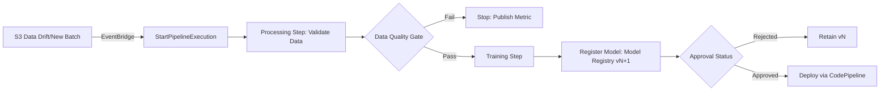
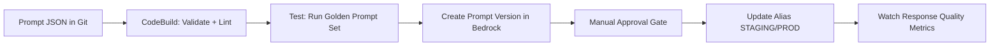

# Skill 3.1.1: Select appropriate compute environments and deployment targets.

## Task 3.1: Manage deployment infrastructure for ML and AI model types

---

## Core Decision Drivers

- **Who is waiting for the answer?** The single most decisive question. If a user/process is blocked → synchronous options. If not → asynchronous/batch options.
- **How fast they need it:** Strict latency budgets eliminate cold-start-prone options.
- **How data arrives:** Pre-assembled bulk dataset vs. individual dynamic requests vs. streaming.
- **Payload size / processing time:** Exceeds real-time limits → asynchronous or batch.
- **Control vs. managed posture:** Determines managed API vs. self-hosted endpoint vs. container/EC2.

---

## SageMaker Inference Options — Decision Matrix

| Option | Traffic Pattern | Max Payload / Timeout | Scaling to Zero | Key Limitation |
|---|---|---|---|---|
| **Real-Time Endpoint** | Steady or spiky, strict latency (ms–seconds) | 6 MB / 60 s | Requires Inference Components + custom policy; requests **fail** during scale-out from zero | Always-on cost unless auto-scaled aggressively |
| **Serverless Endpoint** | Intermittent, true idle gaps, tolerates cold starts | 4 MB / 60 s | Automatic | **No** VPC, **no** accelerated instances, **no** multi-model, cold-start latency |
| **Asynchronous Endpoint** | Large payloads (up to 1 GB), long processing (up to 1 hr), queued requests | 1 GB / 15–60 min | Automatic (queue holds work) | Requires S3 output + optional SNS notification |
| **Batch Transform** | Pre-assembled bulk dataset, scheduled/offline | Dataset in S3 | Compute spins up, runs, releases | No endpoint; cannot serve dynamic requests |

> **Exam Gotcha:** Real-time scale-in-to-zero is **not** a single toggle. It requires **Inference Components** + autoscaling policy on the `NoCapacityInvocation` metric. Requests arriving during zero-capacity window return errors — so do **not** pair scale-to-zero with latency-critical traffic.

---

## Endpoint Packing Strategies

| Strategy | Assumption | Best For | Penalty / Risk |
|---|---|---|---|
| **Single-Model Endpoint** | One model, one endpoint | High throughput, tight latency SLA | Idle cost if underutilized |
| **Multi-Model Endpoint (MME)** | Same framework, shared serving container | Hundreds of small models, uneven traffic | Cold-load penalty on first invocation of rarely used models |
| **Multi-Container Endpoint (MCE)** | Different containers/frameworks, up to 15 containers | Inference pipelines (sequential containers) or direct container invocation | Shared fleet limits across containers |

---

## Foundation Model Deployment Options

| Option | Capacity Model | Where Custom Models Run | Key Constraint |
|---|---|---|---|
| **Bedrock On-Demand** | Pay-per-token, no reservation | Base models + Custom Model Import | May throttle under heavy load |
| **Bedrock Provisioned Throughput** | Reserved Model Units (MUs) | Base models + models fine-tuned **inside Bedrock** | Required for Bedrock-customized models; cost commitment |
| **Bedrock Custom Model Import** | On-demand only | External open-weight models (Llama, Mistral, etc.) from S3 | Architecture must be supported; served via `InvokeModel`/`Converse` API |
| **SageMaker Self-Hosted** | Instance-based | Any model | Full control over accelerator, instance, scaling policy; full operational burden |

> **Exam Gotcha:** A model fine-tuned **inside** Bedrock **must** be served via Provisioned Throughput. A model imported via **Custom Model Import** is invoked **on-demand**. Two different custom-model paths with different operating postures.

---

## Self-Hosted / Container Options

| Option | Use When | Trade-off |
|---|---|---|
| **Amazon ECS** | Long-lived container inference, simpler than Kubernetes | Less ecosystem portability |
| **Amazon EKS** | Existing Kubernetes manifests/controllers, multi-cluster Portability | More control plane overhead |
| **Amazon EC2 directly** | Need OS-level control, custom drivers, or non-containerized inference | Full operational responsibility |
| **AWS Lambda** | Lightweight inference or orchestration glue (invoking endpoints, pipeline reactions) | 10 GB memory / 15 min timeout / deployment package limits |

---

## RAG & Agent Configuration Levers

| Lever | Fixes | Limitation |
|---|---|---|
| **Raise top_k / retrieved passages** | Low recall | Adds irrelevant text to prompt; may dilute model focus |
| **Hybrid search (BM25 + vector)** | Exact keyword terms embeddings miss | Requires vector store with filterable text field; not universally available |
| **Metadata filters** | Stale / out-of-scope documents surfacing | Cuts candidate set **before** similarity search — correct tool for pre-filtering |
| **Reranking model** | Correct passage retrieved but ranked low | **Ordering fix only** — cannot recover a passage never retrieved in pass 1 |
| **Query decomposition** | Compound questions spanning multiple topics | Each sub-query retrieves against its own domain |

> **Exam Gotcha:** Reranking improves **ordering**, not **recall**. If the right passage never made it into the initial vector search results, adding a reranker changes nothing. Use metadata filters or hybrid search to fix retrieval breadth.

---

## Security & Compliance (Applicable Across Targets)

- **IAM roles:** Inference endpoints assume an execution role; Bedrock uses caller identity (`InvokeModel` / `Converse` permissions).
- **KMS encryption:** SageMaker endpoints support encrypted EBS volumes; Bedrock encrypts at rest by default; S3 inputs/outputs for Batch Transform and Asynchronous Inference require explicit KMS policies for cross-account access.
- **VPC configuration:** Real-time and asynchronous endpoints support VPC isolation; **serverless endpoints do not**; Bedrock is API-only (VPC via interface endpoints).
- **Custom Model Import:** Models read from S3 must be in one of the supported open-weight architectures; file layout must match expected format before migration planning.

---

## Anti-Patterns & Distractor Traps

- **Choosing serverless for steady traffic** because "no instance management sounds good" → cold starts and higher per-invocation cost.
- **Choosing batch transform for individual dynamic requests** → batch processes pre-assembled static data only.
- **Choosing real-time for multi-minute processing** → 60-second timeout guarantees failure.
- **Assuming multi-model endpoints handle different frameworks** → they require a shared serving container; use MCE instead.
- **Importing a custom model architecture Bedrock doesn't support** → verify supported architectures before planning a migration.
- **Using a reranker to fix poor retrieval** → reranking reorders existing candidates, doesn't expand the candidate set.

---

# Skill 3.1.2: Select deployment orchestrators and multi-model or multi-container deployment strategies.

## Task 3.1: Deployment and Orchestration of ML and AI Workflows - Manage deployment infrastructure for ML and AI model types.

---

### Core Concept & Business Objective

**Primary Goal:** Choose the correct compute orchestrator and endpoint "packing" strategy so multiple models share infrastructure without violating latency, cost, or framework constraints.

**The Orchestrator Decision:** Determine what "control plane" should manage model containers.
*   **AWS-native ML pipeline:** Use **Amazon SageMaker AI** hosting options (managed endpoints, batch, async).
*   **Existing container scheduler:** Use **Amazon ECS** when the org runs simple, long-lived container services without needing Kubernetes-specific features.
*   **Existing Kubernetes manifests/controllers:** Use **Amazon EKS** when the team's deployment workflow is already Kubernetes-native.
*   **Serverless compute glue:** Use **AWS Lambda** for lightweight inference or event-driven orchestration (invoking endpoints, reacting to pipelines)—not for large model hosting.

---

### Endpoint Packing Strategies: Decision Matrix

The exam asks you to distinguish between hosting models **alone**, **together**, or **in a sequence**.

| Strategy | Assumption | Invocation Method | Best Use Case | Key Trade-off / Anti-pattern |
| :--- | :--- | :--- | :--- | :--- |
| **Single-Model Endpoint (SME)** | One dedicated fleet for one model. | Direct invoke to endpoint. | **High throughput**, **strict latency** SLAs, or critical isolation needs. | Highest cost if the model is small or underutilized. Do not pack a mission-critical model with "noisy neighbors." |
| **Multi-Model Endpoint (MME)** | **Same serving container/framework** for all models (e.g., PyTorch, TensorFlow). | `TargetModel` parameter specifies model artifact in S3. | **Hundreds/thousands of small models** sharing compute to save cost; models have uneven traffic. | **Cold-start/load penalty** on first invocation of a rarely-used model (dynamically loaded into memory). Requires same framework. |
| **Multi-Container Endpoint (MCE)** | Different containers (frameworks or custom logic). | **Inference Pipeline:** Sequential data flow (`A → B`). **Direct Invocation:** Invoke containers directly on one endpoint. | **Inference pipelines** (preprocessing → model → post-processing) or mixing frameworks. | Max 15 containers. Not for scaling hundreds of small models. |
| **Isolated Endpoints** | One container per model, but running on shared hardware via **Inference Components**. | Direct invoke to unique endpoint URL. | When MMEs are not flexible enough (different frameworks) but you still want to share raw compute to save cost. | Requires managing dynamic scaling per model component. |

> **Exam Gotcha:** MMEs assume a **shared framework**. If models use different stacks, MCEs or Inference Components are required. Do not select MMEs solely to save money if the models don't share the serving container.

### Orchestration & Deployment Trade-offs

| Orchestrator | Managed Level | Use When | Avoid When |
| :--- | :--- | :--- | :--- |
| **SageMaker AI** | Fully managed ML hosting. | Standard model serving, pipelines, batch/real-time inference. | You need raw OS-level control or non-standard container orchestration. |
| **ECS (Fargate)** | Managed containers (tasks). | The app is a simple long-running container service; team knows Docker but not K8s. | You need K8s-specific features (CRDs, Operators, Istio). |
| **EKS** | Managed Kubernetes control plane. | You must migrate existing K8s manifests/Helm charts or use K8s-native tooling (KFServing, Seldon). | The team doesn't need K8s; imposes significant operational overhead. |
| **EC2 (Self-managed)** | Unmanaged. | Need deep hardware control (GPU drivers, custom kernels) denied by managed services. | Default choice; do not choose EC2 without a specific hardware/software constraint. |

> **Exam Gotcha: Anti-pattern:** Proposing EKS for a simple inference task is a trap answer. Use EKS only when the scenario screams "Kubernetes-native workflows" or "lift-and-shift existing K8s."

### Key API & SDK Nuances (Boto3)

*   **CreateMultiModelEndpoint:**
    *   `TargetModel`: The S3 path to the model artifact (e.g., `s3://bucket/model_path`).
    *   `ModelDataDownloadTimeoutInSeconds`: Controls wait time for downloading model to the instance.
*   **CreateModel (for MCE):**
    *   `InferenceExecutionConfig.Mode`: Set to `Serial` for inference pipelines (containers run in order).
    *   `Containers`: List of container definitions (up to 15).
*   **UpdateEndpoint / CreateEndpoint:**
    *   Splitting traffic between variants is done via `ProductionVariants` with `InitialVariantWeight`.
*   **KMS Encryption:**
    *   Set `KmsKeyId` on the Endpoint Config to encrypt the **EBS volume** where the model is downloaded (rest).
    *   In-transit encryption defaults to HTTPS for SageMaker endpoints.

### Security & Compliance (IAM / VPC)

*   **IAM Execution Role:** Must allow `s3:GetObject` on the specific bucket holding model artifacts (for MMEs, this is critical).
*   **VPC Configuration:** Real-time endpoints can be placed in a private VPC (via `VpcConfig`) to secure network traffic.
    *   **Distractor:** Serverless endpoints and Batch Transform jobs often do *not* support direct VPC placement in older configurations—check feature availability.
*   **Encryption:** Models loaded from S3 via MMEs require S3-SSE-KMS permission if the bucket uses KMS keys.

### Multi-Model vs. Multi-Container Summaries

**Multi-Model (MME):**
*   **Memory Management:** SageMaker AI loads/unloads artifacts dynamically from S3.
*   **Cost Efficiency:** Minimizes instance count, maximizing resource utilization.
*   **Framework constraint:** Must use the same inference framework.

**Multi-Container (MCE):**
*   **Cost Efficiency:** Shares a single endpoint across different containers.
*   **Sequence/Pipeline:** Allows data preprocessing (e.g., image resizing) before model inference.
*   **Limit:** Hard cap of 15 containers per model.

---

# Skill 3.1.3: Select Model Inference Strategies

## Task 3.1: Deployment and Orchestration of ML and AI Workflows - Manage deployment infrastructure

---

## Decision Drivers (Ask First)

| Signal | Question |
| --- | --- |
| **Who is waiting?** | Is a user/downstream service blocked on the response? |
| **Latency budget** | Milliseconds vs. seconds vs. minutes vs. hours? |
| **Data arrival pattern** | Steady stream vs. spiky/intermittent vs. bulk scheduled vs. queued single requests? |
| **Payload size** | Under 6 MB (real-time/serverless) vs. up to 1 GB (async)? |
| **Processing duration** | Under 60s (real-time/serverless) vs. up to 1 hour (async)? |

> **Exam Gotcha:** The 60-second synchronous timeout is a hard limit for real-time and serverless endpoints. Any workload exceeding it must use async or batch.

---

## Core Strategy Matrix

| Strategy | Traffic Pattern | Latency Budget | Key Characteristics | Scaling Behavior |
| --- | --- | --- | --- | --- |
| **Real-Time Endpoint** | Continuous or spiky, no true idle gaps | Milliseconds to <60s | Warm instances; caller blocked waiting | Auto Scaling on invocation metrics; can scale-in to zero (with inference components) |
| **Serverless Inference** | Intermittent; long idle periods | Seconds (cold start possible) | No instance management; pay per execution | Automatic scale-to-zero; cold starts after idle (~1–5s+) |
| **Asynchronous Inference** | Dynamic single requests; large payloads | Minutes to 1 hour | Queued processing; caller unblocked (HTTP 202) | Managed queue; scale instances to zero when queue empty |
| **Batch Transform** | Pre-assembled dataset; scheduled | Completion deadline (hours) | Offline bulk processing; S3 input/output | Provisioned per job; release all compute on completion |

---

## Selection Rules

- **Real-Time Endpoint:** Steady traffic + strict ms-level latency + availability requirement. Use auto scaling on `SageMakerVariantInvocationsPerInstance`. Never choose serverless when payment-critical or latency-intolerant.
- **Serverless Inference:** Bursty traffic + genuine idle stretches + cold-start tolerance + zero infra management. Ideal for dev/test, prototypes, sporadic internal APIs.
- **Asynchronous Inference:** Single requests arriving dynamically + minute-level processing + caller polls or SNS notified later. Handles payloads up to 1 GB.
- **Batch Transform:** Fixed dataset on schedule + no caller + results to S3 + pay only during job. Trigger via cron, Step Functions, EventBridge.

> **Exam Gotcha:** Real-time endpoint scale-in to zero requires **inference components** + a policy reacting to the no-capacity metric. It is NOT a single toggle. Requests during the provisioning window **fail**, not queue.

---

## Anti-Patterns (Common Distractors)

| Bad Choice | Why It Fails |
| --- | --- |
| Serverless for fraud/transactional scoring | Cold starts violate strict latency budgets |
| Batch for dynamic incoming requests | Batch expects pre-assembled bulk data, not per-request arrival |
| Real-time for multi-minute tasks | 60-second timeout kills the request |
| Async for synchronous | Adds queue latency that breaks a user-facing flow |

---

## Endpoint Type Cross-Comparison (Deployment Packaging)

| Endpoint Type | Models Sharing | Framework Requirement | Routing Mechanism | Use Case |
| --- | --- | --- | --- | --- |
| **Single-Model** | 1 model | Any | Direct invocation | Dedicated latency/throughput needs |
| **Multi-Model (MME)** | Up to thousands | Same framework, same serving container | `TargetModel` parameter in request | Many small models + uneven traffic; will accept cold-load penalty |
| **Multi-Container (MCE)** | Up to 15 containers | Different frameworks per container | Sequential pipeline OR direct by container name | Inference pipelines, ensemble preprocessing |

---

## Capacity & Configuration Nuances

| Feature | Real-Time | Serverless | Asynchronous | Batch |
| --- | --- | --- | --- | --- |
| **Max timeout** | 60s | 60s | 60 min | None (job-level) |
| **Max payload** | 6 MB | 4 MB (request), 6 MB (response) | 1 GB | Large (S3 bound) |
| **VPC support** | Yes | **No** | Yes | Yes (job) |
| **Accelerated instances** | Yes | **No** | Yes | Yes |
| **Multi-model** | Yes | **No** | Yes | N/A |
| **Scale to zero** | Via inference components | Automatic | Yes | Automatic (job ends) |

> **Exam Gotcha:** Serverless endpoints **disqualify** any requirement for VPC, GPUs/accelerators, or multi-model hosting. If any of those appear in the prompt, eliminate serverless immediately.

---

## Orchestration & Integration Patterns

- **Step Functions:** Orchestrate batch transform with upstream preprocessing/downstream evaluation.
- **EventBridge Scheduler:** Trigger nightly batch transforms or async endpoint warming.
- **SNS topics:** Async inference completion notifications; used to notify downstream workers.
- **S3 event notifications:** Trigger batch/inference pipelines when data lands in a bucket.
- **Lambda:** Lightweight glue invoking endpoints; NOT for multi-minute model inference (fit for <15 min Lambda limit, though typically for simple orchestrations).

---

## Boto3 / CLI Parameters (High-Yield)

| Parameter | Real-Time | Serverless | Async | Batch |
| --- | --- | --- | --- | --- |
| `CreateEndpointConfig` | Required | Required (with `ServerlessConfig`) | Required (with `AsyncInferenceConfig`) | Not used |
| `InvokeEndpoint` | Synchronous | Synchronous | Returns 202 with `InferenceId` | N/A |
| `TargetModel` | MME only | **Not supported** | MME supported | N/A |
| `MaxConcurrency` | N/A | Yes | N/A | Yes (`MaxConcurrentTransforms`) |
| `SnsErrorTopic` | No | No | Yes (failure notification) | Yes (job status) |
| `OutputLocation` | N/A | N/A | Yes (S3 output) | Yes (S3 output) |

---

## Foundation Model Deployment (Special Cases)

| Option | Capacity Model | Customization Path | Self-Hosting? |
| --- | --- | --- | --- |
| **Bedrock On-Demand** | Pay per token | Base models only | No |
| **Bedrock Provisioned Throughput** | Reserved model units | Base OR Bedrock-customized fine-tuned models | No |
| **Bedrock Custom Model Import** | On-demand invocation | External fine-tuned open-weight models (Llama, Mistral, etc.) | No |
| **SageMaker JumpStart** | Self-hosted endpoint | Pretrained models deployable to configurable endpoints | Yes |
| **SageMaker Real-Time (custom FM)** | Self-hosted with accelerators | Full control | Yes |

> **Exam Gotcha:** Models fine-tuned inside Bedrock require **Provisioned Throughput**. Models customized externally and brought via **Custom Model Import** are invoked **on-demand**. This distinction is a frequent tripping point.

---

## Decision Trips & Distractors

| Trap | Correct Reasoning |
| --- | --- |
| "Spiky traffic" → choose Serverless? | Only if idle gaps exist. Continuous spiky traffic = Real-Time auto scaling. |
| "No one waiting" → always Batch? | If individual requests arrive dynamically, async is correct. |
| "Scales to zero" → Serverless? | Async has scale-to-zero too. Real-time can with inference components. |
| "Custom model + managed API" → Bedrock? | Only if supported architecture. Otherwise SageMaker endpoint. |
| "MME for different frameworks" → Correct? | No. MME requires same framework/container. Use MCE. |

---

## RAG/Agent Deployment Considerations

- **Bedrock Knowledge Bases:** Managed retrieval, no self-hosted vector store required unless custom.
- **Reranking:** Improves ordering of already-retrieved passages; does not improve recall.
- **Hybrid search:** Adds keyword (`BM25`) to vector match; requires filterable text field in vector store.
- **Metadata filtering:** Cuts candidate set BEFORE similarity search; use for stale/out-of-scope documents.

---

# Skill 3.1.4: Evaluate and Select Appropriate Foundation Model (FM) Deployment Options

## Task 3.1: Deployment and Orchestration of ML and AI Workflows - Manage deployment infrastructure for ML and AI model types

---

## Core Decision Framework

**Primary Question:** Managed API vs. Self-Hosted Endpoint?

| Signal | Managed FM API (Bedrock) | Self-Hosted (SageMaker/ECS/EKS) |
| --- | --- | --- |
| Instance/endpoint management | None | You size, scale, patch |
| Capacity model | On-demand or Provisioned Throughput | Instance count + Auto Scaling |
| Model customization | In-service fine-tuning or Custom Model Import | Full control (any framework/format) |
| Accel

---

# Skill 3.1.5: Deploy models that were built outside of AWS into AWS environments (for example, Amazon SageMaker AI, Amazon Bedrock Custom Model Import)

## Task 3.1: Deployment and Orchestration of ML and AI Workflows - Manage deployment infrastructure for ML and AI model types

---

## Core Objective & Decision Framework

**Primary capability:** Bring externally trained models (on-prem, EC2, Colab, other clouds) into AWS managed hosting without retraining.

| Signal | Points To |
| --- | --- |
| External open-weight FM (Llama, Mistral, Mixtral) → managed API | **Bedrock Custom Model Import** |
| External custom traditional ML model → managed endpoint | **SageMaker AI hosting** (real-time, serverless, async, batch) |
| External model needs full control (framework, container, accelerator) | **SageMaker BYOC** (Bring Your Own Container) |
| External model formatted for specific serving stack | **SageMaker with inference toolkit** (via `inference.py` + `model.tar.gz`) |

---

## Amazon Bedrock Custom Model Import — Critical Path

### Supported Architectures
| Family | Key Models |
| --- | --- |
| Llama | Llama 3.2 (1B–90B), Llama 3.1 variants |
| Mistral | Mistral 7B, Mixtral 8x7B |
| Others | Flan-T5, other supported open-weight architectures |

> **Hard rule:** Only certain open-weight architectures and file formats are accepted. Confirm architecture compatibility **before** planning migration — unsupported architectures are rejected at import time.

### Import Mechanics (API/CLI)

| Action | API / CLI |
| --- | --- |
| Create import job | `create-model-import-job` / `aws bedrock create-model-import-job` |
| Required inputs | `modelName`, `roleArn`, `modelDataSource` (S3 URI), `jobName` |
| S3 format | Must contain `.safetensors` or supported checkpoint formats + config/tokenizer files |
| Async operation | Returns `arn` for imported model; poll `get-model-import-job` |

**Boto3 snippet:**
```python
import boto3
bedrock = boto3.client("bedrock")

resp = bedrock.create_model_import_job(
    jobName="llama-custom-import",
    modelName="my-finetuned-llama-7b",
    roleArn="arn:aws:iam::123456789012:role/BedrockImportRole",
    modelDataSource={"s3DataSource": {"s3Uri": "s3://my-bucket/model-weights/"}}
)
```

### Invocation After Import

| Capacity Mode | Invocation API |
| --- | --- |
| **On-demand** | `invoke_model` or `converse` — pay per token |
| **Provisioned Throughput** | Create PT, then `invoke_model` against PT ARN |

> **Exam Gotcha:** Imported models are invoked **on-demand** by default. Models fine-tuned **inside Bedrock** require **Provisioned Throughput**. This is a key operating posture difference — do not confuse the two paths.

### IAM Requirements
- **Import role** needs `s3:GetObject` on source bucket
- **Invocation role** needs `bedrock:InvokeModel` on imported model ARN
- **S3 bucket policy**: allow `bedrock.amazonaws.com` access if bucket is restricted

### Trade-offs

| Aspect | Bedrock Custom Model Import | SageMaker BYOC |
| --- | --- | --- |
| Infrastructure management | None (serverless API) | User manages endpoint, instances, scaling |
| Capacity control | On-demand + PT model units | Instance types, counts, auto scaling policies |
| Accelerator choice | Abstracted entirely | Explicit (`g5`, `p4d`, `inf2`, etc.) |
| Model architecture restriction | Strict allow-list | Any model that fits in container |
| Cold start / scaling | Managed, no visible instances | User-managed, `MinCapacity` controls warm pool |

---

## SageMaker AI for External Models

### Deployment Paths

| Path | What It Supports | External Model Fit |
| --- | --- | --- |
| **Script Mode** | Framework containers + `inference.py` | PyTorch, TensorFlow, XGBoost, SKLearn models saved externally |
| **BYOC (Build Your Own Container)** | Full custom Docker image | Any runtime, pre/post processing, custom serving stacks |
| **JumpStart Deploy** | Prebuilt templates | Not applicable for external custom models |
| **Multi-Model Endpoint** | Many models sharing one container | External models that share same framework + I/O contract |

### Script Mode Artifact Layout

```
model.tar.gz
├── code/
│   └── inference.py          # model_fn(), input_fn(), predict_fn(), output_fn()
└── model/                     # Optional; or weights loaded from S3 via model_fn
    └── trained_model.pth
```

### Key `inference.py` Hooks

| Hook | Purpose | External Model Relevance |
| --- | --- | --- |
| `model_fn(model_dir)` | Load model from artifact dir or S3 | Critical — load external serialized model |
| `input_fn(request_body, content_type)` | Deserialize input payload | Map external model's expected input format |
| `predict_fn(input_data, model)` | Run inference | Core external model forward pass |
| `output_fn(prediction, accept)` | Serialize response | Match downstream consumer expectations |

### BYOC Container Requirements

| Requirement | Detail |
| --- | --- |
| **Port** | Must listen on `8080` for `invocations` and `ping` |
| **Health check** | `GET /ping` returns `200 OK` |
| **Inference** | `POST /invocations` handles request body |
| **Registry** | Push to Amazon ECR in same region/account as endpoint |
| **Multi-container** | Up to **15 containers** per endpoint (inference pipeline or direct invoke) |

---

## Security & Compliance for Imported/Hosted Models

| Control | SageMaker Hosting | Bedrock Custom Model Import |
| --- | --- | --- |
| **Encryption at rest** | KMS key on S3 artifacts, EBS volumes, ECR images | KMS key on S3 source bucket (model weights) |
| **Encryption in transit** | TLS 1.2+ by default | TLS via `InvokeModel` API |
| **Network isolation** | VPC endpoints (PrivateLink) for SageMaker API + runtime | Interface VPC endpoint for Bedrock (no SageMaker runtime VPC endpoint) |
| **IAM scoping** | `sagemaker:InvokeEndpoint` on endpoint ARN | `bedrock:InvokeModel` on imported model ARN |
| **Model artifact integrity** | Version control via `register_model` + `approve_model` | No model registry — version by import job name |

> **Exam Gotcha:** SageMaker **serverless endpoints do not support VPC configuration**. If a requirement names VPC isolation, serverless is ruled out. Real-time endpoints with VPC config use **network interfaces** in your VPC.

---

## Decision Matrix: External Model → AWS Hosting

| Requirement | Best Choice | Why |
| --- | --- | --- |
| Supported open-weight FM, no endpoint management | **Bedrock Custom Model Import** | Serverless API, token-based billing |
| Unsupported architecture (e.g., custom CNN, proprietary model) | **SageMaker Script Mode or BYOC** | Full flexibility |
| Multiple external small models, same framework, uneven traffic | **Multi-Model Endpoint** | Cost-efficient, `TargetModel` parameter switches artifacts |
| Different serving stacks per model (e.g., one PyTorch, one custom) | **Multi-Container Endpoint** | Up to 15 containers, direct invoke or pipeline |
| Large payloads or long processing (external model) | **Asynchronous Inference** | Queue-based, S3 output, no caller blocking |
| Batch dataset from external source | **Batch Transform** | Processes S3 data directly, no endpoint idle cost |
| FM customized externally, want Bedrock tools (Agents, KBs) | **Bedrock Custom Model Import** | Integrates with Bedrock ecosystem |

---

## Common Distractor Traps

| Anti-Pattern | Why It Fails |
| --- | --- |
| Choosing **SageMaker MME** for models with different frameworks | MME requires shared serving container — one framework only |
| Choosing **Bedrock Custom Import** for a Scikit-learn model | Bedrock only accepts supported open-weight FMs |
| Choosing **Provisioned Throughput** for an imported model when on-demand would work | Imported models default to on-demand; PT is optional, not required |
| Choosing **JumpStart** for an externally fine-tuned model | JumpStart serves pretrained catalog models, not custom imports |
| Choosing **Lambda** for heavy FM inference | Lambda has size/time limits (10 GB / 15 min) — not suitable for most FM serving |
| Assuming **SageMaker serverless** supports custom containers | Serverless only supports **script mode** and select framework containers, not BYOC |

---

## Quick Recall — Artifact Transfer Paths

```text
External Training → Save Model
    ├─ Open-weight FM + S3 → Bedrock import job → On-demand or PT invoke
    ├─ PyTorch/TF/SKLearn → model.tar.gz + inference.py → SageMaker Script Mode
    └─ Any framework/storage → Docker image → ECR → SageMaker BYOC
```

**Key API calls:** `create_model_import_job` (Bedrock) | `create_model`, `create_endpoint_config`, `create_endpoint` (SageMaker) | `update_endpoint` for model rotation

---

# Skill 3.1.6: Deploy and Configure Agents for Specific Tasks, Integration with Other Services and Tools, and Agent Communication Protocols

## Task 3.1: Deployment and Orchestration of ML and AI Workflows - Manage Deployment Infrastructure

---

### Core Concept & Business Objective

**Agent deployment** extends FM inference by giving models the ability to take actions: calling tools, querying data sources, and executing multi-step workflows. The objective is selecting the right agent runtime, tool integration method, and communication protocol to enable production-grade, observable, and secure agent orchestration.

| AWS Service | Agent Role | Key Capability |
|-------------|-----------|----------------|
| **Amazon Bedrock AgentCore** | Production agent runtime | Serverless execution, memory, gateways, observability |
| **Amazon Bedrock Agents** | Managed agent creation | Orchestration, action groups, knowledge base integration |
| **Lambda-based agents** | Custom agent logic | Full control, no managed runtime |
| **SageMaker AI + Agent** | Model-hosted agent | Custom agent deployed on managed endpoint |

---

### Agent Deployment Decisions

#### When to Use Bedrock AgentCore vs. Custom Agent

| Requirement | Bedrock AgentCore | Custom (Lambda/ECS/EKS) |
|------------|-------------------|------------------------|
| **Time to production** | Fast (serverless runtime) | Slower (build runtime) |
| **Managed memory/state** | Built-in | Must implement (DynamoDB, ElastiCache) |
| **Tool integration** | Gateway with MCP support | Custom HTTP/gRPC handlers |
| **Observability** | Built-in tracing | CloudWatch + custom telemetry |
| **Control over runtime** | Limited | Full |

> **Exam Gotcha:** Bedrock AgentCore is the correct answer for production agents needing managed memory, identity, and observability. Lambda is correct when the agent logic is simple or requires direct access to AWS services without the agent orchestration layer.

---

### Agent Communication Protocols

| Protocol | Use Case | AWS Integration |
|----------|----------|-----------------|
| **Model Context Protocol (MCP)** | Open standard for LLM-to-tool communication | Bedrock AgentCore Gateway exposes MCP |
| **OpenAPI/Swagger** | REST API definition for action groups | Bedrock Agents action groups |
| **Function Calling (ReAct)** | Model-native tool invocation | Bedrock Converse API |
| **LangGraph/State Graph** | Complex agent workflows with state | Custom Lambda/ECS deployment |

#### MCP Protocol Architecture

```
LLM ‹──MCP──› MCP Server ‹──› Tools/APIs
                (Gateway)
                
Bedrock AgentCore Gateway:
- Exposes existing APIs as tools via MCP
- Handles authentication (IAM, OAuth)
- Provides request/response routing
```

> **Exam Gotcha:** MCP is the emerging standard for agent-tool communication. If a scenario mentions "open agent protocol" or "Model Context Protocol," Bedrock AgentCore Gateway is the expected answer—not a custom integration.

---

### Tool Integration Patterns

| Pattern | When to Use | AWS Implementation |
|---------|-------------|-------------------|
| **Action Groups** | Lambda-backed tools defined in Bedrock | Bedrock Agents + Lambda |
| **Gateway Tools** | Existing APIs exposed as tools | Bedrock AgentCore Gateway |
| **Knowledge Base** | Document retrieval as a tool | Bedrock Knowledge Bases |
| **Code Interpreter** | Sandboxed code execution | Bedrock Agents built-in |

#### Action Group Configuration (Boto3)

```python
import boto3
bedrock = boto3.client('bedrock-agent')

response = bedrock.create_agent_action_group(
    agentId='agent-id',
    agentVersion='DRAFT',
    actionGroupName='fraud-check-tools',
    actionGroupExecutor={
        'lambda': 'arn:aws:lambda:us-east-1:123456789012:function:fraud-tools'
    },
    apiSchema={
        's3': {
            's3BucketName': 'agent-schemas',
            's3ObjectKey': 'fraud-api-schema.json'  # OpenAPI spec
        }
    }
)
```

---

### Agent Identity & Security

| Security Layer | Configuration | Exam Relevance |
|---------------|--------------|----------------|
| **Agent IAM Role** | Scoped permissions for tools/invocations | Must be least-privilege per tool |
| **Tool Authentication** | OAuth, API keys, IAM | Gateway handles credential exchange |
| **VPC Endpoints** | Bedrock/AgentCore private access | VPC + Interface Endpoint |
| **KMS Encryption** | Agent memory, session data | CMK for regulatory compliance |

> **Hard Rule:** Agent identity is separate from user identity. The agent's IAM role governs what tools it can call—not the end user's permissions. Misconfiguring this role is a common security anti-pattern (agent privilege escalation).

---

### Agent Memory & State Management

| Memory Type | Bedrock AgentCore | Custom Implementation |
|------------|-------------------|----------------------|
| **Session State** | Built-in (conversation context) | DynamoDB keyed by session ID |
| **Long-term Memory** | Managed memory service | ElastiCache, DynamoDB |
| **Working Memory** | In-context (prompt) | Lambda environment (ephemeral) |

> **Exam Gotcha:** Agent memory in Bedrock AgentCore persists across turns within a session automatically. Custom implementations must explicitly persist state to DynamoDB. If a scenario requires "stateful conversations" without custom code, AgentCore is the answer.

---

### Anti-Patterns & Common Traps

| Anti-Pattern | Why It Fails | Correct Approach |
|-------------|--------------|-----------------|
| **Using Lambda for complex multi-step agents** | No managed state, memory, or observability | Bedrock AgentCore |
| **Exposing tools without authentication** | Security breach; agent can call anything | Gateway with OAuth/IAM |
| **Ignoring observability** | Cannot debug agent failures in production | AgentCore built-in tracing, CloudWatch |
| **Hard-coding tool schemas** | Breaks when APIs change | OpenAPI schema in S3 |
| **Agent without knowledge base** | Model relies on static training knowledge | Integrate Bedrock Knowledge Bases |

---

### Key CLI/SDK Commands

```bash
# Create a Bedrock Agent
aws bedrock-agent create-agent \
  --agent-name fraud-agent \
  --foundation-model anthropic.claude-v2 \
  --agent-resource-role-arn arn:aws:iam::123456789012:role/agent-role

# Create a Gateway (MCP endpoint)
aws bedrock-agent create-gateway \
  --gateway-name api-gateway \
  --protocol mcp \
  --auth-type oauth

# List agent action groups
aws bedrock-agent list-agent-action-groups \
  --agent-id agent-id \
  --agent-version DRAFT
```

---

### Multi-Agent Orchestration

| Approach | When to Use | AWS Service |
|----------|------------|-------------|
| **Supervisor Pattern** | One agent routes to specialty agents | Custom (Bedrock + Lambda) |
| **Swarm/Collaborative** | Agents negotiate tasks | Custom (LangGraph, AWS Step Functions) |
| **Sequential Pipeline** | Fixed order of agent steps | Step Functions + Bedrock |
| **Hierarchical** | Agents with sub-agents for domain tasks | Bedrock AgentCore + custom logic |

> **Exam Gotcha:** For multi-agent workflows, Step Functions is the preferred orchestration service when the workflow is deterministic. LangGraph or custom orchestration is for dynamic, LLM-decided routing. Bedrock AgentCore supports multi-agent via routing but is not a general-purpose workflow engine.

---

### Monitoring & Observability

| Metric/Signal | Purpose | AWS Service |
|---------------|---------|-------------|
| **Agent invocation latency** | SLA tracking | CloudWatch Metrics |
| **Tool call success rate** | Identify failing integrations | CloudWatch Logs |
| **Token usage** | Cost tracking | CloudWatch + Cost Explorer |
| **Session state errors** | Debug memory failures | CloudWatch Logs + X-Ray |
| **Trace propagation** | End-to-end debugging | AWS X-Ray (built into AgentCore) |

---

### Rapid Decision Matrix

| Scenario Signal | Agent Deployment Choice |
|----------------|------------------------|
| "Serverless runtime" + "memory" + "observability" | Bedrock AgentCore |
| "Existing APIs as tools" + "open protocol" | Bedrock AgentCore Gateway + MCP |
| "Simple single-turn tool call" | Lambda + Bedrock Converse API |
| "Complex deterministic workflow" | Step Functions + Bedrock |
| "Dynamic LLM routing between tools" | Bedrock Agents or LangGraph |
| "Private data access" + "VPC requirement" | VPC endpoint + Bedrock |

---

# Skill 3.1.7: Configure FM Deployment, Model Hosting, and Resource Allocation

## Task 3.1: Deployment and Orchestration of ML and AI Workflows - Manage deployment infrastructure for ML and AI model types

---

### Foundation Model Deployment Decision Matrix

| Deployment Target | Model Source | Capacity Model | Instance Mgmt | Use When |
|---|---|---|---|---|
| **Bedrock On-Demand** | Bedrock base models, Custom Model Import | Pay-per-token, shared capacity | None (fully managed) | Variable traffic, cost-sensitive, no throughput guarantees needed |
| **Bedrock Provisioned Throughput** | Bedrock base models, Bedrock-customized models | Reserved Model Units (MUs) | None | Guaranteed throughput, predictable cost, fine-tuned Bedrock models (required) |
| **Bedrock Custom Model Import** | External open-weight FMs (Llama, Mistral, etc.) via S3 | On-Demand only | None | Bring customized models into managed API without endpoint ops |
| **SageMaker Real-Time Endpoint** | Any model artifact (framework-agnostic) | Instance-based (ML instance types) | You manage (auto scaling available) | Custom ML models needing accelerators, VPC, custom containers |
| **SageMaker JumpStart** | Pre-trained catalog models | Instance-based (preconfigured) | Minimal | Fast deployment of popular OSS models without container config |

> **Exam Gotcha:** Bedrock models customized **inside** Bedrock (fine-tuning) **require** Provisioned Throughput. Models imported via **Custom Model Import** are **On-Demand only**. This asymmetry is a frequent distractor.

---

### Resource Allocation: Bedrock Provisioned Throughput

- **Model Units (MUs):** Measure of throughput capacity (input + output tokens/sec).
- **Purchase Model:** Commit to a term (1 or 6 months) or No-Commitment (hourly, higher price).
- **No scaling to zero:** Reserved throughput persists until explicitly deleted; not auto-scaled.
- **Model Versioning:** PT runs on a specific model version; updating requires re-provisioning or using aliases.

**When to reserve:**
- Hard throughput SLOs
- Foundation model customized in Bedrock (mandatory)
- Fine-tuned models with dedicated capacity requirements

**Anti-pattern:** Using Provisioned Throughput for sporadic/dev workloads where On-Demand suffices — increases cost without latency benefit when traffic is intermittent.

---

### Custom Model Import (Bedrock) — Deployment Constraints

| Requirement | Detail |
|---|---|
| **Supported Architectures** | Llama 3.x, Mistral, Mixtral, Flan-T5, etc. (verify current list) |
| **File Format** | Safetensors (preferred) or PyTorch weights + tokenizer config in S3 |
| **Permission Model** | On-Demand inference only (no Provisioned Throughput) |
| **Invocation** | `InvokeModel` / `Converse` API (same as native Bedrock models) |
| **Size Limits** | Check current size caps per architecture |

> **Exam Gotcha:** Imported models cannot be assigned Provisioned Throughput. If a scenario requires guaranteed throughput for an externally trained model, the solution is **SageMaker real-time endpoint (self-hosted)**, not Bedrock import.

---

### SageMaker Endpoint Packaging: Single vs Multi-Model vs Multi-Container

| Endpoint Type | Assumptions | Scaling Model | Best Fit |
|---|---|---|---|
| **Single-Model Endpoint** | One model, one container | Independent endpoint-level scaling | High-throughput or strict-latency production models |
| **Multi-Model Endpoint (MME)** | Same framework, same serving container; models loaded from S3 on demand | Shared fleet, per-model cached memory | Hundreds/thousands of small models, uneven traffic; accept cold-load penalty on first invocation |
| **Multi-Container Endpoint (MCE)** | Up to 15 containers; different frameworks or serving stacks | Direct invocation by container name OR inference pipeline (sequential) | Different models in one deployable unit; preprocessing + model chains |

> **Exam Gotcha:** MME assumes **same framework** across models. MCE assumes **different containers** may be needed. A model with much higher throughput than peers should be isolated on its own endpoint — sharing a fleet means sharing autoscaling and memory limits.

---

### Resource Allocation for Self-Hosted FMs (SageMaker)

| Consideration | Options | Notes |
|---|---|---|
| **Accelerator Type** | `ml.g5.*` (A10G), `ml.p4d.*` (A100), `ml.p5.*` (H100), `ml.inf2.*` (Inferentia2) | Match accelerator to model size and precision |
| **Instance Right-Sizing** | Start small, measure GPU memory utilization | Model weights + KV cache + batch overhead |
| **Auto Scaling** | Target `SageMakerVariantInvocationsPerInstance` or GPU utilization | Real-time only; serverless scales itself |
| **Inference Components** | Allocate CPU/GPU/memory per model on shared instances | Enables scale-to-zero on real-time endpoints (metric: `NoCapacityInvocationFailures`) |
| **VPC Configuration** | Private connectivity via interface VPC endpoints (`sagemaker.runtime`, `sagemaker.api`) | Serverless does **not** support VPC |

---

### Endpoint Capacity Management — Critical Settings

```
Production Real-Time:
  - min_instance_count: ≥ 2 (high availability)
  - auto_scaling: target on SageMakerVariantInvocationsPerInstance (e.g., 70%)
  - cooldown: 300s
  - instance_type: accelerator-backed for FM/LLM workloads

Scale-to-Zero (Real-Time, complex):
  - Requires: Inference Components + autoscaling policy on NoCapacityInvocationFailures
  - Price: requests fail during scale-up
  - NOT available for serverless (serverless is always scale-to-zero by design)
```

> **Exam Gotcha:** **Serverless endpoints do NOT support:** VPC configuration, accelerated instance types, multi-model hosting, or provisioned concurrency with autoscaling. Any requirement naming these features rules out serverless.

---

### Security & Compliance for FM Deployment

| Layer | Config |
|---|---|
| **IAM Execution Role** | Grants SageMaker/Bedrock access to model artifacts in S3, ECR images, KMS keys |
| **Encryption at Rest** | S3 SSE-KMS for model artifacts; EBS volume encryption (KMS) for endpoint instances |
| **Encryption in Transit** | TLS 1.2+ via AWS API endpoints; VPC interface endpoints for private inference |
| **Bedrock IAM** | `bedrock:InvokeModel`, `bedrock:GetFoundationModel` scoped to model ARNs |
| **Custom Model Import** | S3 bucket accessed by Bedrock service role; cross-account requires bucket policy |
| **VPC Endpoints** | `bedrock`, `bedrock-runtime`, `sagemaker.api`, `sagemaker.runtime` interface endpoints |

**Anti-pattern:** Placing model weights in a public S3 bucket for Custom Model Import — requires customer-managed KMS key and locked-down bucket policy.

---

### FM Hosting Decision Flow

```
                     ┌────────────────────────┐
                     │ Is it a Foundation Model?│
                     └────────────┬───────────┘
                 Yes ────────────┼─────────── No
                  │              │            │
                  ▼              │            ▼
        ┌────────────────┐      │    ┌──────────────────┐
        │ Managed API OK? │      │    │ SageMaker        │
        │ (Bedrock)       │      │    │ Real-Time/       │
        └────────┬───────┘      │    │ Async w/ custom  │
         Yes ────┼────── No     │    │ container        │
          │      │              │    └──────────────────┘
          ▼      ▼              │
     ┌────────┐ ┌────────────┐  │
     │ Bedrock│ │ Customized │  │
     │ Native │ │ internally?│  │
     └────────┘ └──────┬─────┘  │
              Yes ─────┼─── No  │
              │        │        │
              ▼        ▼        │
      ┌───────────┐ ┌────────┐ │
      │ Provisioned│ │Custom  │ │
      │ Throughput│ │Import  │ │
      │ (required)│ │(On-Dmd)│ │
      └───────────┘ └────────┘ │
                               │
              ┌────────────────┘
              ▼
     ┌──────────────────────┐
     │ Self-host (SageMaker)│
     │ Choose accelerator   │
     │ Configure autoscaling│
     └──────────────────────┘
```

---

### Key API References (Boto3)

| Action | API / SDK Call |
|---|---|
| **Bedrock Provisioned Throughput** | `bedrock:CreateProvisionedModelThroughput` → `provisionedModelArn` |
| **Bedrock Custom Model Import** | `bedrock:CreateModelImportJob` with `jobName`, `importedModelName`, `modelSource` (S3 URI) |
| **Bedrock Invoke** | `bedrock-runtime:InvokeModel` with `modelId` (native or imported) |
| **SageMaker Deploy** | `sagemaker:CreateModel` → `sagemaker:CreateEndpointConfig` → `sagemaker:CreateEndpoint` |
| **JumpStart Deploy** | SageMaker SDK: `model.deploy(instance_type=..., initial_instance_count=...)` |
| **Auto Scaling** | `application-autoscaling:RegisterScalableTarget` + `PutScalingPolicy` with `SageMakerVariantInvocationsPerInstance` |

---

### Anti-Patterns & Distractor Traps

- **Bedrock for tabular/structured data:** Bedrock serves text/image FMs only; traditional ML models (XGBoost, neural nets on tabular data) belong on SageMaker endpoints, not Bedrock.
- **Assuming imported models get PT:** They do not. Scenario requiring guaranteed throughput for an externally fine-tuned FM → self-host on SageMaker.
- **Serverless + VPC or Serverless + Multi-model:** Unsupported combinations frequently tested on exam.
- **Real-time + scale-to-zero without Inference Components:** Claims that a real-time endpoint can scale to zero by simply setting `MinInstanceCount=0` are false; requires inference components + specialized autoscaling.
- **JumpStart for custom training:** JumpStart deploys pre-trained models or fine-tunes from catalog; it is not a replacement for custom model hosting in arbitrary frameworks.

---

### Quick Recall Matrix

| Signal | FM Hosting Choice |
|---|---|
| Guaranteed throughput + Bedrock-customized model | **Provisioned Throughput** (mandatory) |
| Variable traffic + supported OSS architecture + no endpoint ops | **Bedrock Custom Model Import** |
| Full infra control + custom container + VPC | **SageMaker Real-Time Endpoint** |
| Rapid deploy of popular model from catalog | **SageMaker JumpStart** |
| GPU cost optimization | **SageMaker + Inference Components** (pack multiple models per GPU) |

---

# Skill 3.1.8: Apply Retrieval Augmented Generation (RAG) System Configurations

## Task 3.1: Deployment and Orchestration of ML and AI Workflows - Manage deployment infrastructure for ML and AI model types

---

### RAG Architecture Core Objective

**Primary Business Goal:** Ground foundation model responses in enterprise-specific, current, or private knowledge without fine-tuning, reducing hallucination while maintaining up-to-date context injection.

> **Exam Gotcha:** RAG does not modify model weights. If a question implies updating the FM itself to incorporate new knowledge, that's fine-tuning (or continued pre-training), not RAG. RAG is an application-layer retrieval pattern.

---

### Retrieval Strategy Configuration Matrix

| Configuration Lever | What It Controls | When to Adjust | Trade-off / Anti-Pattern |
|---|---|---|---|
| **Top-K (`numberOfResults`)** | Number of passages returned from vector store | Increase for broader recall; decrease for tighter focus | More passages = more irrelevant text in prompt = higher cost + diluted context |
| **Vector-only (Semantic) Search** | Embedding similarity match | General-purpose queries; paraphrase-heavy retrieval | Fails on exact terms, acronyms, product codes, or proper nouns |
| **Hybrid Search** (Vector + BM25/Keyword) | Combines embedding similarity with lexical keyword match | Retrieving exact identifiers, legal citations, SKUs | Requires vector DB with filterable text field; not available on all Bedrock-supported stores |
| **Metadata Filtering** | Pre-filters candidates before similarity scoring | Stale documents surfacing; restricting to date ranges, departments, doc types | Applied *before* vector search — if filter is too narrow, correct docs never enter candidate set |
| **Query Decomposition** | Splits compound questions into sub-queries | Multi-topic questions ("Compare Q1 policy vs Q2 policy") | Without decomposition, single embedding query loses one topic |

---

### Reranking: Cross-Encoder Second Pass

**Mechanism:** Bi-encoder (fast) retrieves broad candidate set → Cross-encoder reranker (slower, deeper) re-scores query-candidate pairs → Top-N reordered passages sent to LLM.

| Aspect | Retrieval Only (Bi-Encoder) | With Reranking (Cross-Encoder) |
|---|---|---|
| **Speed** | Fast; nearest-neighbor search | Slower; pair-wise deep semantic scoring |
| **Recall** | High recall, lower precision | Recall unchanged (cannot recover missed docs) |
| **Precision / Ordering** | Distance metric determines order | Reorders to surface true best matches first |
| **Cost** | Single pass | Additional model invocation cost per candidate |

> **Exam Gotcha:** Reranking fixes **ordering** (precision at top), not **recall**. If the correct passage was never retrieved in the first pass, reranking cannot help. To fix recall: increase Top-K, enable hybrid search, or fix metadata filters.

**Bedrock Implementation:** `Amazon Bedrock Knowledge Bases` supports optional reranking with **Amazon Bedrock Rerank model** or **Cohere Rerank** integration.

---

### Amazon Bedrock Knowledge Bases Configuration

**Key Components:**

- **Data Source:** Amazon S3 (primary), plus connectors (Salesforce, SharePoint, Confluence, Web crawler, etc.)
- **Ingestion Pipeline:** Managed chunking + embedding generation → Vector index
- **Vector Store Options:**
  - **Managed:** Amazon OpenSearch Serverless, Amazon Aurora PostgreSQL (pgvector), Amazon Neptune Analytics
  - **External:** Pinecone, Redis Enterprise Cloud, MongoDB Atlas
- **Retrieval API:** `Retrieve` (returns passages) and `RetrieveAndGenerate` (retrieves + calls FM directly)

**Key Boto3/API Parameters:**

| Parameter | Purpose |
|---|---|
| `numberOfResults` | Top-K passages to return |
| `vectorSearchConfiguration.overrideSearchType` | `HYBRID` or `SEMANTIC` |
| `filter` (metadata) | Pre-filter via metadata equality/range operators |
| `rerankConfiguration` | Enable/disable reranking model |
| `bedrockKnowledgeBaseConfiguration.modelArn` | FM used for generation |

---

### Chunking Strategy Impact

| Chunking Approach | Best For | Risk |
|---|---|---|
| **Fixed-size** | Uniform documents; fast ingestion | Splits mid-thought; loses context across boundaries |
| **Semantic / Hierarchical** | Long documents with natural sections | More compute; better context preservation |
| **Sliding window overlap** | Preserving context at boundaries | Redundant embeddings; higher storage cost |
| **No chunking** (whole doc) | Short documents | Long docs produce diluted embeddings |

> **Exam Gotcha:** Chunk size directly affects retrieval quality. Too-large chunks = diluted embeddings and wasted context window. Too-small chunks = fragmented semantics and missed cross-chunk references.

---

### RAG vs. Agentic Patterns

| Pattern | Retrieval Flow | Key Distinguisher |
|---|---|---|
| **Standard RAG** | Single retrieval → Single generation | Fixed pipeline; no iterative search |
| **Agentic RAG** | Agent decides *what/when/how* to retrieve | Tool use; multi-step; may query multiple sources or iterate |
| **Bedrock Agents + Knowledge Bases** | Action groups + KB association | Agent orchestrates; KB is one available tool |

**Bedrock AgentCore:** Serverless runtime, memory, gateway exposing APIs/functions as tools via open protocols (Model Context Protocol - MCP).

---

### Security & Infrastructure for RAG Deployments

- **IAM Roles:** Bedrock Knowledge Bases requires service roles for S3 ingestion, vector store access, and embedding model invocation
- **Encryption at rest:** S3 SSE-S3/SSE-KMS; OpenSearch/KMS; Aurora KMS
- **VPC Integration:** OpenSearch Serverless collections can be configured within VPC; Bedrock endpoints available in-region
- **Cross-service boundaries:** Knowledge base data source must be in same region; external vector stores require internet/VPC connectivity

> **Exam Gotcha:** Bedrock Knowledge Bases manages embeddings automatically during ingestion. You do not pre-embed documents yourself — the service handles chunking, embedding, and indexing via configured models.

---

### Common Distractor Traps

| Incorrect Choice | Why It's Wrong |
|---|---|
| "Fine-tune the FM to add new documents" | Fine-tuning changes weights; RAG injects context at inference without retraining |
| "Increase Top-K to fix ordering" | Increasing Top-K improves recall, not ranking accuracy |
| "Reranking will retrieve missed documents" | Reranking only reorders what retrieval already found |
| "Use semantic search for exact SKU matching" | Semantic search blurs exact terms; hybrid/BM25 is correct |
| "Metadata filters work after vector search" | Filters apply before similarity scoring; they narrow candidate set |
| "Serverless endpoints support VPC config" | Serverless excludes VPC, accelerators, MME — disqualifies for those requirements |

---

# Skill 3.2.1: Optimize Resource Provisioning Between On-Demand and Provisioned Resources

## Task 3.2: Deployment and Orchestration of ML and AI Workflows - Provision and configure resources for ML and AI workloads

---

## Capacity Provisioning Decision Matrix

| Factor | On-Demand | Provisioned/Reserved | Scheduled |
|--------|-----------|---------------------|-----------|
| **Traffic pattern** | Spiky, unpredictable | Steady, predictable baseline | Calendar-driven peaks |
| **Cost profile** | Pay-per-use, no commitment | Discounted (up to 40-60% for SageMaker Savings Plans) | No discount, just pre-provisioned |
| **Latency requirement** | Cold start possible | Warm capacity always ready | Warm only during schedule |
| **Failure mode** | Throttling under burst | Idle capacity waste | Missed unpredicted spikes |
| **Best for** | POC, dev, intermittent inference | Production baselines, high-traffic endpoints | End-of-month, daily batches |

> **Exam Gotcha:** Serverless endpoints only support **on-demand scaling** with optional **Provisioned Concurrency** for warm capacity. Provisioned Concurrency is set per-variant and never supports target tracking.

---

## Scaling Metric Selection

| Metric Type | CloudWatch Metric | Resolution | Use Case | Trade-off |
|-------------|-------------------|------------|----------|-----------|
| **Invocation-based** | `SageMakerVariantInvocationsPerInstance` (±5 min TTL) | 1 min | General-purpose HTTPS endpoints | Slow reaction; proxy for actual load |
| **Concurrency-based** | `ConcurrentRequestsPerModel` / `ConcurrentRequestsPerCopy` | 10 seconds | Streaming responses, long requests | High-resolution; requires SageMaker AI Accelerator or hardware that publishes this metric |
| **Resource utilization** | `GPUUtilization`, `CPUUtilization`, `MemoryUtilization` | 1 min | GPU-intensive inference, batch-style workloads | Custom metric needs validation; can overshoot before scaled |

**Cooldown rules:**
- **Scale-out cooldown:** Prevents rapid successive scale-outs; default 300s.
- **Scale-in cooldown:** Prevents flapping; default 300s.
- **Longer cooldowns = stability, slower response; shorter = agility, risk of thrash.**

> **Exam Gotcha:** A target-tracking policy on `InvocationsPerInstance` scales on **completed requests**, not in-flight work. If users stream responses for 30+ seconds, you'll under-provision. Always choose a **concurrency metric for long-lived connections**.

---

## Provisioned Concurrency for Serverless Endpoints

| Configuration | Value | Notes |
|---------------|-------|-------|
| **Provisioned Concurrency (PC)** | Integer (e.g., 5) | Pre-warmed copies; eliminates cold start |
| **Max Concurrency (per endpoint)** | Up to 200 | Hard limit for Serverless |
| **Scaling Policy** | Application Auto Scaling `SageMaker:ServerlessProvisionedConcurrencyUtilization` | Only metric allowed for PC scaling |
| **PC Cost Model** | Always billed for provisioned; extra requests billed on-demand | Provisioned = cheaper than on-demand if utilization > ~60% |

> **Exam Gotcha:** You **cannot attach VPC network configuration** to serverless endpoints. If the architecture requires private subnets or security groups, you **must** use real-time endpoints on provisioned instances.

---

## When to Use What

| Requirement | Choose | Why |
|-------------|--------|-----|
| **Cost certainty** with steady production load | **SageMaker Savings Plan** (1-yr or 3-yr) | Covers instance usage; applies across AWS ML services |
| **Guaranteed GPU capacity** for uninterrupted training | **HyperPod cluster** or **Capacity Reservation** | Pre-purchased hardware |
| **Spiky, unpredictable inference** | **On-demand real-time endpoint + Auto Scaling** | Only pay when running |
| **Zero cold starts** for latency-sensitive app | **Provisioned Concurrency on Serverless** or **min instance count ≥ 1 on real-time** | Warm ready capacity |
| **Batch workloads** with no interactive latency SLO | **Batch Transform** (provisioned) or **SageMaker Processing** | No scaling needed; jobs run and terminate |

---

## Anti-Patterns and Traps

- **❌ Choosing on-demand for everything** when baseline load is 80% constant → Overspending. Provision the predictable floor, scale the delta.
- **❌ Using `InvocationsPerInstance` for streaming models** → Scale-out triggers after requests complete; latency accumulates. Use concurrency.
- **❌ Setting Provisioned Concurrency on serverless then also expecting VPC isolation** → Serverless doesn't support VPC config. Real-time endpoint required.
- **❌ Ignoring scale-in cooldowns** → Rapid scale-in followed by scale-out causes repeated cold starts.
- **❌ Treating scale-out cooldown as maximum** → Cooldown is a **minimum interval**, not a cap.

---

## Key Boto3 / SDK Parameters

```python
# Register scalable target (real-time endpoint variant)
application_autoscaling.register_scalable_target(
    ServiceNamespace='sagemaker',
    ResourceId='endpoint/MyEndpoint/variant/MyVariant',
    ScalableDimension='sagemaker:variant:DesiredInstanceCount',
    MinCapacity=2,
    MaxCapacity=10
)

# Target-tracking scaling with pre-defined metric
application_autoscaling.put_scaling_policy(
    PolicyName='scale-on-invocations',
    ServiceNamespace='sagemaker',
    ResourceId='endpoint/MyEndpoint/variant/MyVariant',
    ScalableDimension='sagemaker:variant:DesiredInstanceCount',
    PolicyType='TargetTrackingScaling',
    TargetTrackingScalingPolicyConfiguration={
        'TargetValue': 50.0,  # invocations per instance per minute
        'PredefinedMetricSpecification': {
            'PredefinedMetricType': 'SageMakerVariantInvocationsPerInstance'
        },
        'ScaleOutCooldown': 120,
        'ScaleInCooldown': 300
    }
)

# Serverless with provisioned concurrency
sagemaker.create_endpoint_config(
    EndpointConfigName='serverless-config',
    ProductionVariants=[{
        'VariantName': 'AllTraffic',
        'ModelName': 'my-model',
        'ServerlessConfig': {
            'MaxConcurrency': 50,
            'ProvisionedConcurrency': 10
        }
    }]
)
```

> **Exam Gotcha:** `ScalableDimension` strings are case-sensitive. For real-time endpoints: `sagemaker:variant:DesiredInstanceCount`. For inference components: `sagemaker:inference-component:DesiredCopyCount`.

---

## Decision Flow

```
Is traffic predictable?
 ├─ YES → Provision reserved/PC for baseline + on-demand for peaks
 └─ NO → All on-demand + aggressive auto scaling

Is latency critical at cold start?
 ├─ YES → Provisioned concurrency or min instance count
 └─ NO → On-demand with potential cold start acceptable

Is response streaming / long-lived?
 ├─ YES → Scale on concurrency metric
 └─ NO → Scale on invocations per instance

Is VPC isolation required?
 ├─ YES → Real-time endpoint only
 └─ NO → Serverless or real-time
```

---

## Quick Reference: Cost Optimization Rules

- **SageMaker Savings Plans** cover: Instances, instance pools, SageMaker AI services.
- **Compute Savings Plans** cover: Any EC2, Lambda, Fargate — not SageMaker-specific.
- **Reserved Instances** for SageMaker: Available for **real-time inference instances** and **notebook instances** only.
- **Spot Instances:** Allowed for training jobs and batch transform; **NOT allowed for real-time endpoints**.
- **Provisioned Concurrency economics:** Break-even roughly 60-70% utilization vs on-demand serverless.

---

# Skill 3.2.2: Automate Compute Resource Provisioning with Integrated Communication Between Stacks and Orchestration Services

## Task 3.2: Provision and Configure Resources for ML and AI Workloads

---

## Core Objective
**Automate infrastructure lifecycle** as code with deterministic ordering, failure handling, and cross-team decoupling. The exam tests your ability to connect separately owned infrastructure stacks and orchestrate provisioning sequences without drift.

---

## Infrastructure as Code (IaC) Decision Matrix

| Requirement | Service | Key Feature |
|-------------|---------|-------------|
| Declarative, repeatable stack creation | **CloudFormation** | Template-based, native rollback, drift detection |
| Programmatic infrastructure in Python/TS | **AWS CDK** | Synthesizes to CloudFormation; loops, conditionals, OOP |
| Cross-stack value sharing | **CloudFormation Outputs/Imports** | `Export` + `Fn::ImportValue` |
| Subsume existing CloudFormation resources | **CDK `fromLookup`/`fromArn`** | Avoids duplicating identifiers |
| Serverless workflow orchestration | **Step Functions** | Retry, catch, parallel branches, state machine history |

---

## Cross-Stack Communication Patterns

### Export/Import (CloudFormation)
```yaml
# Network stack - Outputs section
Outputs:
  PrivateSubnetA:
    Value: !Ref PrivateSubnetA
    Export:
      Name: !Sub "${AWS::StackName}-PrivateSubnetA"

# Endpoint stack - Resources section
Resources:
  SageMakerModel:
    Properties:
      VpcConfig:
        Subnets:
          - !ImportValue network-stack-PrivateSubnetA
```

### CDK Cross-Stack References
```python
# Network stack exports
exported_vpc = ec2.Vpc.from_vpc_attributes(self, "ImportedVpc",
    vpc_id=network_stack.vpc_id_output.value)

# Stack A passes value to Stack B
```

> **Exam Gotcha:** CloudFormation **cannot delete a stack** while another stack imports its exported outputs. You must remove the importing stack first or update the export. This is a common "why won't deletion work" scenario.

> **Anti-pattern:** Hardcoding subnet IDs, security group IDs, or account IDs as stack parameters. This creates drift and breaks when resources are replaced (e.g., subnet recreation).

---

## Orchestration Integration Patterns

| Pattern | Use Case | Key Configuration |
|---------|----------|-------------------|
| **Step Functions → SageMaker** | Train → Register Model → Deploy Endpoint | `.waitForTaskToken` for async jobs; `ResultPath` to carry outputs |
| **CloudFormation → Lambda → SageMaker** | Custom resource to deploy models (CloudFormation lacks native SageMaker endpoint) | Custom resource with `DependsOn` ordering |
| **EventBridge → Step Functions** | Event-driven pipeline (S3 upload → retraining) | Event pattern matching on bucket + key prefix |
| **CDK Pipeline** | CI/CD for both infrastructure and model artifacts | CodePipeline with manual approval stage |

### Step Functions with SageMaker
```json
{
  "StartAt": "CreateTrainingJob",
  "States": {
    "CreateTrainingJob": {
      "Type": "Task",
      "Resource": "arn:aws:states:::sagemaker:createTrainingJob.sync",
      "Next": "CreateModel"
    },
    "CreateModel": {
      "Type": "Task",
      "Resource": "arn:aws:states:::sagemaker:createModel",
      "Next": "UpdateEndpoint"
    }
  }
}
```
> **Key API nuance:** Use the **`.sync` integration pattern** in Step Functions to wait for SageMaker jobs to complete before proceeding. Without `.sync`, the state transitions immediately after the API call returns, not after job completion.

---

## Programmatic Deployment Layers

| Layer | Tool | When to Use |
|-------|------|-------------|
| High-level SDK | **SageMaker Python SDK** (`from sagemaker import Model`) | Rapid deployment; `.deploy()` wraps model + endpoint config + endpoint |
| Low-level client | **Boto3** (`sagemaker.create_model`, `sagemaker.create_endpoint_config`, `sagemaker.create_endpoint`) | Fine-grained control over individual API parameters |
| CLI | **AWS CLI** (`aws sagemaker create-model`) | Scripting in shell; CI/CD without Python |
| IaC | **CloudFormation/CDK** | Reproducible environments; audit compliance |

### SageMaker SDK `.deploy()` Chain (High-Level)
```python
# One call handles 3 sequential APIs
model.deploy(
    initial_instance_count=1,
    instance_type="ml.g5.2xlarge",
    endpoint_name="my-endpoint"
)
# Internally: create_model → create_endpoint_config → create_endpoint
```

### Boto3 Explicit Chain (Low-Level)
```python
sagemaker = boto3.client("sagemaker")
sagemaker.create_model(...)
sagemaker.create_endpoint_config(...)
sagemaker.create_endpoint(...)
```

> **Exam Gotcha:** The SageMaker SDK `.deploy()` creates resources in a **fixed sequential order** and handles wait states. Boto3 requires you to implement polling/waiters (`get_waiter("endpoint_in_service")`). Choose SDK for productivity, Boto3 for control.

---

## Container Provisioning Pipeline

| Stage | Service | Key Decision |
|-------|---------|--------------|
| Build | **CodeBuild** (or local) | Base image: prebuilt framework vs custom |
| Store | **Amazon ECR** | Immutable tags for reproducibility |
| Pull | **SageMaker** | Execution role needs `ecr:GetDownloadUrlForLayer`, `ecr:BatchGetImage` |
| Deploy | **SageMaker Endpoint** | Image URI pinned to explicit tag, not `latest` |

### ECR Image URI Format
```
<account-id>.dkr.ecr.<region>.amazonaws.com/<repo>:<tag>
```

> **Anti-pattern:** Using `:latest` tag in production endpoint configuration. A redeploy may pull a different image without any configuration change.

---

## Cross-Stack Security & IAM

| Concern | Configuration |
|---------|---------------|
| **Model artifact access from private subnet** | S3 Gateway Endpoint (free) in route table |
| **Container image pull from private subnet** | ECR Interface Endpoint (PrivateLink) |
| **CloudWatch metrics/logs from private subnet** | CloudWatch Logs Interface Endpoint |
| **Step Functions invoking SageMaker** | IAM role with `sagemaker:CreateTrainingJob`, `sagemaker:CreateModel`, `sagemaker:CreateEndpoint` |
| **Cross-account access** | Resource-based policies (S3 bucket policy, ECR repository policy) |
| **KMS encryption at rest** | KMS key in model artifact bucket + ECR repo; endpoint execution role must have `kms:Decrypt` |

> **Exam Gotcha:** SageMaker **execution role** (not the training role) requires `ec2:CreateNetworkInterface`, `ec2:DescribeNetworkInterfaces`, `ec2:DeleteNetworkInterface`, `ec2:DescribeSubnets`, `ec2:DescribeSecurityGroups` when deploying into a VPC. Missing these causes endpoint creation to fail before container even pulls.

---

## Orchestration Failure Handling

| Mechanism | Service | Purpose |
|-----------|---------|---------|
| Retry with backoff | Step Functions `Retry` field | Transient failures (throttling, network) |
| Catch and failover | Step Functions `Catch` field | Route to cleanup state or DLQ |
| Stack rollback | CloudFormation | Restore to previous good state on failure |
| Custom resource timeout | CloudFormation | Lambda returns `FAILED` with reason |
| Wait conditions | CloudFormation | Pause stack creation until external signal |

### Step Functions Retry Configuration
```json
"Retry": [
  {
    "ErrorEquals": ["SageMaker.ResourceLimitExceeded"],
    "IntervalSeconds": 30,
    "MaxAttempts": 3,
    "BackoffRate": 2.0
  }
]
```

---

## Common Distractor Traps

| Wrong Answer Pattern | Why It's Wrong |
|---------------------|----------------|
| **"Use a nested stack to share values"** | Nested stacks share values via parameters within the same parent, not across separately owned stacks |
| **"Store subnet IDs in Systems Manager Parameter Store"** | Valid for runtime lookup, but not the native cross-stack pattern CloudFormation provides; adds external dependency |
| **"Run `update_endpoint` in a Step Functions `.sync` task"** | SageMaker update endpoint is synchronous but the `.sync` pattern is for async jobs (training, transform, processing) |
| **"CDK cannot reference existing CloudFormation stacks"** | CDK has `Fn.importValue` equivalent through `Stack.exportValue` and cross-stack references |
| **"CloudFormation has native SageMaker endpoint resource"** | It does, but provisioning requires the model container + artifacts to exist first; order with `DependsOn` |

---

## GPU & Accelerated Workload Provisioning

| Consideration | Configuration |
|---------------|---------------|
| Inferentia/Trainium instances | `ml.inf2.xlarge`, `ml.trn1.2xlarge` — require Neuron SDK container |
| GPU instance families | `ml.g5.*` (NVIDIA A10G), `ml.p4d.*` (A100) — CUDA-enabled containers |
| Reserved capacity | **Savings Plans** for predictable training; on-demand for burst |
| Spot for training | SageMaker managed spot training with checkpoints to S3 |
| HyperPod clusters | Resilient multi-node; automatic node replacement via `NodeRecovery: Automatic` |

> **Exam Gotcha:** SageMaker **HyperPod** automatically replaces failed nodes but requires `NodeRecovery` set to `Automatic` and a lifecycle script to resume training from the latest checkpoint. Without checkpointing to S3/FSx, a node replacement loses progress.

---

## Key API & CLI Parameter Nuances

| API / CLI | Critical Parameter | Notes |
|-----------|---------------------|-------|
| `create_endpoint_config` | `ProductionVariants[].VariantName` | Must match `update_endpoint` variant name; case-sensitive |
| `update_endpoint` | `RetainAllVariantProperties` | Preserves variants not being updated |
| `sagemaker create-model` | `--primary-container Image` | Must be full ECR URI with explicit tag |
| `aws application-autoscaling register-scalable-target` | `--resource-id endpoint/{endpoint-name}/variant/{variant-name}` | Required format for SageMaker endpoints |
| `create_training_job` | `VpcConfig` + `EnableNetworkIsolation` | `EnableNetworkIsolation=True` blocks all outbound; must have VPC endpoints for S3/ECR |
| `cdk synth` | `--context` overrides | Cross-stack value injection at synth time |

---

## Review Priority Matrix

| Topic | Exam Weight (Estimated) | Confidence Check |
|-------|------------------------|------------------|
| CloudFormation Export/Import cross-stack | HIGH | Understand why `Fn::ImportValue` cannot be used in `Parameters` |
| Step Functions `.sync` vs `.waitForTaskToken` | HIGH | `.sync` = wait for job; `waitForTaskToken` = pause until external callback |
| SageMaker SDK `.deploy()` vs Boto3 explicit calls | MEDIUM | SDK abstracts waiters; Boto3 exposes granular control |
| CDK cross-stack references | MEDIUM | `Stack.exportValue()` and `Fn.importValue` equivalents |
| Failure handling (Retry/Catch) | MEDIUM | Test on throttling scenarios with `MaxAttempts` |
| GPU provisioning specifics | LOW | Know instance family prefixes (`g5` vs `inf2`) |

---

# Skill 3.2.3: Build and Maintain Containers for ML and AI Workloads

## Task 3.2: Deployment and Orchestration of ML and AI Workflows - Provision and configure resources for ML and AI workloads

---

## Container Strategy Decision Matrix

| Container Approach | Use When | Trade-offs | Exam Signal |
|---|---|---|---|
| **Prebuilt SageMaker Framework Container** | Standard frameworks (PyTorch, TensorFlow, Scikit-learn, XGBoost) with no custom dependencies | Fastest deployment; limited customization; version tied to SageMaker release | Default answer unless custom requirements exist |
| **Extended Framework Container** (FROM prebuilt) | Add Python packages or minor modifications to a framework image | Balances speed vs customization; inherits inference toolkit; vulnerable to base image drift | Correct when "custom library" or "additional dependency" mentioned |
| **Custom Container (FROM scratch)** | Non-standard runtimes, compiled binaries, custom HTTP servers, GPU-specific CUDA builds | Maximum control; must implement serving stack manually; highest maintenance burden | Correct when "custom inference logic" or "non-standard runtime" specified |

> **Hard Rule:** A custom container **must** implement a web server responding to `/invocations` (POST) and `/ping` (GET returning HTTP 200) to work with SageMaker hosting.

---

## Container Image Maintenance & Registry

**Amazon ECR essentials:**
- **Version immutability:** Tag images with semantic versions or commit hashes; `latest` tag is an anti-pattern for production
- **Lifecycle policies:** Automate expiration of old images by count or age
- **Repository policies:** Control cross-account pull access using IAM resource policies
- **VPC interface endpoint (ECR API + ECR Docker):** Required for private subnet image pulls without NAT

**Image scanning:**
- **Enhanced scanning (Inspector):** Continuous vulnerability scanning; default recommendation
- **Basic scanning:** Scans on push only; legacy option

| Practice | What It Prevents | Anti-Pattern |
|---|---|---|
| Pinned image SHA in deployment config | Reproducible deploys | Moving `latest` tag |
| Multi-stage builds | Smaller images, fewer CVEs | Installing build tools in final image |
| Non-root user in container | Privilege escalation | Running as root (default) |
| COPY specific files | Cache busting, layer bloat | COPY . (whole context) |

---

## SageMaker Container Contract

```
POST /invocations    → Accepts inference request, returns prediction
GET  /ping           → Returns HTTP 200 if model loaded and healthy
```

**Key configuration parameters (Boto3 / SageMaker Python SDK):**

| Parameter | Boto3 / SDK Argument | Notes |
|---|---|---|
| Image URI | `ImageUri` / `image_uri` | ECR path: `{account}.dkr.ecr.{region}.amazonaws.com/{repo}:{tag}` |
| Model data URL | `ModelDataUrl` / `model_data` | S3 path to `model.tar.gz`; container downloads at startup |
| Environment variables | `Environment` / `env` | Passed to container at runtime; use for inference config |
| Entrypoint override | `ContainerStartupHealthCheckTimeoutInSeconds` | Default 300s; increase for large model loads (up to 600s) |

> **Gotcha:** The `/ping` endpoint must return 200 **before** the health-check timeout expires. Large model artifacts (multi-GB) + slow disk = failed endpoint creation. Mitigate with larger instance storage or EBS volume attachment.

---

## GPU Workload Containerization

**CUDA compatibility matrix:**
- Container CUDA version must be ≤ host NVIDIA driver version
- SageMaker GPU instances ship with specific NVIDIA driver versions
- Use prebuilt framework GPU images when possible (PyTorch/tensorflow:*-gpu tags)

**Efficient GPU containers:**
- **NVIDIA Container Toolkit** for custom GPU containers
- **Layer strategy:** Base CUDA image → framework → dependencies → application code (each separate layer for caching)
- Multi-GPU: use `nvidia-smi` health checks; shard inference with model parallelism if needed

| Instance Family | GPU Type | Container Tag Convention | Use Case |
|---|---|---|---|
| g4dn / g5 | NVIDIA T4 / A10G | `*-gpu` | Cost-effective inference |
| p3 / p4d / p5 | V100 / A100 / H100 | `*-gpu` | Training + heavy inference |
| inf1 / inf2 | AWS Inferentia | Neuron SDK containers | Cost-optimized inference |

> **Gotcha:** Inferentia instances require **Neuron runtime** containers, not standard CUDA images. Building for `inf2` requires AWS Neuron SDK compilation.

---

## IaC for Container Deployments

| Tool | Best For | Container-Specific Notes |
|---|---|---|
| **SageMaker Python SDK** | Programmatic model + endpoint deployment | High-level abstraction; hides endpoint config complexity |
| **Boto3 (low-level)** | Fine-grained control over individual API calls | Sequential calls: `create_model` → `create_endpoint_config` → `create_endpoint` |
| **AWS CLI** | Scripting and automation | Same sequence as Boto3 |
| **CloudFormation** | Reproducible full-stack environments | Declares all resources; supports drift detection |
| **AWS CDK** | Infrastructure in Python/TS/Java | Synthesizes to CloudFormation; reusable constructs |

> **Gotcha:** `UpdateEndpoint` for container changes (new image version) is a blue/green deployment by default in CloudFormation, but direct API calls require explicit `update_endpoint` and `update_endpoint_weights_and_capacities` orchestration for traffic shifting.

---

## EC2 vs Container Trade-offs for ML

| Factor | SageMaker Managed Containers | Self-Managed ECS/EKS |
|---|---|---|
| Inference toolkit | Pre-installed | Must build yourself |
| Scaling integration | Application Auto Scaling native | Requires custom metric wiring |
| VPC networking | Config via endpoint settings | Full VPC control |
| Model registry integration | Direct SageMaker Model Registry link | Manual integration |
| GPU support | Managed instance selection | EC2 GPU nodes + device plugins |

> **Anti-Pattern:** Using ECS/EKS when the only requirement is hosting a standard framework model — SageMaker managed containers handle the serving stack, health checks, and scaling out of the box.

---

## Security & Compliance for ML Containers

- **Execution role needs:** `ecr:GetDownloadUrlForLayer`, `ecr:BatchGetImage`, `ecr:BatchCheckLayerAvailability` (or `ecr:GetAuthorizationToken` for private registry pull)
- **KMS in ECR:** Repository-level encryption with KMS keys for image data at rest
- **Image signing:** Use AWS Signer (CNCF Notary) for supply chain attestation
- **VPC endpoint requirement:** `com.amazonaws.{region}.ecr.api` and `com.amazonaws.{region}.ecr.dkr` interface endpoints for pull from private subnets

| Network Configuration | Image Pull Path | Service Calls Path |
|---|---|---|
| No VPC config (default) | Internet → ECR | Internet → AWS APIs |
| VPC with NAT Gateway | NAT → ECR | NAT → AWS APIs |
| VPC with interface endpoints | PrivateLink → ECR | PrivateLink → AWS APIs |

> **Hard Rule:** Private subnet + no NAT + no ECR VPC endpoint = container pull failure at endpoint creation.

---

## Exam Signal Cheat Sheet

| Signal in Question | Likely Answer |
|---|---|
| "Custom dependency not in prebuilt image" | Extended framework container |
| "Non-standard inference logic" / "Custom web server" | Custom container from scratch |
| "Fastest way to deploy standard PyTorch" | Prebuilt SageMaker container |
| "Reproducible image versions" | Pinned SHA, semantic versioning in ECR |
| "Private subnet cannot reach ECR" | Add ECR interface VPC endpoint |
| "Large model fails to load in time" | Increase health-check timeout, larger instance storage |
| "Inferentia instance" | Neuron-based container (not CUDA) |
| "Blue/green endpoint update" | CloudFormation update or explicit traffic shifting |

---

# Skill 3.2.4: Configure SageMaker AI Endpoints Within VPC Network Environments

## Task 3.2: Deployment and Orchestration of ML and AI Workflows - Provision and configure resources for ML and AI workloads

---

## Core VPC Configuration Parameters

| Parameter | Requirement | Notes |
|-----------|-------------|-------|
| **Subnets** | Minimum 2 (across different AZs) | Required even for single-instance endpoints |
| **Security Groups** | 1+ restrictive SGs | Control inbound/outbound traffic to endpoint instances |
| **Execution Role** | Needs `ec2:CreateNetworkInterface`, `ec2:DescribeNetworkInterface`, `ec2:DeleteNetworkInterface`, `ec2:DescribeSubnets`, `ec2:DescribeSecurityGroups` | Must grant before endpoint can attach ENIs into VPC |
| **PrivateLink/VPC Endpoints** | Required for AWS service access without internet | S3 Gateway Endpoint + Interface Endpoints for ECR, CloudWatch, etc. |

## Supported Endpoint Types: VPC vs. No VPC

| Endpoint Type | VPC Configurable? | When to Use |
|---------------|-------------------|-------------|
| **Real-time (instance-backed)** | ✅ Yes | Standard synchronous inference with private networking |
| **Serverless** | ❌ No | Cost-optimized, bursty inference; cannot meet private-only compliance |
| **Asynchronous** | ✅ Yes | Large payloads (up to 1 GB), queueing; can put in VPC |
| **Batch Transform** | ✅ Yes | Offline scoring; network isolation optional |
| **Multi-model endpoints** | ✅ Yes | Multiple models per container; VPC rules apply per endpoint |

> **Exam Gotcha:** Serverless endpoints CANNOT be configured into a VPC. If compliance requires traffic to stay in a private network, serverless is immediately eliminated.

---

## Networking Failure Modes & Fixes

| Symptom | Root Cause | Fix |
|---------|-----------|-----|
| Endpoint stuck in `Creating` or `Failed` | Execution role lacks ENI permissions | Add `ec2:CreateNetworkInterface` + related permissions to role |
| Cannot pull model artifacts from S3 | No private route to S3 | Create **S3 Gateway Endpoint**, add route to private subnet route table |
| Cannot pull container from ECR | No private route to ECR | Create **ECR Interface Endpoint** (or use `ECR VPC Endpoint` for both API and image layers) |
| Cannot publish metrics/logs to CloudWatch | No private route to CloudWatch | Create **CloudWatch Logs/Monitoring Interface Endpoints** |
| DNS resolution failures inside container | Private DNS not enabled | Set `enable_dns_hostnames` and `enable_dns_support` on VPC |
| Outbound internet needed for third-party APIs | Private-only subnets block internet | Add **NAT Gateway** (if internet access allowed) or Interface Endpoint for the specific service |

> **Exam Gotcha:** VPC-only endpoints = no internet access (no NAT). If the container must call external APIs, you either add a NAT Gateway or use PrivateLink endpoints for AWS services.

---

## Security Group Design Patterns

- **Inbound:** Restrict to application tier SGs (not wide CIDR). Port 8080 (SageMaker inference port, configurable via container).
- **Outbound:** Allow traffic to:
  - S3 Gateway Endpoint (via route table, not SG rule)
  - VPC Endpoint ENIs (Interface Endpoints)
  - Other VPC resources (e.g., databases, application servers)
- **Anti-pattern:** Using `0.0.0.0/0` outbound without intention; defeats private networking.

```python
# Boto3: Configure VPC on endpoint creation
create_endpoint_config(
    EndpointConfigName='vpc-endpoint-config',
    ProductionVariants=[{
        'VariantName': 'AllTraffic',
        'ModelName': 'my-model',
        'InstanceType': 'ml.m5.large',
        'InitialInstanceCount': 1,
    }],
)
create_endpoint(
    EndpointName='vpc-endpoint',
    EndpointConfigName='vpc-endpoint-config',
    VpcConfig={
        'SecurityGroupIds': ['sg-12345678'],
        'Subnets': ['subnet-aaaa1111', 'subnet-bbbb2222'],
    },
)
```

---

## VPC Endpoints: Which Type for Which Service?

| AWS Service | Endpoint Type | Purpose |
|-------------|---------------|---------|
| **Amazon S3** | Gateway Endpoint | Pull model artifacts, write predictions |
| **Amazon ECR** | Interface Endpoint (2 needed: API + Docker) | Pull inference container images |
| **Amazon CloudWatch Logs** | Interface Endpoint | Stream container logs |
| **Amazon CloudWatch Monitoring** | Interface Endpoint | Publish metrics |
| **AWS STS** | Interface Endpoint | Role assumption in isolated networks |
| **Amazon Bedrock** | Interface Endpoint | Call foundation models from endpoint |

> **Exam Gotcha:** S3 uses a **Gateway Endpoint** (route-table based, no SG). All other AWS services typically use **Interface Endpoints** (ENI-based, SG rules apply). Mixing these up is a common distractor.

---

## Programmatic Deployment: VPC Params Across Tools

| Tool | Key Parameter/Flag | Notes |
|------|-------------------|-------|
| **Boto3** | `vpc_config={...}` passed to `create_endpoint()` | Dict with `Subnets` + `SecurityGroupIds` |
| **AWS CLI** | `--vpc-config` | JSON: `Subnets=[...],SecurityGroupIds=[...]` |
| **SageMaker Python SDK** | `EndpointConfig(..., vpc_config=VpcConfig(subnets=[...], security_group_ids=[...]))` | Used in `Model.deploy()` or endpoint config |
| **CloudFormation** | `VpcConfig` property on `AWS::SageMaker::EndpointConfig` | Must also define SecurityGroups + Subnets |
| **CDK** | `VpcConfigOptions` in endpoint config props | Synthesizes to CloudFormation |

---

## High-Yield Architectural Trade-offs

| Decision | Option A | Option B | Verdict |
|----------|----------|----------|---------|
| **Isolation vs. Simplicity** | VPC endpoint (private, more setup) | Public endpoint (simple, internet-exposed) | Choose VPC for compliance/data sensitivity |
| **S3 Access** | Gateway Endpoint (free, route-table) | Interface Endpoint (cost, ENI + SG) | Gateway Endpoint for S3 unless cross-region/VPC peering complexity |
| **VPC + NAT vs. PrivateLink** | NAT Gateway (internet egress, pay per GB) | Interface Endpoints (only AWS services, pay per ENI) | PrivateLink for AWS-only traffic; NAT for third-party/Internet |
| **Multiple AZ Subnets** | 2+ AZs (HA, slight cost) | Single AZ (simpler, SPOF) | Always 2+ AZs for production endpoints |
| **VPC Sharing (RAM)** | Shared subnets across accounts | Duplicate VPCs per account | Use VPC sharing for centralized network governance |

---

## Compliance & Security Checklist

- **Encryption at rest:** Model artifacts in S3 (SSE-KMS), ECR images (AES-256 by default; KMS optional).
- **Encryption in transit:** TLS to S3, ECR, and downstream services (interface endpoints support TLS).
- **IAM:** Execution role for ENI creation; endpoint can assume role only if network path allows STS endpoint in isolated VPC.
- **Resource policies:** S3 bucket policy must allow access from VPC endpoint if using endpoint policies.
- **VPC Flow Logs:** Enable for auditing traffic; publish to CloudWatch Logs or S3 (needs appropriate endpoints).
- **Private DNS:** Must be enabled for interface endpoint hostnames to resolve inside the VPC.

---

## Common Distractors on Exam

> **Anti-pattern:** Enabling VPC isolation with only one subnet → Not allowed; SageMaker requires 2+ subnets across different AZs.

> **Anti-pattern:** Using serverless endpoint with VPC for private networking → Serverless endpoints cannot be placed in VPCs.

> **Anti-pattern:** Relying on security groups alone to block internet access → Subnet routing controls internet access; SGs only filter traffic, they don't route.

> **Anti-pattern:** Assuming execution role automatically has ENI permissions → Must explicitly add EC2 networking permissions; otherwise endpoint fails to start.

> **Anti-pattern:** Using a NAT Gateway when only AWS services are needed → PrivateLink interface endpoints are more secure and cost-effective for AWS-only traffic.

---

# Skill 3.2.5: Deploy and Host Models Programmatically

## Task 3.2: Provision and Configure Resources for ML and AI Workloads

---

## Deployment Interfaces: SDK vs CLI vs Boto3

| Interface | Best For | Trade-offs | Key Methods |
|-----------|----------|------------|-------------|
| **SageMaker Python SDK (high-level)** | Rapid prototyping, standard deployments | Less granular control; abstracts individual API calls | `Model()`, `.deploy()`, `Estimator()`, `PipelineModel()` |
| **Boto3 (low-level client)** | Field-level control over individual APIs | Verbose; requires explicit sequencing of each call | `create_model()`, `create_endpoint_config()`, `create_endpoint()`, `update_endpoint()` |
| **AWS CLI** | Scripting, reproducibility, IaC integration | No Python-native logic; requires shell orchestration | `aws sagemaker create-model`, `update-endpoint` |
| **CloudFormation/CDK** | Environment-level reproducibility, cross-stack linkage | Synthesizes to same API surface; slower iteration for rapid experimentation | `AWS::SageMaker::Endpoint`, `AWS::SageMaker::Model` |

> **Exam Gotcha:** The high-level SDK's `.deploy()` method internally makes three sequential API calls: `create_model()` → `create_endpoint_config()` → `create_endpoint()`. Knowing this ordering matters when diagnosing partial deployment failures.

---

## Core Deployment Constructs & Parameters

### **Boto3 Sequence (Must-Execute In Order)**
1. **`create_model()`** — Register model artifact + image
   - `ModelDataUrl` (S3 path to `model.tar.gz`)
   - `ImageUri` (ECR container image)
   - `ExecutionRoleArn` (IAM role with ECR pull + S3 read)
   - `VpcConfig` (optional: subnets + SGs for private hosting)
2. **`create_endpoint_config()`** — Define capacity & variants
   - `ProductionVariants` (InstanceType, InstanceCount, VariantName, InitialVariantWeight)
   - `DataCaptureConfig` (for Model Monitor)
   - `AsyncInferenceConfig` (if async needed)
3. **`create_endpoint()`** — Provision actual compute
   - `EndpointName`, `EndpointConfigName`

### **SDK `.deploy()` Signature Highlights**
| Parameter | Purpose | When to Override |
|-----------|---------|------------------|
| `initial_instance_count` | Initial variant capacity | Traffic pattern known at deploy time |
| `instance_type` | Compute/GPU selection | Based on model size, latency SLAs |
| `accelerator_type` | Attach Inferentia/GPU (`ml.eia2.medium`) | Cost-optimize inference on CPU base |
| `wait` (default `True`) | Block until endpoint `InService` | Set `False` for async orchestration |
| `vpc_config` | Subnets + security groups | Compliance requires private network |

> **Hard Rule:** A SageMaker real-time endpoint with `VpcConfig` requires subnets in **at least 2 Availability Zones**. Single-AZ subnet count deploys fail at `create_endpoint()` time.

---

## Provisioned vs On-Demand Capacity

| Capacity Type | Use Case | Key Parameters | Cost Behavior |
|---------------|----------|----------------|----------------|
| **On-Demand (real-time)** | Unpredictable/steady concurrent traffic | `InstanceType`, `InitialInstanceCount` | Pay per provisioned instance-hour |
| **Serverless** | Bursty, low-P99 latency tolerance, CI/CD | `MaxConcurrency`, `ProvisionedConcurrency` (optional) | Per-GB-second + per-invocation; `ScaleToZero` |
| **Provisioned Concurrency** | Eliminate cold starts, predictable base load | `ProvisionedConcurrency` number | Additional hourly charge on top of serverless |
| **Async Inference** | Large payloads (>6 MB), buffer-based, no persistence | `AsyncInferenceConfig.S3OutputPath` | Queued requests; can scale to zero |

> **Exam Gotcha:** Serverless endpoints do **not** accept `VpcConfig` as a parameter. If the architecture mandates private subnet placement, you must choose **real-time** or **async** hosting.

---

## Security & IAM Requirements

### **Execution Role (Model Runtime)**
| Resource | Permissions Required |
|----------|---------------------|
| **S3** | `s3:GetObject` on artifact bucket |
| **ECR** | `ecr:BatchGetImage`, `ecr:GetDownloadUrlForLayer` |
| **CloudWatch** | `logs:CreateLogGroup`, `CreateLogStream`, `PutLogEvents` |
| **VPC (if private)** | `ec2:CreateNetworkInterface`, `CreateNetworkInterfacePermission`, `DescribeNetworkInterfaces` |

### **Encryption**
- **At Rest:** KMS key for model artifacts (`KmsKeyId` in `create_model()`), EBS volume encryption on endpoint instances
- **In Transit:** TLS for all request/response paths; internal container-to-container traffic within endpoint is managed by SageMaker

### **VPC Endpoint Requirements (Private Hosting)**
| Target Service | Endpoint Type | Required For |
|----------------|---------------|--------------|
| **S3** | Gateway Endpoint | Pull `model.tar.gz` over private path |
| **ECR** | Interface (PrivateLink) | Pull inference container image |
| **CloudWatch Logs** | Interface | Stream inference logs |
| **SageMaker API** | Interface | Control-plane calls from private subnets |

> **Anti-Pattern:** Adding a NAT Gateway only solves outbound internet access for instance-to-service traffic when no VPC endpoint exists—it does **not** guarantee all traffic stays on the AWS backbone. For strict "no internet traversal" compliance, every downstream service must have a VPC endpoint (or Gateway Endpoint for S3/DynamoDB).

---

## Scaling Signal Configuration (Programmatic)

| Metric Type | Example CloudWatch Metric | Cadence | When to Use |
|-------------|--------------------------|---------|-------------|
| **Predefined (invocations)** | `SageMakerVariantInvocationsPerInstance` | 1 min | General-purpose, request-driven workloads |
| **Concurrency (high-res)** | `ConcurrentRequestsPerModel`, `ConcurrentRequestsPerCopy` | 10 sec | Streaming responses, rapid burst detection |
| **Custom (resource-util)** | `CPUUtilization`, `GPUUtilization`, `MemoryUtilization` | 1 min (standard) | Cost driver is compute, not request count |

### **Application Auto Scaling Registration**
```python
# Register scalable target
autoscaling.register_scalable_target(
    ServiceNamespace="sagemaker",
    ResourceId=f"endpoint/{endpoint_name}/variant/{variant_name}",  # note: variant path
    ScalableDimension="sagemaker:variant:DesiredInstanceCount",
    MinCapacity=1,
    MaxCapacity=10
)
# Apply target-tracking policy
autoscaling.put_scaling_policy(
    PolicyName="high-res-concurrency",
    TargetTrackingScalingPolicyConfiguration={
        "TargetValue": 10.0,
        "PredefinedMetricSpecification": {
            "PredefinedMetricType": "SageMakerVariantConcurrentRequestsPerModelHighResolution"
        },
        "ScaleOutCooldown": 60,
        "ScaleInCooldown": 300
    }
)
```

> **Critical Distinction:** `ResourceId` for scalable targets uses `variant/` (not `Variant/`) in the Boto3 path. Capitalization errors silently fail the registration.

---

## Compute Choices for Inference

| Instance Family | Use Case | Accelerator |
|-----------------|----------|-------------|
| `ml.g4dn.xlarge` | Cost-effective GPU (T4), vision/light NLP | NVIDIA T4 |
| `ml.g5.xlarge` | Mid-tier GPU (A10G), larger transformer models | NVIDIA A10G |
| `ml.inf2.xlarge` | High-throughput LLM inference, cost/performance | AWS Inferentia2 |
| `ml.p4d.24xlarge` | Multi-GPU large-scale distributed inference | 8x NVIDIA A100 |
| `ml.m5.*` (CPU) | Low-complexity models, low concurrency | None (CPU only) |
| `ml.c5.*` | Compute-optimized CPU, feature extraction | None (CPU only) |

> **Distractor Trap:** `ml.trn*` (Trainium) instances are **training-only** and cannot host endpoints. The exam may include them as a plausible-sounding inference option.

---

## Container Image Strategy

| Approach | When to Use | Key Consideration |
|----------|-------------|-------------------|
| **Prebuilt framework container** | Standard frameworks (PyTorch, TensorFlow, XGBoost) with no custom dependencies | Simplest; no Dockerfile required |
| **Extended framework container** | Additional Python libs or system packages | Use `env` in SDK or `ImageUri` pointing to built image |
| **Scratch-built container** | Fully custom inference logic | Must implement `/invocations` and `/ping` endpoints; HTTPS only |
| **Multi-container (Inference Pipeline)** | Preprocessing → model → postprocessing chain | `PipelineModel` chains containers with S3 intermediate storage |

> **Exam Rule:** A custom inference container **must** implement:
> - `GET /ping` → HTTP 200 when healthy
> - `POST /invocations` → inference response
> - Listen on port `8080` (default; can override with `SAGEMAKER_HTTP_PORT`)

---

## Common Deployment Failure Checkpoints

| Failure Symptom | Likely Root Cause | Resolution |
|-----------------|-------------------|------------|
| `create_endpoint()` stalls at `Creating` → `Failed` | VPC subnets lack route to ECR/S3 endpoint | Add Gateway Endpoint for S3 + Interface Endpoint for ECR |
| `create_model()` fails with access denied | Execution role missing `s3:GetObject` | Attach S3 read policy to execution role |
| Endpoint pull fails with `InternalServerError` on `/invocations` | Container unhealthy (`/ping` not responding) | Verify health check endpoint; check container logs in CloudWatch |
| Scaling target not found | Wrong `ResourceId` path or namespace | Verify `ServiceNamespace="sagemaker"` and path uses `variant/{name}` |
| Endpoint in `InService` but latency spikes | Cold start or insufficient instance capacity | Add provisioned concurrency (serverless) or scale up instance type |

---

## Decision Matrix: Deployment Method Selection

| Requirement | Recommended Interface |
|-------------|----------------------|
| Reproducible environment across accounts/regions | **CloudFormation/CDK** with cross-stack references |
| Tight control over individual API parameters | **Boto3** (`create_*` calls in sequence) |
| Rapid iteration during development | **SageMaker Python SDK** (high-level) |
| Scripted deployment in CI/CD pipelines | **AWS CLI** or **Boto3** within Lambda/CodeBuild |
| Multi-model pipeline with preprocessing | **SDK `PipelineModel`** (chains multiple containers) |
| Need to capture API response for audit trail | **AWS CLI** with `--output json` for stdout parsing |

---

## Cross-Stack Orchestration (CloudFormation)

| Mechanism | Purpose | Syntax |
|-----------|---------|--------|
| **`Outputs.Export`** | Expose values from network stack | `Export: { Name: "prod-subnet-ids" }` |
| **`Fn::ImportValue`** | Reference exported value in hosting stack | `Value: !ImportValue prod-subnet-ids` |
| **`DependsOn`** | Ensure model artifact upload completes before endpoint creation | `DependsOn: [CustomResource]` |
| **Stack Sets** | Multi-account, multi-region deployment | CLI: `aws cloudformation create-stack-instances` |

> **Anti-Pattern:** Hardcoding subnet IDs/security group IDs as template parameters rather than importing from an exported output. Renames or refactors in the network stack silently break the hosting stack.

---

## Model Artifact Management

| Aspect | Best Practice |
|--------|---------------|
| **Versioning** | `ModelDataUrl` should point to versioned artifact path (e.g., `s3://bucket/models/v42/model.tar.gz`), not `latest.tar.gz` |
| **Registry tagging** | Use immutable tags (e.g., commit SHA) for container images; avoid mutable `latest` tag |
| **Artifact lifecycle** | Configure S3 Lifecycle policy for old model versions after `delete_endpoint()` |
| **Cross-region deployment** | Copy artifacts to regional bucket using `aws s3 cp` or S3 Replication |

---

## Summary: Key Exam Takeaways

- **Deploy order in Boto3:** Model → EndpointConfig → Endpoint (every one requires the prior)
- **`VpcConfig` requires 2+ AZs** and is **not supported** on serverless endpoints
- **High-resolution concurrency metrics (10 sec)** are the only way to react fast enough for streaming/bursty LLM traffic
- **Execution role needs network interface permissions** (`ec2:CreateNetworkInterface`) specifically when VPC isolation is enabled
- **Custom container contract:** `/ping` (health) + `/invocations` (inference) on port 8080
- **Cross-stack references use `Export`/`ImportValue`** — never copy identifiers between teams
- **Provisioned concurrency eliminates cold starts** on serverless endpoints but adds cost; scaling to zero is the default without it

---

# Skill 3.2.6: Select Specific Metrics for Auto Scaling Implementations

## Task 3.2: Deployment and Orchestration of ML and AI Workflows - Provision and configure resources for ML and AI workloads

---

## Metric Selection Decision Matrix

| Metric Type | Metric Name | Resolution | Best For | Reacts To |
|-------------|-------------|------------|----------|-----------|
| **Predefined Invocation** | `SageMakerVariantInvocationsPerInstance` | Standard (1 min) | General-purpose HTTP/REST endpoints with short requests | Request count per instance |
| **High-Resolution Concurrency** | `ConcurrentRequestsPerModel` / `ConcurrentRequestsPerCopy` | High (10 sec) | Streaming responses, long-running inferences, rapid spikes | In-flight concurrent requests |
| **Custom Resource Utilization** | Custom CloudWatch metric (e.g., `GPUUtilization`, `CPUUtilization`, `MemoryUtilization`) | User-defined | Non-request-driven workloads (batch inference queues, GPU memory pressure) | Resource saturation |
| **Queue-Based** | `ApproximateBacklogPerInstance` (custom) | User-defined | Asynchronous processing, batch transforms | Pending work depth |

---

## Core Scaling Metrics & When to Use

### Predefined Invocation Metrics
- **Default choice** for synchronous real-time endpoints with predictable, short-lived requests.
- **Metric:** `SageMakerVariantInvocationsPerInstance`
- **Formula:** Total invocations ÷ number of instances in the variant
- **Limitation:** Publishes at **standard 1-minute aggregation**—too slow for sub-minute traffic spikes.
- **Best fit:** Chatbots with quick responses, classification APIs, recommendation endpoints with uniform latency.

### High-Resolution Concurrency Metrics
- **Required for streaming and long-lived responses** (e.g., token-by-token LLM generation, WebSocket-like inference).
- **Metrics:** `ConcurrentRequestsPerModel` (real-time endpoints) or `ConcurrentRequestsPerCopy` (serverless endpoints)
- **Resolution:** 10-second emission interval—**enables near-instant scale-out**.
- **Why it matters:** Per-minute invocation averages miss the spike because requests are still in-flight and not yet counted as completed invocations.
- **Trade-off:** Higher CloudWatch metric cost and more frequent scaling policy evaluations.

### Custom Resource Utilization Metrics
- **Fallback when request count is not the bottleneck.**
- **Common choices:**
  - `GPUUtilization` – For GPU-backed inference when VRAM or compute saturation drives capacity.
  - `MemoryUtilization` – For models with large feature/embedding caches or in-memory vector stores.
  - `CPUUtilization` – For CPU-bound preprocessing or feature engineering inside the inference container.
  - `DiskUtilization` – For model caching scenarios or dynamic artifact loading.
- **Gotcha:** Must publish custom metrics to CloudWatch via `PutMetricData` from the inference container—nothing validates the metric correlates with capacity unless you test it.

> **Exam Gotcha:** High-resolution concurrency metrics are non-negotiable for streaming responses. A per-minute invocation metric will consistently **under-provision** because scale-out triggers only after requests complete, not while they're active.

---

## Application Auto Scaling Configuration

### Target Tracking Policies
- **Preferred over step/simple policies** for ML workloads—no manual threshold tuning.
- **Key parameters (Boto3 `register_scalable_target` + `put_scaling_policy`):**
  - `ServiceNamespace`: `sagemaker`
  - `ResourceId`: `endpoint/{endpoint-name}/variant/{variant-name}` (or inference component)
  - `ScalableDimension`: `sagemaker:variant:DesiredInstanceCount`
  - `PolicyType`: `TargetTrackingScaling`
  - `TargetValue`: Desired metric threshold (e.g., 70 for `SageMakerVariantInvocationsPerInstance`)

### Cooldown Settings
- **Scale-in cooldown:** Longer (e.g., 300+ seconds) to prevent premature termination during lulls.
- **Scale-out cooldown:** Shorter (e.g., 60–180 seconds) to allow rapid response to traffic surges.
- **Anti-pattern:** Symmetric cooldowns cause either thrashing (scale-in too fast) or starvation (scale-out too slow).

### Scheduled Scaling
- **Use only for predictable, calendar-driven traffic** (e.g., business-hours batch scoring, weekly retraining inference bursts).
- **Combine with target tracking:** Scheduled actions establish baseline capacity; target tracking handles intra-day variance.
- **Not a substitute** for reactive scaling on dynamic workloads.

---

## Serverless Endpoint Scaling vs Real-Time Endpoint

| Aspect | Serverless Endpoint | Real-Time Endpoint |
|--------|--------------------|--------------------|
| **Scaling dimension** | `ConcurrentRequestsPerCopy` | `SageMakerVariantInvocationsPerInstance` |
| **Provisioned concurrency** | Yes—pre-warms execution environments | N/A (instances always provisioned) |
| **Metric resolution** | High (10 sec) | Standard (1 min) |
| **Scaling limits** | Scales to zero; provisioned concurrency up to max setting | Min/Max instance count bounds |
| **Best for** | Intermittent, spiky, or latency-tolerant traffic | Sustained, predictable load with fixed capacity |

> **Exam Gotcha:** Serverless endpoints **do not support VPC configuration** and scale on concurrency only. Real-time endpoints **require a minimum of 1 instance** even at zero traffic.

---

## GPU Workload Scaling Specifics

- **GPU utilization is the primary signal** for accelerator-backed inference—request count alone may not reflect VRAM pressure.
- **Provisioned concurrency does not apply to GPU real-time endpoints**—scaling is always in instance (or inference component) units.
- **HyperPod or training clusters** scale via cluster management (Slurm/Kubernetes), not Application Auto Scaling—use `sagemaker:hyperpod:DesiredNodeCount` or workload manager controls.
- **Inference components** allow sharing a GPU across multiple models—scale the component's `DesiredComputeUnits` for resource-based scaling.

---

## Selection Heuristics (Fast Scanning)

- **Short, synchronous requests + uniform traffic** → `SageMakerVariantInvocationsPerInstance` target tracking
- **Streaming or long-lived responses** → `ConcurrentRequestsPerModel` / `ConcurrentRequestsPerCopy` high-resolution target tracking
- **GPU memory saturation or non-invocation bottleneck** → Custom `GPUUtilization` or `MemoryUtilization` metric
- **Asynchronous queue processing** → Custom backlog depth metric (queue length per instance)
- **Predictable daily/weekly patterns** → Scheduled scaling + target tracking overlay
- **Cold start prevention on serverless** → Provisioned concurrency with `ConcurrentRequestsPerCopy` scaling

---

## Boto3 Essentials

```python
# Register scalable target (real-time endpoint variant)
autoscaling.register_scalable_target(
    ServiceNamespace='sagemaker',
    ResourceId='endpoint/my-endpoint/variant/AllTraffic',
    ScalableDimension='sagemaker:variant:DesiredInstanceCount',
    MinCapacity=1,
    MaxCapacity=10
)

# Attach target tracking policy (concurrency-based)
autoscaling.put_scaling_policy(
    ServiceNamespace='sagemaker',
    ResourceId='endpoint/my-endpoint/variant/AllTraffic',
    ScalableDimension='sagemaker:variant:DesiredInstanceCount',
    PolicyName='concurrency-target-tracking',
    PolicyType='TargetTrackingScaling',
    TargetTrackingScalingPolicyConfiguration={
        'TargetValue': 5.0,
        'PredefinedMetricSpecification': {
            'PredefinedMetricType': 'SageMakerVariantConcurrentRequestsPerModel'
        },
        'ScaleOutCooldown': 60,
        'ScaleInCooldown': 300
    }
)
```

---

## Anti-Patterns & Distractor Traps

- **Using invocation metrics for streaming endpoints** → Capacity added after the fact; persistent timeouts.
- **Setting symmetric cooldowns** → Oscillation between over- and under-provisioning.
- **Relying on scheduled scaling for dynamic traffic** → Cannot react to unpredicted surges; missed SLOs.
- **Using standard resolution for bursty AI workloads** → Metric aggregation lag causes scale-out delay.
- **Configuring scale-in below 1 instance** on real-time endpoints → Invalid; real-time requires minimum 1 instance.
- **Ignoring cooldown interaction with target tracking** → Target tracking calculates desired capacity continuously; cooldowns only gate policy execution, not metric evaluation.

---

# Skill 3.2.7: Amazon Bedrock Knowledge Bases

## Task 3.2: Deployment and Orchestration of ML and AI Workflows

---

### Core Objective & Architecture
**Amazon Bedrock Knowledge Bases** provides a fully managed RAG pipeline: ingestion, embedding, storage, and retrieval.

| Component | Purpose | Key Configuration |
|-----------|---------|-------------------|
| **Data Source** | S3 bucket, web crawler, Confluence, SharePoint, Salesforce | S3 prefix filtering; include/exclude patterns |
| **Embedding Model** | Converts chunks to vectors | Titan Embeddings, Cohere, or custom model via Bedrock |
| **Vector Store** | Stores embeddings + metadata + text | Dimension must match embedding model output |
| **Ingestion Job** | Chunking + embedding + indexing | Chunk size, overlap, parsing strategy |

### Vector Database Selection Matrix

| Vector Store Option | Best When | Key Trade-offs |
|--------------------|-----------|----------------|
| **Amazon OpenSearch Serverless** | Highest retrieval flexibility; hybrid search; metadata filtering | Higher per-hour cost; default choice for Bedrock KB |
| **Amazon OpenSearch (provisioned)** | Predictable scale, manual cluster control | Operational overhead; config shards/replicas |
| **Amazon Aurora (PostgreSQL pgvector)** | Embeddings must live beside relational data; transactional consistency | Query latency under heavy vector load; limited ANN index |
| **Pinecone (bedrock integration)** | Fully managed, no AWS ops; massive scale | External dependency; data residency considerations |
| **Redis Enterprise Cloud** | Ultra-low latency caching + vector store | Cost at scale; external vendor |
| **Amazon Neptune Analytics** | Graph-based relationships between entities | Not a general-purpose vector store; specialized use cases |

> **Hard Rule:** Vector index dimensions MUST equal embedding model output dimensions. Mismatch causes ingestion failure. Changing embedding models requires full reindexing — no in-place migration.

### Embedding Model ↔ Vector Dimension Reference

| Embedding Model | Dimensions | Notes |
|----------------|------------|-------|
| Amazon Titan Embeddings G1 - Text v2 | 1024 | Default for Bedrock KB |
| Amazon Titan Embeddings G1 - Text v1 | 1536 | Legacy model |
| Cohere Embed v3 - English | 1024 | Compact embeddings |
| Cohere Embed v3 - Multilingual | 1024 | Multi-language support |
| Custom SageMaker embedding endpoint | Variable | Must match published dimension |

---

### Document Indexing Pipeline

**Chunking Strategies:**

| Strategy | Use Case | Key Parameter |
|----------|----------|---------------|
| **Fixed-size chunking** | General-purpose text; predictable token limits | Chunk size (tokens/chars), overlap % |
| **Semantic chunking** | Preserve topic boundaries; reduce context fragmentation | Embedding model for boundary detection |
| **Hierarchical chunking** | Long documents; parent-child retrieval | Parent chunk size, child chunk size |
| **No chunking (full document)** | Small structured docs (single record per doc) | Document fits within model context |

**Ingestion Job Behavior:**
- **Initial ingestion:** Processes all documents in data source.
- **Incremental sync (resync):** Only processes changed/added documents since last sync — not a full re-run.
- **Default chunking:** 300 tokens per chunk, 20% overlap (Titan defaults).

> **Exam Gotcha:** Reindexing is required when changing: (1) embedding model, (2) chunking strategy, (3) vector store index mapping, or (4) field mapping. None of these can be modified after initial ingestion without a full re-sync.

---

### Field Mapping (Critical Pre-Ingestion Step)

| Field | Required | Purpose |
|-------|----------|---------|
| **Vector field** | ✅ Required | Holds the dense embedding |
| **Text field** | ✅ Required | Original chunk text returned to LLM |
| **Metadata field** | ✅ Required | Source URI, file type, timestamps |
| **Additional metadata fields** | Optional | Custom attributes for filtering (e.g., department, version, date) |

> **Hard Rule:** Field mappings are declared BEFORE ingestion and cannot be changed afterward. A mismatch means data lands in wrong fields or ingestion fails silently.

---

### Retrieval Configuration & Optimization

| Retrieval Parameter | Default | Impact |
|---------------------|---------|--------|
| **Search type** | Semantic (vector) | Hybrid requires OpenSearch with filterable text field |
| **Number of results (top_k)** | 5 | Higher = more context but more tokens/cost |
| **Metadata filters** | None | Pre-filters candidate set before similarity scoring |
| **Reranking** | Off | Reorders results using cross-encoder for relevance |

**Retrieval Pipeline Configurations:**

| Requirement | Configuration |
|-------------|---------------|
| Exact keyword match + semantic | Hybrid search (OpenSearch required) |
| Narrow by document type/date | Metadata filters (AND/OR logic) |
| Reduce irrelevant results | Enable reranking (Bedrock Rerank model) |
| Optimize token cost | Low top_k + aggressive filtering |
| Maximize recall | High top_k + hybrid + no reranking |

**Formula through API (RetrieveAndGenerate):**
```python
# Boto3 core parameter structure
response = client.retrieve_and_generate(
    knowledgeBaseId="KB_ID",
    retrievalQuery={
        "text": "user question"
    },
    retrievalConfiguration={
        "vectorSearchConfiguration": {
            "numberOfResults": 5,
            "overrideSearchType": "HYBRID",  # or SEMANTIC
            "filter": {
                "equals": {
                    "key": "metadata.department",
                    "value": "engineering"
                }
            }
        }
    }
)
```

---

### Security & Compliance

| Security Layer | Configuration |
|----------------|---------------|
| **IAM Role (Bedrock KB)** | `bedrock:CreateKnowledgeBase`, `bedrock:IngestKnowledgeBase`, `bedrock:RetrieveAndGenerate` |
| **Data Source Access Role** | S3 read permissions for source bucket |
| **Vector Store Access** | OpenSearch write/index permissions; Aurora DB credentials |
| **KMS Encryption** | CMK for vector store at rest; S3-SSE for source data |
| **VPC Connectivity** | OpenSearch provisioned in VPC requires matching security group rules; serverless uses AWS PrivateLink automatically |
| **Data Residency** | Choose vector store region to comply with data sovereignty |

---

### Operation Mode: Retrieve vs. RetrieveAndGenerate

| API Call | Use When | Returns |
|----------|----------|---------|
| `Retrieve` | Custom generation logic; separate LLM call | Chunks with scores + metadata |
| `RetrieveAndGenerate` | Single-call RAG; Bedrock invokes foundation model | Final generated response + citations |
| `Retrieve` + `InvokeModel` | Need to modify prompt before generation | Full pipeline control |

> **Exam Gotcha:** `RetrieveAndGenerate` auto-invokes the foundation model — no explicit `InvokeModel` call needed. Citations are returned via `generatedResponseParts` for traceability.

---

### Common Anti-Patterns

- **❌ Changing embedding models without reindexing** → dimension mismatch, silent failures
- **❌ Using S3 as vector store for low-latency retrieval** → S3 is object storage, not a query engine
- **❌ Serializable isolation on Aurora for read-heavy vector search** → unnecessary latency
- **❌ Relying on moving tags for container ingestion** → non-reproducible pipeline
- **❌ Top_k=20 without filtering** → token blowout, irrelevant results
- **❌ Semantic-only search for part numbers/SKUs** → exact match misses

---

### Deployment Modes

| Mode | Cost Profile | Use Case |
|------|--------------|----------|
| **Standard (always-on)** | Pay per OCU-hour even when idle | Production with steady traffic |
| **Serverless OpenSearch** | Pay per OCU + storage only | Variable/low-traffic KBs; cost-efficient |

---

### Boto3 Key Methods

| Method | Purpose | Critical Parameters |
|--------|---------|---------------------|
| `create_knowledge_base` | Initialize KB | `roleArn`, `storageConfiguration`, `embeddingModelArn` |
| `create_data_source` | Connect S3/other source | `dataSourceType`, `s3Configuration` |
| `start_ingestion_job` | Trigger indexing | `knowledgeBaseId`, `dataSourceId` |
| `get_knowledge_base` | Check status | `knowledgeBaseId` |
| `get_ingestion_job` | Monitor progress | `ingestionJobId` |
| `retrieve` | Get chunks | `knowledgeBaseId`, `retrievalQuery`, `retrievalConfiguration` |
| `retrieve_and_generate` | End-to-end RAG | + `sessionId`, `generationConfiguration` |
| `associate_agent_knowledge_base` | Connect KB to agent | `agentId`, `knowledgeBaseId` |

---

### Ingestion Job States

| State | Action |
|-------|--------|
| `STARTING` | Queued |
| `IN_PROGRESS` | Processing documents |
| `COMPLETE` | Success; verify document count |
| `FAILED` | Check CloudWatch logs; IAM permissions; embedding dimension mismatch |
| `STOPPED` | Manual intervention required |

---

### Cost Optimization

- **Use serverless OpenSearch** for intermittent/small KBs (< 50k docs).
- **Reduce chunk size** only if context window allows — smaller chunks = more embeddings = higher storage cost.
- **Filter metadata BEFORE similarity** to reduce compute.
- **Set top_k = 3-5** for conversational Q&A; increase only for research/summarization tasks.

---

# Skill 3.2.8: Implement Retrieval Pipelines to Meet Business Needs

## Task 3.2: Deployment and Orchestration of ML and AI Workflows - Provision and Configure Resources

---

## Core Objective

Retrieval pipelines connect user queries to relevant context. The exam tests your ability to select the right vector store, configure ingestion correctly, and tune retrieval for business requirements—not just technical defaults.

---

## Vector Store Selection Matrix

| Store Option | Best For | Hybrid Search | Key Limitations | Cost Profile |
|-------------|----------|---------------|-----------------|--------------|
| **Amazon OpenSearch Serverless** | Production RAG, hybrid search, filtering | ✅ Yes (BM25 + k-NN) | Requires vector field + text field mapping | Pay-per-usage, auto-scales |
| **Amazon OpenSearch Managed Cluster** | Full-text search + vectors at scale | ✅ Yes | Manual cluster management | Provisioned instances |
| **Amazon Aurora PostgreSQL (pgvector)** | Vectors beside transactional data | ❌ No (vector only) | Distance: L2, cosine, inner product | Existing DB costs |
| **Amazon Neptune (Graph)** | Entity-relationship retrieval | ❌ No (graph traversal) | Gremlin/openCypher queries | Provisioned instances |
| **S3 (Vectors as objects)** | Large, infrequently queried sets | ❌ No | No indexing; linear scans | Cheapest storage |
| **Amazon MemoryDB/Redis** | Ultra-low latency caching | ❌ No | Volatile unless persisted | In-memory pricing |

> **Exam Gotcha:** Hybrid search requires a **filterable text field** alongside the vector field. This is exclusive to OpenSearch-based stores. If a requirement mentions exact keyword matching + semantic similarity, only OpenSearch qualifies.

---

## Index Configuration: Non-Negotiables

- **Dimension match:** Vector index dimensions **must equal** embedding model output dimensions (e.g., Cohere Embed v4 = 1024, Titan Embeddings G1 = 1536). Mismatch = ingestion failure or undefined query behavior.
- **Field mapping timing:** Declare `vector_field`, `text_field`, and `metadata_field` **before ingestion**. Cannot be changed without full re-indexing.
- **Distance metric:** Set during index creation (`cosine` for semantic similarity, `dot_product` for normalized embeddings, `L2` for exact distance).
- **Metadata definition:** Map metadata fields explicitly to enable filtering. Implicit/unmapped metadata is not queryable.

> **Anti-pattern:** Changing the embedding model after creating the index requires **full re-ingestion** of all documents. There is no field migration path.

---

## Ingestion Pipeline: Key Parameters

```python
# Bedrock Knowledge Base - Start Ingestion Job (Boto3)
bedrock_agent.start_ingestion_job(
    knowledgeBaseId="KB123",
    dataSourceId="DS456"
)

# Resync only processes changed/new documents since last job
# Force full re-ingestion: delete and recreate data source
```

- **Incremental sync:** Default behavior—processes only new/modified files detected via S3 events or timestamps.
- **Chunking strategy:** Fixed size (`chunkSize=1000`, `overlap=200`), semantic (by paragraph/section), hierarchical (parent-child). Semantic chunking preserves context better for long documents.
- **Parquet support:** Optimized batch format. Reduces S3 API calls vs. individual text files.
- **Transformation:** Lambda can preprocess documents (PDF extraction, OCR, text normalization) before embedding.

> **Exam Gotcha:** "Resync" in Bedrock Knowledge Bases means **incremental**—not full re-ingestion. To force a full refresh, delete the data source and create it again.

---

## Retrieval Query Tuning

### Key Parameters

| Parameter | What It Controls | Typical Range | Trade-off |
|-----------|------------------|---------------|-----------|
| `top_k` / `numberOfResults` | Number of chunks returned | 3–10 | Higher = more context but ↑ latency + noise |
| `searchType` | `lexical`, `semantic`, `hybrid` | Hybrid for precision+recall | Hybrid costs more compute |
| **Metadata filters** | Narrow candidate set before similarity search | e.g., `year >= 2024`, `region == "US"` | Requires mapped metadata fields |
| **Reranking** | Re-scores initial candidates by relevance model | Top 20 → Top 3 | Improves precision at ↑ latency + cost |

### Reranking Patterns

- **Cross-encoder model** (e.g., Cohere Rerank, BGE-reranker): Scores query-document pairs jointly. More accurate but slower.
- **Two-stage retrieval:** Broad vector search (cheap) → reranker on top candidates (expensive but precise).
- **Reranker API:** Bedrock `rerankModelArn` parameter in `RetrieveAndGenerate` API.

> **Anti-pattern:** Using `top_k = 50` without a reranker. This floods the LLM context with irrelevant chunks, degrading answer quality and increasing token costs.

---

## Retrieval API Choices (Bedrock)

| API | Use Case | Notes |
|-----|----------|-------|
| `Retrieve` | Pure retrieval—no LLM | Returns chunks + scores; caller decides next step |
| `RetrieveAndGenerate` | End-to-end RAG | Retrieves + calls specified foundation model; supports `rerankModelArn` |
| **Knowledge Base API** | Custom retrieval logic | Gives raw vector store access via `Query` |

> **Exam Gotcha:** `RetrieveAndGenerate` includes the LLM call. If the question asks only for "retrieval," choose `Retrieve`. If it asks for "answer generation with retrieved context," choose `RetrieveAndGenerate`.

---

## Business Requirement → Retrieval Design Mapping

| Business Need | Design Choice | Why |
|---------------|---------------|-----|
| "Exact product codes + similar descriptions" | **Hybrid search** on OpenSearch | BM25 catches exact strings; k-NN catches semantics |
| "Only retrieve documents from 2024+ for compliance" | **Metadata filter** on `year` field | Filters before similarity computation |
| "Latency under 200ms for chatbot" | **Serverless OpenSearch** + `top_k=3`, no reranker | Minimizes hops and compute |
| "High precision over recall for legal research" | **Two-stage retrieval with reranker** | Reranker filters noise from broad initial search |
| "Returning users don't repeat preferences" | **Long-term memory** (not retrieval) | State persists across sessions; retrieval alone is stateless |
| "Multi-tenant SaaS with per-customer isolation" | **Metadata filter on `tenant_id`** | Enforces partitioning at query time |

---

## Security & Compliance

- **VPC Endpoints:** Bedrock Knowledge Bases requires:
  - `bedrock-agent-runtime` VPC endpoint for `Retrieve`/`RetrieveAndGenerate` API calls.
  - S3 Gateway Endpoint for source document access (unless using private subnets with NAT).
  - OpenSearch VPC endpoint if using private managed clusters.
- **KMS encryption:**
  - Source documents: SSE-KMS on S3 bucket.
  - Vector store: OpenSearch encrypts indexes with KMS (customer-managed key supported).
  - Transient embeddings: Encrypted in memory (not persisted).
- **IAM roles:**
  - Bedrock Knowledge Base service role needs: `s3:GetObject` on source bucket, `bedrock:InvokeModel` for embedding model, write access to vector store.
  - Query role (caller) needs: `bedrock:Retrieve` permission on the knowledge base.

> **Exam Gotcha:** If retrieval fails with "access denied" on the knowledge base, but the caller has `bedrock:InvokeModel`, they're missing the `bedrock:Retrieve` or `bedrock:RetrieveAndGenerate` permission. These are **separate IAM actions**.

---

## Common Distractor Traps

1. **"S3 can be a vector database"** — No. S3 stores vector files but does not index or query them. Use OpenSearch, Aurora PostgreSQL, etc.
2. **"Increase top_k to improve accuracy"** — Often wrong. Larger top_k increases noise unless paired with a reranker.
3. **"Serverless endpoints solve VPC issues"** — Serverless SageMaker endpoints do not support VPC configuration. If private networking is required, use real-time endpoints.
4. **"Resync re-indexes everything"** — Bedrock Knowledge Base resync is incremental by default.
5. **"Embedding model can be swapped freely"** — Changing embedding model requires new index + full re-ingestion. Dimension mismatch is fatal.
6. **"Hybrid search works on any vector store"** — Only OpenSearch-based stores support BM25 + k-NN in a single query.

---

# Skill 3.2.9: Implement agent state management systems

## Task 3.2: Deployment and Orchestration - Provision and configure resources for ML and AI workloads

---

### Core Concept & Business Objective

**Agent state management** controls what an agent remembers, for how long, and across which boundaries. The primary objective is to deliver context continuity without leaking state across users, sessions, or tenants.

| **State Type** | **Scope** | **Persistence** | **Purpose** | **Service/Mechanism** |
|---|---|---|---|---|
| **Short-term memory** | Single `sessionId` | Volatile / session-only | Multi-turn conversation context within one interaction | AgentCore runtime memory, in-session thread |
| **Long-term memory (LTM)** | User/actor namespace | Durable across sessions | Returning-user continuity, shared agent context | AgentCore Memory (consolidated insights) |
| **Session state** | One execution environment | Isolated per session | Working variables, intermediate tool results | Runtime session isolation |
| **Conversation history** | Session-scoped | Configurable retention | Prompt context window assembly | Message store / transcript log |

---

### Key Decision Matrix

| **Requirement** | **Short-Term (Session)** | **Long-Term (Cross-Session)** | **Both** |
|---|---|---|---|
| Multi-turn within one conversation | ✅ | ❌ | ✅ |
| Returning user avoids repeating prefs | ❌ | ✅ | ✅ |
| Shared context across multiple agents | ❌ | ✅ | ✅ |
| Privacy: no cross-session persistence | ✅ | ❌ | ❌ (disable LTM) |
| Regulatory data retention | ❌ | ✅ (with TTL/expiry) | ✅ (policy per tier) |

---

### Architectural Trade-Offs

- **Session isolation is a runtime concern, not a memory-store concern.** Separate execution environments per session prevent cross-conversation state leakage, even if both sessions write to the same LTM namespace.
- **LTM introduces retention and privacy as explicit design decisions.** Auto-extracted facts (preferences, history summaries) must have defined TTLs, PII redaction, and per-actor access controls.
- **Namespace scoping is the security boundary.** `/preferences/{actorId}/` vs. `/shared/global/` determines whether state is user-private or agent-shared.
- **Over-persisting short-term state** causes context-bloating: irrelevant historical turns degrade prompt quality and increase token costs.

---

### Amazon Bedrock AgentCore Memory

**Short-term memory:**
- Bound to `sessionId`
- Cleared on session termination/expiry
- No persistence configuration required

**Long-term memory:**
- Namespace-scoped: `/topics/{actorId}/...`
- Automatically extracts entities, preferences, past decisions
- Available across distinct sessions for the same actor
- Requires opt-in enablement and IAM-scoped access

> **EXAM GOTCHA:** Bedrock AgentCore Memory scopes LTM by **actor/namespace**, not by `sessionId`. If a question asks why returning users repeat context, the answer is **missing LTM**, not misconfigured short-term session memory.

---

### AWS Services for State Management

| **Service** | **State Role** | **Notes** |
|---|---|---|
| **Amazon Bedrock AgentCore** | Runtime + memory + identity + gateway | Managed agent production infrastructure |
| **Amazon DynamoDB** | Custom state store for LTM | Session table vs. user-profile table partitioning |
| **Amazon ElastiCache (Redis)** | In-flight session state / TTL-based context cache | Expiring keys for short-term state |
| **Amazon OpenSearch Service** | Searchable conversation history / semantic memory | Hybrid retrieval over past interactions |
| **AWS Step Functions** | Workflow state machine execution state | Passing state between tool-call steps |

---

### Boto3 / SDK Parameters

| **API** | **Key Parameter** | **Purpose** |
|---|---|---|
| `bedrock-agent-runtime` | `sessionId` | Isolate per-conversation short-term state |
| `bedrock-agent` | `memoryConfiguration` | Enable/configure LTM on agent |
| `bedrock-agent` | `namespacePattern` | Scope LTM to actor/user |
| `DynamoDB` `put_item` | `PartitionKey = userId` | Cross-session LTM table design |
| `DynamoDB` `put_item` | `TTL` attribute | Auto-expire transient state records |
| `Step Functions` | `"Type": "Pass"` / `Parameters` | Carry state between workflow steps |

---

### Observability & Failure Diagnosis

- **Agent failure is usually a tool call returning unexpected output.** Enable step-level tracing (X-Ray / AgentCore observability).
- **Trace structure:** `sessionId → invocation → tool call → result` is the minimum granularity needed to isolate a bad step.
- **State-related failures:**
  - Returning users repeat context → LTM disabled or namespace mismatch
  - Cross-session data leak → runtime session isolation broken (check gateway config)
  - Context window overflow → short-term history not truncated/summarized

---

### Anti-Patterns & Distractor Traps

- **Storing LTM in session-scoped variables** – lost on session end; rebuilds context from scratch each visit.
- **Using a shared DynamoDB table without user partition keys** – risks cross-tenant state leakage; violates data isolation.
- **Treating AgentCore session isolation as a memory feature** – it is an execution sandbox only; persistence requires explicit memory configuration.
- **Confusing scaling policies with state handling** – auto scaling adjusts endpoint capacity, not agent memory behavior.
- **Selecting a vector store for session state** – vector DBs serve retrieval, not ephemeral conversation state (use DynamoDB/ElastiCache).

---

### Security & Compliance

| **Control** | **Application** | **Mechanism** |
|---|---|---|
| **Actor-scoped IAM** | Restrict LTM access to owning user | `NamespacePattern`: `/users/${bedrock:actorId}/` |
| **KMS encryption** | Encrypt state at rest in DynamoDB/OpenSearch | Customer-managed CMK |
| **VPC endpoints** | Keep state stores private | DynamoDB/OpenSearch VPC Interface Endpoints |
| **Data retention policy** | LTM TTL + scheduled cleanup | DynamoDB TTL attribute / lifecycle rules |
| **PII redaction** | Prevent sensitive data persistence | Bedrock Guardrails + custom filter before LTM write |
| **Session token rotation** | Invalidate stale session state access | Gateway-level session auth |

---

### Quick Reference: When to Use What

| **Scenario** | **Solution** |
|---|---|
| Multi-turn follow-up within one chat | **AgentCore short-term memory** (default session scope) |
| Returning user preferences across visits | **AgentCore LTM** with `/preferences/{actorId}/` namespace |
| State shared between 2+ agents | **Shared LTM namespace** with cross-agent IAM grants |
| Temporary in-flight tool results | **Runtime session memory** (discard after session) |
| Searchable past conversation corpus | **OpenSearch** with embedding index |
| Multi-step workflow state passing | **Step Functions** state output chaining |

---

> **HARD RULE:** Session isolation does **not** equal state persistence. If a requirement says "survives across sessions," the solution must include LTM or an external store (DynamoDB/OpenSearch), never session-runtime memory.

---

# Skill 3.2.10: Implement AI-specific Resource Scaling for GPU Workloads

## Task 3.2: Deployment and Orchestration of ML and AI Workflows - Provision and configure resources for ML and AI workloads

---

### Core Concept & Business Objective
**GPU scaling is fundamentally different from CPU scaling.** GPU workloads (training, inference with large models) have unique constraints: accelerator availability, memory bandwidth, inter-GPU communication (NCCL), and hardware topology. The objective is to match accelerator capacity to workload demand while minimizing idle GPU cost and preventing out-of-memory failures.

---

### GPU Resource Types & When to Use

| Resource | Best For | Key Characteristic |
|----------|----------|-------------------|
| **SageMaker Real-Time Endpoint (GPU-backed)** | Low-latency single/few-model inference | Instance-level scaling via Application Auto Scaling |
| **SageMaker Inference Component** | Multiple models sharing GPU(s), right-sizing per-model | Concurrency/copies per component, independent scaling |
| **SageMaker Async Endpoint** | Large payloads, near-real-time (seconds-minutes) | Queued, GPU processes from S3 |
| **SageMaker Batch Transform** | Offline, scheduled, large-dataset inference | GPU instances allocated per job, auto-released |
| **SageMaker HyperPod** | Distributed training on large GPU/accelerator clusters | Resilient clusters, automatic node replacement, Slurm/Kubernetes |
| **EC2 Capacity Blocks** | Reserved GPU capacity for time-bound training/inference | Guaranteed capacity in defined time windows |

---

### Scaling Mechanisms & Metrics for GPU

#### Application Auto Scaling (Real-Time Endpoints)

| Scaling Type | Use Case | Notes |
|--------------|----------|-------|
| **Target Tracking – InvocationsPerInstance** | General GPU API serving | Standard 1-min resolution; reactive for bursty workloads |
| **Target Tracking – High-Resolution Concurrency Metrics** (e.g., `ConcurrentRequestsPerModel`, `ConcurrentRequestsPerCopy`) | Streaming responses, long-held GPU requests | Sub-minute (~10s) resolution; **preferred for GPU inference** |
| **Target Tracking – GPU Utilization** | Training or inference where compute is the cost driver | Custom metric; must emit via CloudWatch agent |
| **Target Tracking – GPU Memory Utilization** | Large-model inference prone to OOM | Custom metric; scale before memory exhaustion |
| **Scheduled Scaling** | Predictable batch GPU workloads (daily peak) | Pre-provision; no reactive lag |
| **Step Scaling** | Triggered by CloudWatch alarm thresholds | For custom GPU metrics not suitable for target tracking |

#### Inference Component Scaling (Multi-Model GPU)

| Parameter | Purpose |
|-----------|---------|
| **Copies** | Number of model copies on an endpoint |
| **MaxConcurrencyPerCopy** | Max concurrent requests per copy |
| **ProvisionedConcurrency (Serverless)** | Pre-warmed inference capacity |

> **Exam Gotcha:** Scaling an *endpoint variant* adds/removes entire GPU instances. Scaling an *inference component* adjusts copies/concurrency on shared GPU instances. The latter is how you right-size GPU cost for multi-model hosting.

---

### GPU-Specific Scaling Rules & Anti-Patterns

> **Hard Rule:** GPU instances have limited per-instance availability. Scaling policies must account for **instance availability** in the chosen AZ — a scale-out to `ml.g5.12xlarge` can fail if the instance pool is constrained. Use **multiple instance types** in production for resilience.

**Anti-Patterns to Avoid:**

- **Scaling on CPU for GPU-bound workloads** – CPU utilization may stay low while GPU is saturated (or vice versa).
- **Using standard 1-min metrics** for bursty GPU LLM inference – scale-out lag causes request queue buildup and timeouts.
- **Ignoring cold-start overhead of GPU instances** – GPU instance launch + container init + model load can take 5-15+ minutes. Cooldowns must account for this.
- **Scaling to zero GPU instances** – Data plane response during scale-in causes dropped requests. Use scale-in cooldowns (e.g., 300s default) to prevent thrash.
- **Assuming all GPU instance types are equal** – `g4dn` (T4, inference), `g5` (A10G, inference/small training), `g6` (L4), `p4d` (A100, large training), `p5` (H100, frontier training). Wrong family = OOM or cost overrun.

---

### Cooldown Configuration for GPU

| Setting | Recommendation | Rationale |
|---------|----------------|-----------|
| **Scale-Out Cooldown** | Lower than default (e.g., 60-120s) | Respond quickly to GPU saturation |
| **Scale-In Cooldown** | Higher than default (e.g., 300-600s) | Avoid churn from short-lived traffic dips |
| **Warm Pool / Provisioned Concurrency** | Use for serverless; not applicable to GPU real-time | GPU real-time always has warm capacity |

---

### HyperPod: Resilient GPU Scaling for Training

**Key Features:**

- **Auto-replaces faulty nodes** (GPU, NIC, instance) without losing training progress
- **Orchestration:** Slurm (HPC-style) or Kubernetes (EKS with HyperPod cluster)
- **Health checks:** Monitors GPU, EFA networking, storage on each node
- **Checkpointing integration:** Automatically resumes from last checkpoint on node replacement
- **Networking:** Uses Elastic Fabric Adapter (EFA) for low-latency, high-throughput GPU-to-GPU communication (NCCL)

| Decision Point | HyperPod Choice |
|----------------|-----------------|
| Training > 1 week with hundreds of GPUs | HyperPod with auto-resume |
| Short training runs (< day), fault-tolerant | Standard SageMaker Training (managed spot instances) |
| HPC-style cluster management | Slurm |
| Container-native workflows | EKS + HyperPod |

> **Exam Gotcha:** HyperPod is for **training** (long-running, multi-node, GPU-resilient). It is not an endpoint hosting service. Do not select HyperPod for inference scaling questions.

---

### Boto3 / SDK Parameter Nuances (GPU Scaling)

#### Register Scalable Target

```python
# Boto3: Application Auto Scaling registration
autoscaling.register_scalable_target(
    ServiceNamespace='sagemaker',
    ResourceId='endpoint/my-endpoint/variant/main-variant',
    ScalableDimension='sagemaker:variant:DesiredInstanceCount',
    MinCapacity=1,
    MaxCapacity=8,
)

# Inference Component
autoscaling.register_scalable_target(
    ServiceNamespace='sagemaker',
    ResourceId='endpoint/my-endpoint/inference-component/my-component',
    ScalableDimension='sagemaker:inference-component:DesiredCopyCount',
    MinCapacity=1,
    MaxCapacity=20,
)
```

#### Target Tracking Policy – High-Resolution GPU Metric

```python
autoscaling.put_scaling_policy(
    ServiceNamespace='sagemaker',
    ResourceId='endpoint/my-endpoint/variant/main-variant',
    ScalableDimension='sagemaker:variant:DesiredInstanceCount',
    PolicyName='gpu-memory-target',
    PolicyType='TargetTrackingScaling',
    TargetTrackingScalingPolicyConfiguration={
        'TargetValue': 75.0,  # percentage
        'PredefinedMetricSpecification': {
            'PredefinedMetricType': 'SageMakerVariantConcurrentRequestsPerModelHighResolution',
        },
        'ScaleOutCooldown': 120,
        'ScaleInCooldown': 600,
        'CustomizedMetricSpecification': None,
    }
)
```

> **API Note:** For custom GPU metrics (GPU utilization, GPU memory), use `CustomizedMetricSpecification` with a CloudWatch metric name the SageMaker container emits. No built-in predefined GPU metric exists in Application Auto Scaling.

---

### Provisioned vs. On-Demand GPU Capacity

| Option | Provisioning Model | Cost Profile | Best For |
|--------|-------------------|--------------|----------|
| **On-Demand Instances** | Pay per second, no commitment | Highest per-hour | Variable, spiky GPU inference |
| **Savings Plans (Compute or Instance)** | 1-yr/3-yr commitment | ~50-66% discount | Steady-state GPU endpoints or training |
| **Reserved Instances (Standard/Convertible)** | AZ/instance-specific, 1-yr/3-yr | ~50-72% discount | Predictable GPU capacity in specific AZ |
| **EC2 Spot Instances** | Discounted unused capacity | 60-90% discount | Interruptible training, batch GPU jobs |
| **Capacity Blocks** | Reserved time window (e.g., 8h/day for 14 days) | Guaranteed availability | Time-bound GPU training bursts |

> **Exam Gotcha:** Spot instances for GPU inference are **an anti-pattern** — endpoint outages occur when spot capacity is reclaimed. Spot is appropriate only for **fault-tolerant training** with checkpointing.

---

# Skill 3.2.11: Deploy Agentic Workflow Infrastructure

## Task 3.2: Deployment and Orchestration of ML and AI Workflows - Provision and configure resources for ML and AI workloads

---

## Architecture Decision Matrix

| Requirement | Service/Pattern | Key Configuration | Anti-Pattern |
|-------------|----------------|-------------------|--------------|
| Stateful multi-step agent | **Bedrock AgentCore** | Session-scoped runtime, memory resolution | Hand-rolling state in Lambda |
| Cross-session user context | **AgentCore Long-Term Memory** | `/actors/{actorId}/` namespaces | Session-only memory |
| Tool exposure as APIs | **MCP Gateway** | Protocol translation (MCP/OpenAPI) | Rebuilding services inside agent |
| Per-session isolation | **Bedrock AgentCore runtime** | Ephemeral execution environments | Shared memory stores across tenants |
| Step-level traceability | **Bedrock AgentCore Observability** | CloudWatch trace + event logs | Logging only final response |
| Embedded agent in app | **Bedrock Inline Agents** | Runtime must be invoked by application | Deploying standalone orchestration |

---

## Agent State Management

**Short-Term (Working) Memory**
- Scope: **Single `sessionId` only**
- Use: Multi-turn conversation within one visit
- Lifecycle: Ephemeral; cleared on session end/expiry
- Storage pattern: Runtime-managed, no developer persistence code

**Long-Term (Persistent) Memory**
- Scope: **User/actor namespace** (e.g., `/preferences/{actorId}/`)
- Use: Returning-user context, saved facts, shared agent knowledge
- Lifecycle: Persists across sessions; explicit retention policy required
- Distinction: **LTM is a privacy/compliance decision, not just a feature**
- Implementation: AgentCore Memory with ID-based CRUD

**Session Isolation — Runtime Responsibility**
- Separate sessions → separate execution environments
- One conversation **cannot read** another's working state
- Isolation enforced by **Bedrock AgentCore**, not the memory store
- Multi-tenant safety: Never key memory by user ID alone at the application layer

> **Exam Gotcha:** Short-term memory solves follow-up questions *within* a session. Long-term memory solves context across *sessions*. The two failures look similar but require different fixes. Do not select "stronger session isolation" for a cross-session context complaint.

---

## AgentCore Production Components

| Component | Purpose | Must-Know Detail |
|-----------|---------|------------------|
| **Runtime** | Executes the agent | Sandboxed per-session enclaves |
| **Memory** | Persists state | Short-term vs. long-term separation |
| **Gateway** | Tool exposure via APIs | Existing services wrapped, not rebuilt |
| **Identity** | Agent authentication | IAM role for AWS + OAuth/OIDC for external |
| **Observability** | Step-level tracing | Trace records *tool inputs, outputs, and failures* |

**Identity Configuration**
- **AWS services:** IAM role with least-privilege permissions for each tool
- **External APIs:** OIDC/OAuth2 credentials managed via gateway
- **Guardrails:** Apply Amazon Bedrock Guardrails to tool *inputs and outputs*, not just user prompts

**Observability Must-Haves**
- Full tool-call trace (which tool, what arguments, what result)
- Intermediate reasoning steps (not only final answer)
- Cost attribution per step (token usage per tool call)
- Integration: Amazon CloudWatch, AWS CloudTrail for API audit

> **Exam Gotcha:** Agent failures are usually caused by *unexpected tool-call results*, not model errors. The correct diagnostic is a recorded trace of steps, not a larger model or more retrieval results.

---

## API Gateway & Tool Integration

**Bedrock Gateway (MCP/API Gateway for Agents)**
- Converts existing HTTP/OpenAPI endpoints into agent-callable tools
- Protocol support: **MCP (Model Context Protocol)**, OpenAPI 3.x
- Authentication passthrough: Gateway injects credentials; agent never sees secrets
- Approach: **Wrap existing services as tools** — never rebuild domain logic inside the agent

**Tool Definition Best Practices**
- Single-purpose functions, explicit schemas
- Validate outputs at the gateway layer
- Rate-limiting at the gateway, not the agent runtime
- Version tools; breaking changes require agent re-approval

**When NOT to use an agent**
- Single deterministic API call → direct invocation
- Batch processing with no decision branching → SageMaker Batch Transform
- Simple retrieval → Bedrock Knowledge Bases (no tool orchestration needed)

---

## Deployment Patterns

**Pattern 1: Bedrock AgentCore (Managed)**
- Configuration: Runtime + Memory + Gateway + Observability
- Scaling: Fully managed; no capacity decisions
- Use: Production agents with state, tools, and multi-session users
- Boto3/SDK: `bedrock-agent` client — create, configure, invoke via `InvokeAgent`

**Pattern 2: Inline Agents**
- Configuration: Model + instructions + tools/tool groups + guardrails
- Runtime: Called by **your application**; no Bedrock-managed session state
- Use: Simple agent logic embedded in existing apps
- Limitation: No built-in LTM; you supply session state

**Pattern 3: DIY Orchestration**
- Lambda + Step Functions + DynamoDB for state
- Use only when Bedrock AgentCore lacks a required integration
- Risk: You own isolation, memory, observability, and scaling

**SDK Invocation Nuances (Boto3)**
- Agent invocation requires `agentId`, `agentAliasId`, `sessionId`
- Streamed responses: `InvokeAgent` returns event stream (`llmResponse` chunk events)
- Memory namespaces: Positive integer IDs; app maps user → memory ID

---

## GPU Workload & Scaling for Agents

| Consideration | Implementation | Anti-Pattern |
|---------------|----------------|--------------|
| Training agent's base model | **SageMaker HyperPod** for resilient GPU clusters | Spot instances for long-running critical training |
| Inference for agent-hosted models | Accelerator-backed real-time endpoints | CPU-only instances for LLM inference |
| Auto-scaling signal | **High-res concurrency metric** (streaming responses) | Per-minute invocation average |
| Agent tool latency | Scale tools independently (gateway handles burst) | Coupling agent scale to tool scale |

**HyperPod Key Facts**
- Replaces faulty hardware automatically; node health checks intrinsic to the cluster
- Orchestration: Slurm (workload manager) or Kubernetes (EKS integration)
- Use for multi-node, multi-day GPU training — not for inference hosting

---

## Security & Compliance for Agentic Workloads

- **Data residency:** Configure agent runtime region; LTM stores stay in-region
- **Encryption:** AgentCore encrypts in-transit (TLS) and at-rest (KMS optional for LTM stores)
- **VPC endpoints:** For private connectivity to tool APIs in your VPC (PrivateLink)
- **IAM best practice:** Service-linked role for AgentCore operations; invoke role for tool calls
- **Retention policy:** Explicit LTM TTL or manual purge triggers; no default deletion
- **Guardrails on tools:** Apply input/output moderation to external tool calls; agent can call untrusted sources

> **Exam Gotcha:** A compliance requirement for LTM data retention is a *configuration decision on AgentCore Memory*, not a guardrail policy. Guardrails moderate content; retention policies delete data. Do not conflate the two.

---

## Quick Recall Mnemonics

| Mnemonic | Meaning |
|----------|---------|
| **R-M-G-I-O** | Runtime, Memory, Gateway, Identity, Observability — five pillars of agentic infra |
| **Short = Session** | Short-term memory = single session |
| **Long = Lifecycle** | Long-term memory = across sessions |
| **Show, don't guess** | Observability for failure diagnosis |
| **Wrap, don't rebuild** | Gateway exposes existing APIs as tools |

---

# Skill 3.3.1: Implement Automated Deployment Strategies and Rollback Actions

## Task 3.3: Deployment and Orchestration of ML and AI Workflows - Implement automated orchestration and CI/CD pipelines for MLOps and AI workloads.

---

## Deployment Strategy Selection Matrix

| Strategy | Traffic Shift Pattern | Best For | Rollback Speed | Key Limitation |
|---|---|---|---|---|
| **Blue/Green (All-at-once)** | 100% instant shift | Low-risk updates; well-tested models | Fast (instant cutover) | Brief dual-fleet cost; zero-risk appetite for canary |
| **Canary** | Small % first (e.g., 10%) → 100% after baking | High-risk model changes; Sobserve real behavior | Automatic if alarm trips | Longer bake window; partial exposure to old + new simultaneously |
| **Linear** | Even increments (e.g., 10% every N minutes) | Large fleets; gradual capacity confidence | Gradual; alarm triggers full revert | Longest total rollout; may over-provision |
| **Rolling** | Replace instances in batches (no dual fleet) | Stateful or non-Model-serving workloads | Revert remaining batches manually | Not available for SageMaker endpoints; only ECS/EC2 |

> **Exam Gotcha:** SageMaker Deployment Guardrails use **blue/green** only (all-at-once, canary, linear). Rolling updates apply to **ECS/CodeDeploy**, not SageMaker endpoints. Do not mix these in a design answer.

---

## Rollback Configuration Essentials

**SageMaker `AutoRollbackConfiguration`:**
- **`Alarms`**: List of CloudWatch alarm names (e.g., `Invocation5XXErrors`, `ModelLatency`, `CPUUtilization`).
- **`AutoRollbackOnError`**: `true` for automatic rollback on any alarm trip during baking.
- **`TrafficRoutingConfig`:**
  - `Type`: `ALL_AT_ONCE`, `CANARY`, or `LINEAR`
  - `CanarySize` (int): % of traffic for canary
  - `LinearStepSize` (int): % per step for linear
  - `WaitIntervalInSeconds`: bake period between steps (e.g., `60`, `300`)

**CodeDeploy rollback:**
- `AutoRollbackConfiguration` with `RollbackEvents`: `DEPLOYMENT_FAILURE`, `DEPLOYMENT_STOP_ON_ALARM`
- `BlueGreenDeploymentConfiguration` with `TerminationWaitTimeInMinutes`
- **Trigger**: CloudWatch alarm on target group metrics (ELB `5XX`, `TargetResponseTime`)

> **Hard Rule:** No alarm configured = no automatic rollback possible. The deployment **will complete as "Successful"** even if the new version errors at 100% rate. Alarm-linked baking periods are the only guardrail.

---

## Boto3 / SDK Parameter Nuances

**Create endpoint with guardrails:**
```python
client.create_endpoint(
    EndpointName="prod-model",
    EndpointConfigName="config-v2",
    DeploymentConfig={
        "BlueGreenUpdatePolicy": {
            "TrafficRoutingConfiguration": {
                "Type": "CANARY",
                "CanarySize": 10,
                "WaitIntervalInSeconds": 300
            },
            "TerminationWaitInSeconds": 600,
            "MaximumExecutionTimeoutInSeconds": 3600
        },
        "AutoRollbackConfiguration": {
            "Alarms": [{"AlarmName": "error-alarm"}],
            "AutoRollbackOnError": True
        }
    }
)
```

**Update endpoint (same guardrail behavior):**
```python
client.update_endpoint(
    EndpointName="prod-model",
    EndpointConfigName="config-v3",
    DeploymentConfig={"BlueGreenUpdatePolicy": ..., "AutoRollbackConfiguration": ...}
)
```

**CodeDeploy `CreateDeployment` with rollback:**
```python
codedeploy.create_deployment(
    applicationName="ml-app",
    deploymentGroupName="prod",
    revision={"revisionType": "S3", "s3Location": {...}},
    autoRollbackConfiguration={
        "enabled": True,
        "events": ["DEPLOYMENT_FAILURE", "DEPLOYMENT_STOP_ON_ALARM"]
    }
)
```

---

## Anti-Patterns & Common Distractor Traps

- **Manual rollback**: Deploying a new version without guardrails and "watching metrics manually" — distractor for automated strategies.
- **Dual endpoint client routing**: Creating two separate endpoints and letting the application choose between them — fails exam answers; SageMaker manages blue/green internally.
- **Scaling policy as rollback**: Application Auto Scaling adds/removes instances; it does not revert model versions.
- **`UpdateEndpoint` without `DeploymentConfig`**: Falls back to standard deployment (no traffic control, no rollback), not blue/green.
- **Configuring rollback alarms on training metrics**: Alarms must target **inference** metrics (invocation errors, latency), not training loss or validation accuracy.

---

## Deployment Orchestration Layer

| Component | Role | Key Config | Fail If |
|---|---|---|---|
| **SageMaker Pipelines** | Orchestrates ML steps (train → eval → register) | `ModelStep`, `ConditionStep` for gating | Evaluation metric below threshold |
| **CodePipeline** | Orchestrates release stages (source → build → deploy) | Stage order, approval actions | Any stage fails |
| **CodeBuild** | Runs tests/container builds | `buildspec.yml` with `commands` | Unit tests fail; eval script exits non-zero |
| **CodeDeploy** | Executes rollout to endpoint/compute | `DeploymentGroup`, guardrail config | Alarms trip during baking |
| **EventBridge** | Triggers pipeline on events (data landed, registry approved) | Rule pattern matching `StartPipelineExecution` | Event doesn't match pattern |

---

## Rollback Signal Flow

```
Canary 10% traffic → New Fleet
         ↓
Baking Period (WaitIntervalInSeconds)
         ↓
CloudWatch Alarm monitors Invocation5XXErrors
         ↓
Alarm trips? → YES → Auto-route 100% back to old fleet (rollback)
             → NO  → Continue to next canary step or 100% (complete)
```

> **Critical:** The **old fleet is never removed** until the baking period completes without alarm trips. Removal happens only after `TerminationWaitInSeconds` post-rollout.

---

## IAM & Security for Rollback Actions

- **SageMaker creates/updates endpoints**: Requires `sagemaker:CreateEndpoint`, `sagemaker:UpdateEndpoint`, `sagemaker:CreateEndpointConfig`
- **CloudWatch alarms read**: `cloudwatch:DescribeAlarms`, `cloudwatch:GetMetricData`
- **CodeDeploy with ELB**: `elasticloadbalancing:ModifyTargetGroup`, `elasticloadbalancing:DescribeTargetGroups`
- **KMS for guardrail config**: `kms:Decrypt` if using encrypted alarm data (rare; alarms are not encrypted)
- **VPC endpoint for rollback**: `com.amazonaws.region.sagemaker.endpoint`, `com.amazonaws.region.codedeploy` (if using VPC-restricted CI/CD)

---

## Key Distinctions Summary

| **CANARY** | **LINEAR** | **ALL_AT_ONCE** |
|---|---|---|
| Small fixed % first | Even % increments over time | One instant shift |
| Single bake period | Multiple bake periods (one per step) | Single bake period |
| Best: validate quickly | Best: gradual load validation | Best: low-risk, already validated |
| Config: `CANARY` + `CanarySize` | Config: `LINEAR` + `LinearStepSize` | Config: `ALL_AT_ONCE` |

> **Exam Gotcha:** A **canary** deployment does not always roll back automatically — only if an alarm is configured in `AutoRollbackConfiguration`. Many questions assume "canary = automatic rollback," but the alarm is the deciding factor.

---

# Skill 3.3.2: Configure and Troubleshoot AWS CodeBuild, CodeCommit, CodeDeploy, CodePipeline, and CodeConnections

## Task 3.3: Implement Automated Orchestration and CI/CD Pipelines for MLOps and AI Workloads

---

## Service Decision Matrix

| Scenario | Service | Why |
|---|---|---|
| Git repo inside AWS, managed by IAM | **CodeCommit** | Native IAM policies, no external OAuth |
| Git repo on GitHub/GitLab/Bitbucket | **CodeConnections** | Managed OAuth/App handshake, no stored PATs |
| Compile, test, build containers, run eval scripts | **CodeBuild** | Ephemeral compute, buildspec-defined |
| Deploy to EC2/ECS/Lambda/on-prem | **CodeDeploy** | Rollout + rollback management |
| Orchestrate stages, gates, approvals | **CodePipeline** | Visually orders actions across services |

---

## CodeBuild Essentials

- **buildspec.yml** lives in repo root or referenced by S3 path.
- **Phases:** `install` → `pre_build` → `build` → `post_build` → `artifacts`.
- **Environment types:** Linux/Windows, standard images vs. custom Docker images.
- **Batch builds:** fan-out for matrix testing (multiple models/frameworks).
- **Compute size:** 1–145 vCPU, 1–300 GB RAM (check current quotas).

> **Exam Gotcha:** CodeBuild fails if the buildspec is missing, malformed YAML, or the service role lacks `s3:GetObject`/`s3:PutObject` on artifact buckets. IAM role for CodeBuild is the **most common silent failure**.

### Common Buildspec Fields

| Field | Purpose | MLOps Note |
|---|---|---|
| `runtime-versions` | Pin language/framework | Pin Python version for reproducibility |
| `env.variables` | Plain-text overrides | Not for secrets |
| `env.parameter-store` | Pull from SSM Parameter Store | Secure config/endpoint ARNs |
| `env.secrets-manager` | Pull from Secrets Manager | API keys, registry credentials |
| `artifacts.files` | Output to S3 | Trained model paths, eval reports |
| `cache.paths` | Speed up builds | Cache virtualenv, pip wheels |

> **Exam Gotcha:** Use `env.secrets-manager` or `env.parameter-store` for sensitive values—never hardcode credentials in buildspec. The service role must have `secretsmanager:GetSecretValue` or `ssm:GetParameter`.

---

## CodePipeline Architecture

### Stage Anatomy

```
Source → Build → Test → [Approval Gate] → Deploy → [Post-Deploy Validate]
   │        │        │            │           │              │
CodeCommit CodeBuild CodeBuild  Manual/Auto  CodeDeploy/SM   Invoke tests
CodeConnections      (unit/eval)  (SNS/Lambda)  Endpoint
```

### Source Stage Gotchas

- **CodeCommit trigger:** automatic via CloudWatch Events (EventBridge).
- **CodeConnections:** supports GitHub.com, GitHub Enterprise, GitLab, Bitbucket Cloud.
- **S3 source:** requires versioned bucket + EventBridge rule.
- **Source artifact:** source is zipped and passed between stages via S3.

> **Exam Gotcha:** Cross-account pipelines require KMS CMK with `kms:GenerateDataKey` and `kms:Decrypt` granted to the pipeline role in **both** accounts. Missing KMS permissions cause cryptic S3 access denied failures.

### Action Types in CodePipeline

| Action Provider | Use Case |
|---|---|
| `CodeBuild` | Run tests, build images, eval models |
| `CodeDeploy` | Blue/green, canary, rolling deploys |
| `SageMaker` | CreateModel, CreateEndpoint, UpdateEndpoint, InvokeTransformJob |
| `S3` | Deploy static artifacts/notebooks |
| `Lambda` | Custom logic, dynamic config |
| `Manual Approval` | Human gate before model promotion |

---

## CodeDeploy Deployment Configurations

| Deployment Type | Targets | Traffic Shift | Rollback Mechanism |
|---|---|---|---|
| **In-place** | EC2/on-prem | None—all instances updated at once | Redeploy last known good revision |
| **Blue/Green** | ECS, Lambda | Instant/canary/linear | Route traffic back to original |
| **Rolling** | EC2/ASG | Batch-by-batch | Manual or CloudWatch alarm |

### CodeDeploy Rollback Triggers

- **Automatic rollback:** if deployment fails or CloudWatch Alarm trips during specified monitoring window.
- **Manual rollback:** redeploy previous revision.
- **Lambda + ECS canary/linear:** traffic shift percentages with interval timers.

> **Exam Gotcha:** CodeDeploy **does not natively deploy to SageMaker endpoints**. For SageMaker model deployments, use CodePipeline with SageMaker actions or Lambda invoking `UpdateEndpoint`. CodeDeploy is for application workloads (EC2, ECS, Lambda).

### CodeDeploy AppSpec Essentials

- **EC2:** `appspec.yml` with `files`, `hooks` (BeforeInstall, AfterInstall, ApplicationStart, ValidateService).
- **Lambda:** `appspspec.yml` with `resources`, `hooks` (BeforeAllowTraffic, AfterAllowTraffic).
- **ECS:** `appspec.yml` with `taskDefinition`, `loadBalancerInfo`, `hooks`.

---

## CodeConnections Configuration

### Supported Providers

| Provider | Auth Method | Key Nuance |
|---|---|---|
| GitHub.com | GitHub App (OAuth) | Auto-refreshed token |
| GitHub Enterprise | PAT or OAuth | Requires network reachability |
| GitLab.com | OAuth | Scoped access |
| Bitbucket Cloud | OAuth | Workspace-level permissions |

### Setup Workflow

1. Create connection in AWS Console or CLI (`create-connection`).
2. Complete OAuth handshake with provider.
3. Associate connection ARN with CodePipeline source action.
4. Grant `codestar-connections:UseConnection` to pipeline role.

> **Exam Gotcha:** AWS CodeConnections renamed from **CodeStar Connections**. Exam questions may use either name—treat them as equivalent. The connection stores credentials in the provider, **not** in pipeline definition or Secrets Manager.

---

## IAM Role Requirements by Service

| Service | Minimum IAM Permissions | Common Missing Permission |
|---|---|---|
| **CodeBuild** | `s3:GetObject/PutObject`, `logs:CreateLogGroup/Stream`, `ecr:*` | `ssm:GetParameter` when using Parameter Store |
| **CodePipeline** | `s3:GetObject/PutObject`, `codebuild:StartBuild`, `codedeploy:CreateDeployment`, `iam:PassRole` | `codestar-connections:UseConnection` for external repos |
| **CodeDeploy** | `ec2:DescribeInstances`, `s3:GetObject`, `lambda:UpdateFunctionCode`, `ecs:RegisterTaskDefinition` | `iam:PassRole` to pass ECS task execution role |
| **CodeCommit** | `codecommit:GitPull`, `codecommit:GitPush` | SSH key or HTTPS Git credentials configured |

> **Exam Gotcha:** `iam:PassRole` is a **frequent exam trap**. CodeBuild, CodePipeline, and CodeDeploy all require it to pass the service role to underlying resources. Missing `iam:PassRole` produces a permissions error that looks like a resource problem.

---

## EventBridge Integration

| Trigger Source | Event Pattern | Target |
|---|---|---|
| S3 object created | `ObjectCreated` | StartPipelineExecution |
| CodeCommit push | `referenceCreated` | StartPipelineExecution |
| SageMaker TrainingJobComplete | `SageMaker Model Package Created` | Invoke approval Lambda |
| Model Registry status change | `SageMaker Model Registry Model Package Updated` | UpdateEndpoint |
| Schedule (cron) | Fixed cadence | Retraining pipeline |

---

## Troubleshooting Quick Reference

| Symptom | Likely Cause | Fix |
|---|---|---|
| Build fails immediately | Bad YAML in buildspec | Validate indentation, no tabs |
| 403 on source stage | Missing CodeConnections permission | Add `UseConnection` to pipeline role |
| S3 artifact access denied | Missing KMS permissions (cross-account) | Grant kms:Decrypt on object key |
| Pipeline stuck at approval | No approver configured or SNS topic unreachable | Check approval action + SNS IAM |
| CodeDeploy fails "no instances" | Target group/tag mismatch | Verify tags or ASG names |
| Build can't pull image | ECR permission missing | Add `ecr:GetAuthorizationToken` |
| Pipeline runs with stale source | CloudWatch Event rule disabled | Verify rule targets + IAM |

---

## Anti-Patterns to Recognize on Exam

- **❌ Storing credentials in buildspec** → Use Secrets Manager/Parameter Store.
- **❌ Using CodeDeploy for SageMaker endpoints** → Use SageMaker pipeline actions or Lambda.
- **❌ Single-stage pipeline with no approval gate before production deploy** → Separate model registration from deployment.
- **❌ Embedding model artifacts in container images** → Store in S3, reference by registry version.
- **❌ Retraining pipeline that auto-deploys without human/eval gate** → End pipeline at registry approval.
- **❌ Treating CodePipeline as ML orchestrator** → Use SageMaker Pipelines for ML steps, CodePipeline for release stages.

> **Exam Gotcha:** The distinction between **SageMaker Pipelines** (ML step orchestration—processing, training, eval, registration) and **CodePipeline** (release orchestration—build, test, approve, deploy) is critical. They work together but solve different problems. Misassigning which tool orchestrates which layer is a common distractor.

---

# Skill 3.3.3: Configure training and inference jobs.

## Task 3.3: Deployment and Orchestration of ML and AI Workflows - Implement automated orchestration and continuous integration and continuous delivery (CI/CD) pipelines for MLOps and AI workloads.

---

### Core Job Configuration Parameters

| Parameter | Training Job (`boto3 start_training_job`) | Inference Job/Endpoint (`boto3 create_endpoint_config`) |
|:----------|:------------------------------------------|:--------------------------------------------------------|
| **Container Image** | `AlgorithmSpecification.TrainingImage` (ECR path) | `ProductionVariants[].Image` (ECR path) |
| **Instance Type** | `ResourceConfig.InstanceType` (e.g., `ml.g4dn.xlarge`) | `ProductionVariants[].InstanceType` |
| **Instance Count** | `ResourceConfig.InstanceCount` (≥1) | `ProductionVariants[].InitialInstanceCount` |
| **Input Data** | `InputDataConfig[].DataSource.S3DataSource.S3Uri` | N/A (model artifact path passed via `ModelDataUrl`) |
| **Output Path** | `OutputDataConfig.S3OutputPath` | N/A |
| **IAM Role** | `RoleArn` | `ExecutionRoleArn` (endpoint execution role) |
| **Volume/Storage** | `ResourceConfig.VolumeSizeInGB` | N/A |
| **Model Artifact** | N/A (produced at `$S3OutputPath/<job-name>/output/model.tar.gz`) | `ProductionVariants[].ModelName` |

> **Exam Gotcha:** Training outputs always land in `s3://<output-path>/<job-name>/output/model.tar.gz`. The pipeline's next step must reference this exact path pattern.

---

### Training Job Security & Isolation Rules

**IAM Role Constraints**
- Training role needs `s3:GetObject` on input buckets, `s3:PutObject` on output buckets, and `ecr:GetAuthorizationToken` + `ecr:BatchGetImage` + `ecr:BatchCheckLayerAvailability` on the training image ECR repository.
- Inference endpoint role requires `s3:GetObject` on the **model artifact** S3 location plus ECR permissions for the inference image.

**Encryption**
- **At rest:** Add `KmsKeyId` to `OutputDataConfig` (training outputs) and `ResourceConfig` (storage volumes).
- **In transit:** S3 VPC endpoint **required** for private inter-container traffic; container-to-S3 traffic is encrypted by TLS by default.

**VPC Isolation**
- Use `ResourceConfig.VpcConfig` with **subnets + security groups** for both training and inference to keep jobs off the public internet.
- Requires **S3 Gateway VPC Endpoint** *and* **ECR Interface VPC Endpoint**.

---

### Distributed Training Configurations

| Strategy | `SageMaker` Parameter | Use Case |
|:---------|:----------------------|:---------|
| **Data Parallel** | `input_mode: S3 / File / Pipe` + `model_parallel: off` | Large dataset, small-to-medium model (e.g., ResNet, BERT-base) |
| **Model Parallel** | `SageMaker.distributed.modelparallel = True` | Model too large for single GPU (e.g., GPT-style, >30B params) |
| **Pipe Mode** | `input_mode: Pipe` | Streams data from S3 instead of local disk copies; reduces EBS volume requirement |

---

### Deployment Strategy Trade-offs (SageMaker Deployment Guardrails)

| Strategy | Shifting Pattern | Risk Profile | Best For |
|:---------|:-----------------|:-------------|:---------|
| **All-at-once** | 100% instantly | High risk, no rollback window unless manual | Low-stakes endpoints, internal testing |
| **Canary** | Small % (e.g., 10%) → bake → full shift | Controlled blast radius | New model versions |
| **Linear** | Even % increments (e.g., 10% every 5 min) | Gradual exposure | Large production fleets |
| **Rolling** | Replace capacity in batches | Zero-downtime fleet replacement | EKS/ECS under SageMaker multi-model |

> **Exam Gotcha:** **No alarm configured = no automatic rollback.** The baking period progresses silently to completion regardless of error rate. This is the most common exam trap for deployment guardrails.

**Rollback Configuration (Boto3)**
```python
DeploymentConfig={
    'BlueGreenUpdatePolicy': {
        'TrafficRoutingConfiguration': {
            'Type': 'CANARY',          # or LINEAR / ALL_AT_ONCE
            'CanarySize': { 'Type': 'INSTANCE_COUNT', 'Value': 1 },
            'WaitIntervalInSeconds': 900
        },
        'TerminationWaitInSeconds': 300,
        'MaximumExecutionTimeoutInSeconds': 3600
    },
    'AutoRollbackConfiguration': {
        'Alarms': [{'AlarmName': 'Invocation5XXErrorsAlarm'}]
    }
}
```

---

### Inference Job Configurations

**Endpoint Types**

| Type | Key Difference | Exam Context |
|:-----|:---------------|:-------------|
| **Real-time** | Synchronous, persistent instance fleet | Low-latency, always-on serving |
| **Batch Transform** | Asynchronous, ephemeral compute, no endpoint | Large offline scoring; no hosting cost |
| **Serverless** | Auto-scales to zero, 4 GB memory cap, 60s timeout | Bursty/low traffic; no scale-to-zero with real-time |
| **Multi-model** | Multiple models per instance using dynamic loading | Many small models, shared fleet |

**Multi-Model Endpoint (MME) Configuration**
- `create_endpoint_config` with `ProductionVariants[].ModelName` as an **S3 prefix** (not a model name).
- Models stored under a shared S3 prefix; endpoint dynamically loads `model.tar.gz` per request.
- **Anti-pattern:** Using MME for large models (>10 GB) — dynamic loading latency becomes prohibitive.

**Batch Transform**
- `CreateTransformJob` (not an endpoint). 
- `MaxConcurrentTransforms` parallelizes over input files. 
- Supports **data-level parallelization** via `SplitType` (e.g., `Line`, `RecordIO`).
- **No fleet persistence** — instances spin up/down per job.

---

### When to Use SageMaker Pipelines vs. External CI/CD

| Scenario | Recommended Tool |
|:---------|:-----------------|
| Orchestrating data preprocessing → training → evaluation → registration **as ML steps** | **SageMaker Pipelines** (steps, not stages) |
| Building/testing/sourcing code, defining release gates, manual approvals | **AWS CodePipeline + CodeBuild** |
| Handoff between the two | CodePipeline's **SageMaker Action** triggers `StartPipelineExecution` |

> **Exam Gotcha:** CodePipeline handles *software* release stages (Source → Build → Deploy with approval gates). SageMaker Pipelines handles *ML execution* steps (Process → Train → Evaluate → Register). The exam expects you to know where the handoff occurs.

---

### Training Job Anti-Patterns & Fixes

| Anti-Pattern | Consequence | Fix |
|:-------------|:------------|:----|
| Storing training data in EBS only | Duplicates data per instance; slow job startup | Use **S3 with Pipe Mode** or FSx for Lustre |
| Using Spot instances for critical training with no checkpoint | Job fails, work lost | Enable **managed spot training** with `CheckpointConfig` |
| Hardcoding input paths in container | Pipeline can't parameterize | Use environment variables in `Environment` map |
| Deploying directly from training output | Skips evaluation/approval gate | End pipeline at **Model Registry registration** |

> **Exam Gotcha:** A well-designed training pipeline ends at **registration, not deployment**. Separation of concerns allows human approval or automated gate before production traffic shifts.

---

### Retraining Trigger Decision Matrix

| Trigger | Mechanism | Best When | Trade-off |
|:--------|:----------|:----------|:----------|
| **Scheduled** | EventBridge cron rule → `StartPipelineExecution` | Predictable data drift cadence | Wastes compute if no new data |
| **Event-driven** | S3 `ObjectCreated` / EventBridge custom event | Irregular data arrival | Requires event source to exist |
| **Manual** | `boto3 start_pipeline_execution` | Pipeline still being trusted/validated | Not automated |

---

### Inference-Specific IAM & VPC Notes

**Endpoint IAM Role Requirements**
- `s3:GetObject` on the **model artifact S3 path**.
- `ecr:*` permissions on the inference image.
- If using **multi-model endpoint**: `s3:GetObject` on the shared prefix + `s3:ListBucket`.

**VPC Configuration**
- Inference endpoints support `VpcConfig` in `CreateModel` (real-time only).
- **Batch Transform** does **not** support VPC configuration; it runs outside VPC (though data can be encrypted in transit).
- Serverless endpoints do **not** support VPC at all.

---

### File System Choice for Training

| File System | When to Use | Consideration |
|:------------|:-------------|:--------------|
| **S3 + Pipe Mode** | Streaming data, no local persistence needed | Avoids EBS volume sizing |
| **EBS (default)** | Standard training | Minimum 10 GB; must size for dataset |
| **FSx for Lustre** | Large datasets (>500 GB), low-latency random access | Must attach via `FileSystemConfig` in `InputDataConfig` |
| **EFS** | Shared state across multiple training jobs | Persistent across jobs; requires VPC |

---

### Key Model Registry Integration

**Boto3 Flow:**
```python
# 1. Create model package group
create_model_package_group(ModelPackageGroupName='my-model-group')

# 2. Register from training job (auto-extracts lineage)
create_model_package(ModelPackageGroupName='my-model-group',
                     ModelApprovalStatus='PendingManualApproval',
                     InferenceSpecification=...)

# 3. Deployment reads approved version
describe_model_package(ModelPackageName='<arn>')  # check ApprovalStatus
```

> **Exam Gotcha:** `ModelApprovalStatus='PendingManualApproval'` is the default. If a pipeline deploys without explicitly checking approval status, it may push unapproved models to production. Deployment steps must query registry state first.

---

### Prompt Versioning & Deployment (Bedrock)

| Capability | Description | Exam Relevance |
|:-----------|:-------------|:---------------|
| **Prompt Management** | Versioned prompts with `{variables}` placeholders | Prompt changes are deployment artifacts |
| **Prompt Variants** | A/B test multiple prompt versions | Pipeline compares variants via evaluation |
| **Flow versioning** | Bedrock Flows (agents/workflows) are versioned resources | Deploy by version ID, not in-place edit |

> **Exam Gotcha:** Prompt changes are behavior changes. They require the same testing/approval gates as model weight changes. A pipeline that versions the model but employee-scripts the prompt cannot trace regressions.

---

### RAG/RAG Pipeline Orchestration Quick Notes

| Update Type | Operation | Cost Implication |
|:------------|:----------|:-----------------|
| **Incremental Resync** | Parse/chunk/embed only added/changed/deleted docs | Low; frequent runs affordable |
| **Full Re-index** | Re-embed every document | High; only for embedding model or chunk strategy change |
| **Index Copy** | Copies vectors without regeneration | **Anti-pattern** — stale vectors persist |

> **Exam Gotcha:** If the question mentions changing the **embedding model** or **chunking strategy**, the answer is **full re-index**, not an incremental resync. Copying an index does not regenerate vectors.

---

# Skill 3.3.4: Configure Automated Testing Strategies within CI/CD Pipelines for Traditional ML and AI Workloads

## Task 3.3: Deployment and Orchestration of ML and AI Workloads - Implement automated orchestration and CI/CD pipelines for MLOps and AI workloads

---

## Testing Taxonomy: What Gets Tested Where

| Test Type | Pipeline Stage | Deterministic? | Failure Action | Primary Tool |
|---|---|---|---|---|
| **Unit Tests (code)** | Build (CodeBuild) | ✅ Yes—exact assertions | Fail build immediately | pytest/unittest |
| **Data Validation** | Build/Pre-processing | ✅ Yes—schema, ranges, nulls | Fail before training | Great Expectations, SageMaker Processing |
| **Model Evaluation (traditional)** | Post-training gate | ✅ Yes—numeric threshold on held-out set | Stop at gate; no registry approval | SageMaker Processing + Clarify |
| **Generative AI Evaluation** | Post-inference gate | ❌ No—semantic scoring vs. criteria | Compare to baseline; block if degraded | Bedrock Model Evaluation, LLM-as-judge |
| **Prompt Variant Testing** | Pre/prod gate | ❌ No—aggregate quality scoring | Promote only winning variant | Bedrock Prompt Management, fixed prompt set |
| **Canary/Baking Tests** | Deployment stage | ✅ No—runtime alarm monitoring | Auto-rollback on alarm trip | SageMaker Deployment Guardrails + CloudWatch Alarms |

> **Core Exam Distinction:** Code tests assert **exact expected outputs**. Traditional ML tests assert **numeric metric thresholds**. Generative AI tests assert **semantic quality vs. criteria or baseline**—never exact string matching, which produces flaky false failures.

---

## Traditional ML Model Testing Gates

### Evaluation Gate Architecture
```python
# SageMaker Pipelines: condition step as deployment gate
from sagemaker.workflow.conditions import ConditionGreaterThanOrEqualTo
from sagemaker.workflow.condition_step import ConditionStep
from sagemaker.workflow.functions import JsonGet

accuracy = JsonGet(
    step_name="evaluate-model",
    property_file="evaluation-jar",
    json_path="accuracy")
cond_gte = ConditionGreaterThanOrEqualTo(
    left=accuracy,
    right=0.90  # gate threshold
)
gate = ConditionStep(
    name="accuracy-gate",
    conditions=[cond_gte],
    if_steps=[register_model_step],  # pass → register
    else_steps=[fail_step]           # fail → stop, no approval
)
```
- **Gate on `RegisterModel` step**: Model landing in Model Registry with `ApprovalStatus` = `PendingManualApproval` is the correct pipeline termination; **never auto-deploy**( leaves no human gate).
- **Evaluation outputs**: Write to `PropertyFile` (`evaluation.json`) via Evaluation `ProcessingStep`; read with `JsonGet` for conditions.
- **Threshold source**: Hardcode or pull from parameter store; must be numeric comparison for deterministic gates.

### Model Metrics to Gate On

| Metric | Use Case | Typical Threshold Direction |
|---|---|---|
| Accuracy / F1 | Classification | ≥ threshold |
| RMSE / MAE | Regression | ≤ threshold |
| **Invocation4XXErrors** | Runtime rollback (CloudWatch alarm) | ≥ trips rollback |
| **Invocation5XXErrors** | Runtime rollback | ≥ trips rollback |
| **ModelLatency** | Runtime rollback | ≥ trips rollback |
| Bias metrics (Clarify) | Fairness gate | ≤ baseline drift |

> **Critical rule:** A SageMaker Deployment Guardrail with **no CloudWatch Alarm** configured has **no rollback signal**. Bad deployments complete successfully. Alarms must be pre-existing CloudWatch alarms, not pipeline-created.

---

## Generative AI Testing Strategies

### LLM-as-a-Judge Evaluation Pattern
- **Fixed "golden prompt set"**: Curated representative prompts run against **baseline and candidate** in parallel.
- **Scoring axes**: Faithfulness, answer relevance, toxicity, helpfulness, context precision.
- **Aggregate comparison**: Candidate average score vs. baseline average; gate on delta threshold.
- **Tooling**: Amazon Bedrock Model Evaluation jobs (automatic and human-in-the-loop), or custom SageMaker Processing with custom scoring.

### Deterministic vs. Non-deterministic Test Comparison

| Dimension | Traditional Unit Test | Generative AI Eval |
|---|---|---|
| **Expected output** | Exact string/typed value | Semantic quality range |
| **Assertion method** | `assert result == expected` | `assert avg_score >= baseline_score - epsilon` |
| **Flaky failure risk** | Low | **High if exact-match used** |
| **Temperature sensitivity** | N/A | Must pin temperature for reproducibility |
| **Metric type** | Boolean pass/fail | Continuous score comparison |

> **Prompt versioning requirement**: Prompts must be **version-controlled** alongside model weights. A pipeline that versions the model but not the prompt **cannot explain a regression**. Use Amazon Bedrock Prompt Management for versioned, variable-parameterized prompts.

### RAG Pipeline Testing
- **Context retrieval quality**: Test retrieval precision/recall on query set before evaluating generation.
- **Ingestion validation**: Post-ingestion check that chunks, embeddings, and metadata landed in vector store.
- **Incremental resync verify**: Confirm only added/modified/deleted docs processed; unchanged docs skipped (cost control).
- **Reindex trigger**: Changing embedding model, chunking strategy, or index dimensions requires **full reindex** (regenerate all vectors)—copying index without re-embedding leaves stale vectors.

---

## CI/CD Pipeline Stage Responsibilities

| Stage | AWS Service | What Runs Here | Failure Signal |
|---|---|---|---|
| **Source** | CodeCommit / CodeConnections | Git push/PR merge | N/A (triggers pipeline) |
| **Build & Unit Test** | CodeBuild | `pytest`, linting, container build | Exit code ≠ 0 |
| **Data Validation** | CodeBuild or SageMaker Processing | Schema checks, drifts, null rates | Threshold violation |
| **Train** | SageMaker Pipelines TrainingStep | Model training job | Job failure |
| **Evaluate** | SageMaker Pipelines ProcessingStep | Metric computation on held-out set | Below gate threshold |
| **Register** | SageMaker Model Registry | Version creation, lineage capture, pending approval | Manual rejection |
| **Deploy** | CodeDeploy / SageMaker Guardrails | Blue/green, canary, rolling shifts | CloudWatch alarm during baking |
| **Post-deploy Monitor** | CloudWatch + EventBridge | Runtime metrics, drift detection | Alarm → rollback or retrain trigger |

---

## Automated Testing Anti-Patterns

- **Exact string assertions on generative outputs** → flaky pipines, false negatives; use semantic scoring.
- **Auto-approving registry versions** → removes human/gate from deployment; pipeline should halt at `PendingManualApproval`.
- **Omitting alarm in Deployment Guardrail** → no automated rollback; failed model ships.
- **Testing model quality in build stage** → build stage should test code; model quality gates belong after training/evaluation steps.
- **Copying a vector index for RAG refresh** → does not regenerate embeddings under new settings; use ingestion resync or full reindex with embedding pipeline.
- **Hardcoding prompt text in application code** → un-versionable, untestable drift; use Bedrock Prompt Management or version-controlled config.
- **One model version, no lineage** → registry version must link back to training job, dataset URIs, hyperparameters via lineage tracking.

---

## Key Boto3 / CLI Nuances

| Action | API/CLI | Parameter Nuance |
|---|---|---|
| Start pipeline execution | `sagemaker:StartPipelineExecution` | `PipelineExecutionDescription` for id; use boto3 `start_pipeline_execution()` |
| Create model package | `sagemaker:CreateModelPackage` | `ModelApprovalStatus=PendingManualApproval` |
| Update deployment | `sagemaker:UpdateEndpoint` | `DeploymentConfig` with `BlueGreenUpdatePolicy` and `AutoRollbackConfiguration` |
| Configure guardrails | `AutoRollbackConfiguration` | `Alarms: [{AlarmName}]` + `WaitIntervalInSeconds` + `MaxInFlightPercentage` |
| Trigger on data arrival | S3 event → EventBridge → `StartPipelineExecution` | S3 `ObjectCreated` event pattern |
| Bedrock eval | `bedrock:CreateEvaluationJob` | `EvaluateConfig`, `InputDataConfig` (S3), `OutputDataConfig` |
| Prompt version | `bedrock:CreatePromptVersion` | Version immutable prompt resource |

---

# Skill 3.3.5: Build and integrate mechanisms to re-train models.

## Task 3.3: Deployment and Orchestration of ML and AI Workflows - Implement automated orchestration and CI/CD pipelines for MLOps and AI workloads.

---

## Retraining Trigger Selection Matrix

| Trigger Type | Mechanism | Best For | Anti-Pattern |
|---|---|---|---|
| **Schedule-based** | EventBridge Rule (`cron`/`rate`) → `StartPipelineExecution` | Stable data drift, compliance-mandated periodic retraining, batch cadence | Irregular data arrival (wastes compute) |
| **Event-driven** | S3 `ObjectCreated` → EventBridge → Lambda/SQS → `StartPipelineExecution` | Irregular data batches, streaming ingestion, new labeled datasets | No event source exists or events unreliable |
| **Manual** | Console/CLI `start-pipeline-execution` or SageMaker Pipeline Studio | Pipeline under initial validation, one-off Data Scientist experiments | Production MLOps requiring unattended operation |

> **Exam Gotcha:** A pipeline that ends at **registration** (Model Registry) rather than **deployment** is the correct design. Approval gates live between registration and deployment stages.

---

## Retraining Pipeline Architecture (SageMaker Pipelines)



### Key Boto3/CLI Parameters

| Component | Parameter | Notes |
|---|---|---|
| `start_pipeline_execution` | `PipelineExecutionDescription` | Optional description for audit trail |
| `ProcessingStep` | `cache_config` | Enable `EnableInterContainerCommunication` for distributed processing |
| `TrainingStep` | `RetryPolicy.MaxAttemptRetry` | Must set >1 for transient EC2/Training failures |
| `CreateModelPackage` | `ModelApprovalStatus=PendingManualApproval` | Blocks auto-deploy; requires human/tests to promote |
| `RegisterModel` | `InferenceSpecification` | Encapsulates container, instance, and data capture config |

> **Hard Rule:** Retraining pipeline **must terminate at registry, not at endpoint**. Auto-deploying fresh models contradicts CI/CD approval gates and audit requirements.

---

## Integration with CI/CD (CodePipeline ↔ SageMaker)

| Stage | AWS Service | SageMaker Integration |
|---|---|---|
| **Source** | CodeCommit / S3 / CodeConnections | Model artifact, training script, prompt files |
| **Build/Test** | CodeBuild | Unit tests on pre-processing code; `sagemaker.image_uris` validation |
| **Evaluation Gate** | CodeBuild + Step Functions | Invoke SageMaker Processing for metric evaluation; Block on threshold breach |
| **Deploy** | CodeDeploy / SageMaker Deploy API | Target: `UpdateEndpoint`, `CreateEndpointConfig`, `RegisterModel` |
| **Approve** | Manual Approval Action (CodePipeline) | Post-registry; before deployment stage |

### IAM Role Boundaries

| Pipeline Component | Minimum IAM Permissions |
|---|---|
| **CodePipeline role** | `sagemaker:StartPipelineExecution`, `sagemaker:DescribePipelineExecution`, `s3:GetObject` |
| **SageMaker Pipeline role** | `s3:GetObject`/`PutObject` (training data/output), `kms:Decrypt` (if KMS-SSE), `logs:CreateLogGroup/Stream` |
| **EventBridge rule role** | `sagemaker:StartPipelineExecution` on target pipeline ARN |
| **CodeBuild role** | `s3:GetObject` (test data), `cloudwatch:PutMetricData` (emit eval metrics), `sagemaker:InvokeEndpoint` (smoke test) |

> **Security Note:** Retraining pipelines reading KMS-encrypted S3 require the SageMaker execution role to have `kms:Decrypt` on the specific CMK — not the default service role.

---

## Data Drift Detection & Retraining Thresholds

| Metric | Service | Retraining Trigger |
|---|---|---|
| **Feature drift** | SageMaker Model Monitor (`DataQualityJobDefinition`) | Schedule or EventBridge on violation |
| **Prediction degradation** | CloudWatch Alarm on `Invocation5XXErrors` / custom model quality metric | Alarm threshold breach → EventBridge → retrain |
| **Baseline deviation** | SageMaker Model Monitor `ModelQualityJobDefinition` (baseline + ground truth merge) | Scheduled metrics evaluation |

### Model Monitor Retraining Loop

1. **Schedule Monitoring Job** with `baseline_constraints` and `baseline_statistics` from S3
2. **Enable CaptureConfig** (`DataCaptureConfig`) with `EnableCapture=True`, `SamplingPercentage=100`
3. **Compare** captured predictions to constraints via `ModelQualityMonitor`
4. **Emit** violation metrics to CloudWatch
5. **Trigger** EventBridge rule on metric → `StartPipelineExecution`

> **Gotcha:** DataCaptureConfig only applied at **endpoint creation**; cannot modify existing endpoint in-place.

---

## Model Versioning & Lineage Tracking

| Tool | Purpose | Key Feature |
|---|---|---|
| **SageMaker Model Registry** | Version truth and audit | Immutable `ModelPackage` ARNs with `ModelGroupName`, `ModelPackageVersion`, `ApprovalStatus` |
| **MLflow on SageMaker AI** | Experiment tracking → Registry | `mlflow.sagemaker.register_model()` auto-registers winning run |
| **AWS Artifact** | Pipeline artifact lineage | `Artifact` lineage from `CreateArtifact` (source/input/output) |
| **SageMaker Lineage** | End-to-end data-model-endpoint graph | `AddAssociation` between Dataset, TrainingJob, ModelPackage |

### Registration Flow (Boto3)

```python
sagemaker_client.register_model(
    ModelPackageGroupName="churn-model-group",
    ModelPackageDescription="v2.3 CLI pipeline retrain",
    ModelApprovalStatus="PendingManualApproval",
    InferenceSpecification={
        "Containers": [{
            "Image": "763104351884.dkr.ecr.us-east-1.amazonaws.com/pytorch-inference:2.1.0",
            "ModelDataUrl": "s3://bucket/model-v2.3.tar.gz"
        }],
        "SupportedContentTypes": ["text/csv"],
        "SupportedResponseMIMETypes": ["application/json"]
    }
)
```

---

## Prompt & Agent Versioning (GenAI)

| Artifact | AWS Service | Versioning Pattern |
|---|---|---|
| **Prompt** | Amazon Bedrock Prompt Management | `CreatePromptVersion`, variants compared in parallel |
| **Agent** | Amazon Bedrock Agents | Agent ARN + alias; `UpdateAgentAlias` for blue/green |
| **Knowledge Base** | Bedrock Knowledge Bases | `StartIngestionJob` with incremental resync (delta only) |

> **Anti-Pattern:** Treating a **copy of a vector index** as a refresh. Copying does not regenerate embeddings. Any change to embedding model, chunking strategy, or index dimensions requires **full re-indexing** — not incremental resync.

---

## Common Distractor Traps

**Wrong Answer Pattern 1:** Auto-deploy from training pipeline directly to production endpoint.
**Why Wrong:** Bypasses Model Registry approval, deployment guardrails, and CI/CD audit.

**Wrong Answer Pattern 2:** Schedule-based retrain for irregular data arrival.
**Why Wrong:** Wastes compute, delays recency.

**Wrong Answer Pattern 3:** Unit tests pass → deploy model.
**Why Wrong:** Unit tests verify code, not model quality. Must include model evaluation gate (metric threshold on held-out data).

**Wrong Answer Pattern 4:** Configure Model Monitor on existing endpoint without DataCaptureConfig.
**Why Wrong:** Capture must be enabled at endpoint creation; not retrofittable.

---

# Skill 3.3.6: Manage Model Versions for Repeatability and Audits

## Task 3.3: Deployment and Orchestration of ML and AI Workflows - CI/CD Pipelines

---

## Core Objective

**Model versioning** creates immutable, traceable artifacts that link deployed models to their training origins, enabling rollback, audit, and reproducibility. The registry is the single source of truth for what can be deployed.

---

## SageMaker Model Registry

| Component | Purpose | Key Configuration |
|-----------|---------|-------------------|
| **Model Group** | Logical container for versions of one model | Created once per model/project |
| **Model Version** | Immutable artifact with unique ARN | Registered via `RegisterModel` or Pipeline step |
| **Model Package** | Deployable unit (artifact + inference image) | `ModelPackageGroupName`, `ModelPackageVersion` |
| **Approval Status** | Gates deployment eligibility | `PendingManualApproval` → `Approved` / `Rejected` |
| **Lineage** | Records training job, data, params, metrics | Auto-captured via SageMaker ML Lineage Tracking |

### Key APIs / SDK Methods

```python
# Boto3 - Register a model version from training job
sagemaker_client.create_model_package(
    ModelPackageGroupName="fraud-detection-models",
    ModelPackageDescription="v1.3 trained on 2025-Q3 data",
    ApprovalStatus="PendingManualApproval",
    MetadataProperties={
        "CommitIdentifier": "sha-abc123",
        "Repository": "sagemaker-pipelines"
    }
)

# Update approval status (human/automated gate)
sagemaker_client.update_model_package(
    ModelPackageArn="arn:aws:sagemaker:...:model-package/fraud-v1/3",
    ModelApprovalStatus="Approved"
)
```

> **Exam Gotcha:** `PendingManualApproval` is the default for auto-registered models. A pipeline that auto-deploys without an explicit approval step bypasses the registry gate entirely — this is an anti-pattern unless the pipeline includes evaluation as the approval gate.

---

## MLOps Approval Workflow

**Standard CI/CD + Registry pattern:**

```
Training → Evaluation → Register (Pending) → Human/Test Approval → Deploy
```

**Key insight:** The registry carries the *decision state* (approval), while CodePipeline carries the *change state* (stage transitions). A `DescribeModelPackage` action in a build stage can gate deployment on registry status.

---

## MLflow on SageMaker AI vs. Model Registry

| Feature | SageMaker Model Registry | MLflow Tracking Server |
|---------|--------------------------|------------------------|
| **Primary function** | Production model catalog & approval | Experiment tracking & run comparison |
| **Versioning unit** | Model Package Version | Run ID / Model Version |
| **Auto-registration** | Via SageMaker Pipelines step | Via `mlflow.register_model()` or autolog |
| **Approval** | Native `ApprovalStatus` field | Requires custom tags or external logic |
| **Lineage** | Built-in SageMaker ML Lineage | MLflow runs (params, metrics, artifacts) |
| **Deployment integration** | Native SageMaker endpoints | Requires wrapper or custom code |

> **Exam Gotcha:** MLflow on SageMaker AI is *not* a replacement for Model Registry. MLflow tracks experiments; the registry catalogs production-ready models. The expected pattern is: track experiments in MLflow → register the winning run into SageMaker Model Registry → deploy from registry.

### MLflow Autolog & Auto-Registration

```python
import mlflow
mlflow.set_tracking_uri(sagemaker_mlflow_uri)

with mlflow.start_run() as run:
    mlflow.sklearn.autolog()  # captures params, metrics, model
    model.fit(X_train, y_train)
    # Auto registers to SageMaker Model Registry
    mlflow.register_model(
        "runs:/{}/model".format(run.info.run_id),
        name="fraud-detection-models"
    )
```

---

## Versioning Beyond Models

| Artifact | Versioning Method | Storage Location |
|----------|-------------------|------------------|
| **Model weights** | Model Registry version | S3 (`model.tar.gz`) |
| **Training code** | Git commit/branch | CodeCommit / CodeConnections |
| **Container image** | ECR image tag | ECR repository |
| **Prompts** | Bedrock Prompt Management version | Prompt storage |
| **Datasets** | S3 object versioning / DVC | Versioned S3 bucket |
| **Feature definitions** | Feature Store versioning | SageMaker Feature Store |
| **Agent config** | Amazon Bedrock Agent version | Bedrock Agent service |

> **Exam Gotcha:** A model version without a recorded training job, dataset URI, or container image tag is not truly reproducible. The Model Registry's lineage tracking *auto-captures* these, but only if registration happens through SageMaker Pipelines or with explicit association — not when copying model artifacts manually.

---

## Bedrock Prompt Management

**Core concept:** Prompts are versioned, parameterized, and deployed — never hardcoded in application code.

| Feature | Purpose |
|---------|---------|
| **Versioned prompts** | Immutable releases with unique ARNs |
| **Variables** | Placeholders (`{{input_text}}`) replaced at invocation |
| **Prompt variants** | A/B test comparable prompt versions |
| **Rollback** | Deploy previous version by identifier |

**Key configuration:**

```python
# Apply versioned prompt
bedrock_agent_client.invoke_flow(
    flowIdentifier="arn:aws:bedrock:...:flow/prompt-eval-v3",
    inputs={"input_text": "Summarize this document"}
)
```

> **Exam Gotcha:** Changing a prompt in application code is the #1 anti-pattern for GenAI versioning. Prompts that change behavior must go through the same CI/CD pipeline as model weights — versioned, tested, approved, deployed.

---

## RAG Knowledge Base Versioning

**Knowledge base refresh vs. full reindex:**

| Change Type | Process | Cost Impact |
|-------------|---------|-------------|
| **Document added/modified/removed** | Incremental resync (delta ingestion) | Low — only changed docs re-embedded |
| **Embedding model change** | Full reindex (all vectors regenerated) | High — entire corpus re-embedded |
| **Chunking strategy change** | Full reindex | High — all chunks re-parsed and re-embedded |
| **Index dimension change** | Full reindex + new vector store | Highest — requires new index creation |

**Pipeline orchestration:**

```
S3 Event → EventBridge Rule → Lambda/Pipeline → Bedrock KB Sync → Vector Store Refresh
```

> **Exam Gotcha:** Copying a vector index does **not** regenerate embeddings. If the embedding model or chunking strategy changes, a full reindex through the embedding pipeline is mandatory. Treating a copy as a refresh leaves stale vectors in place.

---

## Security & Compliance

| Layer | Requirement | Configuration |
|-------|-------------|---------------|
| **Registry access** | IAM role with `sagemaker:DescribeModelPackage`, `UpdateModelPackage` | Pipeline role policy |
| **KMS encryption** | Model artifacts encrypted at rest | S3 bucket KMS key |
| **Lineage immutability** | Training job metadata cannot be altered | Automatic via ML Lineage |
| **Audit trail** | CloudTrail logs all registry operations | `UpdateModelPackage`, `CreateModelPackage` |
| **VPC endpoints** | Private access to registry | VPC interface endpoints for SageMaker |

---

## Anti-Patterns & Distractor Traps

- **❌ Deploying directly from S3 artifacts** — bypasses registry lineage and approval
- **❌ Using `Latest` as a version identifier** — not immutable, breaks reproducibility
- **❌ Manual copying of model.tar.gz to endpoints** — no lineage, no audit trail
- **❌ Combining multiple models in one Model Group** — versions lose semantic meaning
- **❌ Relying on Git tags alone for model versioning** — Git tracks code, not trained artifacts

---

## Fast-Scan Decision Matrix

| Requirement | Solution |
|-------------|----------|
| Track experiment parameters & metrics | **MLflow on SageMaker AI** |
| Gate deployment on human approval | **Model Registry ApprovalStatus** |
| Record which training run produced which version | **SageMaker ML Lineage** |
| Version prompts for GenAI applications | **Bedrock Prompt Management** |
| Trigger retrain on new data | **EventBridge + S3 event → Pipeline** |
| Recover what served during incident | **Registry version + lineage + deployment history** |

---

# Skill 3.3.7: Manage Prompts (Amazon Bedrock Prompt Management)

## Task 3.3: Deployment and Orchestration of ML and AI Workflows

### Core Concept & Business Objective

**Primary objective:** Treat prompts as versioned, auditable, deployable artifacts—not embedded application strings. Prompt Management moves prompt changes from ad-hoc console edits into a governed release lifecycle integrated with CI/CD.

| Capability | Purpose |
|---|---|
| **Prompt versioning** | Immutable snapshots; each change creates a new version for rollback/audit |
| **Prompt variables** | Parameterized placeholders (`{{variable}}`) filled at inference time |
| **Prompt variants** | A/B test multiple prompt versions simultaneously against live traffic |
| **Bedrock Prompt Flows** | Chain prompt templates, knowledge bases, agents, and Lambda into an orchestrated graph |
| **Deployable alias** | Stable named reference (e.g., `PROD`, `STAGING`) pointing to a specific version |

> **EXAM GOTCHA:** Prompts are behavior-changing artifacts exactly like model weights. A pipeline that versions models but not prompts cannot attribute a generative output regression to its root cause. Both must be under version control.

---

### Key APIs, SDK Methods & Boto3 Parameters

| Operation | Boto3/CLI | Notes |
|---|---|---|
| **Create prompt** | `bedrock.create_prompt()` | Defines `name`, `description`, `variantName`, `templateType=TEXT`, `templateConfiguration` with `text` + `inputVariables` |
| **Create prompt version** | `bedrock.create_prompt_version(promptIdentifier=arn, description=...)` | Snapshot of a variant; returns `version` (e.g., `1`, `2`) |
| **Update variant** | `bedrock.update_prompt_variant()` | Edits template or inference config; does NOT change existing versions |
| **Create alias** | `bedrock.create_prompt_alias(promptIdentifier, aliasName, promptVersion=...)` | Alias targets a specific version; clients call alias ARN |
| **Invoke via alias** | `bedrock_runtime.invoke_model(promptIdentifier=aliasArn, modelId=..., variables={...})` | Runtime fills variables; alias resolves to version |
| **List versions** | `bedrock.list_prompt_versions(promptIdentifier, maxResults=...)` | Audit lineage and diff history |
| **Delete prompt version** | `bedrock.delete_prompt_version()` | Cannot delete a version referenced by an alias |

> **CRITICAL RULE:** An alias can point to exactly **one version** at a time. Traffic splitting between prompt versions is done via **Bedrock Prompt Flows** routing or application-level distribution—not by the alias itself.

---

### Security, Compliance & IAM

| Layer | Config |
|---|---|
| **IAM for prompt access** | `bedrock:GetPrompt`, `bedrock:GetPromptVersion`, `bedrock:CreatePromptVersion`, `bedrock:GetPromptAlias`, `bedrock:ListPromptVersions` |
| **Runtime invocation** | `bedrock:InvokeModel` on the **prompt alias ARN** (not the model ARN alone) |
| **KMS at rest** | Prompt templates and versions encrypted with AWS-managed key by default; custom KMS key via `kmsKeyArn` at prompt creation |
| **In transit** | TLS 1.2+ enforced; **VPC Interface Endpoint** for Bedrock (`com.amazonaws.region.bedrock`, `bedrock-runtime`, `bedrock-agent-runtime`) to avoid internet egress |
| **Resource policies** | Prompt resources support Bedrock resource-based policies for cross-account sharing |

> **ANTI-PATTERN:** Storing prompt text in application code or SSM Parameter Store without versioning. This bypasses auditability, makes rollback manual, and breaks the "every behavior-changing artifact has a version" rule.

---

### Prompt Management vs. Alternatives — Decision Matrix

| Requirement | Service/Approach | Why |
|---|---|---|
| Versioned prompts with variables, variants, aliases | **Amazon Bedrock Prompt Management** | Purpose-built; native integration with Bedrock runtime; alias-based deployment |
| Full prompt + model + RAG + agent orchestration | **Bedrock Prompt Flows** | Graph-based multi-step orchestration; node-level versioning |
| Experiment tracking for prompt/model combos | **MLflow on SageMaker AI** + prompt as parameter | Track prompt text as a logged parameter alongside model metrics |
| Code-only prompts in Git, deployed via CI/CD | **CodePipeline + CodeBuild + app config** | Viable but lacks native Bedrock versioning/alias semantics |
| Sharing prompts across accounts without copying | Bedrock **Resource Policies** | Cross-account access via prompt ARN |

> **DISTRACTOR TRAP:** Don't confuse **Prompt Management** (store/version prompts) with **Bedrock Agents** (multi-step orchestration with tool use) or **Bedrock Knowledge Bases** (RAG ingestion/retrieval). Prompt Flows = orchestration; Prompt Management = artifact governance.

---

### CI/CD Pipeline Integration for Prompts



| Pipeline Stage | Action |
|---|---|
| **Source** | Prompt templates as JSON/YAML in CodeCommit/CodeConnections repo |
| **Build** | Validate variables (`{{...}}`), schema check, linter (e.g., `promptfoo`) |
| **Test** | Run **golden prompt dataset**; compare candidate vs. baseline version using LLM-as-judge (faithfulness, relevance, toxicity) |
| **Register** | `bedrock.create_prompt_version()` — immutable snapshot |
| **Approve** | Manual gate in CodePipeline; separation of "tested" from "deployed" |
| **Deploy** | Update alias: `bedrock.update_prompt_alias(aliasName='PROD', promptVersion=newVersion)` |
| **Rollback** | Point alias back to `previousVersion` — one API call, no redeploy |

> **EXAM GOTCHA:** Generative AI tests **cannot assert exact string matches** — responses vary between runs. Use aggregate quality scoring against a baseline, not deterministic assertions.

---

### Automated Deployment for Fine-Tuned Foundation Models + Prompts

| Artifact | Versioning Mechanism | Deployment Action |
|---|---|---|
| **Fine-tuned model** | SageMaker Model Registry version (from training job) | Update endpoint deployment via CodeDeploy blue/green or canary |
| **Prompt** | Bedrock Prompt Management version + alias | Update alias target inside CodePipeline deploy stage |
| **Agent** | Bedrock Agent version (`agentVersion`) + alias | Update agent alias via DeploymentStage |
| **RAG knowledge base** | Ingest job triggering incremental resync | S3 event → EventBridge → `StartIngestionJob` |

**Combined release pattern:**
- Both model version and prompt version are passed as pipeline parameters.
- Deploy stage updates both aliases atomically (or in a coordinated order: model first, then prompt).
- Rollback reverts both aliases to previous versions.

---

### Anti-Patterns & Common Distractor Traps

| Anti-Pattern | Why It Fails |
|---|---|
| **Editing prompt in-place in Bedrock console** | No version, no rollback, no audit trail; breaks reproducibility |
| **Embedding prompt text in Lambda/app code** | Requires app redeploy for prompt change; untracked behavior change |
| **Testing prompts with exact string assertions** | Non-deterministic outputs cause flaky builds and false negatives |
| **Versioning prompts but not models (or vice versa)** | Cannot attribute regression root cause; incomplete audit lineage |
| **Using alias as traffic-splitting mechanism** | Aliases are single-version pointers; use Prompt Flows or app-level A/B |
| **Deleting a version referenced by an alias** | Bedrock rejects this API call; must reassign alias first |

> **HARD RULE:** `create_prompt_version` produces an **immutable** snapshot. You cannot edit a version after creation. Any change requires a new version — this is what makes audits and rollbacks trustworthy.

---

### Quick Reference — Key Exam Commands

```bash
# Create a prompt with variables
aws bedrock create-prompt \
  --name "customer-support-summarizer" \
  --description "Summarizes support tickets" \
  --variant-name "v1" \
  --template-configuration '{
    "text": {
      "text": "Summarize the following support ticket in {{length}} words: {{ticket_text}}",
      "inputVariables": [{"name": "length"}, {"name": "ticket_text"}]
    }
  }'

# Create a snapshot version
aws bedrock create-prompt-version \
  --prompt-identifier "arn:aws:bedrock:us-east-1:123456789012:prompt/PROMPT123" \
  --description "Approved for production"

# Point PROD alias to version 3
aws bedrock create-prompt-alias \
  --prompt-identifier "arn:aws:bedrock:us-east-1:123456789012:prompt/PROMPT123" \
  --alias-name "PROD" \
  --prompt-version "3"

# Invoke using alias (runtime)
aws bedrock-runtime invoke-model \
  --model-id "anthropic.claude-3-sonnet-20240229-v1:0" \
  --body '{"promptIdentifier": "arn:...:prompt-alias/PROMPT123/PROD", "variables": {"length": "50", "ticket_text": "..."}}' \
  output.json
```

---

# Skill 3.3.8: Implement Automated Agent Deployment Pipelines and Agent Version Management

## Task 3.3: Deployment and Orchestration of ML/AI Workflows - CI/CD Pipelines

---

### Core Concept & Business Objective
Automate the release of AI agents (Bedrock Agents, SageMaker Agent-based systems) with immutable versions, audit-ready lineage, and rollback capability. Treat agents as versioned artifacts that include **model reference + prompt version + tool/config bundle** — not as runtime edits.

---

### Agent Version Anatomy: What Must Be Versioned

| Artifact | Version Mechanism | Audit Value |
|----------|-------------------|-------------|
| **Agent configuration** | Bedrock Agent version alias / SageMaker Model Registry | What shipped when |
| **Foundation model reference** | Bedrock FM ARN + version suffix (e.g., `anthropic.claude-3-5-sonnet-20241022-v2:0`) | Which base model + inference profile |
| **Prompts** | Bedrock Prompt Management versions / stored in version control | System prompt, tool instructions |
| **Tools/Action groups** | Lambda versions, OpenAPI schema versions | What agent could call |
| **Knowledge base binding** | Bedrock Knowledge Base ID + ingestion job | RAG context snapshot |
| **Fine-tuned model** | SageMaker Model Registry version / Bedrock Custom Model ARN | Weight lineage |

> **Exam Gotcha:** A Bedrock Agent version snapshots **configuration only**, not the underlying FM changes. If you update the FM on a versioned agent, you must publish a new agent version for the change to be immutable and auditable.

---

### Bedrock Agent Deployment Pipeline

| Pipeline Stage | Primary Tool | Actions |
|----------------|--------------|---------|
| **Source** | CodeCommit / CodeConnections (GitHub, GitLab) | Agent config (YAML/JSON), OpenAPI schemas, Lambda code, prompt templates |
| **Build/Test** | CodeBuild | Validate OpenAPI schema, run unit tests on Lambda tools, lint agent config, prompt regression tests |
| **Deploy (staging)** | CodeDeploy / SageMaker deployment | Publish draft agent → version → alias (e.g., `alias/staging`) |
| **Evaluation gate** | Bedrock Model Evaluation / custom eval Lambda | Golden prompt set → semantic scoring → compare vs. baseline |
| **Deploy (prod)** | CodePipeline manual approval → deployment | Agent alias update (e.g., `alias/prod`) with bake period |

> **Exam Gotcha:** Bedrock Agent versioning requires **DRAFT → PREPARED/VERSION → ALIAS** flow. Aliases point to a specific version; updating an alias is the production release act. Rollback = repoint alias to previous version.

---

### Key API/SDK Operations

| Operation | Boto3 Method | Purpose |
|-----------|--------------|---------|
| Create agent version | `bedrock-agent.create_agent_version(agentId=...)` | Immutable snapshot of agent config |
| Update agent alias | `bedrock-agent.update_agent_alias(agentAliasName='prod', agentVersion='3')` | Release/rollback pointer |
| List agent versions | `bedrock-agent.list_agent_versions(agentId=...)` | Audit trail |
| Create prompt version | `bedrock-agent.create_prompt_version(promptIdentifier=...)` | Prompt immutability |
| Deploy fine-tuned model | `bedrock.create_model_customization_job(...)` → `bedrock.create_provisioned_throughput(...)` | FM deployment |

> **Hard Rule:** Agent versions are **immutable**. Never "edit" a versioned agent — publish a new version. The alias is the mutable pointer that moves.

---

### CI/CD Pipeline Orchestration Patterns

| Pattern | Use When | Anti-Pattern |
|---------|----------|--------------|
| **Event-driven (S3/EventBridge)** | Agent knowledge base docs change → trigger ingestion + agent refresh | Polling S3 on schedule for near-real-time updates |
| **Schedule-based (EventBridge rule)** | Fixed refresh cadence (e.g., weekly KB ingestion) | Hourly refresh with large corpus |
| **Manual approval gate** | Production alias promotion | Auto-deploy untested agent |
| **Blue/green with aliases** | Canary agent rollout | Direct draft production use |
| **SageMaker Pipelines → Lambda publish** | Agent embeds fine-tuned model; pipeline registers model → publishes agent version | Manual model → agent wiring |

---

### Agent Evaluation in Pipeline

| Test Layer | Method | Gate Criteria |
|------------|--------|---------------|
| **Config/schema** | CodeBuild: JSON Schema validation, OpenAPI lint | Hard fail on invalid schema |
| **Tool/Lambda unit tests** | Deterministic assertions | Exact output match |
| **Agent behavior** | Bedrock Model Evaluation w/ golden prompt set | Semantic similarity / LLM-as-judge score ≥ baseline |
| **Regression (prompt drift)** | Bedrock Prompt Management version comparison | Aggregate score delta < threshold |
| **RAG relevance** | KB retrieval eval against query set | Precision@K / faithfulness score |

> **Exam Gotcha:** Generative agent evaluation is **non-deterministic**. Do not use string equality assertions in pipeline gates. Use semantic evaluation (e.g., `bedrock:Evaluate`, Claude as judge) with statistical thresholds.

---

### Rollback Strategies for Agent Deployments

| Strategy | Mechanism | Recovery Time |
|----------|-----------|---------------|
| **Alias repoint** | `update_agent_alias(prod→version N-1)` | Seconds |
| **Blue/green** | Two aliases (`prod-blue`, `prod-green`) + traffic router | Instant |
| **Lambda version rollback** | CodeDeploy auto-rollback for tool functions | Minutes |
| **FM rollback** | Switch FM to previous version (retain custom model ARN) | Minutes (provisioned throughput change) |

> **Hard Rule:** Alias repoint reverts the agent configuration but **not** the underlying tools or FM. If a Lambda is updated independently, rollback requires Lambda version rollback too. Keep tool versions aligned with agent version.

---

### Security & Compliance for Agent Pipelines

| Requirement | Configuration |
|-------------|---------------|
| **Service role** | `AmazonBedrockExecutionRoleForAgents_*` with least privilege to KB, Lambdas, S3 |
| **Pipeline role** | CodePipeline role with `bedrock:CreateAgentVersion`, `bedrock:UpdateAgentAlias` |
| **KMS** | Encrypt agent data, KB index, S3 corpus at rest with `bucket_key_enabled=true` |
| **VPC endpoints** | `bedrock-runtime`, `bedrock-agent`, `lambda` VPC endpoints when agent runs in VPC |
| **Audit** | AWS CloudTrail `CreateAgentVersion`, `UpdateAgentAlias` data events |

---

### Key Trade-offs & Distractor Traps

| Trap | Correct Choice |
|------|----------------|
| **Editing agent inline** in Bedrock console for production update | Publish new version via pipeline → update alias |
| **Storing prompts in application code** | Bedrock Prompt Management or version control; reference by version ID |
| **Copying KB index** to simulate refresh | Run ingestion resync (incremental) for doc changes; full reindex only for embedding/chunking changes |
| **CodeDeploy for agent config** | CodeDeploy handles compute targets; Bedrock Agent alias/version handles agent release |
| **Deploying custom FM without versioning** | Use Bedrock Custom Model ARN + `GetModelCustomizationJob` lineage; tag with pipeline run ID |
| **One pipeline for all agent changes** | Separate concerns: code pipeline (tools, schemas) vs. agent version pipeline (config, prompt, FM binding) |

---

### RAG Knowledge Base Refresh Triggers

| Trigger Type | EventBridge Rule Example | Best For |
|--------------|-------------------------|----------|
| **S3 Put** | `{"source":["aws.s3"],"detail":{"eventName":["PutObject"]}}` | Doc add/edit |
| **S3 Delete** | `{"detail":{"eventName":["DeleteObject"]}}` | Doc removal |
| **CloudWatch alarm** | `MissedChunkRate > threshold` | Quality-based refresh |
| **Schedule** | `cron(0 2 ? * SUN *)` | Weekly full sanity sync |

> **Gotcha:** A full reindex (embedding rerun) is required when **embedding model, chunking strategy, or vector dimension** changes. Incremental resync only covers content changes.

---

### Quick Decision Matrix: Release Agent Change Type

| Change | Pipeline Path | Version Action |
|--------|---------------|----------------|
| Agent instruction/tool config | Agent CI/CD → new agent version | `CreateAgentVersion` → new `UpdateAgentAlias` |
| Prompt text | Prompt pipeline → new prompt version → new agent version | `CreatePromptVersion` → agent version → alias update |
| Lambda tool code | Code pipeline → Lambda version → new agent version (bind) | `publish_version` → `update_agent` → `create_agent_version` |
| FM switch (on-demand) | One-step pipeline → agent version | `create_agent_version` with new FM ID |
| FM switch (fine-tuned) | SageMaker pipeline → Bedrock customization job → provid. throughput → agent version | Register model → bind FM → version |
| KB doc update | Ingestion resync pipeline (incremental) | KB ingestion job (no agent version needed) |
| Embedding/chunking change | Full reindex pipeline → new agent version | Reindex → `create_agent_version` (if agent config changed) |

---

# Skill 3.3.9: Implement AI Model Testing Frameworks, Including Prompt Testing

## Task 3.3: Deployment and Orchestration of ML and AI Workflows - Implement automated orchestration and CI/CD pipelines for MLOps and AI workloads

---

## Core Concept & Business Objective

**Automated AI model testing frameworks** gate generative AI and traditional ML deployments on quality signals—not just code correctness. The primary business objective: **prevent behavioral regressions** (hallucinations, toxicity, quality drops) from reaching production while maintaining release velocity through CI/CD automation.

> **Critical distinction:** Traditional ML tests are **deterministic** (numeric thresholds on metrics). Generative AI tests are **stochastic** (distribution-based evaluations over multiple runs). A pipeline that treats genAI like traditional ML will produce flaky builds.

---

## Testing Architecture: Traditional ML vs Generative AI

| Dimension | Traditional ML Testing | Generative AI / Prompt Testing |
|-----------|----------------------|-------------------------------|
| **Test assert type** | Exact metric threshold comparison | Aggregate score comparison vs baseline |
| **Determinism** | Deterministic (same test → same result) | Non-deterministic (responses vary per run) |
| **Primary evaluation tool** | SageMaker Model Evaluation, Clarify, custom metrics | LLM-as-judge, Bedrock Model Evaluation, ROUGE/BERTScore |
| **Gate mechanism** | `step_condition` on metric threshold in SageMaker Pipelines | Compare aggregate eval score against previous version |
| **Failure mode** | Numeric underperformance on held-out set | Behavioral regression (hallucination ↑, relevance ↓) |
| **Test data** | Held-out validation dataset | Golden prompt dataset (fixed, curated, representative) |

---

## AI Model Testing Framework Components

### 1. Prompt Testing & Version Management

**Amazon Bedrock Prompt Management** stores prompts as **versioned resources** with comparable variants.

- **Prompt versioning:** Each prompt change gets a distinct version ID—application refers to version, not embedded text
- **Prompt variables:** `{{variable}}` syntax for dynamic substitution at inference time
- **Variant comparison:** Run A/B comparisons between prompt versions before release
- **Prompt lineage:** Track which prompt version served traffic when auditing incidents

> **Hard rule:** Prompts must be version-controlled **alongside** model artifacts. A pipeline that versions model weights but not prompts **cannot explain or roll back** a behavioral regression caused by a prompt change.

### 2. Golden Prompt Datasets

**What:** A fixed, curated set of representative prompts + expected behavioral criteria.

**Characteristics:**
- **Fixed across pipeline runs** (non-negotiable for comparability)
- **Comprehensive coverage** of edge cases: toxicity, factual accuracy, instruction following, format adherence
- **Versioned** in the same repo or S3 bucket as the pipeline definition
- **Reusable** across model versions for apples-to-apples comparison

### 3. Evaluation Methods & Metrics

| Evaluation Type | Metrics | When to Use |
|----------------|---------|-------------|
| **LLM-as-judge** | Faithfulness, answer relevance, toxicity, instruction following | Subjective quality criteria where no ground truth exists |
| **Reference-based** | ROUGE, BERTScore, METEOR | Summarization, translation where reference output exists |
| **Task-specific** | Exact match, F1, semantic similarity | Classification, entity extraction, structured outputs |
| **Safety/guardrail** | Toxicity score, PII detection, prompt injection resistance | All production-facing genAI deployments |
| **Custom model evaluation** | Traditional ML metrics (AUC, precision, recall, RMSE) | Non-generative models in the same pipeline |

---

## CI/CD Pipeline Integration Pattern

```
┌─────────────┐    ┌─────────────┐    ┌─────────────────┐    ┌──────────────┐
│ CodeCommit / │ →  │  CodeBuild  │ →  │  Evaluation     │ →  │  Model       │
│ CodeConnections│   │ (unit tests)│    │  Stage          │    │  Registration │
└─────────────┘    └─────────────┘    │ (model quality) │    └──────────────┘
                                       └─────────────────┘          ↓
                                                            ┌──────────────┐
                                                            │  Deployment  │
                                                            │  Gate (approval)│
                                                            └──────────────┘
```

### Build Stage (CodeBuild)
- **Deterministic code tests:** Unit tests, integration tests, IaC validation
- **Container builds:** Validate Dockerfile, push to ECR
- **Prompt syntax validation:** Validate prompt template structure, variable declarations
- **Golden dataset integrity check:** Verify test dataset version matches expected hash

### Evaluation Stage
- **Traditional models:** Compute metrics on held-out dataset, gate on threshold
- **GenAI models:** Run golden prompt dataset through candidate model + baseline, compute aggregate scores
- **Comparison gate:** Candidate score must **exceed baseline score** (or meet minimum threshold)

> **Exam gotcha:** A pipeline that passes unit tests but skips model evaluation **is not a valid MLOps gate**. Code quality ≠ model quality. Both must be tested.

---

## SageMaker Pipelines Testing Integration

### Key Boto3 / SDK Parameters

```python
# SageMaker Pipelines evaluation step with gating
from sagemaker.workflow.condition_step import ConditionStep
from sagemaker.workflow.conditions import ConditionGreaterThanOrEqualTo
from sagemaker.workflow.properties import PropertyFile

# Evaluation report from processing job
evaluation_report = PropertyFile(
    name="EvaluationReport",
    output_name="evaluation",
    path="evaluation/metrics.json"
)

# Gate: model must achieve ≥ 0.85 accuracy
condition = ConditionGreaterThanOrEqualTo(
    left=evaluation_report["accuracy"],
    right=0.85
)

gate_step = ConditionStep(
    name="ModelQualityGate",
    conditions=[condition],
    if_steps=[register_step],  # Pass → register
    else_steps=[fail_step]     # Fail → stop pipeline
)
```

### Key Parameters for Evaluation Jobs

| Parameter | Purpose | Notes |
|-----------|---------|-------|
| `evaluation_config` | Define baseline vs candidate comparison | For Bedrock Model Evaluation |
| `golden_dataset_uri` | S3 path to fixed prompt dataset | Must be immutable per pipeline version |
| `inference_params` | Temperature, top_p, max_tokens | **Fix parameters** during eval to reduce variance |
| `model_id` / `version` | Candidate model identifier | From Model Registry or Bedrock |
| `threshold_config` | Pass/fail criteria | Numeric comparison for traditional, semantic for genAI |

---

## Automated Model Evaluation Services

### SageMaker Model Evaluation
- **Traditional ML:** Automatic metrics computation, bias detection (Clarify), explainability
- **Feature importance:** Post-hoc SHAP values for model interpretation
- **Bias reports:** Pre-training and post-training bias metrics

### Amazon Bedrock Model Evaluation
Two modes:
1. **Automatic evaluation:** Pre-defined metrics (toxicity, robustness, accuracy) with built-in or custom datasets
2. **Human evaluation:** A/B testing with human reviewers for subjective quality

| Mode | Use Case | Cost/Latency |
|------|----------|--------------|
| Automatic | Fast, repeatable CI/CD gates | Low cost, tight integration with pipelines |
| Human | Final approval for sensitive use cases, nuance detection | Higher cost, slower (hours-days), not for every pipeline run |

> **Exam gotcha:** Human evaluation is **not suitable for automated CI/CD gating**. It introduces latency and subjectivity into a pipeline that must be repeatable and deterministic in its gate logic.

---

## Anti-Patterns & Common Distractor Traps

| Anti-Pattern | Why It Fails | Correct Approach |
|--------------|--------------|------------------|
| **String-matching genAI responses** | Non-deterministic outputs create flaky builds, false failures | Aggregate scoring vs baseline or LLM-as-judge |
| **Skipping model eval when only code changed** | Prompt or config changes affect model behavior | Always run evaluation on every deployment candidate |
| **Using production data as golden set** | Production data shifts; test set must be stable for comparability | Pin golden dataset version per pipeline run |
| **Testing only latency/throughput in canary** | Infrastructure metrics don't detect quality regressions | Layer quality alarms with infrastructure alarms |
| **Hard-coding prompts in application code** | No versioning, no rollback capability, no testability | Use Bedrock Prompt Management with version IDs |
| **One-off prompt testing outside pipeline** | No repeatability, non-auditable release process | Integrate prompt tests as pipeline stage |

---

## Security & Compliance for Testing Pipelines

- **IAM Role for evaluation jobs:** Requires `s3:GetObject` (golden dataset), `sagemaker:CreateProcessingJob`, `bedrock:InvokeModel` (if using Bedrock for LLM-as-judge)
- **KMS encryption:** Golden prompt datasets may contain sensitive information—encrypt at rest in S3 with KMS
- **VPC endpoints:** Keep evaluation processing jobs in VPC if golden datasets contain PII/regulated data
- **Audit trail:** `sagemaker:AddTags` on pipeline executions, link evaluation results to Model Registry lineage

> **Hard rule:** Evaluation artifacts (reports, scores, judgment calls) **must be stored in S3 with versioned paths**. Auditors must be able to reconstruct *why* a model passed or failed a gate at any point in time.

---

## Rapid Recall: Key Exam Distinctions

- **Deterministic vs stochastic:** Traditional ML gates on thresholds; genAI gates on comparisons to baseline
- **Golden dataset is immutable:** Changing test data between pipeline runs destroys comparability
- **Model Registry approval ≠ deployment:** Registration marks artifact as ready; separate approval gate controls production rollout
- **LLM-as-judge is an automated approach:** It's a programmatic scoring method, not a human review step
- **Prompt versioning is a first-class citizen:** Prompts change behavior exactly like weights—treat them identically in the pipeline
- **Evaluation failure stops the pipeline:** A `ConditionStep` on evaluation metrics is the gate, not a warning log

---

## Service-to-Skill Mapping

| AWS Service | Testing/Pipeline Role |
|-------------|----------------------|
| **SageMaker Pipelines** | Orchestrates eval step, condition gate, registration |
| **SageMaker Clarify** | Bias detection, explainability, traditional model quality |
| **Bedrock Model Evaluation** | Automatic LLM evaluation (toxicity, robustness, relevance) |
| **Bedrock Prompt Management** | Prompt versioning, variant comparison, release management |
| **CodeBuild** | Runs deterministic unit tests, validates IaC, builds containers |
| **CodePipeline** | Stages code → build → eval → approval → deploy |
| **Model Registry** | Stores evaluation metadata, approval status, lineage |
| **MLflow on SageMaker** | Tracks experiments; links eval metrics to specific runs |

---

# Skill 3.3.10: Configure FM deployment automation with fine-tuned model versioning

## Task 3.3: Deployment and Orchestration of ML and AI Workflows - Implement automated orchestration and CI/CD pipelines

---

## Core Concept

**Foundation Model deployment automation** treats fine-tuned model artifacts as immutable, versioned release units—not configuration edits in place. Each fine-tuned run produces a unique identifier that flows through the pipeline: training → evaluation → registration → approval → deployment.

> **Hard Rule:** A fine-tuned model must be released by **artifact identifier/ARN**, never by overwriting an existing model or mutating endpoint config. Versioned identifiers are the only way to reconstruct what served traffic during an incident.

---

## Fine-Tuned Model Versioning Mechanisms

| Mechanism | AWS Service | Key Boto3/API Parameters | When to Use |
|---|---|---|---|
| **Managed registry** | SageMaker Model Registry | `create_model_package_group`, `create_model_package`, `update_model_package`, `ModelApprovalStatus` | Traditional ML models, SageMaker-hosted FMs |
| **Bedrock custom model** | Amazon Bedrock Provisioned Throughput | `CreateProvisionedThroughput`, `modelArn` (or `baseModelId` + `customizationArn`), `commitmentDuration` | Bedrock fine-tuned models requiring dedicated throughput |
| **Bedrock import** | Bedrock Custom Model Import | `CreateModelImportJob`, `importedModelArn` | Importing fine-tuned weights (e.g., from SageMaker training) into Bedrock |
| **Experiment tracking** | MLflow on SageMaker AI | `log_model`, `register_model`, `model_uri` | Linking training runs to registered versions |
| **Prompt versioning** | Bedrock Prompt Management | `CreatePromptVersion`, `promptVariant` | Versioning prompt templates alongside model weights |

---

## Deployment Automation Flow

**Pipeline stages:**

```text
CodeCommit/CodeConnections Source
  → CodeBuild (unit tests + container build)
  → SageMaker Pipelines (fine-tune training job → evaluation)
  → Model Registry (register version + approval gate)
  → CodePipeline (approval action)
  → CodeDeploy / SageMaker Deployment Guardrails (blue/green rollout)
```

| Stage | Automation Task | Critical Boto3 Call |
|---|---|---|
| Fine-tuning job | Submit training with unique job name (timestamp/source commit hash) | `create_training_job(TrainingJobName=f"ft-{commit}")` |
| Evaluation gate | Score on held-out eval set; write metrics to `RegisterModel` step | `RegisterModel(metrics_dict)` |
| Registry | Create model package version with `ModelApprovalStatus="PendingManualApproval"` | `create_model_package` |
| Approval gate | CodePipeline manual approval action (or automated via eval threshold) | Codepipeline `ManualApprovalAction` |
| Deployment | Deploy using deployment guardrails with canary/linear shift | `create_deployment_guardrail` + `DeploymentConfig` |

---

## Fine-Tuned Model Identifiers

| Deployment Target | Identifier Format | Boto3 Parameter |
|---|---|---|
| SageMaker Endpoint | `sagemaker://<model-package-arn>` or `arn:aws:sagemaker:...:model-package/.../version` | `ModelPackageArn` in `CreateModel` |
| Bedrock Provisioned Throughput | `arn:aws:bedrock:...:provisioned-throughput/<id>` | `ProvisionedThroughputArn` in `InvokeModel` |
| Bedrock Imported Model | `arn:aws:bedrock:...:imported-model/<id>` | `modelId` in `CreateProvisionedThroughput` |
| Bedrock Fine-Tuned Model (distillation) | `arn:aws:bedrock:...:custom-model/<model-id>/<customization-id>` | `customizationId` + `baseModelArn` |

> **Exam Gotcha:** Bedrock **custom model ARNs** (fine-tuned) are distinct from **provisioned throughput ARNs**. The custom model is the artifact; provisioned throughput is the **deployment capacity**. A pipeline must track both identifiers for full auditability.

---

## Versioning Anti-Patterns

- **Overwriting S3 artifacts:** Fine-tuned weights written to the same S3 prefix as a prior version destroy lineage.
- **Embedding model ARN in application config:** Breaks when pipeline produces new ARN; use aliases or SSM Parameter Store (e.g., `/prod/model-arn`) updated atomically by the deployment stage.
- **Skipping registry:** Deploying directly from a training job leaves no approval state or lineage record.
- **Prompt-and-model coupling:** Changing prompt text in app code while new model version deploys creates untraceable behavior changes; version prompts in Bedrock Prompt Management.

---

## Bedrock FM Deployment Automation

| Action | API | Key Parameters |
|---|---|---|
| Fine-tune job | `CreateModelCustomizationJob` | `customizationType` (FINE_TUNING, DISTILLATION, CONTINUED_PRE_TRAINING), `baseModelIdentifier`, `trainingDataConfig` |
| Provision throughput | `CreateProvisionedThroughput` | `modelArn`, `modelUnits`, `commitmentDuration` (e.g., `OneMonth`, `SixMonths`) |
| Import fine-tuned model | `CreateModelImportJob` | `modelName`, `importJobSource` (S3 weights), `modelImportConfig` |
| Prompt versioning | `CreatePromptVersion` | `name`, `variants[].inferenceConfiguration` |

> **Hard Rule:** Bedrock fine-tuning (`CreateModelCustomizationJob`) is asynchronous. The pipeline must poll `GetModelCustomizationJob` until `status=Success` before proceeding. No synchronous completion exists.

---

## Rollback for FM Deployments

| Scenario | Rollback Mechanism |
|---|---|
| Bad fine-tuned model on SageMaker | SageMaker Deployment Guardrails with `AutoRollbackConfig` (CloudWatch alarm on `Invocation5XXErrors` or `ModelLatency`) |
| Bad Bedrock custom model | Point application to previous `ProvisionedThroughputArn` (or update SSM Parameter to prior ARN) |
| Bad prompt version | Revert `promptArn` reference to prior version; no model retraining needed |
| Bad RAG knowledge base sync | Trigger previous snapshot restore or re-ingest from versioned S3 prefix |

---

## Key Python/Boto3 Snippet Patterns

**Register fine-tuned model with lineage:**

```python
model_package = sagemaker_client.create_model_package(
    ModelPackageGroupName="my-fm-group",
    ModelPackageDescription="Fine-tuned from Claude v1.2, commit abc123",
    InferenceSpecification={
        "Containers": [{"Image": serving_container_uri}],
        "SupportedTransformInstanceTypes": ["ml.m5.large"],
        "SupportedRealtimeInferenceInstanceTypes": ["ml.g5.2xlarge"]
    },
    ModelApprovalStatus="PendingManualApproval",
    MetadataProperties={
        "TrainingJobName": training_job_name,
        "BaseModelId": "anthropic.claude-v2",
        "CommitSha": "abc123"
    }
)
```

**Deploy with guardrails:**

```python
sagemaker_client.create_endpoint_config(
    EndpointConfigName=f"ep-config-{version}",
    ProductionVariants=[{
        "VariantName": "AllTraffic",
        "ModelName": model_name_from_registry_arn,
        "InitialVariantWeight": 1
    }],
    DeploymentConfig={
        "BlueGreenUpdatePolicy": {
            "TrafficRoutingConfiguration": {
                "Type": "CANARY",
                "CanarySize": {"Type": "PERCENT", "Value": 10},
                "WaitIntervalInSeconds": 300
            },
            "TerminationWaitInSeconds": 600
        },
        "AutoRollbackConfiguration": {
            "AlarmsForRollback": [
                {"AlarmName": "fine-tuned-model-5xx-alarm"}
            ]
        }
    }
)
```

---

## Security & Compliance

| Control | Detail |
|---|---|
| **KMS at rest** | Fine-tuned model artifacts in S3 encrypted with customer-managed key (`sse_kms_key_id` in training job config) |
| **IAM role boundary** | Pipeline execution role scoped to specific registry group ARN, S3 prefix, and Bedrock model IDs |
| **Cross-account deploy** | Model Registry supports cross-account `ResourcePolicy` grants (`ModelPackage` permissions) |
| **VPC endpoints** | CodeBuild, SageMaker, Bedrock support VPC endpoints; traffic stays private |
| **Audit trail** | CloudTrail captures `CreateModelPackage`, `CreateProvisionedThroughput`, `UpdatePromptVersion` |

> **Exam Gotcha:** Bedrock fine-tuning does not support VPC-only data sources unless the S3 bucket is accessible via VPC endpoint for S3; the fine-tuning job assumes the IAM role you pass (`roleArn` parameter).

---

## Deployment Strategy Decision Matrix

| Requirement | Strategy | Rollout Config |
|---|---|---|
| Validate FM quickly with minimal blast radius | Canary (5–10%) | `Type: CANARY`, short wait interval |
| Steady migration with continuous monitoring | Linear | `Type: LINEAR`, step percent + interval |
| Legacy hosting (multi-instance) | Rolling | `Type: ROLLING` |
| Full cutover, no guardrails needed | All-at-once | `Type: ALL_AT_ONCE` |
| Human-in-the-loop approval | Manual approval in CodePipeline | `ManualApprovalAction` between registry and deploy stages |

---

# Skill 3.3.11: Configure AI-Specific Pipeline Orchestration for RAG System Updates and Knowledge Base Refresh Cycles

## Task 3.3: Implement Automated Orchestration and CI/CD Pipelines for MLOps and AI Workloads

---

### Core Objective
**Automate the end-to-end lifecycle of retrieval-augmented generation (RAG) knowledge bases** so document changes propagate to production indexes without manual intervention, while minimizing unnecessary recompute costs and maintaining version traceability.

### RAG Pipeline Anatomy

| Stage | AWS Service | Key Action | Output |
|-------|-------------|------------|--------|
| **Source** | Amazon S3 | Detect document add/update/delete | Event notification |
| **Trigger** | Amazon EventBridge | Route event or schedule | `StartIngestionJob` API call |
| **Parse & Chunk** | AWS Lambda / Bedrock KB | Extract text, split into chunks | Chunked documents |
| **Embed** | Bedrock / SageMaker Batch Transform | Generate vectors | Vector embeddings |
| **Index** | OpenSearch Serverless / Aurora pgvector / Pinecone | Upsert/remove vectors | Updated vector index |
| **Version** | Bedrock KB versioning / SageMaker Model Registry | Tag index snapshot | Immutable release record |
| **Deploy** | Bedrock KB alias / endpoint update | Cut over to new index | Production serving |

---

### Incremental Resync vs. Full Reindex

| Criterion | Incremental Resync (Delta) | Full Reindex |
|-----------|----------------------------|--------------|
| **Trigger** | S3 `ObjectCreated`, `ObjectRemoved`, `ObjectModified` events | Embedding model change, chunking strategy change, schema/dimension change |
| **Processing scope** | Only added/changed/deleted documents | Entire corpus, all documents |
| **Cost** | Low—proportional to delta size | High—O(N) embedding calls |
| **Latency** | Minutes for small deltas | Hours–days for large corpora |
| **Skips unchanged docs?** | **Yes**—compares object hashes or E-Tags | **No**—reprocesses everything |
| **Use case** | Routine knowledge base updates | Model/strategy migrations, schema migrations |

> **Exam Gotcha:** Copying a vector index does **not** regenerate embeddings. If vectors were produced under an older embedding model or chunking strategy, a copy preserves stale vectors. You must route the corpus through the **embedding pipeline again** to regenerate vectors.

---

### Trigger Design Decision Matrix

| Trigger | Mechanism | Best When | Anti-Pattern |
|---------|-----------|-----------|--------------|
| **Event-driven** | S3 → EventBridge → `StartIngestionJob` / `StartPipelineExecution` | Irregular document arrivals, low-latency freshness needed | No event exists; blind spots in event routing |
| **Scheduled** | EventBridge Rule (cron/rate) → pipeline | Predictable cadence, controlled cost, batch updates | Irregular updates—wastes compute or delays freshness |
| **Manual** | Console / SDK `StartIngestionJob` | Pipeline still under validation; one-off backfills | Production dependency on human action |
| **Hybrid** | Event-driven + scheduled reconciliation sweep | Missing events self-heal; drift correction | Over-engineering when events are reliable |

> **Exam Gotcha:** Amazon Bedrock Knowledge Bases `StartIngestionJob` only processes **changes since the last sync** by default. There is no automatic full reindex unless you explicitly **delete and recreate the data source** or configure a **full resync**.

---

### Bedrock Knowledge Base Ingestion APIs

| Boto3 Method | Purpose | Key Parameters | Notes |
|--------------|---------|----------------|-------|
| `bedrock-agent.start_ingestion_job` | Start incremental sync | `knowledgeBaseId`, `dataSourceId`, `clientToken` | Idempotent via `clientToken` |
| `bedrock-agent.get_ingestion_job` | Poll sync status | `knowledgeBaseId`, `dataSourceId`, `ingestionJobId` | Status: `STARTING`, `IN_PROGRESS`, `COMPLETE`, `FAILED` |
| `bedrock-agent.list_ingestion_jobs` | Audit history | `knowledgeBaseId`, `dataSourceId` | Sort by `startedAt` |
| `bedrock-agent.update_data_source` | Change chunking/parsing config | `dataSourceConfiguration`, `vectorIngestionConfiguration` | Triggers full reindex on next sync |
| `bedrock-agent.create_data_source` | Register new source | `s3Configuration`, `chunkingConfiguration` | Must match index dimensionality |

---

### CI/CD Pipeline Integration Architecture

```
[Document Landing]
       │
       ▼
[S3 Event] ──► EventBridge Rule
       │
       ├──► Lambda (validate metadata, sanitize)
       │
       ▼
[CodePipeline Trigger]
       │
       ├── Stage 1: Source (S3/GitHub)
       ├── Stage 2: Build (CodeBuild)
       │     ├── Unit tests for ingestion Lambda
       │     ├── Chunking validation (min/max size, overlap)
       │     └── Embedding dimension sanity check
       ├── Stage 3: Test (SageMaker Pipeline / Bedrock Eval)
       │     ├── Golden query set → retrieve → judge quality
       │     ├── Compare vs. baseline index recall@k
       │     └── Gate: block if retrieval quality drops
       ├── Stage 4: Approval (Manual Gate)
       │     └── Optional for production index swap
       └── Stage 5: Deploy (CodeDeploy / Bedrock KB alias)
             ├── Cut over knowledge base alias
             └── Rollback: revert alias to previous index
```

---

### Versioning & Rollback for Knowledge Bases

| Artifact | Version Mechanism | Rollback Action |
|----------|-------------------|-----------------|
| **Vector index** | Bedrock KB version snapshots / OpenSearch snapshot | Revert **alias** to point at previous snapshot |
| **Chunking config** | `UpdateDataSource` creates new data source version | Re-deploy earlier data source config via IaC |
| **Embedding model** | Model ARN / alias recorded in metadata | Point KB back to previous embedding model ARN |
| **Ingestion Lambda** | Lambda version / CodeDeploy deployment | Rollback Lambda alias to previous version |
| **Prompt template** | Bedrock Prompt Management version | Revert prompt version in application config |

> **Exam Gotcha:** A knowledge base **alias** is the rollback lever. If your pipeline pushes directly to the production index without an alias or snapshot mechanism, you cannot roll back a bad ingestion. Always deploy through an alias swap pattern.

---

### Security & Compliance

| Control | Implementation |
|---------|----------------|
| **Encryption at rest** | KMS CMK on S3 source, OpenSearch domain, Bedrock KB (`kmsKeyArn`) |
| **Encryption in transit** | HTTPS/TLS enforced; VPC endpoints for Bedrock, S3, OpenSearch |
| **IAM least privilege** | Ingestion Lambda: `bedrock:StartIngestionJob`, `s3:GetObject`, `kms:Decrypt`; EventBridge: `lambda:InvokeFunction` only from trusted rule |
| **VPC isolation** | OpenSearch in private subnet; ingestion Lambda in same VPC; `VPC Endpoint` for Bedrock + S3 |
| **Audit trail** | CloudTrail on `StartIngestionJob`, `UpdateDataSource`, alias changes; OpenSearch audit logs |

> **Exam Gotcha:** Bedrock Knowledge Bases can be configured as **service-managed** or **customer-managed** (bring your own OpenSearch/Aurora). Customer-managed is required for VPC isolation and granular security controls, but you own patching and scaling.

---

### Anti-Patterns to Avoid

| Anti-Pattern | Correct Approach |
|--------------|------------------|
| **Triggering full reindex on every S3 PUT** | Use delta sync—only changed docs are processed |
| **Copying vector index when embedding model changes** | Re-embed entire corpus through new model |
| **Deploying directly to live index** | Stage new index, evaluate, then alias swap |
| **No metadata tracking on index version** | Record embedding model ARN, chunking config, sync job ID |
| **Ignoring deletion events** | Handle `ObjectRemoved` events to purge stale vectors (RAG grounded incorrectly on deleted docs) |
| **Treating prompts as immutable** | Version prompts in Bedrock Prompt Management alongside index changes |
| **Scaling Lambda for heavy embedding** | For large corpora, use **SageMaker Batch Transform** or Bedrock batch APIs instead of Lambda |

---

### Key CLI / SDK Snippets (High-Yield Flags)

| Tool | Command/Parameter | Purpose |
|------|-------------------|---------|
| Boto3 | `bedrock_agent.start_ingestion_job(knowledgeBaseId=X, dataSourceId=Y, clientToken=Z)` | Idempotent incremental sync |
| AWS CLI | `aws bedrock-agent start-ingestion-job --knowledge-base-id KB123 --data-source-id DS456` | CLI equivalent |
| EventBridge | Rule pattern: `{"source": ["aws.s3"], "detail-type": ["Object Created"]}` | Trigger on document upload |
| Lambda env | `KB_ID=KB123; DATA_SOURCE_ID=DS456` | Pass config to Lambda without hardcoding |
| CodeBuild | `buildspec.yml` → `python -m pytest tests/` followed by evaluation script | Gate CI on quality thresholds |

---

### Retrieval Quality Evaluation Gate (Exam Focus)

**Gate before production index swap:**

| Metric | Purpose | Threshold Example |
|--------|---------|-------------------|
| **Recall@k** | Fraction of relevant docs retrieved | Must not drop >5% vs. baseline |
| **MRR** | Mean reciprocal rank of first relevant doc | Must not drop >10% |
| **Faithfulness** | LLM groundedness on retrieved context | Drop → block deployment |
| **Answer relevance** | Semantic quality of final RAG response | Must meet or beat baseline |
| **Latency p95** | Retrieval + generation time | Must stay under SLA |

> **Exam Gotcha:** Traditional unit tests cannot validate RAG quality. You need **golden query sets** with known relevant documents, evaluation metrics, and a comparison against the **previous index version**. If no evaluation gate exists, bad embeds/retrieval reach production silently.