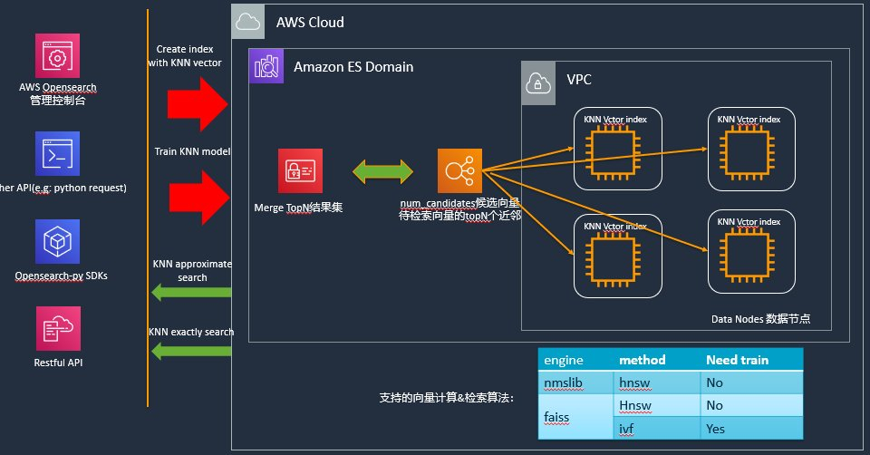

# Amazon OpenSearch Service

## 1. Overview & High-Yield Exam Context

**Amazon OpenSearch Service** is a fully managed search, vector, and analytics engine in AWS. Derived as an open-source fork of Elasticsearch (v7.10) and Kibana, OpenSearch plays two critical roles in the **AWS MLA-C02** exam:

1. **Enterprise Search & Ingestion Engine:** Indexing structured/unstructured documents for full-text search, filtering, and log analytics.
2. **Vector Database for RAG:** Storing high-dimensional embeddings generated by LLMs (e.g., Amazon Bedrock Titan Embeddings) to enable semantic search and Retrieval-Augmented Generation (RAG).

---



---

## 2. Provisioned vs. OpenSearch Serverless

Understanding when to choose **Provisioned Clusters** versus **OpenSearch Serverless** is a frequent decision point on the exam.

| Dimension | Provisioned OpenSearch Domain | OpenSearch Serverless |
| --- | --- | --- |
| **Capacity Management** | Manual configuration of Dedicated Master Nodes and Data Nodes (e.g., `r6g.xlarge.search`). | Auto-scales compute capacity based on workload demand (measured in **OCUs**). |
| **Storage & Compute Coupling** | Bound to EBS volumes attached to specific data nodes (or UltraWarm). | Decouples compute from storage completely (data stored in managed S3 buckets under the hood). |
| **Collection Types** | Single domain handles search, analytics, and vector indexes together. | Optimized collections: **Vector search**, **Timeseries**, or **Search**. |
| **Bedrock Knowledge Bases** | Supported via custom cluster configuration and VPC endpoints. | **Default native integration** for automated zero-code RAG ingestion pipelines. |
| **Best Used For** | Predictable 24/7 workloads, precise cluster tuning, or existing Elasticsearch migrations. | Unpredictable traffic spikes, fast RAG prototyping, and zero-cluster-management architectures. |

---

## 3. Multi-Tiered Storage Architecture

To manage multi-terabyte search logs or historical customer tickets economically, OpenSearch uses a **3-tier storage architecture**:

```
[ Hot Tier (NVMe / EBS) ] ──> [ UltraWarm Tier (S3 + Local Cache) ] ──> [ Cold Storage (S3 Detached) ]
  Fastest Query Latency           90% Cost Reduction                      Archival Only (Attach to Query)

```

1. **Hot Tier (EBS / Instance Storage):**
    * High-performance SSD storage used for active indexing, frequent updates, and real-time k-NN vector searches.
    * *Exam Note:* Vector indexes (HNSW) must reside in RAM on Hot data nodes for sub-second retrieval.


2. **UltraWarm Tier (Amazon S3 + Caching):**
    * Uses S3 for persistent storage with local compute nodes for caching.
    * Up to **90% cheaper** than Hot storage.
    * Ideal for read-only historical indexes (e.g., tickets or logs older than 30 days) that still need to be actively queryable.


3. **Cold Storage:**
    * Fully detached indexes stored directly in S3.
    * Does not consume cluster compute resources until explicitly attached to a domain for historical retrieval.


---

## 4. Vector Search & RAG Mechanisms

### The k-NN (k-Nearest Neighbors) Engine

OpenSearch supports vector search via its native `k-NN` plugin. It supports two main index-building algorithms:

* **HNSW (Hierarchical Navigable Small World):**
    * Graph-based algorithm. Stored in memory (RAM).
    * **Characteristics:** Extremely low query latency, high recall. Slower index build times and higher memory footprint.
    * **When to pick:** Real-time user-facing RAG applications where latency is critical.


* **IVF (Inverted File):**
    * Partition-based algorithm.
    * **Characteristics:** Reduced memory footprint and faster indexing, but lower recall precision than HNSW.
    * **When to pick:** Massive datasets (tens or hundreds of millions of vectors) where RAM cost is the primary constraint.


### Hybrid Search & Reciprocal Rank Fusion (RRF)

Vector embeddings capture **semantic meaning**, but struggle with **exact keyword matches** (e.g., product IDs, invoice numbers, or specific legal codes).

* **Hybrid Search** combines BM25 lexical keyword matching with HNSW dense vector search in a single query.
* **Reciprocal Rank Fusion (RRF)** combines the rank position of keyword search results and vector search results into a unified, balanced relevance score.

```python
# OpenSearch Hybrid Search Query Structure
{
  "query": {
    "hybrid": {
      "queries": [
        { "match": { "ticket_text": "504 Gateway Timeout" } },  # Lexical Keyword Search
        {
          "knn": {                                             # Vector Semantic Search
            "ticket_vector": {
              "vector": [0.023, -0.114, 0.881, ...],
              "k": 5
            }
          }
        }
      ]
    }
  }
}

```

---

## 5. Bulk Ingestion & Extraction Patterns

### Exporting Data (The 10k Limit)

By default, OpenSearch sets `index.max_result_window = 10000`. Standard `from` and `size` pagination fails when fetching deep data beyond 10,000 documents because the cluster must load and sort all preceding hits in heap memory.

* **Bulk Extraction Tool:** Use the **Scroll API** or **Point-in-Time (PIT) with `search_after**`.
* **Why:** Preserves a point-in-time search context on the data nodes, streaming millions of records sequentially without memory degradation.

### Ingestion Pipeline Integration

* **Amazon Bedrock Knowledge Bases:** Automatically manages document parsing, chunking, embedding generation via Titan, and writing into OpenSearch Serverless.
* **Amazon Kinesis Data Firehose:** Streams log or metric data directly into OpenSearch with built-in retry logic and S3 backup for failed documents.

---

## 6. Security, Encryption & Compliance

1. **Encryption Policies (OpenSearch Serverless):**
* Encryption policies using **AWS KMS Customer-Managed Keys (CMKs)** *must* be created **before** creating the collection. They cannot be attached retroactively to an existing collection.


2. **Fine-Grained Access Control (FGAC):**
* Provides Document-Level Security (DLS) and Field-Level Security (FLS).
* Allows masking sensitive columns (e.g., redacting credit card numbers or PII) based on IAM user role.


3. **VPC Endpoints:**
* Keep OpenSearch domain traffic entirely on private subnets without traversing the public internet.


---

## 7. MLA-C02 Exam Decision Matrix

| Scenario Requirements | Correct AWS Solution |
| --- | --- |
| Need a vector store for Bedrock RAG with **zero infrastructure management** | **OpenSearch Serverless (Vector Collection)** |
| Querying unstructured notes **and** searching for exact part serial numbers | **Hybrid Search (BM25 + k-NN with RRF)** |
| Need to query 3-year-old ticket logs cost-effectively without loading into RAM | **UltraWarm Tier** |
| Exporting 10M documents from OpenSearch to S3 to build a training set | **Scroll API or Point-in-Time (PIT) API** |
| Encrypting vector embeddings at rest with a custom key | **OpenSearch Serverless with KMS CMK Encryption Policy** |

---

## 8. Sample Exam Practice Questions

### Question 1 (Multiple Choice)

An ML team has a 500 GB OpenSearch Service domain containing 20 million customer resolution documents. They need to extract all 20 million documents into an Amazon S3 bucket to fine-tune a domain-specific LLM. Standard search requests fail when paginating past 10,000 records.

Which approach is the most efficient and reliable for performing this extraction?

* **A)** Increase the `index.max_result_window` parameter to 20,000,000 and run standard `from`/`size` queries.
* **B)** Use the OpenSearch Scroll API or Point-in-Time (PIT) with `search_after` to iterate through the dataset.
* **C)** Query the OpenSearch domain using Amazon S3 Select directly from the AWS Management Console.
* **D)** Attach an Amazon EFS file system to the OpenSearch data nodes and copy the Lucene index files directly.

??? note "Click to reveal Answer & Explanation"
**Correct Answer:** **B**

```
#### Correct Option Analysis
* **B is Correct:** The **Scroll API** (or Point-in-Time with `search_after`) creates a persistent search context that allows streaming millions of documents from OpenSearch sequentially without loading all results into RAM or hitting the 10,000 document window cap.

#### Distractor Analysis
* **A is Incorrect:** Increasing `index.max_result_window` to 20 million will cause extreme heap memory pressure and crash the OpenSearch cluster data nodes.
* **C is Incorrect:** Amazon S3 Select queries files stored inside S3 buckets (CSV, JSON, Parquet), not indexes inside an OpenSearch domain.
* **D is Incorrect:** OpenSearch manages storage internally via EBS or S3 storage tiers; Lucene index files cannot be mounted or extracted via EFS.

```

---

### Question 2 (Multiple Response — Select TWO)

An AI engineer is setting up a Retrieval-Augmented Generation (RAG) knowledge base using **Amazon Bedrock** and **Amazon OpenSearch Serverless**. The solution must fulfill two strict security and operational constraints:

1. All vector data stored in OpenSearch Serverless must be encrypted at rest using an AWS KMS customer-managed key (CMK).
2. The document parsing, semantic chunking, and embedding generation from S3 files must run automatically without writing custom parsing code or managing Lambda functions.

Which **TWO** actions should the engineer take? (Select TWO)

* **A)** Define an OpenSearch Serverless encryption policy specifying the KMS CMK before creating the vector collection.
* **B)** Create an S3 Event Notification to trigger a Python script running on AWS Lambda to parse PDFs and push embeddings to OpenSearch.
* **C)** Create a Bedrock Knowledge Base pointing to the S3 bucket and trigger a synchronization job (`StartIngestionJob`).
* **D)** Configure Bedrock Guardrails to encrypt all text chunks before sending them to OpenSearch Serverless.
* **E)** Enable SSE-S3 default bucket encryption on the source S3 bucket to automatically encrypt the OpenSearch collection.

??? note "Click to reveal Answer & Explanation"
**Correct Answers:** **A** and **C**

```
#### Correct Options Analysis
* **A is Correct:** OpenSearch Serverless encryption policies must be defined and associated *prior* to collection creation to enforce KMS CMK encryption at rest.
* **C is Correct:** Amazon Bedrock Knowledge Bases handles document ingestion, parsing, chunking, Titan embedding generation, and writing to OpenSearch Serverless as a fully managed service (`StartIngestionJob`).

#### Distractor Analysis
* **B is Incorrect:** Writing custom Lambda parsing scripts adds unnecessary operational overhead compared to Bedrock's native ingestion pipeline.
* **D is Incorrect:** Bedrock Guardrails handle safety filtering, toxic content blocking, and PII redaction—not database encryption.
* **E is Incorrect:** SSE-S3 encryption only secures data residing inside the S3 bucket, not the index inside OpenSearch Serverless.

```